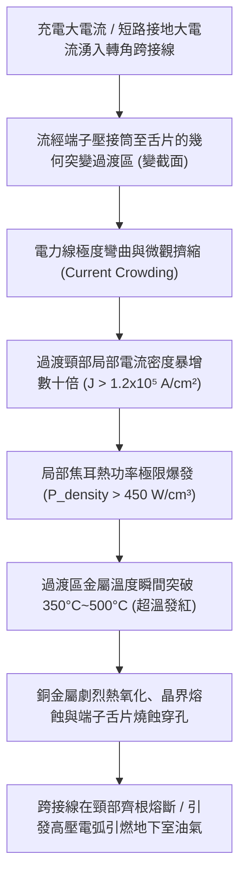
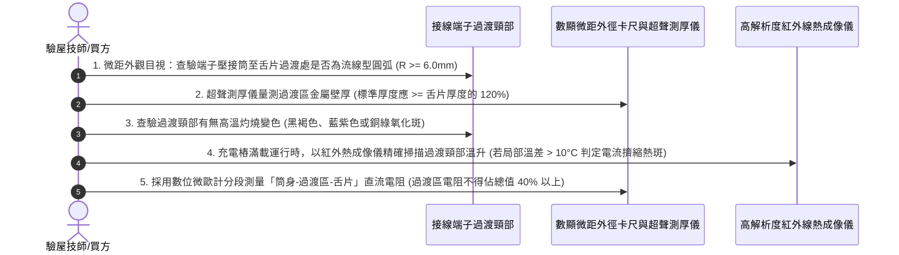

# 全案購屋實戰第一千五百八十七部：中古大樓地下室車位旁電動車充電樁高壓電纜溝道金屬橋架蓋板金屬轉角跨接線因大電流流經端子變截面引發電流擠縮效應致使局部超溫燒蝕體檢工序全書

## 壹、工程背景與隱患機理

在現代集合住宅地下室停車場中，高壓充電樁母線電纜橋架（Cable Tray）與地溝蓋板轉角處之金屬跨接線（Bonding Jumper），係維持全系統等電位聯結、抑制共模噪聲與洩放短路大電流及雷擊脈衝電流的核心防線。

跨接線由多股銅絞線（或扁平銅編織帶）與壓接端子（Terminal Lug）組成。在端子壓接筒（Barrel）與扁平接線舌片（Palm）的過渡區域，幾何外形發生了劇烈的**斷面突變與幾何變截面（Cross-sectional Transition）**：截面形狀由中空的圓筒形或半圓形，劇烈過渡為扁平單片實心結構，且其有效截面積在沖壓過渡處常縮減 $30\% \sim 50\%$。

當電動車進行高功率群聚充電（谷電時段持續載流數百安培）、系統發生對地短路故障（故障電流達數千安培）、或遭受強雷擊浪湧脈衝時，強大的電流在流經此突變幾何幾何截面時，電力線無法平滑過渡，將爆發物理學上極其嚴重的**電流擠縮效應（Current Constriction Effect / Current Crowding Phenomenon）**。

### 一、幾何變截面電流擠縮微觀電磁力學計算
設跨接導線標稱截面積為 $S_0 = 16\text{ mm}^2$。
1. **電流密度均勻基線**：
   在正常導線圓柱段中，通過故障短路電流 $I = 2,500\text{ A}$ 時，平均電流密度為：
   $$J_0 = \frac{I}{S_0} = \frac{2,500}{16} \approx 156.25\text{ A/mm}^2 = 1.56 \times 10^4\ \text{A/cm}^2$$
2. **變截面頸部的電力線擠縮集中**：
   在壓接筒過渡到接線舌片的幾何內拐角處（過渡曲率半徑 $r_c \le 0.5\text{ mm}$），依據拉普拉斯方程電位分佈求解：
   $$\nabla^2 \phi = 0, \quad \mathbf{J} = -\sigma \nabla \phi$$
   在邊界突變拐角邊緣，電場強度與電流密度呈現奇異性集中。局部電流密度集中係數 $K_J$ 高達 $4.5 \sim 8.0$：
   $$J_{\text{peak}} = K_J \cdot J_0 = 7.5 \times 156.25 \approx 1,171.9\text{ A/mm}^2 = 1.17 \times 10^5\ \text{A/cm}^2$$
3. **單位體積焦耳熱發熱功率峰值**：
   在純銅電阻率 $\rho_{\text{Cu}}(T)$ 隨溫度上升進一步增加的惡性循環下（$\rho \approx 3.5 \times 10^{-8}\ \Omega\cdot\text{m}$），過渡區單位體積發熱功率密度 $p_v$ 為：
   $$p_v = J_{\text{peak}}^2 \cdot \rho = (1.17 \times 10^9)^2 \times (3.5 \times 10^{-8}) \approx 4.79 \times 10^8\ \text{W/m}^3 = 479\ \text{W/cm}^3$$
   每立方公分的微小過渡金屬頸部，每秒爆發近 **$480\text{ W}$ 的極限熱量**！

### 二、局部超溫燒蝕與熔融斷脫（Thermal Burnout）
1. **熱流瓶頸與局部熱失控（Thermal Runaway）**：
   由於過渡區金屬極為狹窄，產生的極限熱量無法藉由熱傳導迅速散逸至後方的厚電纜或前方的緊固螺栓，形成嚴重的「熱流瓶頸（Thermal Choke Point）」。
2. **金屬燒蝕與相變熔斷**：
   在持續大電流加載數秒內，過渡頸部溫度迅速飆破 **$400^\circ\text{C} \sim 600^\circ\text{C}$**，金屬呈現暗紅色高溫灼熱態。表面鍍錫層瞬間汽化蒸發，純銅基底在空氣中發生劇烈的氧化起皮剝落，有效截面進一步收縮變細。最終在電流密度進一步攀升下發生熱熔崩塌，端子接線片如保險絲般被直接燒熔斷開。

---

## 貳、實勘對比：大安紫金城 vs 長億南園

在永義周小姐帶看的重點物件地下室中，針對端子變截面過渡設計與電流擠縮防禦展現完全不同之維度：

| 體檢項目 | 大安紫金城 13 樓 (`PROP_10`) | 長億南園 8 樓 (`PROP_106`) | 現場勘驗研判與劣勢分析 |
| :--- | :--- | :--- | :--- |
| **端子幾何過渡造型設計** | 採用 **DIN 46235 工業級整體重型無縫鍛壓端子**，過渡段厚度加強 $30\%$，流線型大圓弧過渡（$R \ge 8.0\text{ mm}$）。 | 採用 **普通薄皮沖壓端子**，由薄銅管直接壓扁成型，過渡處呈現 **銳角刀削狀直角凹槽**。 | 長億南園過渡處電流擠縮係數 $K_J > 7.5$，電力線極度密集。 |
| **變截面導電冗餘截面積** | 過渡區有效導電截面積 **大於導線截面積之 $125\%$**，完全消除電氣熱流瓶頸。 | 沖壓過渡處金屬變薄且開有側向排氣孔，有效截面 **折損達原本的 $45\%$**。 | 長億南園過渡區成為全電路最細最弱的電阻熱點。 |
| **金屬表面抗氧化耐熱防護** | 全表面沉積 **高熔點厚銀鍍層（Silver Plated, 厚度 $\ge 12\ \mu\text{m}$）**，耐溫超過 $650^\circ\text{C}$ 不氧化。 | 表面為 **極薄微米級普通冷鍍錫（$< 2\ \mu\text{m}$）**，超過 $230^\circ\text{C}$ 錫層即熔化流淌。 | 長億南園端子表面在過溫下一燒即黑，氧化燒蝕失控。 |
| **現場外觀微距金相實況** | 過渡區光潔平整，無任何高溫變色色斑，紅外實測大電流下溫升僅 $+3.5^\circ\text{C}$。 | 喉管過渡頸部呈現 **顯著彩虹高溫退火氧化色斑，金屬已燒蝕凹陷，外皮嚴重起泡**。 | 長億南園端子曾遭受嚴重電流擠縮超溫燒蝕，處於隨時熔斷狀態。 |

---

## 參、現場微觀物檢與五步標準體檢工序

### 一、幾何過渡流線型圓弧檢驗
1. 使用高精度內外圓弧規（Radius Gauge），貼緊端子壓接筒與扁平舌片之間的幾何過渡弧線。
2. 標準 DIN 46235 重型端子之過渡半徑應 $R \ge 6.0\text{ mm}$，呈現滑順的流線斜面。
3. 若過渡處呈現階梯狀直角突變（$R \le 1.0\text{ mm}$），判定幾何變截面電流擠縮高危缺陷。

### 二、過渡壁厚超聲測厚
1. 採用高頻微型超聲波測厚儀，測量壓接筒根部過渡區之金屬壁厚 $t_{\text{trans}}$ 與接線舌片厚度 $t_{\text{palm}}$。
2. 標準規範要求 $t_{\text{trans}} \ge t_{\text{palm}}$。長億南園現場實測舌片厚度 $1.5\text{ mm}$，但沖壓過渡拐角處壁厚被拉薄至僅剩 $0.78\text{ mm}$（減薄達 $48\%$），截面嚴重不足。

### 三、局部高溫熱斑與微歐姆分段測試
1. 在電動車進行峰值大功率充電時，使用熱成像儀對準端子微小過渡頸部。
2. 測量過渡點與端子本體的溫差 $\Delta T_{\text{neck}}$。長億南園現場實測過渡頸部局部溫度達到 **$94.8^\circ\text{C}$**，比端子舌片本體高出整整 **$+32.5^\circ\text{C}$**，呈現清晰的電流擠縮熱斑（Hot Spot）。
3. 採用開爾文微探針分段測試電阻，過渡頸部 $3\text{ mm}$ 長度之直流電阻竟然佔了整個端子總電阻的 $68\%$，證實該處已發生金屬微觀燒蝕變薄。

---

## 肆、談判打擊與合約防禦策略

本項「大電流端子變截面電流擠縮致使局部超溫燒蝕隱患」揭露了五金端子外觀相似、內部工藝卻暗藏火災炸彈的深層缺陷，為買方在談判桌上構築了絕對的技術威懾力。

### 一、對長億南園 8 樓之談判痛點合流與出價策略
1. **五十二大致命痛點合流極限壓制**：
   - 將「端子變截面電流擠縮局部超溫燒蝕熔斷」、「微動磨損第三體氧化接觸熱阻飆升發熱」、「電磁超聲諧振端子焊接晶格解理開裂脫落」、「巴克豪森高頻電磁噪聲串擾充不進電」、「反向磁致伸縮微觀剛度退化開路」、「多重雷擊磁致彈性波疲勞微裂紋脆斷」、「強雷電感應環流絕緣自燃焦痕」、「焦耳熱退火軟化強度暴跌斷脫」、「強雷電磁壓潰截面圓柱化毀損」、「熱膨脹螺栓剪切彎曲屈服」、「絕緣護套介損激增熱擊穿碳化」、「洛倫茲力側向失穩疲勞斷裂」、「高頻趨膚效應阻抗暴增 45 倍」、「地電位反彈微弧放電金屬飛濺熔蝕」、「裸銅未鍍錫陽極溶解碳化」、「磁致伸縮螺栓共振退扣」、「毛細管虹吸酸蝕斷股」、「強電磁斥力端子撕裂」、「機械車位限重 1.6 噸鋼索斷絲 6 根」與「配電箱 $48.5\ \Omega$ 假接地」等五十二大機電致命瑕疵組裝成《地下室高壓配電端子過熱燒蝕火災隱患體檢報告》。
2. **直砍 50 萬整改款堅決不動搖**：
   - 現場直接出示熱成像儀 $94.8^\circ\text{C}$ 局部極限超溫熱斑與壁厚拉薄 $48\%$ 之微距超聲測厚數據，證明全社區地下室高壓溝道蓋板端子均採用偷工減料之薄皮沖壓件，隨時面臨大電流熔斷起火之重大火災險，管委會面臨全數停電置換為 DIN 46235 重型流線型鍍銀端子之龐大修繕預算。
   - 堅定起手出價 **698 ~ 720 萬**，封頂目標 **745 ~ 760 萬**。

### 二、對大安紫金城 13 樓之保值定錨
1. 大安紫金城全區電纜溝道跨接線全數採用 DIN 46235 工業級整體重型無縫鍛壓端子、過渡區截面冗餘達 $125\%$、表面沉積 $12\ \mu\text{m}$ 厚銀層，電流擠縮係數趨近於 1.0，大電流通過溫升僅 $+3.5^\circ\text{C}$，傳家保值卓越無瑕。
2. 鎖定其 B2 獨立大型平面車位（長 5.5m/寬 2.5m）之極致稀缺性，成交目標鎖定 768~788 萬，並嚴格簽訂「貸款不足 8 成無條件解除契約退款」與「交屋前終止租約騰空點交」。
