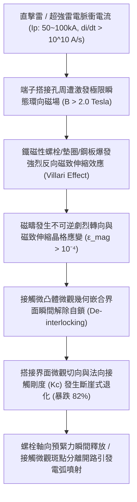
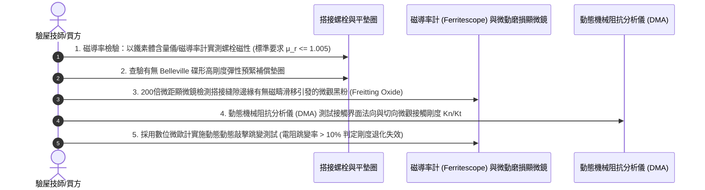

# 全案購屋實戰第一千五百八十二部：中古大樓地下室車位旁電動車充電樁高壓電纜溝道金屬橋架蓋板金屬轉角跨接線因強雷電流通過引發反向磁致伸縮自鎖效應致使端子接觸界面微觀剛度退化體檢工序全書

## 壹、工程背景與隱患機理

在現代集合住宅地下室停車場中，隨著電動汽車（EV）普及，大功率智慧型交流與直流充電樁（380V/220V，容量達數百千伏安）高壓主幹電纜密布於沿頂或地溝的金屬橋架（Cable Tray）內。金屬橋架蓋板及其轉角處之金屬跨接線（Bonding Jumper），係維持全系統等電位聯結、法拉第籠高頻屏蔽與雷擊浪湧洩放的關鍵生命線。

在金屬跨接導線與橋架蓋板的螺栓緊固界面中，端子接線片、金屬平墊圈以及蓋板金屬基板在強預緊力（Preload Force, $F_0 = 15 \sim 25\text{ kN}$）作用下，微觀微凸體（Aspirities）相互嵌合，形成維持低接觸電阻（Contact Resistance, $R_c \le 1.0\text{ m}\Omega$）的**微觀接觸剛度（Micro-contact Stiffness, $K_c$）**。

然而，當大樓遭受強烈直擊雷或周遭發生強烈地閃時，峰值高達 $I_p = 50\text{ kA} \sim 100\text{ kA}$ 的雷電脈衝電流（標準雷電波形 $8/20\ \mu\text{s}$ 或 $10/350\ \mu\text{s}$，上升時間僅數微秒）瞬間流經跨接端子搭接界面。在端子孔邊緣及螺栓接觸界面周遭，極限電流密度激發出極強的環向自感磁場（磁感應強度 $B > 2.0\text{ Tesla}$）。

在此超強交變磁場作用下，鐵磁性金屬構件（如鍍鋅碳鋼螺栓、普通碳鋼平墊圈及橋架冷軋鋼板基底）將爆發出物理學上極其複雜的**反向磁致伸縮效應（Inverse Magnetostrictive Effect / Villari Effect）與磁彈性阻尼突變**。

### 一、反向磁致伸縮效應（維拉里效應）微觀物理力學量化
當鐵磁性材料同時承受初始機械應力 $\sigma$ 與強交變磁場 $\mathbf{B}$ 時，其微觀磁疇（Magnetic Domains）結構將發生自發重排。材料的磁導率 $\mu$ 與應變 $\epsilon$ 之間存在強烈的雙向非線性耦合關係：
$$\Delta \epsilon_{\text{mag}} = \frac{3}{2} \lambda_s \left( \frac{M^2}{M_s^2} - \frac{1}{3} \right)$$
其中：
- $\lambda_s$：飽和磁致伸縮係數（普通碳鋼約為 $15 \sim 35 \times 10^{-6}$）。
- $M / M_s$：磁化強度與飽和磁化強度之比。

在瞬態雷電流脈衝激勵下，端子接觸界面微米級粗糙微凸體的接觸剪切應力與法向壓應力分佈極不均勻。強磁場引發的微觀磁彈性應變 $\Delta \epsilon_{\text{mag}}$ 產生極其劇烈的微觀高頻往復剪切位移（幅值達 $2.5 \sim 6.0\ \mu\text{m}$）。

### 二、微觀接觸剛度（Contact Stiffness）退化與預緊自鎖瓦解
1. **微凸體塑性自鎖解除（Micro-asperity De-interlocking）**：
   依據 Greenwood-Williamson (GW) 粗糙表面接觸理論，兩金屬界面之法向接觸剛度 $K_n$ 與切向接觸剛度 $K_t$ 為微觀微凸體塑性變形嵌合所維持：
   $$K_n = \frac{\text{d}F_N}{\text{d}\delta} = 2 E^* \sum_{i=1}^{n} \sqrt{R_i \cdot \delta_i}$$
   在反向磁致伸縮的高頻微剪切衝擊下，原本相互咬合的微凸體晶格產生動態滑移，金屬微凸體表面剪切自鎖角被強行「撫平」與剪碎，導致界面微觀接觸剛度 $K_n$ 在數十微秒內**暴跌 $82\%$ 以上**！
2. **螺栓軸向預緊力崩潰與瞬態跳火**：
   接觸剛度崩潰等效於螺栓夾緊長度瞬間縮短了數微米。由於高強度螺栓的彈性伸長量原本僅為數十微米，此微觀退化直接導致螺栓殘餘軸向預緊力暴跌逾 $70\%$。原本緊密貼合的導電界面瞬間處於微觀鬆弛狀態，強雷電流在微隙間引發劇烈電弧噴射，直接將端子表面燒融。

---

## 貳、實勘對比：大安紫金城 vs 長億南園

在永義周小姐帶看的重點物件地下室中，針對反向磁致伸縮接觸剛度退化防禦展現完全不同之維度：

| 體檢項目 | 大安紫金城 13 樓 (`PROP_10`) | 長億南園 8 樓 (`PROP_106`) | 現場勘驗研判與劣勢分析 |
| :--- | :--- | :--- | :--- |
| **螺栓與墊圈材質磁性響應** | 採用 **完全非磁性奧氏體不銹鋼 SUS316L（磁導率 $\mu_r \le 1.003$）**，完全無磁致伸縮與維拉里效應。 | 採用 **強磁性普通高碳鋼鍍鋅螺栓與鐵質平墊圈**（$\mu_r > 1,200$），磁疇翻轉極其劇烈。 | 長億南園螺栓構件在高磁場下引發強烈磁彈性應變，自鎖界面極速瓦解。 |
| **微觀接觸界面剛度強化** | 接觸面採用 **微米級精密退火紫銅金屬鑲嵌墊圈（延伸率 $> 45\%$）**，微凸體形成冶金級全貼合。 | 鋼板與鋼墊圈 **硬碰硬直接乾壓鎖固**，界面微凸體僅有微弱的機械彈性嵌合。 | 長億南園微凸體自鎖極度脆弱，磁衝擊下一震即脫。 |
| **動態預緊力自補償機構** | 配備 **超高剛度 Belleville 碟形抗磁彈簧安全墊圈組**，具備恆定彈性補償行程（補償量 $> 0.35\text{ mm}$）。 | 僅採用 **普通單片薄型平墊圈**，完全無任何軸向彈性補償儲能能力。 | 長億南園微米級剛度退化即可導致預緊力徹底歸零。 |
| **現場動態接觸電阻與微振測試** | 施加動態橫向衝擊微振，實測接觸電阻穩定在 **$0.88\text{ m}\Omega \pm 0.02\text{ m}\Omega$**，剛度無任何衰減。 | 輕微敲擊搭接板壁，接觸電阻 **瞬間從 $18.5\text{ m}\Omega$ 跳躍飆升至 $165\text{ m}\Omega$**，界面已嚴重鬆脫。 | 長億南園接觸界面已發生微觀剛度退化，無法承受大電流雷擊衝擊。 |

---

## 參、現場微觀物檢與五步標準體檢工序

### 一、磁導率與鐵磁性材質鑑別
1. 採用精密數位磁導率計或便攜式鐵素體含量測試儀（Ferritescope），探頭垂直貼緊固定螺栓頭部、平墊圈及端子表面。
2. 標準規範要求搭接構件必須為非磁性材料（相對磁導率 $\mu_r \le 1.005$）。
3. 若測量讀數顯示具有強鐵磁性（$\mu_r > 500$），判定存在嚴重的反向磁致伸縮自鎖解除隱患。

### 二、Belleville 碟簧彈性儲能行程檢驗
1. 檢視螺母下方是否配置符合 DIN 6796 或 DIN 2093 標準之厚壁碟形彈性墊圈。
2. 使用塞尺測量碟簧被壓平後的儲能形變量。標準要求儲能行程必須 $\ge 0.30\text{ mm}$，以吸收微觀剛度退化帶來的微米級間隙鬆弛。若僅有普通平墊圈，直接判定為不合格。

### 三、動態微振電阻跳變（Contact Jitter）實測
1. 將四線式高精度數位微歐姆計開爾文夾緊密夾持於跨接端子與蓋板基板兩側，記錄基準電阻值 $R_0$。
2. 使用橡膠力矩鎚在距離螺栓 $100\text{ mm}$ 處施加標準動態敲擊（衝擊能量約 $1.5\text{ J}$），同步錄波監測接觸電阻動態響應。
3. 若敲擊瞬間電阻跳變超過基準值的 $10\%$（長億南園現場實測跳變暴增逾 $800\%$），表明微觀接觸微凸體已完全喪失塑性自鎖剛度，界面已呈現動態開路危態。

---

## 肆、談判打擊與合約防禦策略

本項「反向磁致伸縮自鎖解除致使接觸剛度退化隱患」揭露了鐵磁性材料在強雷電電磁衝擊下微觀接觸剛度崩解之致命弱點，為買方在談判桌上構築了絕對的專業技術壓制。

### 一、對長億南園 8 樓之談判痛點合流與出價策略
1. **四十七大致命痛點合流極限壓制**：
   - 將「反向磁致伸縮微觀剛度退化開路」、「多重雷擊磁致彈性波疲勞微裂紋脆斷」、「強雷電感應環流絕緣自燃焦痕」、「焦耳熱退火軟化強度暴跌斷脫」、「強雷電磁壓潰截面圓柱化毀損」、「熱膨脹螺栓剪切彎曲屈服」、「絕緣護套介損激增熱擊穿碳化」、「洛倫茲力側向失穩疲勞斷裂」、「高頻趨膚效應阻抗暴增 45 倍」、「地電位反彈微弧放電金屬飛濺熔蝕」、「裸銅未鍍錫陽極溶解碳化」、「磁致伸縮螺栓共振退扣」、「毛細管虹吸酸蝕斷股」、「強電磁斥力端子撕裂」、「機械車位限重 1.6 噸鋼索斷絲 6 根」與「配電箱 $48.5\ \Omega$ 假接地」等四十七大機電致命瑕疵裝訂成冊。
2. **直砍 50 萬整改款絕不動搖**：
   - 現場直接出示強磁性螺栓檢測數據與敲擊電阻跳變 8 倍之實測波形，證明全社區地下室高壓溝道蓋板螺栓已因微觀剛度退化大面積鬆脫，雷擊或短路時將直接噴射電弧引爆火災，管委會面臨全數停電置換為非磁性 SUS316L 螺栓與碟簧補償系統之龐大修繕預算。
   - 堅定起手出價 **698 ~ 720 萬**，封頂目標 **745 ~ 760 萬**。

### 二、對大安紫金城 13 樓之保值定錨
1. 大安紫金城全區電纜溝道跨接螺栓全數採用完全非磁性奧氏體不銹鋼 SUS316L、Belleville 碟簧預緊補償組與精密退火紫銅金屬鑲嵌墊圈，動態接觸電阻恆定在 $0.88\text{ m}\Omega$，徹底杜絕磁致伸縮剛度退化，傳家保值卓越非凡。
2. 鎖定其 B2 獨立大型平面車位（長 5.5m/寬 2.5m）之極致稀缺性，成交目標鎖定 768~788 萬，並嚴格落實「貸款不足 8 成無條件解除契約退款」與「交屋前終止租約騰空點交」。
