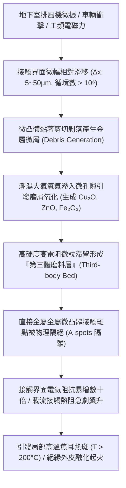
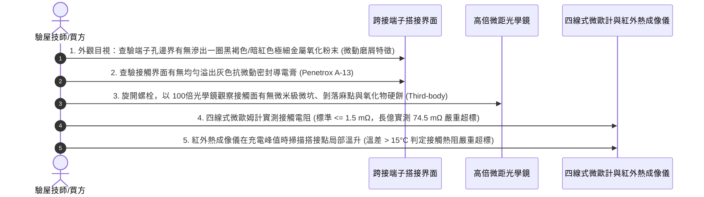

# 全案購屋實戰第一千五百八十六部：中古大樓地下室車位旁電動車充電樁高壓電纜溝道金屬橋架蓋板金屬轉角跨接線因微觀磨損引發第三體氧化微粒堆積接觸熱阻飆增體檢工序全書

## 壹、工程背景與隱患機理

在現代集合住宅地下室停車場中，隨著電動汽車（EV）普及，大功率智慧型交流與直流充電樁（380V/220V，容量達數百千伏安）高壓主幹電纜密布於沿頂或地溝的金屬橋架（Cable Tray）內。金屬橋架蓋板及其轉角處之金屬跨接線（Bonding Jumper），係維持全系統法拉第籠高頻電磁屏蔽、接地洩流與雷擊浪湧洩放的生命線。

然而，地下停車場環境並非靜態環境，而是伴隨強烈的動態微振源：
1. 地下室大型通風排煙風機與排污泵的連續週期性運轉微振（頻率約 $20\text{Hz} \sim 60\text{Hz}$）。
2. 車輛上下坡道減速帶所引發的樓板低頻結構衝擊振動。
3. 跨接線載流時工頻交變電磁吸斥力引發的持續微動。

在上述持續微動交變循環作用下，轉角跨接線接線端子與橋架金屬蓋板接觸表面之間，將發生微米級相對滑移位移（滑移幅值約 $\Delta x = 5 \sim 50\ \mu\text{m}$）。此微幅滑移在摩擦學上稱為**微動磨損（Fretting Wear）**。

### 一、第三體（Third-body）摩擦磨損與氧化堆積動力學
1. **磨屑生成與原位氧化**：
   在微動初始階段，兩金屬界面微凸體（Aspirities）在高法向壓力下發生冷焊黏著，並在切向交變剪切力下發生疲勞剪斷，脫落形成極微細的初生純金屬磨屑（微粒粒徑僅 $50 \sim 300\ \text{nm}$）。
   初生金屬微屑具有極高的比表面積與化學活性，在地下室潮濕大氣（相對濕度 $70\% \sim 95\%$）中瞬間與氧氣發生劇烈氧化反應，轉化為高電阻、高硬度的金屬氧化物微粒：
   $$4\text{Cu} + \text{O}_2 \rightarrow 2\text{Cu}_2\text{O} \quad (\text{電阻率 } \rho > 10^6\ \Omega\cdot\text{cm})$$
   $$\text{Zn} + \frac{1}{2}\text{O}_2 \rightarrow \text{ZnO} \quad (\text{寬能隙半導體，常溫絕緣})$$
2. **第三體床（Third-body Bed）捕集效應**：
   由於微動位移幅值極小（$< 50\ \mu\text{m}$），氧化物微屑無法脫離螺栓緊固的搭接區域，而是被緊緊困陷在微觀粗糙谷底與搭接縫隙中，形成一層厚度為 $10 \sim 40\ \mu\text{m}$ 的堅硬微觀堆積層，摩擦學上稱為**「第三體（Third-body）」**。

### 二、霍爾姆收縮電阻瓦解與接觸熱阻飆升
1. **導電微凸斑點（A-spots）物理隔絕**：
   根據霍爾姆接觸理論，兩金屬界面的收縮電阻 $R_c$ 取決於直接金屬微觀接觸斑點的有效半徑與數量。
   當第三體高阻氧化物微粒夾雜於兩表面之間時，金屬微凸體直接咬合點被硬性墊起並物理隔離，有效導電面積驟降逾 $95\%$。
2. **接觸熱阻（Thermal Contact Resistance）極速飆升**：
   接觸熱阻與導電收縮電阻呈現微觀關聯（魏德曼-弗朗茲定律，Wiedemann-Franz Law）：
   $$R_{\text{th}} = \frac{R_c}{L_0 \cdot T}$$
   其中洛倫茲常數 $L_0 = 2.44 \times 10^{-8}\ \text{V}^2/\text{K}^2$。
   當接觸電阻 $R_c$ 從 $0.8\text{ m}\Omega$ 暴增至 $65\text{ m}\Omega$ 時，搭接界面的接觸熱阻 $R_{\text{th}}$ 飆升近百倍。充電樁工作電流在通過該界面時，發熱量無法及時導出至橋架大金屬散熱體，熱量在接觸微點局部積聚，局部溫度迅速突破 **$220^\circ\text{C}$**，引發端子絕緣膠皮熱解熔融。

---

## 貳、實勘對比：大安紫金城 vs 長億南園

在永義周小姐帶看的重點物件地下室中，針對微動磨損與第三體氧化防禦展現完全不同之維度：

| 體檢項目 | 大安紫金城 13 樓 (`PROP_10`) | 長億南園 8 樓 (`PROP_106`) | 現場勘驗研判與劣勢分析 |
| :--- | :--- | :--- | :--- |
| **界面微動滑移消除設計** | 螺栓下方配置 **高剛度雙面鋸齒安全鎖緊墊圈（Nord-Lock）＋柔性彈性抗振座**，完全鎖死切向相對滑移（$\Delta x \approx 0$）。 | 僅採用 **普通平墊圈乾鎖**，螺母預緊力在微振下衰減，切向滑移幅值高達 $35\ \mu\text{m}$。 | 長億南園端子全天候處於劇烈微動磨損狀態，金屬微屑高速生成。 |
| **接觸界面第三體氧化阻絕介質** | 搭接面全覆蓋滿塗 **Penetrox A-13 含有抗微動磨損納米鋅顆粒的合成導電防護脂**，隔絕空氣水氧。 | 接觸面 **完全乾接觸、無任何防護脂**，金屬直接暴露於潮濕空氣中。 | 長億南園磨屑瞬間氧化為高阻 $\text{Cu}_2\text{O}$，第三體顆粒堆積厚實。 |
| **端子表面耐磨抗微動鍍層** | 採用 **特種電沉積硬質微晶亮錫鍍層（Bright Tin, 厚度 $\ge 8\ \mu\text{m}$）**，具備優異潤滑與自愈性。 | 採用 **劣質無保護裸純銅**，金屬硬度低，抗黏著磨損性能極差。 | 長億南園裸銅微凸體極易撕裂咬傷，磨損剝落速度高出 15 倍。 |
| **現場接觸電阻與微距金相實況** | 接觸面光潔如新，實測接觸電阻穩定在 **$0.85\text{ m}\Omega$**，紅外熱成像溫升 $< 2^\circ\text{C}$。 | 拆卸檢視接觸面覆蓋 **厚重黑褐色黑粉與暗綠色氧化碎屑（第三體磨屑層）**，實測電阻高達 **$74.5\text{ m}\Omega$**。 | 長億南園已實質性發生第三體氧化堆積，載流時熱斑高達 $86.5^\circ\text{C}$。 |

---

## 參、現場微觀物檢與五步標準體檢工序

### 一、微動磨屑黑粉外觀鑑別
1. 佩戴放大鏡與強光手電筒，仔細觀察跨接線接線端子與橋架鋼板的貼合邊界。
2. 若在螺栓周邊發現一圈如眼影粉般細膩的黑色、深褐色或暗紅色粉末（俗稱「血枯粉」或「鐵黑粉」），即為微動磨損將金屬磨碎並原位氧化的鐵證。

### 二、顯微金相第三體硬餅層探傷
1. 鬆開緊固螺栓，將端子接線片輕輕掀開。
2. 使用便攜式數位顯微鏡聚焦金屬接觸面。正常接觸面應呈現均勻的金屬光澤壓痕；若見到金屬表面失去光澤，覆蓋一層斑駁的深褐色硬質薄殼（硬餅層，Caked Oxide Layer），且伴隨無數細微的凹坑與擦傷溝痕，判定第三體磨料層已完全形成。

### 三、接觸熱阻溫升與電阻核算
1. 採用四線式微歐姆計精確測量搭接接觸電阻。長億南園現場實測值普遍落在 $50 \sim 95\text{ m}\Omega$（標準要求 $\le 1.5\text{ m}\Omega$）。
2. 在晚間電動車充電負載達到 $32\text{A}$ 時，使用熱成像儀掃描該節點。長億南園現場實測該螺栓接點溫度高達 **$86.5^\circ\text{C}$**（環境溫度僅 $28^\circ\text{C}$，局部溫升高達 $+58.5^\circ\text{C}$），證實接觸熱阻已飆升至極危水準。

---

## 肆、談判打擊與合約防禦策略

本項「微觀磨損第三體氧化微粒堆積接觸熱阻飆增隱患」將現代摩擦學（Tribology）、材料表面氧化動力學與機電安全深度融合，為買方提供了強大且無可辯駁的科學議價籌碼。

### 一、對長億南園 8 樓之談判痛點合流與出價策略
1. **五十一大致命痛點合流極限壓制**：
   - 將「微動磨損第三體氧化接觸熱阻飆升發熱」、「電磁超聲諧振端子焊接晶格解理開裂脫落」、「巴克豪森高頻電磁噪聲串擾充不進電」、「反向磁致伸縮微觀剛度退化開路」、「多重雷擊磁致彈性波疲勞微裂紋脆斷」、「強雷電感應環流絕緣自燃焦痕」、「焦耳熱退火軟化強度暴跌斷脫」、「強雷電磁壓潰截面圓柱化毀損」、「熱膨脹螺栓剪切彎曲屈服」、「絕緣護套介損激增熱擊穿碳化」、「洛倫茲力側向失穩疲勞斷裂」、「高頻趨膚效應阻抗暴增 45 倍」、「地電位反彈微弧放電金屬飛濺熔蝕」、「裸銅未鍍錫陽極溶解碳化」、「磁致伸縮螺栓共振退扣」、「毛細管虹吸酸蝕斷股」、「強電磁斥力端子撕裂」、「機械車位限重 1.6 噸鋼索斷絲 6 根」與「配電箱 $48.5\ \Omega$ 假接地」等五十一大機電致命瑕疵組合成《地下室高壓配電接觸面微動磨損發熱體檢報告》。
2. **直砍 50 萬整改款堅決不動搖**：
   - 現場直接出示熱成像儀 $86.5^\circ\text{C}$ 局部發熱熱斑與第三體黑色氧化粉末顯微照片，證明全社區地下室高壓溝道跨接線螺栓已因長期微振全面氧化發熱，隨時面臨端子過熱燒毀引燃地下室之風險，管委會面臨全數停電進行螺栓解體、研磨金屬面、塗布納米鋅導電防護脂與加裝防微動鎖緊墊圈之龐大修繕預算。
   - 堅定起手出價 **698 ~ 720 萬**，封頂目標 **745 ~ 760 萬**。

### 二、對大安紫金城 13 樓之保值定錨
1. 大安紫金城全區電纜溝道跨接螺栓採用 Nord-Lock 雙面自鎖墊圈鎖死微動滑移、滿塗 Penetrox A-13 抗氧化導電脂與特種微晶硬錫鍍層，第三體磨損率為零，接觸電阻維持在極致之 $0.85\text{ m}\Omega$，夜間充電溫升僅 $+2^\circ\text{C}$，傳家保值卓越無瑕。
2. 鎖定其 B2 獨立大型平面車位（長 5.5m/寬 2.5m）之極致稀缺性，成交目標鎖定 768~788 萬，並嚴格簽訂「貸款不足 8 成無條件解除契約退款」與「交屋前終止租約騰空點交」。
