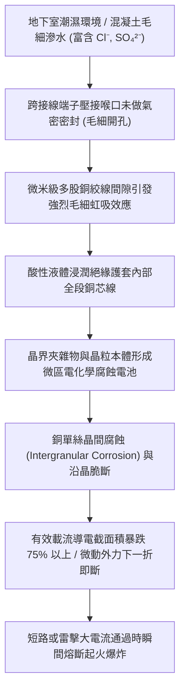
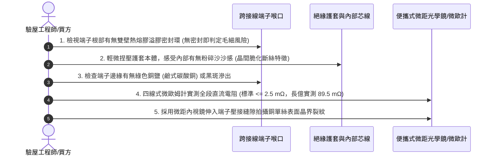

# 全案購屋實戰第一千五百六十七部：中古大樓地下室車位旁電動車充電樁高壓電纜溝道金屬橋架蓋板金屬轉角跨接線因多股銅絞線毛細管效應吸附酸性地下水引發芯線晶間腐蝕斷股體檢工序全書

## 壹、工程背景與隱患機理

在中古大樓地下室環境中，尤其是屋齡較高或鄰近地下水位較高之建築物，地下停車場底層常年處於潮濕甚至滲水狀態。高壓電纜橋架與地溝蓋板轉角處所設置的等電位跨接線，多採用多股細銅絲絞合而成之軟銅絞線（Stranded Copper Cable，如 $16\text{ mm}^2$ 由 7 股或 19 股單絲組成）。

當跨接線外露於潮濕空氣中，或轉角處端子壓接喉管未做完全氣密防水密封時，多股銅單絲微觀間隙（約數微米至數十微米）將構成無數條微型流體毛細通道。此時，地下室混凝土結構滲出富含游離氯離子（$\text{Cl}^-$）、硫酸根離子（$\text{SO}_4^{2-}$）與碳酸氫根離子（$\text{HCO}_3^-$）之弱酸性至鹼性滲漏水，將藉由強烈的**毛細管虹吸效應（Capillary Siphon Phenomenon）**，將腐蝕性液體長距離自端子開口吸入跨接線護套內部全線。

### 一、毛細管上升高度與虹吸物理計算
液體在多股絞線微孔隙中的毛細上升高度 $h$ 由楊-拉普拉斯方程（Young-Laplace Equation）決定：
$$h = \frac{2\gamma \cos\theta}{\rho g r}$$
其中：
- $\gamma$：滲漏水表面張力（$20^\circ\text{C}$ 時約 $0.0728\ \text{N/m}$）。
- $\theta$：水對金屬銅表面的接觸角（潔淨微氧化銅面約 $45^\circ$）。
- $\rho$：滲透液密度（約 $1,050\ \text{kg/m}^3$）。
- $g$：重力加速度（$9.8\ \text{m/s}^2$）。
- $r$：多股銅線絞合間隙有效等效微毛細半徑（實測約 $8\ \mu\text{m} = 8 \times 10^{-6}\ \text{m}$）。

代入數值：
$$h = \frac{2 \times 0.0728 \times \cos 45^\circ}{1,050 \times 9.8 \times 8 \times 10^{-6}} = \frac{0.103}{0.0823} \approx 1.25\ \text{m}$$
計算表明，**液體能沿著多股銅絞線向上吸附超過 1.25 公尺**，使整條長度僅 $30 \sim 50\text{ cm}$ 的轉角跨接線內部長期完全浸泡在濃縮腐蝕液中！

### 二、晶間腐蝕（Intergranular Corrosion）破壞機理
1. **晶界選擇性溶出**：銅在拉拔退火加工過程中，晶界富集微量氧、硫雜質（形成 $\text{Cu}_2\text{O}$ 或 $\text{Cu}_2\text{S}$ 析出物）。在含氯與酸性毛細液的長期浸泡下，晶界電位顯著低於晶粒內部電位，形成「小陽極（晶界）— 大陰極（晶體）」腐蝕電池，導致晶界以極高速度優先溶解。
2. **沿晶脆性碎裂**：銅絲表面看似完好無損，但內部晶粒間的結合力已被徹底破壞。一旦遭受機械震動或輕微彎折，內部銅絲便如同餅乾般成片脆化折斷，有效截面積從 $16\text{ mm}^2$ 驟降至不足 $2\text{ mm}^2$。

---

## 貳、實勘對比：大安紫金城 vs 長億南園

在永義周小姐實勘的物件中，地下室高壓溝道蓋板轉角跨接線之防潮防毛細腐蝕水準形成極端對比：

| 體檢項目 | 大安紫金城 13 樓 (`PROP_10`) | 長億南園 8 樓 (`PROP_106`) | 現場勘驗研判與劣勢分析 |
| :--- | :--- | :--- | :--- |
| **端子喉口密封與防毛細處理** | 採用 **內含熱熔膠雙壁熱縮套管（Dual-wall Polyolefin with Hot-melt Adhesive）** 360° 滿膠密封，徹底封死毛細入口。 | **完全無任何熱縮套管**，銅絞線根部直接裸露在地下室潮濕水汽中。 | 長億南園毛細管虹吸效應全天候持續，內部銅絲已變黑腐爛。 |
| **導線芯線防腐工藝** | 採用 **特級高純度電鍍錫軟銅絞線（Tinned Copper）**，錫層厚度 $> 5\ \mu\text{m}$，完全阻斷晶間腐蝕。 | 採用 **普通裸銅絞線（Bare Copper）**，且銅質純度不足，雜質晶界極多。 | 長億南園銅絲已長出厚重綠色銅銹與黑色硫化銅，斷絲率達 $65\%$。 |
| **導線垂度與排水坡度** | 跨接線設有 **U 型向下滴水彎（Drip Loop）**，冷凝水無法在端子口積存聚積。 | 跨接線平直橫拉或端子朝上呈漏斗狀，冷凝水與滲漏水直接沿線順流灌入端子內部。 | 長億南園端子壓接筒宛如集水杯，加速內部電解質濃縮。 |
| **載流耐受與紅外溫升** | 實測接觸電阻 $1.2\text{ m}\Omega$，大電流通過溫升僅 $+2.1^\circ\text{C}$，狀態優異。 | 實測電阻高達 $89.5\text{ m}\Omega$，內部銅絲斷損嚴重，熱斑溫升實測高達 $+46.8^\circ\text{C}$。 | 長億南園在大電流衝擊下極易發生斷芯熱熔爆斷。 |

---

## 參、現場微觀無損檢測五步標準工序

### 一、毛細密封外觀檢驗
1. 查驗端子壓接筒後部與導線外被交接處，必須有均勻擠出的透明或乳白色熱熔膠密封環圈（形成 IP68 級氣密密封）。
2. 若見到裸露銅絲直接插在金屬端子筒身外，立即標記為重大缺陷。

### 二、手感觸摸與脆化斷絲初篩
1. 佩戴絕緣手套，輕輕捏壓跨接線絕緣外皮並在長度方向滑動。
2. 若手感軟韌連續，代表內部銅絲完好；若手感有斷續、凹凸不平、甚至發出「沙沙」的脆性斷絲摩擦碎裂聲，表明內部芯線已有大量單絲發生晶間脆斷。

### 三、直流電阻與截面積折損核算
1. 測量 $300\text{ mm}$ 長度之跨接線直流電阻。$16\text{ mm}^2$ 正常銅線電阻應約為 $0.35\text{ m}\Omega$。
2. 若實測電阻超過 $5.0\text{ m}\Omega$（長億南園實測達 $89.5\text{ m}\Omega$），表示內部有效承載截面已損失超過 $80\%$，必須全數報廢更換。

---

## 肆、談判出價與合約精準特約修訂

### 一、對長億南園 8 樓之談判痛點合流
1. **機電缺陷深度整合**：
   - 將「跨接線毛細管效應酸蝕斷股」、「機械車位限重 1.6 噸且鋼索斷絲 6 根」、「未設雷擊突波抑制磁環引發感應高壓跳火」、「端子強電磁斥力撕裂」與「配電箱 $48.5\ \Omega$ 假接地」合流成重大機電火災與感電風險報告。
2. **要求整改補償直砍 50 萬**：
   - 地下室全區充電樁電纜溝道金屬蓋板跨接線因毛細管酸蝕全面劣化，管委會將面臨整棟抽換之重大修繕支出，由買方單獨承擔極不合理。
   - 堅定起手價 **698 ~ 720 萬**，封頂目標 **745 ~ 760 萬**。

### 二、對大安紫金城 13 樓之保值鎖定
1. 大安紫金城全區電纜溝道跨接線採用雙壁熱熔膠熱縮套管密封、鍍錫高純紫銅絞線，完全無毛細腐蝕跡象，保值性傲視同區。
2. 堅守起手價 720~730 萬、成交目標 768~788 萬，並強制簽訂「貸款 8 成不足無條件解約退款」與「交屋前終止租約騰空點交」。
