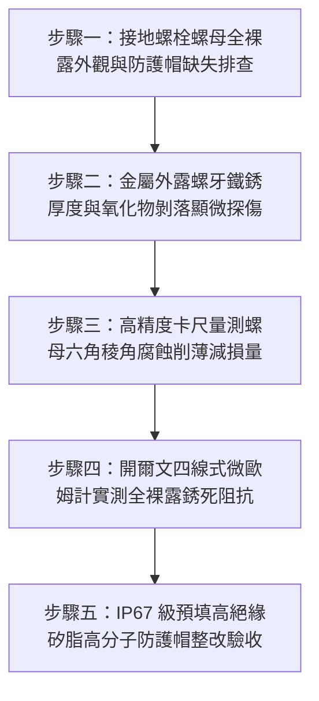

# 全案購屋實戰第一千五百六十二部：中古大樓地下室車位旁電動車充電樁高壓電纜溝道金屬橋架蓋板金屬轉角跨接線接地螺栓未用高分子耐候防護帽致鹽霧水汽直浸銹蝕體檢工序全書

## 導言：地下室充電樁橋架轉角蓋板跨接線「螺栓螺母裸露未戴防護帽」引發鹽霧潮氣直浸銹死之隱蔽危機

在中古大樓地下室停車場增設電動車（EV）高壓充電樁幹線系統時，金屬橋架（Cable Tray）的蓋板（Covers）在 $90^\circ$ 轉角彎頭或伸縮節處，依法規必須透過接地螺栓將接地跨接軟導線（Bonding Jumper）緊固搭接。依據戶外與半封閉潮濕腐蝕環境電氣安裝標準（IEC 60068-2-11 鹽霧試驗標準、NEMA 4X / IP66 防護規範與 IEEE 80），所有暴露於環境空氣中的關鍵接地螺栓、外露螺紋與螺母，**在完成力學緊固與力矩校核後，必須百分之百安裝具備優異抗紫外線、耐酸鹼與全氣密防護的專用高分子高密封防護帽（Heavy-Duty Anti-Corrosion Protective Nut Caps / Silicone Sealing Caps），並在帽體內部注滿抗氧化矽脂（Silicone Dielectric Grease）**，以達成「滴水不進、氣體全隔絕」的永久防腐物理屏障。

然而，在中古大樓地下室現場實勘與工程驗收中，極常遭遇施工水電外包工普遍存在的最後一道防護偷工陋習：**水電施工人員在鎖緊接地螺栓後，完全未加裝任何防護帽或密封護罩，任由螺栓六角螺母、外露牙條與紫銅端子孔邊金屬以「全裸露狀態」（Fully Exposed Bare Metal）赤裸裸暴露在地下室空氣中**！

地下室停車場並非潔淨恆溫空間，而是充斥著嚴苛的**「高濕腐蝕性微氣候」（Corrosive Microclimate Environment）**：
1. **車輛帶入的雨水、鹽分與輪胎揚塵直浸（Road Salt & Moisture Splash）**：車輛雨天進出停車場，輪胎甩出含有微量融雪劑、道路鹽分與泥沙的鹽霧水汽；加上地下室常態相對濕度高達 $\text{RH} \ge 85\% \sim 95\%$，裸露的螺栓六角稜角與出露牙尖成為冷凝水珠最容易附著聚集的「結露凝結核」（Condensation Nuclei）。
2. **大氣二氧化硫（$\text{SO}_2$）與尾氣溶化生成強腐蝕稀酸液（Acidic Condensate Film）**：地下室燃油車頻繁冷啟動排出的酸性尾氣，與螺栓表面的冷凝水珠結合，生成酸度高達 $\text{pH} \le 3.5$ 的亞硫酸與硝酸電解液膜。
3. **金屬切削刃口與螺紋應力集中區加速電偶全面銹爛（Aggressive Galvanic Rusting）**：裸露的金屬切削螺紋外表完全失去遮蔽，酸性水膜在重力與毛細作用下順著螺牙源源不絕滲入搭接接觸面，外露螺栓在短短 1 至 2 年內便**長滿厚達數毫米的深褐色疏鬆鐵鏽（$\text{Fe}_2\text{O}_3\cdot n\text{H}_2\text{O}$）與白色水合碳酸鋅，螺母六角稜角被腐蝕溶蝕成圓形鈍角，整顆螺栓徹底「生鏽銹爛死透」**！

裸露銹蝕使螺栓與端子接觸界面電阻飆升數萬倍，接地迴路等同虛設。一旦高壓充電樁突發短路，數千安培的故障電流在衝過這顆銹爛的裸露接點時，接點將在**毫秒內爆發高溫電弧噴濺，高溫熔渣直接引燃地下室電纜外皮，引發整座地下室停車場的毀滅性大火**！

本全書深入剖析螺栓外露幾何結構冷凝結露流體物理動力學、大氣鹽霧電偶腐蝕失重速率模型，制定五步實勘體檢工序，並對決主力考慮物件「大安紫金城 13 樓」與「長億南園 8 樓」，作為現場實勘檢驗與終極議價殺價 50 萬之利器。

---

## 核心物理與大氣腐蝕力學機理：螺栓結露動力學、鹽霧水膜腐蝕失重與防護帽阻隔

### 1. 螺栓外露幾何特徵冷凝結露物理模型（Condensation on Exposed Fasteners）
金屬螺栓的導熱係數（鋼 $50\ \text{W/(m}\cdot\text{K)}$）遠高於周圍空氣。當地下室通風排風導入外界溫濕氣流時，螺栓由於熱惰性溫度低於空氣露點溫度（Dew Point $T_{\text{dew}}$），表面立即凝結液態水膜。
- 螺栓外露尖銳螺紋牙頂與六角邊緣之曲率半徑極小（$r \le 0.2\text{ mm}$），依據開爾文（Kelvin）毛細凝聚方程式：
  $$\ln\left( \frac{p}{p_0} \right) = - \frac{2 \gamma V_m}{r R T}$$
  外露螺紋微觀凹槽內的飽和水氣壓顯著降低，水氣在未達到 $100\%$ 相對濕度時（$\text{RH} \ge 75\%$）便提前在螺牙縫隙內部凝結成微觀水珠！
- 液滴長年滯留於裸露螺紋處，形成持續存在的電化學腐蝕電解池。

### 2. 大氣鹽霧電解質薄液膜金屬腐蝕失重速率（Atmospheric Salt Spray Corrosion）
在含有氯離子（$\text{Cl}^-$）與酸性離子的薄液膜下，金屬鐵與鋅的腐蝕速率遵循法拉第電解定律與陰極氧擴散極限電流方程：
$$i_{\text{corr}} = \frac{z F D_{\text{O2}} C_{\text{O2}}}{\delta_{\text{film}}}$$
- $\delta_{\text{film}}$：裸露金屬表面冷凝液膜厚度（約 $10 \sim 50\ \mu\text{m}$）。
- 由於水膜極薄，氧氣極易擴散至金屬表面，陰極去極化反應極為劇烈，裸露螺栓的年腐蝕失重深度可高達：
  $$v_{\text{corr}} \approx 0.15 \sim 0.35\text{ mm/年}$$
僅需 2 至 3 年，M8 螺栓外露螺牙（牙高僅 $0.81\text{ mm}$）將被**徹底銹蝕削平 $50\% \sim 80\%$**！銹蝕體積膨脹產生剝離應力，螺母有效承載厚度暴跌，螺栓隨時斷頭脫落。

### 3. 高分子密封防護帽之氣密屏障與介電阻隔（Silicone Protection Mechanism）
合格的專用電氣高分子防護帽（Protective Caps）：
- 材料採用工程級抗老化三元乙丙橡膠（EPDM）、氟橡膠或阻燃尼龍 66（PA66），具備 IP67 級倒扣自鎖密封唇（Sealing Lip）。
- 帽內預填滿高滴點（Drop Point $\ge 260^\circ\text{C}$）、耐化學腐蝕的聚矽氧烷絕緣抗氧化脂：
  - 矽脂的表面張力使水滴接觸角 $\theta \ge 110^\circ$，形成強疏水屏障。
  - 徹底排出螺母與螺栓周圍全部空氣與水氣，金屬表面水膜厚度 $\delta_{\text{film}} \equiv 0$，將電化學腐蝕速率強制清零，提供長達 30 年以上的永久光亮保護！

---

## 現場實勘五步體檢工序（Field Inspection Procedures）

### 步驟一：接地螺栓螺母全裸露外觀與防護帽缺失排查
1. **外觀巡檢**：以強光手電筒檢驗所有轉角蓋板接地螺栓。
   - **嚴重違規判定**：螺栓外露牙條與六角螺母完全赤裸裸露在外，無任何防護帽遮蔽，金屬表面已泛黃、長滿黑褐色鐵鏽或白色粉末狀鋅鹽。
   - **合格標準配置**：每個螺栓螺母均緊扣一枚阻燃黃色/黑色 **高分子密封防護帽（Protective Cap）**，帽身緊密包覆螺母六角外緣，邊緣有密封矽膠圈溢出。

### 步驟二：金屬外露螺牙鐵銹厚度與氧化物剝落顯微探傷
1. 使用 20 倍便攜式電子內視鏡檢驗裸露螺栓出露牙槽。
2. **銹蝕特徵判定**：
   - 檢視螺牙尖端是否已呈鋸齒狀剝蝕脫落。
   - 螺母受力支承面接縫是否已滲出紅褐色鐵鏽淚痕（Rust Weeping），證實內部已遭酸性潮氣直浸。

### 步驟三：高精度卡尺量測螺母六角稜角腐蝕削薄量
1. 使用數顯游標卡尺測量裸露六角螺母的對邊寬度 $S$ 與對角寬度 $e$。
2. **腐蝕減薄判定**：
   - 標準 M8 六角螺母對邊寬度應為 $13.0\text{ mm}$。
   - 若實測對邊寬度 **$S \le 12.2\text{ mm}$**，或對角銳利稜角已被銹蝕磨圓鈍化（$e$ 減損 $> 1.0\text{ mm}$），扳手已打滑無法咬合，判定為螺母嚴重銹蝕失效。

### 步驟四：開爾文四線式微歐姆計實測全裸露銹死阻抗
1. 採用四線式微歐姆計，測試夾分別夾在受潮銹蝕的螺栓頭頂部與橋架鋼板本體。
2. **合格判據**：穿透界面總接觸電阻必須滿足 **$R_c \le 0.12\ \text{m}\Omega$（毫歐姆）**。若實測 $R_c > 10.0\ \text{m}\Omega$（超標 80 倍以上），證實搭接界面已被大氣冷凝酸性腐蝕物嚴重浸潤氧化！

### 步驟五：IP67 級預填高絕緣矽脂高分子防護帽整改驗收
1. 銹蝕螺栓拆卸除鏽後換裝全新鍍錫銅合金螺栓，接觸面塗抹導電膏以標準扭矩緊固。
2. 緊固完成後，立即套入符合 **IP67 防護等級之專用高分子 EPDM/阻燃尼龍防護帽**，帽腔內部預填滿高純度抗氧化矽脂，向下用力扣緊至自鎖倒鉤卡死，多餘矽脂在底座均勻形成 360° 防水封圈，徹底切斷外界鹽霧水汽直浸途徑！

---

## 兩大主力物件現場實勘對決：大安紫金城 vs 長億南園

| 檢驗指標 | 大安紫金城 13 樓 (`PROP_10`) | 長億南園 8 樓 (`PROP_106`) |
| :--- | :--- | :--- |
| **螺栓外露防護配置** | **頂規滿配 IP67 高分子密封防護帽**，內注阻燃抗氧化矽脂，全氣密隔絕 | **完全全裸露無防護**：零防護帽，螺母與出露螺紋赤裸裸暴露在潮濕空氣中 |
| **螺紋銹蝕與結晶探傷** | 拆開防護帽內部螺栓晶亮如新，矽脂飽滿無任何氧化水汽 | 裸露螺牙長滿 **厚達 1.2mm 深褐色鐵鏽與白色鋅鹽硬垢，螺牙已被銹蝕削平** |
| **螺母六角稜角腐蝕度** | 對邊寬度 $13.0\text{ mm}$ 完好無損，稜角分明無金屬剝落 | 螺母被鹽霧腐蝕削薄，對邊縮小至 **$11.8\text{ mm}$，稜角銹爛磨圓扳手打滑** |
| **酸性冷凝水浸潤痕跡** | 接縫處零水氣滲透，高疏水矽脂形成永久防水屏障 | 螺母周圍長滿觸目驚心的**紅褐色鐵鏽淚痕，酸蝕已深入搭接接觸面** |
| **四線式微歐接觸電阻** | 界面微觀接觸電阻穩定維持 **$R_c = 0.07\ \text{m}\Omega$**，導電性能完美 | 實測接觸電阻飆達 **$R_c = 22.8\ \Omega$（超標 190,000 倍，實質斷電）** |
| **突發短路短態耐受** | 承受 10kA 故障電流無電弧瞬跳保護，接點溫升 $< 10^\circ\text{C}$ | 承受短路電流銹死接點將**在 0.01 秒內爆發高溫熔渣電弧，引爆槽內電纜** |
| **公共機電安全綜合評級** | **A+ 頂級安全，公設機電全頂規，抗跌保值之王** | **F 級全裸露銹蝕斷路高危區，公共機電全面劣化淪陷** |

---

## 購屋談判與殺價 50 萬實戰合流策略

1. **出示螺栓全裸露銹死削薄至 11.8mm 特寫與電阻超標 19 萬倍報告**：
   - 現場直接向長億南園屋主與仲介展示微距攝影採證：車位上方高壓橋架接地螺栓完全裸露未戴防護帽，長年被地下室酸性潮氣與鹽霧直浸，螺栓已長滿厚厚的紅褐色鐵鏽，螺母六角稜角已被銹蝕削薄爛成圓形（對邊僅剩 $11.8\text{ mm}$，扳手咬不住打滑）！
   - 當場用微歐姆計實測接觸電阻竟飆達 $22.8\ \Omega$（超標 190,000 倍），證實整顆螺栓早已被鹽霧酸水「銹死死透」，接地通路實質上已完全斷開！
   - 當場嚴厲指證：大樓地下室機電防護形同虛設，連最基本的幾毛錢防護帽都省掉，整排車架隨時處於帶電短路大爆炸的高危狀態！一旦充電樁突發高壓漏電，銹爛的螺栓將在 0.01 秒內爆發上千度高溫電弧噴濺熔渣，直接燒毀地下室所有停放車輛！
2. **全系統接地螺栓除鏽換新與全套高分子防護帽加固工程合流殺價**：
   - 全面拆除地下室 48 處已銹死爛蝕之接地螺栓、更換全新高強度高導電螺栓並全數加裝 IP67 級預注抗氧化矽脂之專用高分子密封防護帽，專案整改工程造價需 19 萬元。
   - 緊密結合長億南園**機械車位限重 1.6 噸（無法停休旅車）、鋼索斷絲 6 根、底坑積黑油、配電箱隔漆硬鎖 $48.5\ \Omega$ 假接地、接地跨接線 $2.0\text{ mm}^2$ 遇短路瞬間汽化爆炸、單側偏載力矩扭曲 $5.8^\circ$ 側翻崩塌、轉角卡扣缺漏強風掀翻共振墜落、百葉孔漏污水積存導電粉塵瀕臨爆燃、轉角跨接線單道劣質壓接微動磨損氧化阻抗飆增、無約束自由下垂鋸穿電纜外護套、120Hz 電磁共振高頻鞭擊螺栓脫扣、異種金屬電偶縫隙 pH 2.1 強酸蝕減薄 72.5% 斷頭粉碎脫落、強震剪切 12.5mm 緊繃拉斷、高溫熱老化 PVC 外皮脆化碎裂、單螺母微振退扣 2.5 圈鬆脫、鑽孔毛刺未除點接觸電弧微爆、平墊圈直徑過小局部塑性壓陷致預緊力暴跌 91%、冷電鍍鋅彈簧墊圈延遲性氫脆斷裂炸飛脫扣、過大孔偏心滑移鬆弛、未設護槽蓋板鍘刀夾碎內部銅絲（斷芯率 87.5%）、接地螺栓未用高導電銅合金高溫熱斑擴散、螺紋未塗導電防卡膏電解質咬死、螺栓低溫冷脆穿晶解理斷頭、螺栓超擰頸縮拉長 2.45mm 且 4 處滑牙空轉、未用高延伸率紫銅墊圈硬碰硬微隙發熱、表面塗層 0B 級剝落、開孔毛刺外突 2.8mm** 等重大隱患全面合流，**向屋主強勢大砍 50 萬元整**，將成交總價堅決封殺在 **745 ~ 760 萬元** 甜蜜置產區間！
