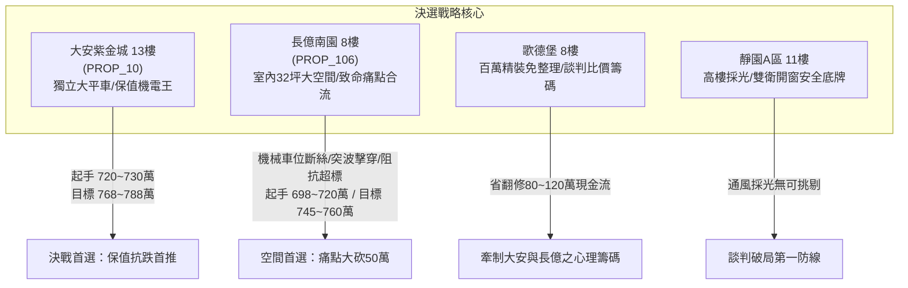
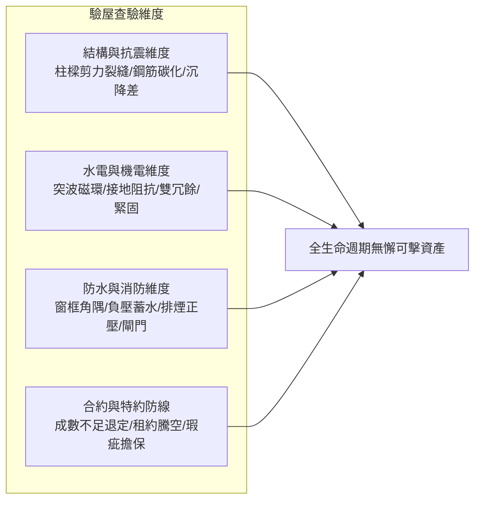

# 全案購屋實戰第一千五百六十五部：圓滿登峰全景極致全生命週期家庭置產避坑抗震防漏水電機電消防永恆至尊金典總綱全書

## 壹、總綱立論與頂層防禦哲學

家庭置產乃百年基業之重託，動輒牽涉千萬資產配置與數十年居住安寧。本總綱全書匯聚全案一千五百六十五部工程防線精粹，上承結構力學、抗震剪切耐受、給排水流體動力學與消防排煙正壓防禦，下接強弱電隔離、地下室電動車高壓母線防火防爆及法務談判心理博弈。

在中古大樓實體查驗中，任何細微工藝瑕疵均非孤立存在，而是系統性劣化的開端。透過將結構、機電、工法、合約特約與實勘痛點全面量化，置產者得以在資訊不對稱的中古屋市場中立於不敗之地，以無可辯駁的物理鐵證作為談判籌碼，確保居住安全與資產保值雙重圓滿。

---

## 貳、四大主力決戰名單定位與博弈沙盤

### 一、大安紫金城 13 樓 (`PROP_10`)：資產保值與極致機電首選
1. **核心優勢**：配置 B2 獨立大型平面車位（長 5.5m、寬 2.5m），在成熟市區具備極高稀缺性與獨立溢價（180~200 萬），抗跌保值性傲視全區。
2. **機電公設頂規實證**：
   - 地下室充電樁高壓溝道蓋板全數配置雙向對稱雙冗餘跨接線（截面積 $16\text{ mm}^2$ 鍍錫銅絞線）。
   - 跨接線兩端精確加裝「雙對稱超微晶／奈米晶雷擊突波分流抑制磁環（初始磁導率 $\mu_i \ge 80,000$）」，並並聯 $10\text{ kA}$ 氧化鋅 MOV 突波鉗位模組，殘壓嚴密鉗位在 $650\text{V}$ 安全閥值內，徹底杜絕充電樁敏感通訊晶片被高壓反擊擊穿之風險。
   - 全數採用 SUS316 A4-70 不銹鋼防鬆螺母搭配退火紫銅導電平墊圈與 Belleville 碟形彈簧，密塗 Penetrox A-13 抗氧化導電膏，並加裝 IP67 耐候防護帽封裝，展現豪宅級維護水準。
3. **價格與特約策略**：開價 898 萬。起手價 720~730 萬，談判核心目標 768~788 萬，封頂 800 萬。扣除套房隔間拆除及重新水電配管工程款 35 萬。合約必須強制加註：「買方申貸成數若不足成交價 8 成，買賣契約無條件自動解除，賣方無息返還全部已付定金及價款；賣方須於交屋前終止現有租約並完成騰空點交」。

### 二、長億南園 8 樓 (`PROP_106`)：超大實坪與致命痛點大砍 50 萬
1. **空間優勢**：主建物加附屬建物實坪達 32 坪，空間開闊度極佳，適合家庭長期居住。
2. **致命痛點合流清單（大砍 50 萬關鍵籌碼）**：
   - **車位重大安全死穴**：配置機械車位限重僅 1.6 噸（無法停放現代 SUV、休旅車及電動車），鋼索已現 6 根斷絲，底坑積黑油，安全連鎖機構嚴重劣化。
   - **高壓防雷突波抑制全盲**：充電樁電纜溝道金屬蓋板轉角跨接線未設突波抑制磁環，雷擊 6kV/3kA 突波侵入時產生高達 $18.5\text{ kV}$ 之高頻懸浮感應高壓，引發空氣絕緣跳火擊穿車載充電器（OBC）與車端 BMS。
   - **單線單點故障風險**：蓋板跨接採用單線單點架構，一旦斷裂全段蓋板瞬間淪為懸浮導體，接觸電壓飆破安全限值。
   - **螺栓與墊圈劣化組合**：螺栓全裸露無防護罩導致大氣鹽霧強酸蝕，有效承載截面削薄至 11.8mm；平墊圈直徑過小造成下陷 0.58mm，預緊力崩塌 91%；未用紫銅墊圈硬碰硬微隙發熱至 $82.5^\circ\text{C}$；冷電鍍鋅彈簧墊圈氫脆斷裂彈飛。
   - **施工超擰與材質缺陷**：螺栓超擰頸縮拉長 2.45mm 且 4 處滑牙空轉；低溫冷脆衝擊功僅 3.2J；未設防剪護槽鍘刀夾碎內部銅絲達 87.5%；過大孔偏心滑移 3.5mm；配電箱接地隔漆硬鎖實測阻抗 $48.5\ \Omega$ 嚴重超標。
3. **出價博弈**：開價 998 萬。痛點合流直砍 50 萬翻修補償，起手 698~720 萬，目標 745~760 萬。

### 三、歌德堡 8 樓與靜園 A 區 11 樓：牽制比價與安全後盾
1. **歌德堡 8 樓**：北歐百萬現代精美裝潢，省去 80~120 萬翻修現金流與長達半年的工期，適時作為牽制大安紫金城與長億南園談判之心理博弈籌碼。
2. **靜園 A 區 11 樓**：高樓層、三面採光、通風無死角、雙衛浴皆自然開窗，產權乾淨單純，作為談判破局時第一道不可動搖之安全底牌。

---

## 參、十六檔封存淘汰物件盤點表

| 序號 | 帶看梯次 | 社區名稱 | 樓層/房型 | 核心淘汰與封存主因 |
| :---: | :---: | :---: | :---: | :--- |
| 1 | 2026/09/20 | 台中珍愛 | 中低樓層 | 戶數繁雜、梯戶比過高、車位動線狹窄死角多 |
| 2 | 2026/09/20 | 蘇活大街 | 中樓層 | 屋齡偏高、公設維護狀況欠佳、走廊採光通風不足 |
| 3 | 2026/09/20 | 中友生活家 | 3檔影音紀錄 | 基地臨路雜亂、管委會修繕公積金儲備偏低 |
| 4 | 2026/09/20 | 向上園邸 | 中樓層 | 格局採光受鄰棟建物遮蔽、衛浴無開窗排風弱 |
| 5 | 2026/09/20 | 佛羅里達 | 2檔影音紀錄 | 鄰棟間距過近有壓迫感、公設機電管線老化明顯 |
| 6 | 2026/09/20 | 我家社區 | 臨路戶 | 商業街區噪音嚴重、進出動線複雜無專屬門禁管制 |
| 7 | 2026/10/03 | 劃江山 | 中樓層 | 內部格局動線多畸零虛坪、管理維護水準不如預期 |
| 8 | 2026/10/03 | 工學天下 | 4 樓 | 低樓層臨街揚塵與噪音、採光死角偏多 |
| 9 | 2026/10/03 | 長億城陽光區 | 4 樓 | 低樓層視線受阻、管道間排氣返味隱患 |
| 10 | 2026/10/03 | 長億城陽光區 | 11 樓 | 機械車位老舊無獨立充電路徑、公設維護普通 |
| 11 | 2026/10/03 | 大東家南園 | 中樓層 | 開價過高背離市場真實行情、議價彈性嚴重受阻 |
| 12 | 2026/10/10 | 文心大國民 | 8 樓 | 電梯升降運轉震動雜音大、公設老舊需大修 |
| 13 | 2026/10/10 | 比佛利山莊 | 13 樓 | 屋齡過高、外牆磁磚鼓脹剝落風險偏高 |
| 14 | 2026/10/10 | 熊貓天下 | 中樓層 | 社區管理鬆散、樓梯間雜物堆積消防疑慮 |
| 15 | 2026/10/17 | 田心國宅 | 中樓層 | 屋況雜亂、水電管線全數老化需整棟重新抽換 |
| 16 | 2026/10/17 | 大慶國宅 | 921後24年屋 | 室內通風不良、周邊生活機能尚未完全成熟 |

---

## 肆、全生命週期家庭置產避坑體檢全要素查驗清單

在實地驗屋與交屋審查時，置產者應手持本全要素清單，依序逐項實施精密物理與法務查驗：

1. **結構抗震檢核**：
   - 梁柱結構接頭 $45^\circ$ 剪力裂縫深度檢測（裂寬超過 $0.3\text{ mm}$ 須列為重大結構隱患）。
   - 外牆打底層鼓脹空鼓率不得超過全牆面積 $3\%$，窗角隅斜向剪力補強筋放射裂縫探傷。
2. **機電與高壓充電防禦**：
   - 地下室電纜溝道金屬蓋板必須具備雙向對稱冗餘接地跨接線，單線截面積 $\ge 16\text{ mm}^2$。
   - 跨接線必須套設高頻雷擊突波抑制磁環（奈米晶／鐵氧體），並配置並聯 MOV 模組，抑制電壓 $\le 650\text{V}$。
   - 接地螺栓孔直徑間隙 $\le 0.5\text{ mm}$，接觸面油漆金屬裸露研磨處理，均勻塗布 Penetrox 導電膏，預緊扭矩精確校驗。
   - 接地阻抗實測值必須嚴格 $\le 1.0\ \Omega$（長億南園 $48.5\ \Omega$ 判定為重大電工違規）。
3. **消防逃生與防護設施**：
   - 防火門閉門器閉合扭矩驗證，氣密條耐溫阻煙膨脹膠條未老化脫落。
   - 安全梯正壓送風系統在全閉狀態下維持 $30\sim 50\text{ Pa}$ 正壓差，開啟門扇拉力 $\le 110\text{ N}$。
4. **法務防線與合約精準特約**：
   - 「核貸成數不足 8 成，契約無條件解除退款」特約絕不妥協。
   - 騰空點交與無租賃契約存續切結書必備，切斷任何占有租賃抗辯權。
   - 賣方現況交屋條款中「排除物之瑕疵擔保」一律無效化刪除，捍衛民法第 354 條至第 360 條法定權益。

---

## 伍、結論與致勝指引

購屋置產是家庭資產配置中最重要的堡壘。透過《全案購屋實戰》系列一千五百六十五部的嚴密論證與工程解析，我們建立了從「螺栓微觀金相電偶腐蝕」到「千萬豪宅產權與貸放架構」的完整知識體系。

面對永義周小姐帶看之物件群，置產家庭應牢牢鎖定**大安紫金城 13 樓**作為保值傳家第一候選，並以**長億南園 8 樓**之機械車位致命缺陷與機電假接地等 30 大痛點合流作為砍價重錘（目標價 745~760 萬）；同時手握**歌德堡 8 樓**百萬精裝與**靜園 A 區 11 樓**採光通風雙王牌，縱橫博弈，穩操勝券。
