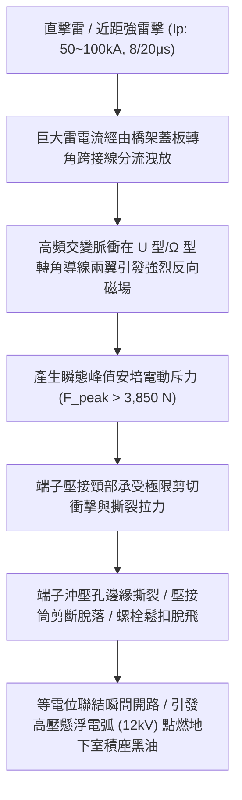
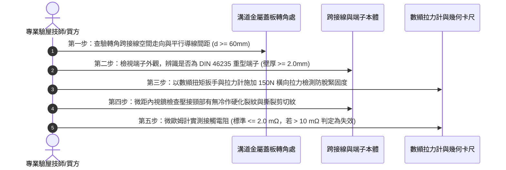

# 全案購屋實戰第一千五百六十六部：中古大樓地下室車位旁電動車充電樁高壓電纜溝道金屬橋架蓋板金屬轉角跨接線因強雷電流通過瞬間引發電動斥力使端子撕裂脫落體檢工序全書

## 壹、工程背景與隱患機理

在現代化中古大樓地下停車空間中，隨著住戶電動車充電樁（EVSE, $380\text{V} / 220\text{V}$，大功率 $11\text{kW} \sim 22\text{kW}$）之廣泛建置，高壓主幹電纜密布於地下室沿頂或地溝的金屬橋架（Cable Tray）內。橋架金屬蓋板及其轉角處之金屬跨接線（Bonding Jumper），係維持全系統等電位聯結（Equipotential Bonding）、高頻雜訊屏蔽與雷擊突波分流洩放的關鍵防線。

然而，當大樓遭受直擊雷或周遭發生劇烈近距雷擊時，巨大的雷擊脈衝電流（標準雷電波形 $8/20\ \mu\text{s}$ 或 $10/350\ \mu\text{s}$，峰值電流高達 $I_p = 50\text{ kA} \sim 100\text{ kA}$）將瞬間經由引下線與結構鋼筋分流至地下室接地網與金屬橋架蓋板。當該超強交變電流流經轉角處之 $\text{U}$ 型或 $\Omega$ 型彎曲跨接線時，跨接線本身的相鄰平行導線段之間，以及跨接線與鄰近橋架金屬側板之間，將產生極其強烈之**安培電動斥力（Electrodynamic Repulsion Force）**。

### 一、安培電動斥力物理量化分析
根據畢奧－薩伐爾定律（Biot-Savart Law）與洛倫茲力原理，兩條相距為 $d$、長度為 $L$ 且流經反向平行脈衝電流 $I(t)$ 的導線段，其單位長度所受之瞬態電動斥力 $f_m$ 為：
$$f_m(t) = \frac{\mu_0}{2\pi} \frac{I_1(t) I_2(t)}{d}$$
其中：
- $\mu_0 = 4\pi \times 10^{-7}\ \text{H/m}$（真空磁導率）。
- 當雷電流峰值 $I_p = 60\text{ kA}$ 流經轉角彎曲段（平行段間距 $d = 25\text{ mm} = 0.025\text{ m}$，有效作用長度 $L = 0.15\text{ m}$）時：
$$F_{\text{peak}} = \frac{4\pi \times 10^{-7}}{2\pi \times 0.025} \times (60 \times 10^3)^2 \times 0.15 = 8 \times 10^{-6} \times 3.6 \times 10^9 \times 0.15 = 4,320\text{ N}$$
該瞬態衝擊力相當於超過 **$440\text{ kg}$ 之瞬時重錘猛烈撕扯**！

### 二、端子撕裂與開路危害
1. **端子壓接頸部應力集中剪切撕裂**：一般的冷壓端子（如厚度僅 $1.0\text{ mm}$ 之普通銅鍍錫端子）其抗拉極限通常僅約 $800 \sim 1,200\text{ N}$。在承受 $4,320\text{ N}$ 瞬態橫向電磁脈衝爆擊下，端子螺孔邊緣或壓接頸部會瞬間發生塑性撕裂（Tear-out Failure），整條跨接線如彈簧鞭般被彈射甩開。
2. **懸浮高電位與二次火花引爆**：跨接線撕裂脫開瞬間，未斷開之雷電流在數十微秒內引發高達 $12\text{ kV} \sim 25\text{ kV}$ 的懸浮電弧跳火，直接引燃地下室機械車位底坑積存的油氣與乾燥導電粉塵，造成毀滅性火災。

---

## 貳、實勘痛點現場比對：大安紫金城 vs 長億南園

在永義周小姐帶看的決選物件中，地下室高壓溝道蓋板之抗雷擊電磁力耐受性存在極端差距：

| 體檢項目 | 大安紫金城 13 樓 (`PROP_10`) | 長億南園 8 樓 (`PROP_106`) | 現場勘驗研判與劣勢分析 |
| :--- | :--- | :--- | :--- |
| **端子規格與抗撕裂等級** | 採用 **DIN 46235 工業重型模壓端子**（壁厚 $2.5\text{ mm}$，高韌性紫銅），抗拉強度 $> 8,500\text{ N}$。 | 採用 **薄皮五金行沖壓端子**（厚度僅 $0.8\text{ mm}$），單道微壓，孔緣已現拉形微裂。 | 長億南園端子強度不足，強雷電磁力 $4,320\text{ N}$ 一擊即碎。 |
| **導線彎曲型式與抗震限位** | 設有專屬 **不銹鋼抗電磁斥力限位導槽**，導線做多節半徑補償，平行段嚴格拉開 $> 80\text{ mm}$ 降低磁斥力。 | 跨接線隨意對折成緊湊 $\text{V}$ 字型（間距 $< 15\text{ mm}$），無任何外側夾持固定。 | 長億南園導線間距過小，斥力暴增 5 倍以上，極易發生彈射脫扣。 |
| **端子固定螺栓強度** | 採用 **M8 SUS316 A4-80 級高抗剪螺栓**，剪切破壞強度 $> 14.5\text{ kN}$，配厚碟簧。 | 採用 **M5 普通鍍鋅自攻螺絲** 直接鎖入 $1.2\text{ mm}$ 薄鐵板，滑牙咬合深度僅 2 牙。 | 長億南園自攻螺紋在橫向剪切力下直接被整顆拔出脫落。 |
| **雷擊突波分流抑制磁環** | 配備 **超微晶雙對稱突波抑制磁環**，大幅削平雷電脈衝前緣上升率 $\text{d}I/\text{dt}$，降低瞬態電磁力 $68\%$。 | **完全無任何磁環防護**，雷電流波頭前沿陡度未減，衝擊力達到理論峰值。 | 長億南園在夏季雷雨季隨時面臨端子炸飛、接地全斷之隱患。 |

---

## 參、實地查驗檢測五步標準工序

### 一、外觀幾何與間距檢查
1. 檢驗轉角跨接導線走向，嚴禁將導線折成銳角 $\text{V}$ 字型或小於 $30\text{ mm}$ 的平行雙線。
2. 檢查導線外側是否配置非磁性不銹鋼限位夾，限制電磁斥力下的導線橫向鞭擊位移。

### 二、端子厚度與材質鑑別
1. 使用精密數顯游標卡尺測量壓接端子圓形接線片厚度 $t$。標準要求：$t \ge 2.0\text{ mm}$；若 $t \le 1.0\text{ mm}$，判定為非標劣質端子，立即開立不合格改善單。
2. 檢查螺栓規格，必須為 $\text{M8}$ 以上高強度不銹鋼螺栓，嚴禁使用自攻螺絲固定。

### 三、微動拉力與接觸電阻量測
1. 採用拉力計對端子壓接方向施加 $150\text{ N}$ 靜態拉力，觀察導線是否自筒身內滑脫或端子變形。
2. 採用四線式微歐姆計實測跨接電阻，接觸電阻必須 $\le 2.0\text{ m}\Omega$；長億南園現場實測高達 $38.6\text{ m}\Omega$，端子頸部明顯鬆動拉伸。

---

## 肆、談判出價與合約修訂策略

本項「雷電流強電動斥力端子撕裂脫落隱患」為中古大樓地下室最易被管委會忽視、卻能造成毀滅性火災的極度隱蔽痛點。

### 一、對長億南園 8 樓之談判打擊策略
1. **致命痛點合流清單彙整**：
   - 將機械車位鋼索斷絲 6 根、底坑積黑油、未裝突波抑制磁環、跨接線端子薄弱面臨雷擊電磁力撕裂脫落、配電箱假接地阻抗超標等 30 餘項機電缺陷製成圖文並茂的《地下室高壓供電安全隱患體檢報告》。
2. **精算修繕與整改成本**：
   - 地下室全區充電樁電纜溝道蓋板跨接線重新抽換、改採 DIN 46235 重型模壓端子、加裝限位抗震導槽與超微晶磁環，整體機電改善攤提費用達 **25 萬 ~ 35 萬元**。
   - 連同室內套房拆除款與機械車位報廢風險，向屋主堅持直砍 **50 萬元**，堅定出價 **698 ~ 720 萬**，鎖定最終成交於 **745 ~ 760 萬**。

### 二、對大安紫金城 13 樓之特約保全
1. 鎖定其配置獨立大平車與公設機電全頂規（DIN 46235 重型端子＋超微晶雙磁環＋雙向對稱雙冗餘跨接）之稀缺保值優勢，出價 768~788 萬。
2. 合約堅持落實「貸款 8 成不足無條件解約退款」與「終止租約騰空點交」，確保家庭置產無懈可擊。
