# 全案購屋實戰第一千五百六十部：第一千五百六十部圓滿登峰全景極致全生命週期家庭置產避坑抗震防漏水電機電消防永恆至尊金典總綱全書

## 總綱銘刻：全案購屋工程實戰體系登峰極致里程碑

本總綱全書匯聚《全案購屋實戰》系列從第一部至第一千五百六十部之智慧大成，象徵著台灣中古大樓與集合住宅實戰置產防線建立的極致里程碑！在中古大樓購屋與地下室車位增設電動車（EV）高壓充電樁的真實場域中，隱藏於機電地下室、管道間、電纜溝道、電梯底坑與天花板內側的非結構性構件、防震支吊架、金屬橋架系統（Cable Tray System）與電氣接地防線，直接決定了整座大樓面對芮氏規模 7 級強震時的生存能力、高壓短路大火防杜能力與全體住戶的人身安全！

本總綱全書全面融會貫通三大核心維度：
1. **結構抗震防晃與化學錨固防墜體系**：全面杜絕火藥射釘衝擊微裂縫爆裂、壓桿長細比失穩彎曲、單側偏載力矩失衡扭曲側翻（$M_t = W \times e$）、轉角蓋板卡扣缺漏強風風阻掀翻共振墜落，以及強震三維剪切位移（$\Delta_{xy} \ge 55\text{ mm}$）硬生生拉斷緊繃跨接線引發接地開路。
2. **高壓電氣絕緣、接地防雷與緊固力學體系**：全面肅清假接地（烤漆未除接觸阻抗超標 97,000 倍）、接地跨接導線截面積不足熱穩定失效短路爆炸、接線端子未做雙道壓接引發微動磨損氧化高阻、跨接線無約束自由下垂鋸穿電纜外護套、120Hz 強電磁交變斥力高頻鞭擊脫扣、異種金屬電偶腐蝕鈍化膜破裂縫隙強酸（$\text{pH} \le 1.8$）溶蝕斷裂、高溫熱場（$T \ge 65^\circ\text{C}$）PVC 外皮熱氧降解脆化粉化、微振環境單螺母自旋退扣預緊力歸零、鑽孔金屬毛刺未刮除引發點接觸電弧微爆、平墊圈直徑過小局部塑性壓陷致預緊力崩塌、冷電鍍鋅彈簧墊圈延遲性氫脆斷裂炸飛脫扣、通孔過大同心度偏差微振橫向剪切滑移、未設彎曲限位護槽在蓋板閉合時鍘刀式剪切折斷內部細銅絲（斷芯率達 $87.5\%$）、接地螺栓未用高導電銅合金致本體焦耳熱斑發熱（$88.5^\circ\text{C}$）、螺紋未塗導電密封防卡膏引發電化學冷焊咬死扭斷、低溫冷氣團衝擊碳鋼螺栓穿晶解理冷脆斷頭，以及氣動衝擊扳手過扭矩超擰引發螺栓塑性頸縮與螺紋剪切滑牙。
3. **終極決戰選品與價格談判兵法**：鎖定大安紫金城 13 樓頂規標竿、長億南園 8 樓致命缺陷全面合流大砍 50 萬、歌德堡 8 樓精裝牽制與靜園 A 區 11 樓高樓通風守底防線。

---

## 體系工程總覽架構圖（Comprehensive Engineering Architecture）

```mermaid
flowchart TD
    subgraph S1[結構抗震抗偏載防墜體系]
        A1[ETA Option 1 環氧樹脂化學錨栓] --> A2[雙拼 C 型槽鋼對稱抗扭橫擔]
        A2 --> A3[剛柔結合抗震抗扭 V 型雙向斜撐]
        A3 --> A4[轉角蓋板 SUS301 抗風雙卡扣加防墜鋼索]
        A4 --> A5[立體大雙曲 Ω 型抗震補償環弧 ΔS > 75mm]
    end

    subgraph S2[高壓接地防微爆抗冷脆抗超擰體系]
        B1[雷射除漆露出 St 3 裸鋼加雙面 45° 去毛刺倒角] --> B2[35mm2 鍍錫純銅高密度編織跨接線]
        B2 --> B3[DIN 46235 液壓雙道六角冷焊氣密壓接]
        B3 --> B4[雙金屬防電偶過渡墊片加塗 Penetrox A-13 導電膏]
        B4 --> B5[對頂雙螺母互鎖加 DIN 9021 大外徑加厚平墊圈]
        B5 --> B6[SUS316 A4-70 奧氏體高韌性零冷脆無氫脆螺栓]
        B6 --> B7[數位定扭力扳手精確校準屈服利用率 75% 杜絕超擰]
        B7 --> B8[304 不銹鋼圓弧導向限位護槽 R > 45mm 杜絕鍘刀剪切]
    end

    subgraph S3[消防防火防熱脆防爆燃體系]
        C1[耐溫 125°C 低煙無鹵輻照交聯 XLPO 絕緣護套] --> C2[IP32 向下 45° 百葉蓋板加 304 微孔阻火網]
        C2 --> C3[天花板頂部獨立人字型導水槽]
        C3 --> C4[EPDM 雙唇防割金屬護口橡膠圈]
        C4 --> C5[雙備份 316 不銹鋼地坑自動排污泵]
    end

    S1 --> Final[全生命週期中古屋置產避坑最高戰略防線]
    S2 --> Final
    S3 --> Final
```

---

## 四大考慮物件核心決戰矩陣（The Four Contenders Matrix）

| 決戰維度 | 大安紫金城 13 樓 (`PROP_10`) | 長億南園 8 樓 (`PROP_106`) | 歌德堡 8 樓 | 靜園 A 區 11 樓 |
| :--- | :--- | :--- | :--- | :--- |
| **主要優勢** | **B2 獨立大型平面車位**（長 5.5m/寬 2.5m，抗跌保值之王，獨立殘值 180~200 萬） | **主＋陽實坪 32 坪超大空間**，低單價高空間效能 | **北歐百萬現代精裝免整理**，省去 80~120 萬翻修現金與工期 | **高樓層、三面採光、雙衛皆自然開窗通風**，格局方正 |
| **開價與談判目標** | 開價 898 萬。起手 720~730 萬，目標 768~788 萬，封頂 800 萬（扣除套房拆除款 35 萬） | 開價 998 萬。起手 698~720 萬，目標 745~760 萬（痛點合流大砍 50 萬） | 開價約 988 萬。鎖定 820~840 萬區間牽制主力物件讓價 | 開價約 950 萬。鎖定 780~810 萬區間作為談判破局第一底牌 |
| **地下室與機電體系** | **公設機電全頂規**：雙金屬防電偶片、液壓雙道壓接、DIN 9021 大墊圈、SUS316 A4-70 螺栓、定扭力校準、圓弧防剪護槽 | **致命缺陷全面合流**：機械車位限重 1.6t、鋼索斷絲 6 根、螺栓超擰頸縮拉長 2.45mm 滑牙空轉、低溫冷脆斷頭、螺紋咬死扭斷、內部斷芯 87.5% | 社區機電維護良好，管線整齊，梯廳無雜物堆積 | 機電設備正常運轉，地下室通風良好無異味，排污抽水泵運作穩定 |
| **置產戰略定位** | **【第一主力進攻王牌】** 逢低必搶，簽約必附 8 成房貸解約與租約騰空條款 | **【重點施壓大砍標的】** 藉致命機電缺陷重組砍價 50 萬，成交即賺安全改造成本 | **【心理博弈牽制籌碼】** 免翻修立即入住，倒逼大安與長億屋主心防瓦解 | **【談判破局安全守底牌】** 通風採光無可挑剔，進可攻退可守之家庭避風港 |

---

## 現場實勘三十五大黃金體檢要訣（Thirty-Five Golden Rules of Property Inspection）

1. **螺栓除漆驗證**：配電箱外殼與橋架接地銅排接合面必須刮除烤漆露出金屬基材，四線式微歐計實測阻抗必須 $R_c \le 0.5\ \text{m}\Omega$。
2. **鑽孔去毛刺倒角**：螺栓孔正反雙面必須具備 $45^\circ \times 0.5\text{ mm}$ 精密倒角，嚴禁翻邊毛刺將端子架空引發點接觸電弧微爆。
3. **對頂雙螺母防鬆**：接地螺栓必須採用「薄螺母在下、厚螺母在上」雙螺母互鎖或 Nord-Lock 楔入自鎖墊圈，杜絕車流微振退扣。
4. **重型大平墊圈支承**：必須配置符合 DIN 9021 標準之大外徑加厚鍍錫鋼墊圈（外徑 $\ge 3.0 \times d_{\text{bolt}}$），防止紫銅局部塑性壓陷致預緊力崩塌。
5. **無氫脆防鬆碟簧**：嚴禁使用冷電鍍鋅高碳鋼彈簧墊圈，必須採用 SUS316 奧氏體不銹鋼防鬆碟簧，杜絕延遲性氫脆斷裂炸飛脫扣。
6. **標準通孔公差配合**：通孔直徑必須符合 ISO 273 中等級公差（M8 開孔 $\le \phi 9.0\text{ mm}$），嚴禁過大開孔引發同心偏心剪切滑移鬆弛。
7. **導線圓弧防剪護槽**：轉角蓋板內側必須加裝 304 不銹鋼圓弧導向限位護槽（曲率半徑 $R \ge 45\text{ mm}$），杜絕蓋板閉合時鍘刀式剪切折斷細銅絲。
8. **高導電銅合金螺栓**：接地螺栓必須採用導電率 $\ge 25\%\ \text{IACS}$ 之高強銅合金（CuSn 錫青銅或鍍厚錫銅螺栓），嚴禁用普通不銹鋼化身電熱棒發熱。
9. **螺紋全周塗抹導電膏**：螺栓螺紋副必須百分之百塗覆 Penetrox A-13 導電密封防卡膏，杜絕毛細吸水與電解質閉塞縫隙腐蝕冷焊咬死。
10. **全溫域高韌性奧氏體鋼**：在低溫通風環境下必須採用面心立方 FCC 晶格之 SUS316（A4-70）不銹鋼，夏比衝擊功 $\ge 100\ \text{J}$，杜絕低溫冷脆斷頭。
11. **數位定扭力校準施擰**：必須使用數位可調式定扭力扳手（M8 鎖至 $22.5 \pm 0.5\ \text{N}\cdot\text{m}$），嚴禁衝擊起子機盲目超擰引發塑性頸縮與滑牙。
12. **電化學防偶介質**：銅鋁或銅鋼異種金屬搭接必須加裝雙金屬複合過渡片（Bimetallic Washer）並塗抹 Penetrox 導電防腐膏，杜絕閉塞電池 pH 1.8 強酸縫隙腐蝕。
13. **耐溫 125°C 絕緣護套**：跨接線絕緣外皮必須採用耐溫 $125^\circ\text{C}$ 低煙無鹵輻照交聯聚烯烴（XLPO），嚴禁普通 PVC 在高溫烘烤下脆化碎裂成粉。
14. **立體抗震補償環弧**：轉角跨接線必須預留展開餘裕量 $\Delta S \ge 75\text{ mm}$ 之立體大「Ω」型環弧，吸收強震層間三維剪切位移，嚴防緊繃拉斷。
15. **跨接線熱穩定容量**：主幹線橋架接地跨接線截面積不得小於 **$25\ \text{mm}^2$**，嚴禁用 $2.0\text{ mm}^2$ 細線充數，防止 10kA 短路電流在 0.0038 秒內汽化爆炸。
16. **端子雙道液壓冷壓**：接地端子必須使用六角液壓模具進行「雙道互鎖壓接」（壓縮比率 $\ge 80\%$），杜絕手動單道夾扁引發微動磨損氧化接觸高阻。
17. **防下垂磨損限位夾**：蓋板接地跨接線必須設於外側或加裝 304 不銹鋼限位導向夾，確保與下方電纜保持 $\ge 30\text{ mm}$ 淨空，嚴防自由下垂鋸穿電纜。
18. **正交避磁防鞭阻尼**：跨接線走向必須與主電纜呈 $90^\circ$ 正交立體交叉，並加設高阻尼防鞭夾，避開 $120\text{ Hz}$ 交變電磁共振高頻鞭擊與螺栓脫扣。
19. **轉角蓋板抗風滿配**：橋架 90° 彎頭蓋板必須滿配 4 組 SUS301 彈簧卡扣，抗拔力必須 $\ge 150\text{ N}$，並配置 304 不銹鋼防墜鋼索，嚴防風揭飛刀墜落砸車。
20. **百葉蓋板防水防爆**：百葉孔必須向下折角 $\ge 45^\circ$ 並內襯微孔阻火鋼網（IP32），正上方必須加設人字型導水槽，嚴禁天花板污水滴入引發導電粉塵爆燃。
21. **單側偏載對稱校正**：電纜敷設必須嚴格雙側對稱平衡佈線，雷射實測橫向高低差不得超過 $2.0\text{ mm}$，加裝「V 型」雙向抗扭斜撐，杜絕整排橋架側翻倒扣。
22. **表面防腐塗層附著力**：鋼製橋架表面熱浸鍍鋅或粉末噴塗必須達到百格刀附著力測試 4B 級以上，嚴防 0B 級剝落導致母材厚度減薄。
23. **電纜進出孔防割防護**：橋架電纜進出開孔邊緣必須進行翻邊模具鈍化處理，且百分之百安裝 EPDM 耐老化雙唇護口橡膠圈，嚴禁金屬毛刺直接割裂絕緣。
24. **嚴禁天花板火藥射釘**：電纜橋架吊架混凝土固定必須全面採用 ETA Option 1 級裂縫混凝土認證之環氧樹脂化學錨栓，抗拔力必須 $\ge 15\text{ kN}$。
25. **放熱焊接無瑕疵審查**：接地引下銅排放熱焊接（Exothermic Welding）必須預熱石墨模具至 $120^\circ\text{C}$，內部氣孔率必須 $< 1\%$，接頭直流電阻必須 $\le 2\ \mu\Omega$。
26. **防鼠入侵密閉防線**：橋架進出機房與垂直管道間之空隙必須加裝孔徑 $\le 4\text{ mm}$ 之 304 不銹鋼金屬網，防止老鼠咬破絕緣引發大火。
27. **防火防煙氣密隔板**：橋架穿越防火分區垂壁必須安裝 UL 認證 3 小時膨脹型阻火隔板，氣密等級達 Class 1，杜絕火災毒煙煙囪效應。
28. **雙層重疊散熱間距**：高低壓雙層橋架垂直淨空必須 $\ge 250\text{ mm}$，採用開孔率 $>45\%$ 梯級橋架，電纜溫升必須控制在 $< 40^\circ\text{C}$ 以內。
29. **配電箱頂防落防護**：位於配電箱正上方之橋架蓋板必須採用 Nord-Lock 雙面楔入防鬆螺母，且箱頂必須加設 A 字型金屬導水防落罩。
30. **地坑積水水樹枝防範**：地下室電纜溝道與泵坑必須配置雙備份 316 不銹鋼耐磨排污泵，杜絕電纜長年浸泡酸性積水引發水樹枝局放擊穿。
31. **垂直立管重力釋放弧**：垂直電纜爬梯每隔 $1.5\text{ m}$ 必須加裝高強度不銹鋼阻尼固定夾，且底端轉彎處必須預留半徑 $\ge 20D$ 之重力應力釋放卸載彎弧。
32. **防雷引下突波防反擊**：接地引下銅排與建築結構鋼筋網必須在柱身加裝氧化鋅突波吸收器（SPD），接地衝擊阻抗必須嚴格控制在 $\le 5\ \Omega$ 以內。
33. **全線等電位連續性複驗**：金屬橋架全線任意兩點間之總等電位聯結電阻，經四線式微歐計實測必須嚴格小於 $0.1\ \Omega$，確保接地洩流安全無死角。
34. **動態微動探傷監控**：所有軟導線與跨接點必須定期進行超音波微動裂紋探傷，確保無隱性疲勞斷芯，杜絕虛接起火隱患。
35. **緊固螺栓力矩標記漆**：所有合格鎖固之螺栓螺母必須劃刷高對比色防鬆檢驗漆線，建立直觀可視化的動態維護管理基準。

---

## 結語與落實指南

本第 1560 部金典總綱全書，凝聚了全生命週期置產防線之精髓。在後續實戰中，不論是現場勘查、水電技師複驗、銀行鑑價核貸，或是走入代書辦公室進行簽約肉搏談判，此全書體系都將化為最強大的防禦盾牌與殺價利刃！
買方當以冷靜、客觀之工程數據直搗屋主痛點，確保置產安全無懈可擊，資產永續增值！
