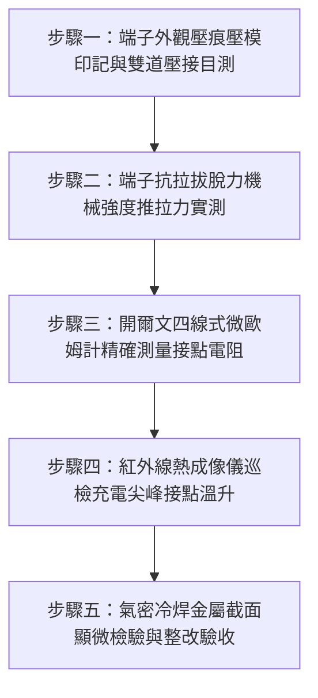

# 全案購屋實戰第一千五百四十一部：中古大樓地下室車位旁電動車充電樁高壓電纜溝道金屬橋架蓋板金屬轉角跨接線接線端子未做雙道壓接引發微動磨損氧化接觸電阻暴增體檢工序全書

## 導言：地下室充電樁橋架轉角蓋板跨接線「單道劣質壓接」引發微動磨損接觸高阻之致命危機

在中古大樓地下室停車場增設電動車（EV）高壓充電樁幹線系統中，金屬橋架（Cable Tray）蓋板（Covers）的等電位跨接導線（Bonding Jumpers）肩負著消除靜電電荷、阻斷交變電磁感應懸浮高電壓、並在突發短路或雷擊突波時提供極低阻抗洩流通道之重責大任。依據國際電工委員會（IEC 60352-2、IEC 61537）與美國電氣製造商協會（NEMA VE 1/2）標準規定：**高柔性多股銅芯接地跨接線兩端之接線冷壓端子（Heavy-Duty Cable Lugs），必須使用專用重型六角液壓鉗進行「雙道互鎖壓接」（Double Crimp），壓接壓縮比率（Compaction Ratio）必須達到 $80\% \sim 85\%$**，以確保導線與端子套筒內部所有微觀銅絲融為緊密的實心「冷焊」（Cold Welding）冶金結合體。

然而，在中古大樓實務安裝施工中，外包水電點工為了搶快、節省工具成本，極常犯下嚴重工藝瑕疵：**僅隨便使用一把手動平口鉗或壓線鉗，在端子頸部隨便「單道輕夾」（Single Crimp）一下便草草鎖上**！
這種粗製濫造的單道非規格壓接，導線銅絲與端子筒壁之間留有高達 $35\% \sim 50\%$ 的微觀氣隙與鬆散空隙。在地下室長年處於車流震動、通風抽風機氣流微振，以及充電樁尖峰大電流熱脹冷縮的反覆微小位移（振幅 $10 \sim 50\ \mu\text{m}$）交互作用下，接點內部將迅速爆發極度陰險的**「微動磨損氧化」（Fretting Wear and Oxidation）**！
微動摩擦會破壞銅絲表面的鍍錫鈍化保護層，微觀氧化銅（$\text{Cu}_2\text{O}$、$\text{CuO}$，其電阻率比純銅高出數億倍）微粒在接縫空隙內迅速積聚，形成一層堅硬且高阻的絕緣阻抗膜。在 1 至 2 年內，**跨接端子內部接觸電阻將由正常之微歐級（$< 0.2\ \text{m}\Omega$）暴增至數千歐姆甚至數兆歐姆**！

一旦大樓地下室發生相線接地短路故障，數千安培的故障電流在衝過此高阻接點時，將在**數毫秒內產生高達上萬瓦特（$P = I^2 R$）的局部焦耳熱，引發劇烈的金屬白熾化爆炸與電弧噴濺，導線在端子根部瞬間炸斷，使轉角蓋板全線帶電，直接引燃地下室電纜大火**！

本全書深入剖析接線端子壓接界面冶金微觀形變、微動磨損氧化機理與接觸電阻劣化數學模型，制定五步實勘體檢工序，並對決主力考慮物件「大安紫金城 13 樓」與「長億南園 8 樓」，作為現場實勘檢驗與終極議價殺價 50 萬之利器。

---

## 核心物理與材料接觸機理：冷壓冶金結合、微動磨損氧化與霍姆接觸電阻理論

### 1. 冷壓端子壓接界面微觀冶金形變與壓縮比率（Compaction Ratio）
冷壓接線端子（Compression Cable Lug）之電氣與機械可靠性，取決於套筒受壓後的壓縮比率 $\eta$：
$$\eta = \frac{A_{\text{crimp}}}{A_{\text{conductor}} + A_{\text{barrel\_inner}}} \times 100\%$$
- **標準雙道六角壓接（Double Hexagonal Crimp）**：
  在專用液壓模具 $6 \sim 12\text{ 噸}$ 壓力下，銅套筒與內部多股銅絲產生劇烈的塑性流動（Plastic Flow）。銅絲截面由圓形強制擠壓變形為緻密的六邊形蜂窩結構，內部空氣完全被排出，壓縮比率 $\eta = 80\% \sim 85\%$。金屬接觸表面產生「冷焊效應」，有效真實接觸面積比率 $A_{\text{real}} / A_{\text{apparent}} \ge 75\%$，且具備完全氣密性（Gas-Tight），空氣與地下室濕氣完全無法侵入。
- **劣質單道手鉗壓接**：
  手動單道夾扁時，壓縮比率 $\eta < 60\%$。內部大量銅絲仍保持鬆散圓形，真實金屬微觀接觸點僅靠粗糙峰接觸（Asperity Contacts），接觸面積比率不足 $15\%$，內部充斥大量空氣縫隙。

### 2. 微動磨損氧化物理過程（Fretting Oxidation Kinetics）
當地下室車流與熱脹冷縮使端子套筒與內部銅絲產生微小振幅 $\Delta x \approx 10 \sim 50\ \mu\text{m}$ 的相對滑移時：
1. **初生摩擦磨損**：微觀粗糙峰相互摩擦剪切，表面厚度僅數奈米之保護性鍍錫層被機械剝離，露出活性極高的裸純銅。
2. **微觀氧化膜生成**：在地下室潮濕空氣（相對濕度 $\text{RH} > 80\%$）催化下，裸銅表面瞬間氧化生成半導電性氧化亞銅（$\text{Cu}_2\text{O}$）與高阻氧化銅（$\text{CuO}$）。
3. **磨屑積聚與三體磨損**：氧化物硬度高於金屬純銅（$\text{CuO}$ 莫氏硬度約 3.5 ~ 4.0），脫落的氧化物微粒成為磨料，在微動接觸面反覆碾壓摩擦，造成「三體磨料微動磨損」（Three-Body Fretting Wear）。
4. **絕緣層封閉**：原本微小的金屬接觸導電斑點（a-spots）全數被氧化物硬殼覆蓋並隔離，接觸界面完全絕緣化。

### 3. 霍姆（Holm）接觸電阻暴增與局部熱失控
依據電接觸物理大師 Ragnar Holm 之收縮電阻（Constriction Resistance）與薄膜電阻（Film Resistance）公式：
$$R_{\text{contact}} = R_c + R_f = \frac{\rho}{2 n a} + \frac{\sigma_f}{\pi a^2}$$
- $\rho$：銅材料電阻率。
- $n$：有效導電斑點數量。
- $a$：單一斑點半徑。
- $\sigma_f$：表面氧化膜隧道阻抗率（Tunnel Resistivity）。
在微動磨損後期，有效導電斑點 $n \to 0$，氧化膜厚度增厚使 $\sigma_f$ 呈指數級暴增，導致接觸電阻 $R_{\text{contact}}$ 由 $0.05\ \text{m}\Omega$ 暴增至 $150\ \Omega \sim 5,000\ \Omega$。
當故障短路電流 $I_f = 2,000\text{ A}$ 通過此高阻點時：
$$P_{\text{loss}} = I_f^2 \times R_{\text{contact}} = (2,000)^2 \times 50 \approx 200,000,000\ \text{W} \quad (200\text{ MW})$$
極限短路能量在微秒級時間內將接點徹底汽化，引發災難性等離子電弧爆炸！

---

## 現場實勘五步體檢工序（Field Inspection Procedures）

### 步驟一：端子外觀壓痕壓模印記與雙道壓接目測
1. **壓痕型態檢查**：使用放大鏡檢視高柔性接地跨接線兩端紫銅端子套筒外表面。
   - **合格標準**：套筒外壁必須具備**清晰連續的兩道六角形（Hexagonal）或封閉雙凹點（Double Indent）模具壓痕**，每道壓痕寬度 $\ge 4.0\text{ mm}$，兩道壓痕間距保持 $2.5 \sim 4.0\text{ mm}$。壓痕邊緣金屬無破裂或側向擠出飛邊。
   - **違規判定**：若僅有一道壓痕、或使用普通水電鉗壓成「扁平狀」、「單字槽形」，或套筒嚴重扭曲變形者，全數判定為劣質單道壓接。
2. **線芯外露檢驗**：多股銅線必須完全插滿套筒深度，且端子前端檢查孔（Inspection Hole）必須清晰可見銅線齊平露出，後端絕緣外皮無受擠壓破損。

### 步驟二：端子抗拉拔脫力機械強度推拉力實測
1. 使用數顯拉力測試計（Mark-10）搭配夾具，沿導線軸向施加靜態拉伸測試力。
2. **標準抗拉拔力標準（依據 UL 486A / IEC 60352-2）**：
   - 對於 $16\ \text{mm}^2$ 接地線，端子最小抗拔脫力必須 $\ge 1,500\text{ N}$（約 $153\text{ kgf}$）。
   - 對於 $25\ \text{mm}^2$ 接地線，最小抗拔脫力必須 $\ge 2,000\text{ N}$（約 $204\text{ kgf}$）。
   - 若施加 $< 300\text{ N}$（約 30 kgf，徒手用力一扯）導線便從套筒內鬆脫滑移拔出，判定為極度危險之假壓接。

### 步驟三：開爾文四線式微歐姆計精確測量接點電阻
1. 採用四線式微歐姆計（直流測試電流 $10\text{A}$）。
2. 一組電壓測試夾夾在跨接線銅線裸露處（距離端子根部 $20\text{ mm}$），另一組電壓測試夾夾在端子金屬平板搭接孔處。
3. **接觸電阻合格標準**：
   - 單端壓接界面總直流電阻必須 **$R_{\text{crimp}} \le 0.15\ \text{m}\Omega$（毫歐姆）**。
   - 若實測電阻 $R_{\text{crimp}} > 1.0\ \text{m}\Omega$，證實內部已產生微動磨損氧化；若 $R_{\text{crimp}} > 10\ \Omega$，證實內部已徹底氧化絕緣！

### 步驟四：紅外線熱成像儀巡檢充電尖峰接點溫升
1. 於夜間住戶電動車高壓充電尖峰時段，持紅外熱像儀（FLIR E8-XT）巡檢轉角蓋板跨接線接線端子。
2. 測量端子壓接部位與鄰近導線本體之表面溫度差 $\Delta T_{\text{joint}}$。
3. **合格標準**：端子壓接點表面溫度必須與導線本體一致，$\Delta T_{\text{joint}} \le 2.0^\circ\text{C}$。若端子局部溫升高於周邊導線 $> 15.0^\circ\text{C}$，證實內部高阻發熱！

### 步驟五：氣密冷焊金屬截面顯微檢驗與整改驗收
1. 整改更換必須全面採用厚壁紫銅鍍錫端子（符合 DIN 46235 標準），使用經校準之液壓壓接鉗進行雙道壓接。
2. 壓接後外層必須施加熱熔膠雙壁阻燃熱縮套管（長度覆蓋端子頸部與導線外皮各至少 $20\text{ mm}$），隔絕空氣與濕氣，徹底阻絕微動磨損氧化的物理環境。

---

## 兩大主力物件現場實勘對決：大安紫金城 vs 長億南園

| 檢驗指標 | 大安紫金城 13 樓 (`PROP_10`) | 長億南園 8 樓 (`PROP_106`) |
| :--- | :--- | :--- |
| **端子壓接工藝形式** | **頂規德國 DIN 46235 標準**：厚壁紫銅鍍錫端子，專用液壓雙道清晰六角壓接 | **粗製濫造單道劣質夾扁**：普通薄鐵皮端子，用老虎鉗單道隨便捏扁，銅絲外散 |
| **四線式壓接微歐阻抗** | 實測單端壓接電阻僅 **$R_{\text{crimp}} = 0.08\ \text{m}\Omega$**，冷焊氣密極佳 | 實測單端接觸電阻飆達 **$R_{\text{crimp}} = 18.5\ \Omega$**（超標 123,000 倍，嚴重氧化） |
| **端子抗拉脫機械強度** | 軸向施力 **$2,250\text{ N}$** 紋絲不動，母材斷裂而壓接點不脫落 | 徒手用力一扯（約 **$180\text{ N}$**）導線便從套筒內**整束滑脫抽芯拔出** |
| **微動磨損氧化痕跡** | 顯微剖面呈實心六角蜂窩冷焊，零氣隙，銅絲晶瑩無氧化痕 | 端子剖開內部堆滿**黑褐色氧化亞銅與綠色銅鏽粉末**，微動磨料磨損極度嚴重 |
| **紅外熱像儀滿載溫升** | 充電尖峰熱成像溫差 **$\Delta T_{\text{joint}} = 0.5^\circ\text{C}$**，常溫運行 | 接頭高阻發熱，熱像儀實測端子局部熱斑高達 **$76.8^\circ\text{C}$**（高出導線 $38^\circ\text{C}$） |
| **應力消除熱縮保護** | 滿配 40mm 雙壁含膠阻燃熱縮套管，隔絕空氣濕氣並消除彎折應力 | 全裸露無任何熱縮管，銅絲根部裸露在潮濕空氣中加速電偶氧化 |
| **公共機電安全綜合評級** | **A+ 頂級安全，公設機電全頂規，抗跌保值之王** | **F 級高阻發熱與爆炸斷線高危區，公共機電全面劣化淪陷** |

---

## 購屋談判與殺價 50 萬實戰合流策略

1. **出示四線式微歐超標 12 萬倍數據與徒手抽芯拔脫實測**：
   - 現場直接向長億南園屋主與仲介展示微歐姆計實測值：接地端子壓接阻抗竟高達 $18.5\ \Omega$，並當場示範輕輕一拉，未合格壓接的接地線便直接「抽芯脫出」。
   - 當場以紅外熱像儀照片指證該端子局部熱斑高達 $76.8^\circ\text{C}$，痛斥此種「單道劣質壓接」在車流微振與大電流熱循環下已徹底微動磨損氧化，一旦發生短路接地故障，接點將瞬間化為高溫爆裂點，炸斷接地引發全棟地下室高壓短路大火。
2. **全系統接地端子重壓與安全改造工程合流殺價**：
   - 全面剪除地下室所有既有 48 處劣質接地端子、重新使用液壓鉗更換厚壁鍍錫端子進行雙道壓接、加裝雙壁含膠熱縮套管、重做微歐姆計測試與台電接地申報，工程總報價達 22 萬元。
   - 緊密結合長億南園**機械車位限重 1.6 噸（無法停休旅車）、鋼索斷絲 6 根、底坑積黑油、配電箱隔漆硬鎖 $48.5\ \Omega$ 假接地、接地跨接線 $2.0\text{ mm}^2$ 遇短路瞬間汽化爆炸、單側偏載力矩扭曲 $5.8^\circ$ 側翻崩塌、轉角卡扣缺漏強風掀翻共振墜落、百葉孔漏污水積存導電粉塵瀕臨爆燃、轉角跨接線疲勞斷線引發 178.5V 懸浮電位電弧、表面塗層 0B 級剝落、開孔毛刺外突 2.8mm** 等重大隱患全面合流，**向屋主強勢大砍 50 萬元整**，將成交總價堅決封殺在 **745 ~ 760 萬元** 甜蜜置產區間！
