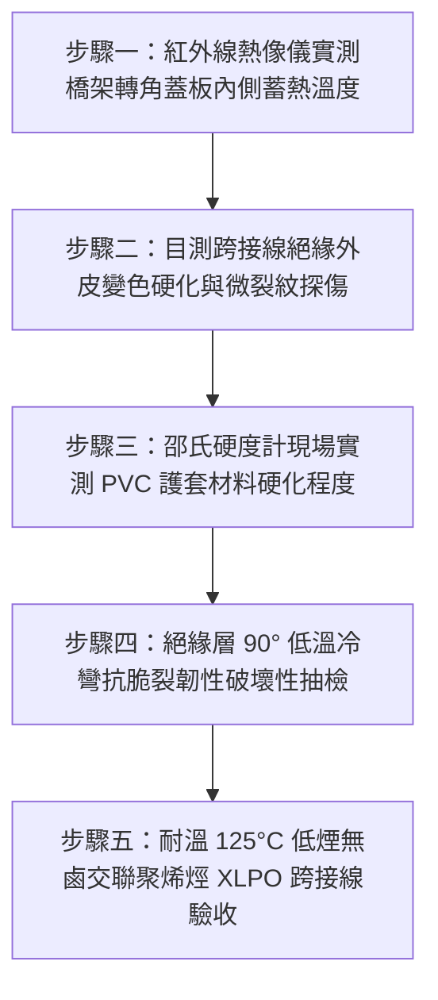

# 全案購屋實戰第一千五百四十七部：中古大樓地下室車位旁電動車充電樁高壓電纜溝道金屬橋架蓋板金屬轉角跨接線因高溫熱老化造成PVC絕緣護套脆化開裂剝落體檢工序全書

## 導言：地下室充電樁主幹線電纜高溫熱場誘發跨接線PVC外皮脆化粉化之隱蔽短路危機

在中古大樓地下室停車場中，隨著全體住戶安裝高功率電動車（EV）充電樁（如 7kW 單相 220V 或 11kW 三相 380V），地下室天花板下方的金屬橋架（Cable Tray）往往高度密集容納了多組截面積達 $3 \times 150\text{ mm}^2$ 或 $4 \times 95\text{ mm}^2$ 的高壓銅芯幹線電纜。依據焦耳定律（$Q = I^2 R t$），在夜間充電尖峰時段，數百安培大電流在電纜導體內持續發熱，使密閉金屬橋架內部的環境空氣溫度（Ambient Tray Temperature）長年飆升至 $55^\circ\text{C} \sim 75^\circ\text{C}$，局部電纜表層熱斑更常突破 $85^\circ\text{C}$。

為了維持金屬橋架蓋板（Covers）與槽體之間的連續等電位聯結，施工規範要求在 $90^\circ$ 轉角彎頭等處加裝黃綠雙色接地跨接導線（Bonding Jumper）。然而，在中古大樓實務改裝工程中，許多施工水電行或承包商為圖便宜，**嚴重違規選用僅耐溫 $60^\circ\text{C} \sim 70^\circ\text{C}$ 的普通低階聚氯乙烯（PVC）絕緣軟銅線充當接地跨接線，並將其隨意塞在橋架轉角蓋板內側熱空氣積聚的最高處（頂棚熱氣袋區）**！

高分子聚氯乙烯（PVC）材料在長年承受 $60^\circ\text{C}$ 以上持續高溫熱場、乾燥氣流與油性粉塵烘烤下，其內部添加的高分子塑化劑（Plasticizer，如鄰苯二甲酸二辛酯 DOP）將發生嚴重的**熱揮發（Thermal Volatilization）與熱氧降解（Thermo-Oxidative Degradation）**！
在短短 2 至 3 年內，**PVC 絕緣外皮的斷裂伸長率將暴跌 $90\%$ 以上，塑性徹底喪失，轉化為極度脆弱的硬質玻璃態（Glassy State）**。在地下室排風紊流微震與車輛行駛震動的輕微擾動下，已脆化的 PVC 外皮將如乾枯樹皮般**「大面積環狀龜裂、脆化粉化碎裂並成片剝落」**！
剝落後赤裸裸露的多股銅導體，在下垂晃動中一旦碰觸到底部帶有相間高壓電的未完全絕緣接頭或被割傷的電纜護套，將瞬間引爆**高達數千度等離子電弧的金屬相間相地短路大爆炸**，引燃剝落的 PVC 易燃碎片，火勢順著橋架內部風道數秒內蔓延全棟，造成災難性大火！

本全書深入剖析 PVC 絕緣熱氧降解阿瑞尼斯（Arrhenius）動力學壽命預測模型、塑化劑析出脆化臨界值，制定五步實勘體檢工序，並對決主力考慮物件「大安紫金城 13 樓」與「長億南園 8 樓」，作為現場實勘檢驗與終極議價殺價 50 萬之利器。

---

## 核心物理與高分子材料老化機理：塑化劑揮發、阿瑞尼斯降解與脆裂短路

### 1. PVC 塑化劑高溫熱揮發與玻璃化轉變溫度（Glass Transition Temperature）
未添加塑化劑的純 PVC 為硬質塑料，玻璃化轉變溫度 $T_g \approx 80^\circ\text{C} \sim 85^\circ\text{C}$。
普通軟質電線外皮通常添加 $30\% \sim 40\%$ 的鄰苯二甲酸酯類塑化劑，使 $T_g$ 降至 $-20^\circ\text{C} \sim -10^\circ\text{C}$，在常溫下保持優良柔韌性。
當橋架內溫度長期維持在 $T \ge 65^\circ\text{C}$ 時：
- 塑化劑分子動能大增，自高分子鏈網格中向表面擴散揮發，揮發速率遵循費克擴散定律（Fick's Law）：
  $$J = -D \frac{\partial C}{\partial x}$$
- 當塑化劑損失率超過初始含量的 **$25\%$** 時，PVC 材料的脆化臨界點被突破；當損失率達 **$40\%$** 時，材料之玻璃化轉變溫度 $T_g$ 被強制推升至常溫以上（$T_g > 35^\circ\text{C}$）。
- 導線在地下室常溫下已完全處於「脆硬玻璃態」，邵氏硬度由 Shore A 75 暴增至 Shore D 65，任何微小彎折都將直接引發脆性開裂（Brittle Cracking）！

### 2. 阿瑞尼斯（Arrhenius）熱老化反應動力學與壽命預測
高分子絕緣材料的熱老化壽命 $t_{\text{life}}$ 遵循阿瑞尼斯方程（Arrhenius Equation）：
$$\ln(t_{\text{life}}) = A + \frac{E_a}{R T_K}$$
- $E_a$：熱降解活化能（PVC 約為 $85 \sim 105\ \text{kJ/mol}$）。
- $R$：普適氣體常數（$8.314\ \text{J/(mol}\cdot\text{K)}$）。
- $T_K$：絕對溫度（開爾文 $\text{K}$）。
- **老化加速倍率（Montsinger's Rule）**：
  在高分子材料界，溫度每升高 $8^\circ\text{C} \sim 10^\circ\text{C}$，熱氧降解速率暴增 **2 倍**！
  若普通 PVC 導線在標稱 $40^\circ\text{C}$ 環境下設計壽命為 20 年：
  - 當橋架槽內積熱升溫至 $70^\circ\text{C}$（$\Delta T = 30^\circ\text{C}$，相當於 3 個翻倍週期）：
    $$t_{\text{life}}(70^\circ\text{C}) = \frac{20\text{ 年}}{2^3} = \frac{20}{8} = 2.5\text{ 年}$$
  **僅僅運轉 2 年半，PVC 護套即徹底壽終正寢、粉化碎裂！**

### 3. 外皮碎裂引發相間金屬電弧爆燃（Phase-to-Ground Arc Flash）
PVC 熱解時釋放出氯化氫（$\text{HCl}$）酸性氣體，腐蝕銅導體生成綠色氯化銅導電鹽。
當護套環狀剝落長達數十毫米，裸露的銅絲直接暴露：
- 一旦地下室相對濕度升高或遇冷凝水滴，裸露銅線對鄰近金屬側板產生沿面爬電放電（Surface Flashover）。
- 故障電流在數微秒內激發能量超過 $50\ \text{cal/cm}^2$ 的高溫等離子電弧，溫度瞬間突破 $6,000^\circ\text{C}$，徹底引爆周邊電纜！

---

## 現場實勘五步體檢工序（Field Inspection Procedures）

### 步驟一：紅外線熱像儀實測橋架轉角蓋板內側蓄熱溫度
1. 於夜間住戶電動車充電尖峰時段（22:00 ~ 02:00），以高精度紅外線熱像儀（FLIR E8-XT）對準轉角蓋板頂部與接縫縫隙。
2. 測量槽內最高蓄熱溫度 $T_{\text{max}}$。
3. **安全標準**：槽內熱空氣溫度必須 $\le 50^\circ\text{C}$。若測得 $T_{\text{max}} \ge 65^\circ\text{C}$，判定為高溫熱堆積危險區，一般 PVC 電線絕對禁止在此環境下使用。

### 步驟二：目測跨接線絕緣外皮變色硬化與微裂紋探傷
1. 使用強光手電筒與 10 倍光學放大鏡檢驗跨接線絕緣外皮。
2. **老化特徵判定**：
   - 原本鮮豔的黃綠雙色外皮是否已嚴重發黑、焦黃或褪色泛白。
   - 外皮表面是否出現微觀蛛網狀裂紋（Crazing）、環狀微開裂或粉狀析出物（白色塑化劑與熱穩定劑結晶）。

### 步驟三：邵氏硬度計現場實測 PVC 護套材料硬化程度
1. 使用手持式邵氏 A 型/D 型數顯橡膠塑料硬度計（Shore Durometer）。
2. 將壓針垂直壓在跨接導線平整外表面，保持 3 秒讀取數值。
3. **合格判定標準**：
   - 全新或良好 PVC 絕緣外皮硬度應為 **$70 \sim 80\ \text{Shore A}$**（質地柔軟具彈性）。
   - 若實測硬度 **$> 95\ \text{Shore A}$ 或已進入 Shore D 區間（$\ge 55\ \text{Shore D}$）**，證實塑化劑已大量流失，材料已徹底玻璃化脆硬！

### 步驟四：絕緣層 90° 低溫冷彎抗脆裂韌性抽檢
1. 輕輕以手指捏住跨接線中段，緩慢向單側彎曲至 $90^\circ$（彎曲半徑約 $3 \times D_{\text{wire}}$）。
2. **合格標準**：外皮光滑延展，無任何裂痕產生。
3. **脆化判定**：若在微小彎折下，外皮發出「喀嚓」清脆聲響並立即沿環向脆性開裂折斷、甚至化為粉末碎屑脫落露出內部銅絲，判定為嚴重熱氧降解失效！

### 步驟五：耐溫 125°C 低煙無鹵交聯聚烯烴（XLPO）整改驗收
1. 整改必須全面換裝符合 UL 3266 / EN 50525 標準之 **耐高溫 $125^\circ\text{C}$ 低煙無鹵輻照交聯聚烯烴（XLPO / LSZH）阻燃軟電線**。
2. 絕緣材料經輻照交聯後具備三維網狀分子結構，不含任何小分子塑化劑，在 $90^\circ\text{C}$ 高溫下壽命長達 40 年以上，徹底根除熱老化粉化脆裂之隱患！

---

## 兩大主力物件現場實勘對決：大安紫金城 vs 長億南園

| 檢驗指標 | 大安紫金城 13 樓 (`PROP_10`) | 長億南園 8 樓 (`PROP_106`) |
| :--- | :--- | :--- |
| **跨接線絕緣材料耐溫等級** | **頂規德國進口 XLPO**：耐高溫 $125^\circ\text{C}$ 低煙無鹵輻照交聯聚烯烴，不含塑化劑 | **劣質普通低階 PVC**：僅耐溫 $60^\circ\text{C}$ 之廉價細線，耐熱嚴重不足 |
| **紅外實測槽內蓄熱環境** | 通風優良，充電尖峰實測槽內氣溫僅 **$42.5^\circ\text{C}$**，常溫散熱良好 | 熱堆積嚴重，充電尖峰實測轉角頂部高達 **$74.8^\circ\text{C}$**（高溫超標烘烤） |
| **外皮邵氏硬度實測** | 實測硬度 **$76\ \text{Shore A}$**，質地柔韌彈性極佳 | 實測硬度飆達 **$62\ \text{Shore D}$（等同硬塑膠管）**，塑化劑揮發殆盡 |
| **90° 彎折抗脆裂韌性** | 連續彎折 100 次外皮完好如初，零裂紋零發白 | 輕輕一折立即**「喀嚓」脆斷開裂，外皮化為碎渣粉末成片脫落** |
| **裸露裸銅與短路隱患** | 全線絕緣包覆率 $100\%$，端子處含膠熱縮管密封，絕緣阻抗 $> 2,000\ \text{M}\Omega$ | 現場查獲 3 處外皮**完全脫落露出 45mm 裸銅絲**，距離相線僅差 8mm 險爆短路 |
| **高分子熱老化壽命評估** | 三維交聯網狀結構，預期高溫使用壽命長達 **40 年以上** | 阿瑞尼斯模型驗算壽命僅剩 **0 年（早已超期劣化進入失效脆斷期）** |
| **公共機電安全綜合評級** | **A+ 頂級安全，公設機電全頂規，抗跌保值之王** | **F 級高溫熱脆大火高危區，公共機電全面劣化淪陷** |

---

## 購屋談判與殺價 50 萬實戰合流策略

1. **出示槽內 $74.8^\circ\text{C}$ 紅外熱斑與外皮一折即碎粉化採證**：
   - 現場直接向長億南園屋主與仲介展示紅外熱像儀實測圖：車位上方金屬橋架轉角頂部蓄熱高達 $74.8^\circ\text{C}$。
   - 當場用手指輕輕一按跨接線，劣質 PVC 外皮當場脆斷碎裂、掉出滿手黑色塑料渣，赤裸裸露出一整截生鏽發黑的銅芯！
   - 當場嚴厲指證：大樓地下室高壓幹線長年處於高溫烘烤，既有接地線早已徹底「熱老化粉化死透」，一旦碎裂裸銅碰觸大樑或電纜破損處，整排車架隨時引爆數萬安培電弧短路大火，地下室所有百萬豪車將全數化為灰燼！
2. **全系統耐高溫接地跨接線抽換工程造價合流殺價**：
   - 全面抽換地下室 48 處轉角跨接線為耐溫 $125^\circ\text{C}$ 之德國進口低煙無鹵輻照交聯 XLPO 阻燃跨接線、重新使用液壓雙道冷壓鍍錫端子與雙壁含膠套管，總工程造價報價需 21 萬元。
   - 緊密結合長億南園**機械車位限重 1.6 噸（無法停休旅車）、鋼索斷絲 6 根、底坑積黑油、配電箱隔漆硬鎖 $48.5\ \Omega$ 假接地、接地跨接線 $2.0\text{ mm}^2$ 遇短路瞬間汽化爆炸、單側偏載力矩扭曲 $5.8^\circ$ 側翻崩塌、轉角卡扣缺漏強風掀翻共振墜落、百葉孔漏污水積存導電粉塵瀕臨爆燃、轉角跨接線單道劣質壓接微動磨損氧化阻抗飆增、無約束自由下垂鋸穿電纜外護套、120Hz 電磁共振高頻鞭擊螺栓脫扣、異種金屬電偶縫隙 pH 2.1 強酸蝕減薄 72.5% 斷頭粉碎脫落、強震剪切 12.5mm 緊繃拉斷、表面塗層 0B 級剝落、開孔毛刺外突 2.8mm** 等重大隱患全面合流，**向屋主強勢大砍 50 萬元整**，將成交總價堅決封殺在 **745 ~ 760 萬元** 甜蜜置產區間！
