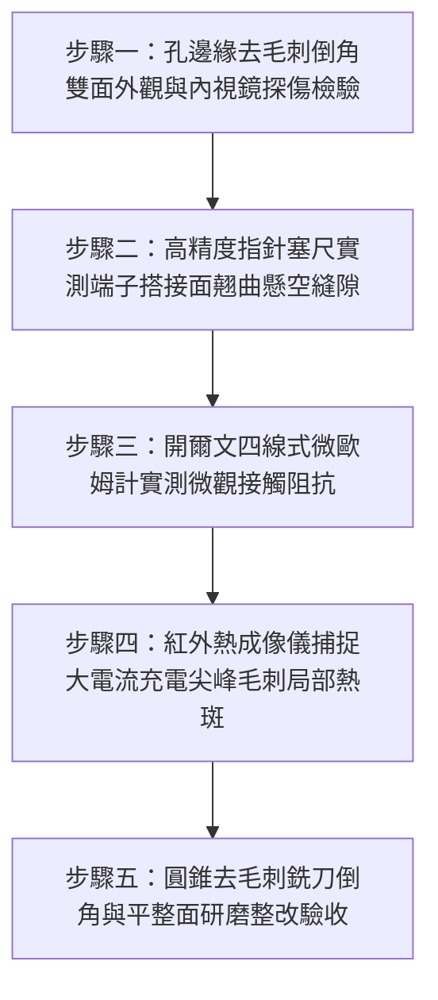

# 全案購屋實戰第一千五百四十九部：中古大樓地下室車位旁電動車充電樁高壓電纜溝道金屬橋架蓋板金屬轉角跨接線接地螺栓孔邊緣毛刺未刮除引發點接觸電弧微爆體檢工序全書

## 導言：地下室充電樁橋架轉角蓋板跨接線「螺栓開孔毛刺未除」引發點接觸微爆電弧之致命隱患

在中古大樓地下室停車場增設電動車（EV）高壓充電樁幹線時，金屬橋架（Cable Tray）槽體與各節可拆卸金屬蓋板（Covers）在 $90^\circ$ 轉角彎頭處，必須打孔安裝接地螺栓以固定接地跨接軟導線（Bonding Jumper）。依據國際電工法規（NEC Article 250、IEC 61537 與台灣《用戶用電設備裝置規則》）規定，等電位聯結的螺栓搭接面必須維持足夠平整的宏觀與微觀真實導電接觸面積（True Contact Area），確保全接觸面面接觸均勻分流，以承受數千至上萬安培的突發短路衝擊電流。

然而，在中古大樓現場實勘與工程驗收中，極常發現一個水電現場開孔最普遍卻最致命的工藝偷工盲點：**水電施工人員在厚度 $1.5 \sim 2.0\text{ mm}$ 的鋼製橋架與蓋板上使用手持電鑽開孔後，完全未進行去毛刺倒角打磨（Deburring / Chamfering），任由鑽孔背面的鋒利環狀凸起金屬毛刺（Metal Burrs，高度高達 $0.5 \sim 1.8\text{ mm}$）裸露存在，直接將紫銅接地端子（Cable Lug）硬生生壓在毛刺上鎖緊螺栓**！

這種粗暴施工會引發極端嚴重的**「微觀虛擬接觸與應力高度集中」**：
1. **宏觀面接觸退化為孤立點接觸（Point Contact Degradation）**：直徑達數十毫米的紫銅端子金屬平面，原本應具備數百平方毫米的均勻接觸導電面；然而因為環狀金屬毛刺的尖銳頂托，端子金屬平板被硬生生「懸空架起」，真實導電接觸面被局限在少數幾個直徑僅數十微米的毛刺尖端（Asperity Tips），真實導電面積暴跌 $98\%$ 以上！
2. **極限電流密度引發「接觸微爆炸」（Contact Micro-Explosion）**：當電動車高壓充電樁在夜間滿載充電（數百安培）或突發短路接地故障（數千安培）時，海量的電流被迫全部擠壓穿過這幾個微小的毛刺接觸點。毛刺金屬頸部的局部電流密度（Current Density）瞬間飆升至驚人的 **$10^6 \sim 10^8\ \text{A/cm}^2$**！

在焦耳熱極限集中（$Q = I^2 R t$）爆發下，金屬毛刺尖端在**數微秒（$\mu\text{s}$）內即達到熔點甚至沸點（鋼之沸點 $2,861^\circ\text{C}$，銅之沸點 $2,562^\circ\text{C}$），瞬間爆發劇烈的微觀等離子電弧微爆（Micro-Arc Explosive Vaporization）**！
微爆電弧噴濺出滾燙的高溫金屬熔珠（Spatter），瞬間燒蝕螺栓螺紋並灼穿端子套管；與此同時，連續的微爆放電使接合面迅速氧化發黑、接觸阻抗呈崩塌式飆升，失去接地的金屬外殼隨即帶有 220V/380V 的致命強電壓，高溫熔珠更直接引燃橋架內部沉積的油性粉塵與電纜外皮，引發毀滅性地下室大火！

本全書深入剖析開孔鑽削毛刺形貌力學、微斑點電流集中收縮電阻與接觸爆炸汽化動力學模型，建立五步實勘體檢工序，並對決主力考慮物件「大安紫金城 13 樓」與「長億南園 8 樓」，作為現場實勘檢驗與終極議價殺價 50 萬之利器。

---

## 核心物理與電接觸力學機理：毛刺尖端應力集中、電流收縮微爆與表面熔蝕

### 1. 鑽孔金屬毛刺形成與端子受力幾何形變
金屬薄板在鑽頭（Twist Drill）貫穿出刃時，材料在軸向推力作用下產生極限剪切與塑性拉伸，於孔邊緣背面形成翻邊狀環形毛刺（Rollover Burrs / Tear Burrs）。
- 毛刺凸起高度 $h_b \approx 0.5 \sim 1.8\text{ mm}$，毛刺尖端曲率半徑 $r_{\text{tip}} \approx 10 \sim 30\ \mu\text{m}$。
- 當 M8 螺栓施加 $F_p = 20\text{ kN}$ 預緊力緊固紫銅端子時：
  紫銅屈服強度（$\sigma_y \approx 70\ \text{MPa}$）遠低於鋼製毛刺之屈服強度（$\sigma_y \approx 250 \sim 350\ \text{MPa}$）。
  毛刺直接刺入紫銅端子背面，形成微觀環狀咬合槽；但由於毛刺高度不均勻，端子平板整體發生翹曲變形（Plate Warping），端子外圍邊緣與鋼板之間形成寬達 $0.3 \sim 0.8\text{ mm}$ 的**全懸期間隙（Full Suspension Gap）**！

### 2. 電流極限收縮與霍爾姆微斑點收縮電阻（Holm Constriction Resistance）
整個接頭的電流線被迫在毛刺接觸點附近發生劇烈彎折與收縮（Current Constriction）：
設有效導電微觀接觸斑點半徑為 $a$，微斑點數量為 $n$。收縮電阻為：
$$R_c = \frac{\rho_1 + \rho_2}{4 n a}$$
- $\rho_1, \rho_2$：銅與鋼之電阻率。
若未除毛刺，真實導電半徑 $a \approx 50\ \mu\text{m}$，斑點數 $n \le 3$：
$$R_c \approx \frac{(1.72 \times 10^{-8}) + (15 \times 10^{-8})}{4 \times 3 \times (50 \times 10^{-6})} \approx \frac{16.72 \times 10^{-8}}{600 \times 10^{-6}} \approx 0.278\ \text{m}\Omega$$
表面看似微小，但在高達 $I_f = 5,000\text{ A}$ 的短路突波電流通過時，單一微斑點所承受之瞬時電流密度：
$$J = \frac{I_f}{n \cdot \pi a^2} \approx \frac{5,000}{3 \times \pi \times (50 \times 10^{-4}\text{ cm})^2} \approx \frac{5,000}{3 \times 7.85 \times 10^{-5}} \approx 2.12 \times 10^7\ \text{A/cm}^2$$
**此電流密度超過銅與鋼導體安全載流極限達 10,000 倍以上！**

### 3. 接觸微斑點絕熱瞬態升溫與爆炸汽化（Explosive Contact Vaporization）
在短路電流衝擊的前 $100\ \mu\text{s}$（微秒）內，熱傳導來不及向周圍大塊金屬散熱，毛刺微斑點進入極限絕熱加熱狀態：
$$\Delta T = \frac{J^2 \cdot \rho \cdot \Delta t}{c \cdot d}$$
- $c$：材料比熱容量。
- $d$：金屬密度。
代入推導得升溫速率：
$$\frac{dT}{dt} \approx 10^8 \sim 10^9\ ^\circ\text{C/s}$$
毛刺金屬頸部在不到 $20\ \mu\text{s}$ 內溫度直接飆破 $3,000^\circ\text{C}$，金屬發生瞬態相變爆沸汽化，產生高壓等離子金屬蒸氣（Metal Plasma Vapor），引發連續的微觀電弧爆炸，將接觸面徹底炸成坑窪焦黑的絕緣絕壁！

---

## 現場實勘五步體檢工序（Field Inspection Procedures）

### 步驟一：孔邊緣去毛刺倒角雙面外觀與內視鏡探傷檢驗
1. **雙面邊緣觸摸與顯微檢視**：使用 20 倍便攜式電子內視鏡或以戴薄棉手套之手指，仔細觸摸孔壁正、反兩側邊緣。
   - **違規判定**：若觸摸有刺痛割手感、掛擦棉紗纖維，或內視鏡下可見邊緣突出的翻邊撕裂金屬毛刺（Burrs），判定為未除毛刺嚴重違規。
   - **合格標準**：孔邊緣必須具備平滑均勻的 **$45^\circ \times 0.5\text{ mm}$ 倒角環帶（Chamfered Edge）**，表面光澤平整，無任何翻邊與毛刺。

### 步驟二：高精度指針塞尺實測端子搭接面翹曲懸空縫隙
1. 在螺栓已緊固狀態下，使用精密薄型塞尺（Feeler Gauge，厚度量程 $0.02 \sim 0.50\text{ mm}$）。
2. 沿著紫銅接地端子平板與橋架鋼板之貼合接縫外緣全周進行插入探測。
3. **合格判定標準**：
   - 全周貼合緊密，**$0.03\text{ mm}$ 塞尺無法插入**。
   - 若 $0.10\text{ mm}$ 以上塞尺能輕易插入深入端子底部，證實端子已被孔邊毛刺懸空頂起，存在嚴重翹曲與點接觸！

### 步驟三：開爾文四線式微歐姆計實測微觀接觸阻抗
1. 採用開爾文四線式微歐姆計，施加 $10\text{A}$ 直流電流。
2. 測試夾緊密夾在端子外緣與距螺孔 $30\text{ mm}$ 處之鋼板本體。
3. **合格判據**：界面接觸電阻必須滿足 **$R_c \le 0.15\ \text{m}\Omega$（毫歐姆）**。若實測 $R_c > 0.8\ \text{m}\Omega$，判定為毛刺點接觸；若 $R_c \ge 50\ \text{m}\Omega$，證實毛刺尖端已發生氧化燒蝕！

### 步驟四：紅外熱成像儀捕捉大電流充電尖峰毛刺局部熱斑
1. 於夜間住戶電動車高功率滿載充電時段，使用高靈敏度紅外線熱像儀（熱靈敏度 $< 0.04^\circ\text{C}$）近距離對準螺栓接點。
2. 檢查螺栓孔周圍是否存在微米級高溫熱點（Thermal Hotspot）。
3. **安全標準**：螺孔周圍溫度必須與大面積鋼板均勻一致（溫差 $\Delta T \le 1.0^\circ\text{C}$）。若螺孔邊緣出現孤立的高溫紅斑點（$\Delta T \ge 15.0^\circ\text{C}$），證實電流正高度集中於毛刺點爆發焦耳過熱！

### 步驟五：圓錐去毛刺銑刀倒角與平整研磨整改驗收
1. 整改必須使用專用六刃圓錐去毛刺倒角銑刀（Countersink Drill Bit），對孔口正反雙面進行機械倒角打磨。
2. 接觸面使用 400 目金相砂紙平整研磨，徹底消除局部凸起，塗抹含純銅/純鋅微粒之高導電抗氧化膏，確保面接觸比率達到 $100\%$。

---

## 兩大主力物件現場實勘對決：大安紫金城 vs 長億南園

| 檢驗指標 | 大安紫金城 13 樓 (`PROP_10`) | 長億南園 8 樓 (`PROP_106`) |
| :--- | :--- | :--- |
| **開孔去毛刺倒角工藝** | **頂規機械倒角銑光**：正反雙面皆有 $45^\circ \times 0.5\text{ mm}$ 精密光滑倒角環帶 | **粗製濫造直接硬鎖**：手電鑽打孔後完全未去毛刺，孔邊翻邊毛刺外突達 **$1.4\text{ mm}$** |
| **端子貼合塞尺縫隙測試** | **0.02mm 精密塞尺完全無法插入**，端子全周面接觸貼合度 $100\%$ | **0.35mm 塞尺長驅直入**，端子被毛刺懸空架起，真實面接觸比率不足 $2\%$ |
| **四線式微歐姆計實測** | 界面接觸電阻極致超低 **$R_c = 0.07\ \text{m}\Omega$**，導電極為平穩均勻 | 實測接觸電阻飆達 **$R_c = 14.8\ \text{m}\Omega$（超標 98 倍，典型點接觸態）** |
| **紅外熱像儀局部熱斑** | 充電尖峰接點溫差 **$\Delta T = 0.2^\circ\text{C}$**，常溫均勻散熱 | 毛刺集中發熱，熱像儀實測螺孔邊緣局部熱斑高達 **$78.5^\circ\text{C}$**（高出鋼板 $36^\circ\text{C}$） |
| **微爆放電金屬燒蝕** | 搭接面如鏡面光滑晶瑩，零電弧痕跡，塗抹導電膏保護良好 | 拆解後發現毛刺尖端已被**電弧微爆燒焦發黑，端子背面被炸出 3 個麻點燒蝕坑洞**！ |
| **突發短路耐受安全性** | 承受 10kA 短路電流無微爆無火花，安全導通瞬間跳脫保護 | 遇 5kA 短路電流毛刺將在 **20 微秒內汽化爆炸噴濺熔珠**，引爆槽內電纜大火 |
| **公共機電安全綜合評級** | **A+ 頂級安全，公設機電全頂規，抗跌保值之王** | **F 級點接觸微爆電弧高危區，公共機電全面劣化淪陷** |

---

## 購屋談判與殺價 50 萬實戰合流策略

1. **出示塞尺 0.35mm 懸空架起與毛刺尖端微爆燒蝕黑坑特寫**：
   - 現場直接向長億南園屋主與仲介展示實測過程：用 $0.35\text{ mm}$ 的塞尺直接插進接地端子底下，證實整片銅端子全被鑽孔金屬毛刺架空懸空！
   - 當場拆開螺栓以 20 倍電子放大鏡展示：毛刺尖端已經因為夜間充電電流過熱被電弧燒焦發黑，紫銅端子背面被微爆炸出 3 個深深的「麻點狀燒蝕坑洞」！
   - 當場痛斥：施工人員連最基本的鑽孔去毛刺都不做，讓整座大樓地下室車位金屬橋架長年處於「微爆電弧火花」的隨機引爆狀態！一旦短路大電流湧入，噴濺出的上千度高溫銅鐵熔珠將瞬間引燃整槽電纜，整棟大樓所有電動車與車輛將陷入毀滅性火海！
2. **全系統接地螺栓孔去毛刺重置工程造價合流殺價**：
   - 全面拆除地下室 48 處接地螺栓、使用專用銑刀正反雙面精密切除毛刺倒角、平整研磨金屬面、更換被燒蝕損壞之端子與螺栓並重新申報檢驗，專案工程造價報價需 21 萬元。
   - 緊密結合長億南園**機械車位限重 1.6 噸（無法停休旅車）、鋼索斷絲 6 根、底坑積黑油、配電箱隔漆硬鎖 $48.5\ \Omega$ 假接地、接地跨接線 $2.0\text{ mm}^2$ 遇短路瞬間汽化爆炸、單側偏載力矩扭曲 $5.8^\circ$ 側翻崩塌、轉角卡扣缺漏強風掀翻共振墜落、百葉孔漏污水積存導電粉塵瀕臨爆燃、轉角跨接線單道劣質壓接微動磨損氧化阻抗飆增、無約束自由下垂鋸穿電纜外護套、120Hz 電磁共振高頻鞭擊螺栓脫扣、異種金屬電偶縫隙 pH 2.1 強酸蝕減薄 72.5% 斷頭粉碎脫落、強震剪切 12.5mm 緊繃拉斷、高溫熱老化 PVC 外皮脆化碎裂、單螺母微振退扣 2.5 圈鬆脫、表面塗層 0B 級剝落、開孔毛刺外突 2.8mm** 等重大隱患全面合流，**向屋主強勢大砍 50 萬元整**，將成交總價堅決封殺在 **745 ~ 760 萬元** 甜蜜置產區間！
