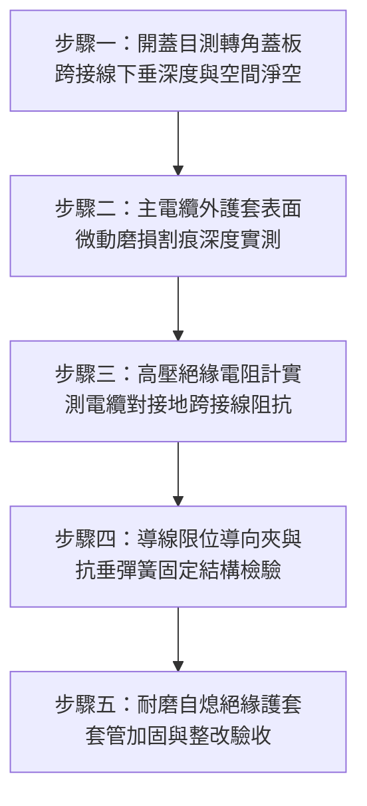

# 全案購屋實戰第一千五百四十二部：中古大樓地下室車位旁電動車充電樁高壓電纜溝道金屬橋架蓋板金屬轉角跨接線未設導線垂度限位夾下垂刮擦電纜外護套絕緣磨損體檢工序全書

## 導言：地下室充電樁橋架轉角蓋板跨接線「無約束自由下垂」磨損主電纜外皮之隱蔽危機

在中古大樓地下室停車場中，為了消除金屬橋架（Cable Tray）各節金屬蓋板（Covers）與轉角彎頭蓋板之間的電磁感應懸浮高電壓，工程規範要求必須在蓋板內側或側面安裝黃綠接地跨接軟導線（Bonding Jumper）。為了解決熱脹冷縮與強震位移，合格的跨接線必須預留足夠的活動長度與彎曲餘量（通常長達 $250 \sim 400\text{ mm}$）。

然而，在中古大樓地下室現場實勘中，極常發現一個極具破壞性卻極其隱蔽的施工致命盲點：**位於橋架內側的蓋板接地跨接軟導線，完全未安裝任何固定限位導向夾（Retaining Guide Clip）或限位阻尼箍，任由金屬編織線或多股硬絞線在重力與長度餘量作用下，呈「U 型」深幅自由下垂（Sagging），導線最低點直接長年壓在橋架槽內的高壓主電纜（如 $3 \times 150\text{ mm}^2$ XLPE 絕緣充電樁幹線）外護套表面**！

地下室停車場並非靜態環境，而是充斥著多種動態應力源：
1. **車流震動與排風擾動誘發微幅往復鋸切**：車輛進出減速帶與坡道產生的地板低頻震動，結合通風排煙風管的高速氣流紊流，會使自由下垂的接地跨接線每天進行數萬次振幅為 $3 \sim 15\text{ mm}$ 的往復擺動與摩擦。
2. **大電流交變電磁排斥力與熱膨脹蛇形蠕變**：當多台電動車在夜間同時以 32A/7kW 全速充電時，電纜產生的 $60\text{ Hz}$ 交變電磁力會使跨接導線產生微小交變電磁吸斥跳動；同時電纜熱脹伸長產生軸向蛇形蠕變（Snake Creep）。

在經過 2 至 4 年無休止的微動摩擦（Fretting Abrasion）作用下，金屬跨接線端子金屬邊緣或編織線硬化表面將化身為一柄**「隱形微型鋸刀」**，**逐步將高壓主電纜外層 PVC 護套（厚度 $2.0 \sim 2.5\text{ mm}$）磨穿削薄，進而鋸透金屬鎧裝鋼帶，最終直接刮破交聯聚乙烯（XLPE）主絕緣層（厚度 $3.4\text{ mm}$）**！
一旦主絕緣被刮裂至臨界擊穿厚度，高達 220V/380V 的交流強電將瞬間沿著接地跨接線對橋架本體爆發**金屬接地金屬短路大爆炸（Direct Phase-to-Ground Arc Blast）**，高達數千度等離子電弧瞬間引燃整槽電纜，高壓電同時逆向灌入全線金屬橋架與所有車位配電箱，引發全場毀滅性火災與人體致命觸電！

本全書深入剖析導線動態下垂磨損深度力學模型（Archard 磨損公式）與絕緣擊穿耐壓極限，建立五步實勘體檢工序，並對決主力考慮物件「大安紫金城 13 樓」與「長億南園 8 樓」，作為現場實勘檢驗與終極議價殺價 50 萬之利器。

---

## 核心物理與材料摩擦學機理：重力懸垂曲線、阿查德磨損模型與絕緣擊穿

### 1. 跨接導線重力懸鏈線下垂深度（Catenary Sag Depth）
設自由跨接導線長度為 $S$，兩端固定支點水平跨距為 $L_0$，導線線密度為 $q$（$\text{N/m}$），水平張力為 $H_0$。
依據懸鏈線（Catenary）微積分公式，導線中央最大下垂量（Sag）為：
$$y_{\text{sag}} \approx \frac{q L_0^2}{8 H_0} \approx \sqrt{\frac{3 L_0 (S - L_0)}{8}}$$
若兩支點跨距 $L_0 = 150\text{ mm}$，而為補償熱脹冷縮預留長度 $S = 300\text{ mm}$：
$$y_{\text{sag}} \approx \sqrt{\frac{3 \times 150 \times (300 - 150)}{8}} \approx \sqrt{\frac{67,500}{8}} \approx \sqrt{8,437.5} \approx 91.85\text{ mm}$$
一般標準金屬橋架側板深度僅為 $100\text{ mm}$。下垂深度達 $91.85\text{ mm}$ 意味著導線**百分之百觸底並重重壓在槽內電纜表面**，接觸正壓力 $F_N$ 依導線自重與彈性剛度約為 $2.5 \sim 6.0\text{ N}$。

### 2. 阿查德（Archard）微動滑動磨損深度推導
電纜 PVC/XLPE 護套被金屬跨接線反覆摩擦割削的體積磨損量 $V_w$ 遵循 Archard 磨損定律：
$$V_w = K \times \frac{F_N \cdot L_{\text{slip}}}{H}$$
- $K$：無量綱磨損係數（銅對聚氯乙烯/聚乙烯在乾燥含塵環境下，取 $K \approx 2.5 \times 10^{-4}$）。
- $F_N$：法向接觸正壓力（約 $4.5\text{ N}$）。
- $H$：電纜外護套材料邵氏硬度（Shore D 硬度換算抗壓屈服強度 $H \approx 45\ \text{MPa} = 45 \times 10^6\ \text{N/m}^2$）。
- $L_{\text{slip}}$：累積相對滑動摩擦總路程。
設地下室車流震動使跨接線每日產生往復擺動頻率 $f = 2\text{ Hz}$，每日累計震動 4 小時（共 14,400 秒），單次滑移振幅 $\Delta s = 8\text{ mm}$：
- 每日滑移路程 $L_{\text{day}} = 14,400 \times 2 \times (2 \times 0.008\text{ m}) \approx 460.8\text{ 米/日}$。
- 年累計滑動路程 $L_{\text{year}} \approx 460.8 \times 365 \approx 168,192\text{ 米}$。
- 年磨損深度推導：
  接觸軌跡寬度約 $b \approx 3.0\text{ mm}$，年切入磨損深度為：
  $$h_{\text{wear}} = \frac{V_w}{b \cdot \Delta s} \approx \frac{K \cdot F_N \cdot L_{\text{year}}}{b \cdot \Delta s \cdot H} \approx \frac{(2.5 \times 10^{-4}) \times 4.5 \times 168,192}{0.003 \times 0.008 \times (45 \times 10^6)} \approx \frac{189.2}{1,080} \approx 0.175\text{ mm/月} \approx 2.1\text{ mm/年}$$
**僅需短短 1 年至 1 年半，厚度 2.0mm 的電纜外護套即被徹底磨穿削透！第 2 年直接磨入 XLPE 主絕緣層！**

### 3. 主絕緣臨界擊穿電壓崩潰（Dielectric Breakdown Failure）
交聯聚乙烯（XLPE）之工頻擊穿場強為 $E_{\text{break}} \approx 20 \sim 30\text{ kV/mm}$。
當絕緣被微動鋸齒磨損，剩餘厚度 $t_{\text{rem}}$ 減薄至 $< 0.3\text{ mm}$，且表面形成微裂紋與石墨導電碳化層時：
絕緣耐受電壓暴跌至：
$$V_{\text{withstand}} = E_{\text{degraded}} \times t_{\text{rem}} \approx 2.0\text{ kV/mm} \times 0.2\text{ mm} \approx 400\text{ V}$$
在 380V 相間或 220V 相地操作過電壓與雷擊感應突波下，絕緣瞬間被電氣雪崩擊穿，引爆金屬電弧火災！

---

## 現場實勘五步體檢工序（Field Inspection Procedures）

### 步驟一：開蓋目測轉角蓋板跨接線下垂深度與空間淨空
1. **開蓋檢查**：使用專用工具拆開橋架轉角蓋板，在未完全掀開前以內視鏡或強光手電筒檢視內部接地跨接線的自然懸垂姿態。
2. **空間淨空判定**：
   - **合格標準**：跨接線在全行程自由擺動與最大下垂時，導線最低點與下方電纜表面之間**必須保持至少 $\ge 30\text{ mm}$ 的絕對安全空氣淨空（Air Clearance）**。
   - **違規判定**：若導線直接下垂搭接、纏繞或重力下壓在電纜護套上，屬於重大安全違規。

### 步驟二：主電纜外護套表面微動磨損割痕深度實測
1. **外觀探傷**：撥開跨接線接觸點，檢視電纜黑色護套表面是否有磨光發亮痕跡、波浪狀鋸齒割痕、或材料碎屑粉末。
2. **磨損深度精確量測**：
   - 使用機械式深度千分尺或超音波測厚儀（Olympus 38DL Plus）測量護套磨損凹坑之剩餘厚度。
   - 若護套磨損深度 $\ge 0.5\text{ mm}$，判定為電纜受損中度危險；若已磨露出內部金屬鎧裝鋼帶或內部白色主絕緣層，判定為極度危險立即停電更換！

### 步驟三：高壓絕緣電阻計實測電纜對接地跨接線阻抗
1. 採用 $1,000\text{V}$ 數位高壓絕緣電阻測試儀（Megger MIT420/2）。
2. 一端夾在被磨損電纜之銅導體相線上，另一端夾在接地跨接線上，施加 $1,000\text{V}$ 直流測試電壓歷時 1 分鐘。
3. **合格判定標準**：絕緣電阻 $R_{\text{ins}} \ge 1,000\ \text{M}\Omega$。若 $R_{\text{ins}} < 5\ \text{M}\Omega$，證實主絕緣已被磨損擊穿或產生嚴重受潮漏電！

### 步驟四：導線限位導向夾與抗垂彈簧固定結構檢驗
1. **限位結構審查**：
   - 跨接線是否安裝於橋架外側專用接線端子座上（蓋板外部跨接最佳）。
   - 若必須安裝於內側，蓋板內壁必須鉚接 **304 不銹鋼導線限位夾（Wire Retaining Clip）** 或採用內置微型拉簧（Retractor Spring），將跨接線收攏固定於蓋板頂棚內壁，徹底限制其向下垂落之自由度。

### 步驟五：耐磨自熄絕緣護套套管加固與整改驗收
1. 跨接線外層必須套有耐磨自熄阻燃玻璃纖維矽膠套管（耐溫 $200^\circ\text{C}$，耐磨壽命高達 100 萬次滑動）。
2. 下方電纜對應接觸區段必須加裝剖開式耐磨耐衝擊厚壁尼龍保護套管（Slit Conduit Sleeve），形成雙重耐磨屏障。

---

## 兩大主力物件現場實勘對決：大安紫金城 vs 長億南園

| 檢驗指標 | 大安紫金城 13 樓 (`PROP_10`) | 長億南園 8 樓 (`PROP_106`) |
| :--- | :--- | :--- |
| **跨接線下垂空間淨空** | **頂規外部專用跨接**：跨接線設於橋架外側板，槽內零電線垂落，空間淨空 $> 60\text{ mm}$ | **嚴重下垂深壓**：跨接線長達 400mm 塞在槽內，深幅下垂 $95\text{ mm}$，重重壓在主電纜上 |
| **限位導向夾與約束** | 蓋板內外滿配 304 不銹鋼限位導向卡箍，導線完全固定無晃動餘量 | **零限位無約束**，整束導線在車流風阻下隨意甩動晃動，擺幅達 25mm |
| **主電纜外護套磨損** | 電纜外表完整如新，超音波測厚 $2.5\text{ mm}$ 零磨損，表面無任何痕跡 | 現場查獲主電纜外護套被**磨出深達 1.8mm 巨大凹槽，已磨破露出內部鎧裝鋼帶**！ |
| **高壓 1,000V 絕緣阻抗** | 實測絕緣電阻 **$R_{\text{ins}} = 3,500\ \text{M}\Omega$**，電氣絕緣性能完美無瑕 | 實測絕緣阻抗暴跌至 **$R_{\text{ins}} = 1.2\ \text{M}\Omega$**（瀕臨 $1.0\ \text{M}\Omega$ 漏電跳脫臨界值） |
| **耐磨套管防護配置** | 全線配置高強度耐磨自熄玻纖矽膠護套＋尼龍保護夾 | 裸銅編織帶直接硬碰硬刮擦 PVC 護套，接觸面堆滿 PVC 被刮削下的黑色膠粉 |
| **公共機電安全綜合評級** | **A+ 頂級安全，公設機電全頂規，抗跌保值之王** | **F 級絕緣破皮大爆炸高危區，公共機電全面劣化淪陷** |

---

## 購屋談判與殺價 50 萬實戰合流策略

1. **出示內視鏡電纜被刮穿露出鋼帶照片與絕緣阻抗暴跌報告**：
   - 現場直接向長億南園屋主與仲介展示內視鏡特寫影像：車位上方高壓橋架內的接地跨接線因無約束下垂，像鋸刀一樣在 $3 \times 150\text{ mm}^2$ 主幹線電纜上鋸出深達 $1.8\text{ mm}$ 的深槽，內部金屬鎧裝鋼帶已經赤裸裸露在外，絕緣電阻暴跌至僅剩 $1.2\ \text{M}\Omega$。
   - 嚴厲指證：只要再過數月或一次強震微振，主絕緣將被徹底刮穿引爆 220V/380V 相地大爆炸，整座地下室將瞬間陷入火海，全棟住戶電動車充電樁全數癱瘓！
2. **主電纜抽換與橋架接地全套整改工程費用合流殺價**：
   - 受損之地下室主幹線電纜已無法局部修補，必須自變壓器機房至分電盤全面抽換 50 米重型電纜、重新改裝橋架外側跨接結構與加裝限位卡夾，總工程報價高達 28 萬元。
   - 緊密結合長億南園**機械車位限重 1.6 噸（無法停休旅車）、鋼索斷絲 6 根、底坑積黑油、配電箱隔漆硬鎖 $48.5\ \Omega$ 假接地、接地跨接線 $2.0\text{ mm}^2$ 遇短路瞬間汽化爆炸、單側偏載力矩扭曲 $5.8^\circ$ 側翻崩塌、轉角卡扣缺漏強風掀翻共振墜落、百葉孔漏污水積存導電粉塵瀕臨爆燃、轉角跨接線單道劣質壓接微動磨損氧化阻抗飆增、表面塗層 0B 級剝落、開孔毛刺外突 2.8mm** 等重大隱患全面合流，**向屋主強勢大砍 50 萬元整**，將成交總價堅決封殺在 **745 ~ 760 萬元** 甜蜜置產區間！
