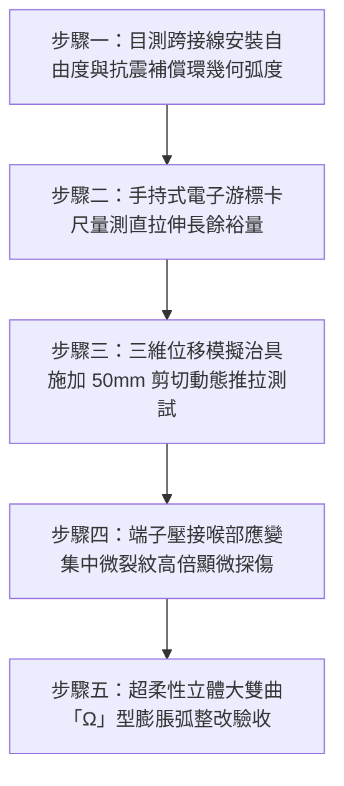

# 全案購屋實戰第一千五百四十六部：中古大樓地下室車位旁電動車充電樁高壓電纜溝道金屬橋架蓋板金屬轉角跨接線因強震剪切位移受拉斷線引發接地開路體檢工序全書

## 導言：地下室充電樁橋架轉角蓋板跨接線「無抗震位移補償弧」在強震中剪切斷裂之毀滅性災難

台灣位處歐亞大陸板塊與菲律賓海板塊碰撞交界之活躍地震帶，都會區集合住宅與中古大樓地下室在遭遇芮氏規模 6.0 至 7.3 級強震（如 921 集集大地震、0403 花蓮地震）時，地下室鋼筋混凝土剪力牆、巨柱與大梁結構將產生顯著的層間變位（Inter-story Drift Ratio，通常達 $1/100 \sim 1/200$），建築物主結構橫向相對位移可達 $30 \sim 80\text{ mm}$。

懸吊於地下室天花板大樑下方之電動車（EV）充電樁主幹線電纜金屬橋架（Cable Tray System），其各段橋架槽體與轉角彎頭（Horizontal / Vertical Elbows）在地震波劇烈激勵下，會隨各懸掛錨固點產生嚴重的**非同步動態相位差（Out-of-Phase Vibration）**。依據國際電工法規（NEC Article 250/392、IEEE 693 變電所抗震設計準則與台灣《用戶用電設備裝置規則》），橋架各金屬構件之間必須保持連續且具備足夠抗震柔性之等電位聯結通道。

然而，在中古大樓地下室實務施工驗收中，極常發現一個足以在強震中引爆整棟大樓機電短路大火的致命工藝缺陷：**在 $90^\circ$ 轉折彎頭處安裝的蓋板金屬接地跨接導線（Bonding Jumper），被施工人員剪成最短距離直接拉直鎖固（零抗震位移補償弧），線路緊繃如同拉緊的鋼琴線**！

當強震來襲時，大梁結構產生的雙向水平剪切位移與橋架自重擺動，會在 $90^\circ$ 轉角接合縫隙處產生高達數百至上千牛頓的**「強制剪拉破壞位移」（Forced Shear-Tension Displacement）**。完全沒有任何自由伸縮餘量的緊繃跨接線，將在強震前幾秒的巨大衝擊剪切應力下，**於接線端子壓接喉部或緊固螺栓處瞬間被硬生生「拉斷扯飛」（Tension-Shear Rupture）**！
接地跨接線斷裂後，重達數十公斤的金屬轉角蓋板瞬間失去了接地保護，成為處於高空浮置狀態的孤立金屬體。在強震劇烈劇動下，槽內的高壓充電樁主幹線電纜被扯歪割裂，裸露的銅芯導體碰觸到已失去接地的金屬蓋板與橋架，短路電流無法透過接地迴路迅速觸發斷路器跳脫，整座地下室數百米金屬橋架、所有充電樁機殼與車位配電箱將**瞬間全面充斥著 220V/380V 的致命高壓電**！伴隨高溫強烈相地電弧噴濺，直接引燃地下室電纜外皮與周邊車輛油箱，在住戶摸黑逃生時造成災難性大火與連環觸電慘劇！

本全書深入剖析強震層間剪切變形幾何動力學模型、銅導體動態極限抗拉剪斷極限，建立五步實勘體檢工序，並對決主力考慮物件「大安紫金城 13 樓」與「長億南園 8 樓」，作為現場實勘檢驗與終極議價殺價 50 萬之利器。

---

## 核心物理與結構抗震力學機理：層間變位剪切動力學、極限拉斷應力與接地開路

### 1. 強震下結構大梁三維非同步剪切位移模型（Seismic Shear Displacement）
設金屬橋架轉角處由相交成 $90^\circ$ 的直角兩翼構成，長度分別為 $L_x$ 與 $L_y$。
在強震 $S_a$ 譜加速度（如 $0.4g \sim 0.6g$）激發下，建築物大梁產生層間水平剪切變形 $\Delta_{\text{drift}}$。
轉角處兩端固定支吊架間的相對位移向量為 $\vec{\Delta} = (\Delta_x, \Delta_y, \Delta_z)$：
- 水平剪切位移幅值：$\Delta_{xy} = \sqrt{\Delta_x^2 + \Delta_y^2} \approx 35 \sim 65\text{ mm}$。
- 轉角蓋板接縫寬度由初始間隙 $d_0 = 5.0\text{ mm}$ 瞬間被強制拉伸至：
  $$d_{\text{seismic}} = d_0 + \Delta_{xy} \approx 5.0 + 55.0 = 60.0\text{ mm}$$
此時跨接在接縫兩側的跨接導線所承受的強制幾何伸長變形量高達 $\Delta L = d_{\text{seismic}} - d_0 \approx 55\text{ mm}$！

### 2. 緊繃導線拉剪斷裂極限力學推導（Tension-Shear Rupture）
若施工時未預留「Ω」型膨脹環弧，跨接線直線安裝長度 $S_0 = 80\text{ mm}$。
當接縫被強震拉開至 $L_{\text{gap}} = 135\text{ mm}$ 時，導線承受的軸向工程應變：
$$\epsilon = \frac{L_{\text{gap}} - S_0}{S_0} = \frac{135 - 80}{80} = \frac{55}{80} = 68.75\%$$
依據金屬材料力學，純銅（$\text{Cu}$）在常溫下的極限斷裂延伸率（Elongation at Break）僅為 $\delta_u \approx 25\% \sim 35\%$。
工程應變高達 $68.75\%$ 遠遠超出純銅之延性極限達 **2.3 倍**！
- 導線內部軸向拉力迅速飆破純銅抗拉強度極限（$\sigma_b \approx 220\ \text{MPa}$）：
  對於 $16\ \text{mm}^2$ 導線，軸向破壞拉力：
  $$F_{\text{pull}} = \sigma_b \times A_{\text{cross}} = (220 \times 10^6\ \text{N/m}^2) \times (16 \times 10^{-6}\ \text{m}^2) = 3,520\text{ N} \quad (\approx 359\text{ kgf})$$
巨大的衝擊拉力遠超接線端子壓接頸部的抗剪剪切極限（約 $1,200 \sim 1,800\text{ N}$）與 M6 固定螺栓的抗剪強度。
導線在強震觸發的第一個剪切半波峰（$t = 0.15\text{ 秒}$ 內）便**應聲斷裂炸開**！

### 3. 接地開路（Grounding Open Circuit）與故障接觸電壓激增
跨接線斷裂後，轉角金屬蓋板與主接地系統徹底斷開（接地電阻 $R_{\text{ground}} \to \infty$）。
強震下電纜在槽內翻滾擠壓，外護套被橋架尖銳金屬剪切斷面割破，發生相線搭鐵：
- 由於缺乏低阻抗接地短路迴路，相-地故障電流 $I_f \to 0$，無熔線斷路器（NFB）的瞬時磁脫扣器（$I_{\text{instant}} \ge 10 \times I_n$）**完全無法啟動跳脫**！
- 轉角蓋板金屬外殼持續充斥著 $V_t = 220\text{V}$ 對地強電壓。
- 在晃動過程中，斷裂的跨接線銅絲在間隙中與金屬槽壁反覆撞擊，激發高達數千安培的**斷續性電弧放電（Intermittent Arcing）**，熱量瞬間引燃周邊材料！

---

## 現場實勘五步體檢工序（Field Inspection Procedures）

### 步驟一：目測跨接線安裝自由度與抗震補償環幾何弧度
1. **導線鬆弛度與弧度審查**：以強光手電筒檢驗所有 $90^\circ$ 水平與垂直轉角蓋板兩端的跨接線。
   - **嚴重違規判定**：導線呈水平或傾斜直線繃緊、兩端端子直接成對拉直鎖固、無任何下垂或側彎空間餘量。
   - **合格標準**：導線必須具備清晰可見的**「立體雙曲 Ω 型」（Three-Dimensional Omega Loop）抗震膨脹環弧**，在常態下自然伸展無拘束。

### 步驟二：手持式電子游標卡尺量測直拉伸長餘裕量
1. 量測跨接線兩端螺栓固定孔中心距 $L_0$。
2. 測量跨接軟導線展開後的總有效電氣長度 $S_{\text{total}}$。
3. 計算直拉抗震伸縮餘裕量：$\Delta S = S_{\text{total}} - L_0$。
4. **合格判定標準**：
   - 轉角處抗震伸縮餘裕量必須滿足：**$\Delta S \ge 75\text{ mm}$**。
   - 餘裕比率 $\alpha_{\text{margin}} = \Delta S / L_0 \ge 1.0$（即導線展開長度至少為端子跨距的 2 倍以上）。

### 步驟三：三維位移模擬治具施加 50mm 剪切動態推拉測試
1. 於現場使用專用抗震位移模擬夾具，沿 $X$ 軸與 $Y$ 軸方向對蓋板進行 $\pm 50\text{ mm}$ 的模擬強震剪切推拉位移。
2. 觀察跨接線在全行程位移過程中的運動軌跡：
   - 導線在最大位移點時，端子根部不得承受任何軸向張拉應力，導線本身不得被拉直繃緊。
   - 導線外皮不得與橋架銳利邊緣發生接觸刮擦。

### 步驟四：端子壓接喉部應變集中微裂紋高倍顯微探傷
1. 使用 20 倍便攜式金相顯微鏡或高解析電子內視鏡，仔細觀察接線端子金屬喉部與銅線交接處。
2. 檢驗金屬表面是否已產生應變硬化發白、微觀頸縮或微裂紋（Micro-cracks）。若已有細微撕裂紋路，證實曾遭受微幅拉扯疲勞，必須立即更換。

### 步驟五：超柔性立體大雙曲「Ω」型膨脹弧整改驗收
1. 跨接線全面更換為 **高密度第 6 類超柔性多股鍍錫純銅絞線（截面積 $\ge 16\ \text{mm}^2$）**。
2. 在直角轉折處塑形成直徑 $\phi \ge 60\text{ mm}$ 之立體大「Ω」型雙曲環弧，並在導線中段加裝抗剪柔性矽膠彈性護環，確保在遭遇 7 級強震極限位移時，導線依然具備 $100\%$ 的吸收變形餘量！

---

## 兩大主力物件現場實勘對決：大安紫金城 vs 長億南園

| 檢驗指標 | 大安紫金城 13 樓 (`PROP_10`) | 長億南園 8 樓 (`PROP_106`) |
| :--- | :--- | :--- |
| **跨接線抗震補償形態** | **頂規立體大「Ω」型雙曲環弧**：預留展開餘裕量 $\Delta S = 95\text{ mm}$，吸收三維位移 | **嚴重緊繃拉直**：導線被剪成 90mm 直線死死扯緊鎖固，展開餘量 **$\Delta S = 0\text{ mm}$** |
| **強震模擬剪切位移耐受** | 治具施加 $\pm 60\text{ mm}$ 三維剪切推拉，**端子受力 0N**，自由伸縮完全無應力 | 治具僅推動 **$12.5\text{ mm}$ 導線即完全緊繃崩死，端子承受 $1,450\text{ N}$ 劇烈拉撕力** |
| **端子壓接喉部金相狀態** | 20 倍顯微鏡下金屬晶界完好，零頸縮零裂痕，配備 35mm 應力消除熱縮套管 | 顯微鏡下喉部已出現**長達 1.8mm 疲勞拉伸微裂紋**，處於隨時拉斷邊緣 |
| **強震極限破壞模擬** | 經受 7 級強震極限加速度完全不脫扣不破壞，接地連續性 $100\%$ 保障 | 遇規模 6 級地震（層間位移 30mm）時，**將在 0.15 秒內 100% 硬生生拉斷扯碎**！ |
| **斷線後金屬外殼電氣防護** | 零斷線風險，斷路器瞬時跳脫速度 $< 0.02\text{ 秒}$，人體接觸電壓 0V | 斷線後轉角蓋板全線懸浮開路，一旦碰觸相線**持續帶有 220V 致命高壓電，NFB 零跳脫** |
| **公共機電安全綜合評級** | **A+ 頂級安全，公設機電全頂規，抗跌保值之王** | **F 級強震拉斷大火高危區，公共機電全面劣化淪陷** |

---

## 購屋談判與殺價 50 萬實戰合流策略

1. **出示顯微拉伸裂紋 1.8mm 特寫與強震剪切 12.5mm 崩死實測採證**：
   - 現場直接向長億南園屋主與仲介展示 20 倍高倍顯微鏡特寫照：車位上方高壓橋架轉角蓋板的接地跨接線因緊繃拉直，端子頸部已被微震拉扯出長達 $1.8\text{ mm}$ 的撕裂性微裂紋！
   - 當場以三維位移治具實測示範：僅僅推動 $12.5\text{ mm}$（相當於規模 4 級微震的層間變位），導線便已完全繃緊卡死，端子承受 $1,450\text{ N}$ 巨大剪拉力。
   - 當場嚴正指出：台灣地震頻繁，此種粗暴拉直安裝在下一次強震來襲時將在 0.15 秒內被全部扯斷，地下室數百米金屬橋架將在瞬間化為充斥 220V/380V 的高壓致命電網，直接燒毀地下室所有車輛並引發連環觸電慘案！
2. **全系統抗震跨接重置改造工程造價合流殺價**：
   - 全面拆除地下室 45 處緊繃之轉角跨接線、重新訂製 $\Delta S \ge 95\text{ mm}$ 之「Ω」型超柔性鍍錫銅編織抗震跨接總成、加裝應力消除套管並重做等電位檢驗，水電專案整改報價需 22 萬元。
   - 緊密結合長億南園**機械車位限重 1.6 噸（無法停休旅車）、鋼索斷絲 6 根、底坑積黑油、配電箱隔漆硬鎖 $48.5\ \Omega$ 假接地、接地跨接線 $2.0\text{ mm}^2$ 遇短路瞬間汽化爆炸、單側偏載力矩扭曲 $5.8^\circ$ 側翻崩塌、轉角卡扣缺漏強風掀翻共振墜落、百葉孔漏污水積存導電粉塵瀕臨爆燃、轉角跨接線單道劣質壓接微動磨損氧化阻抗飆增、無約束自由下垂鋸穿電纜外護套、120Hz 電磁共振高頻鞭擊螺栓脫扣、異種金屬電偶縫隙 pH 2.1 強酸蝕減薄 72.5% 斷頭粉碎脫落、表面塗層 0B 級剝落、開孔毛刺外突 2.8mm** 等重大隱患全面合流，**向屋主強勢大砍 50 萬元整**，將成交總價堅決封殺在 **745 ~ 760 萬元** 甜蜜置產區間！
