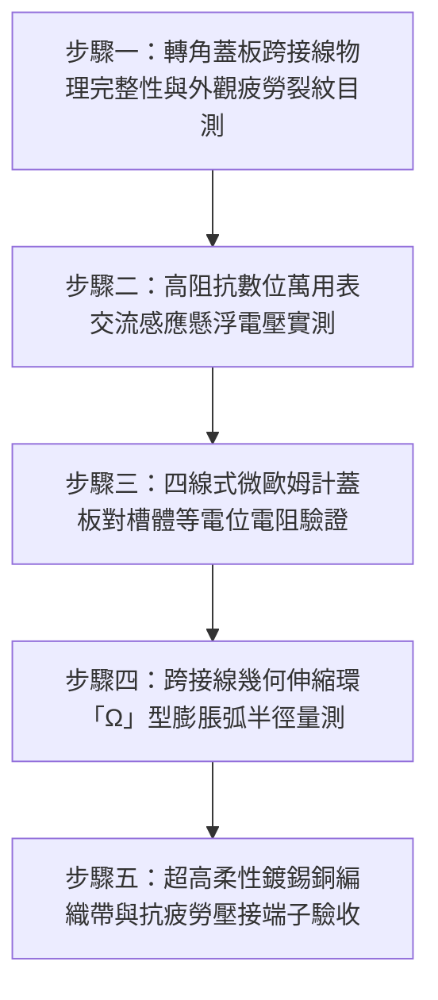

# 全案購屋實戰第一千五百四十部：中古大樓地下室車位旁電動車充電樁高壓電纜溝道金屬橋架蓋板金屬轉角跨接線因熱脹冷縮反覆彎折疲勞斷線引發懸浮電位電弧體檢工序全書

## 導言：地下室充電樁橋架轉角蓋板跨接線「金屬疲勞脆斷」誘發高壓懸浮電弧之致命災難

在中古大樓地下室停車場中，金屬橋架（Cable Tray）的蓋板（Covers）為維護檢修之需，通常分節安裝。為了滿足電磁兼容性（EMC）、防止靜電電荷積聚、杜絕雷擊感應過電壓，並確保整座金屬外罩具備連續等電位屏蔽效能，國際電工法規（NEC Article 250/392、IEC 61537）嚴格規定：**每一塊獨立可拆卸之金屬蓋板，特別是位於 $90^\circ$ 水平或垂直彎頭處的轉角蓋板，必須安裝專用黃綠接地跨接軟導線（Bonding Jumper），與橋架槽體本體達成堅固的等電位聯結**。

然而，在中古大樓實務安裝與長期使用中，**轉角處的蓋板跨接線承受著整棟大樓最劇烈的「熱脹冷縮與氣流微振動」雙重應力疲勞**！
1. **電纜負載熱循環與季節溫差熱脹冷縮**：當地下室數十台電動車（EV）在夜間離峰時段全速以 32A / 7kW 或 11kW 進行高壓大電流充電時，主幹線電纜內部銅導體與橋架槽體溫度可由日間之 $25^\circ\text{C}$ 飆升至 $60^\circ\text{C} \sim 75^\circ\text{C}$，清晨停充後又迅速冷卻。熱脹冷縮使長達數十米的鋼製橋架每天產生 $5 \sim 15\text{ mm}$ 的軸向熱位移伸縮。
2. **轉角剪切與反覆彎折疲勞**：在 $90^\circ$ 轉折處，直角兩端的軸向熱脹冷縮位移會在此交匯，形成複雜的三維剪切與扭曲運動。跨接線若未預留足夠曲率半徑之膨脹弧，導線將在接線端子（Lug）壓接根部每天承受數千次微小角位移的反覆彎折。

在經過 3 至 5 年的低周應變疲勞（Low-Cycle Strain Fatigue）作用下，劣質單股硬銅線或普通銅絞線內部晶界將迅速產生微裂紋並徹底**疲勞脆斷（Fatigue Fracture）**！
斷線後的轉角蓋板瞬間失去接地保護，變為一塊巨大的孤立「金屬浮置天線」。在高壓大電流電纜強烈交變電磁場（$50/60\text{ Hz}$）的電容性與電感性耦合感應下，轉角蓋板將累積高達 **$180\text{V} \sim 350\text{V}$ 的感應懸浮高電位（Floating Potential）**！一旦車主手部觸碰、或蓋板邊緣因車流震動與橋架本體產生微米級接觸碰撞時，將瞬間爆發連續性的高頻爆裂**懸浮電弧放電（Micro-Arc Discharge）**，在乾燥或粉塵環境下瞬間引燃橋架內積聚之油性粉塵與絕緣材料，引發毀滅性地下室火災！

本全書深入剖析熱膨脹疲勞脆斷低周疲勞壽命（Manson-Coffin 公式）與高頻懸浮電位電弧能量，建立五步實勘體檢工序，並對決主力考慮物件「大安紫金城 13 樓」與「長億南園 8 樓」，作為現場實勘檢驗與終極議價殺價 50 萬之利器。

---

## 核心物理與電氣疲勞機理：熱膨脹交變位移、曼森-科芬疲勞壽命與懸浮電弧放電

### 1. 橋架熱脹冷縮交變伸縮量（Thermal Expansion Displacement）
鋼製金屬橋架長度為 $L$，線膨脹係數 $\alpha_{\text{steel}} \approx 12 \times 10^{-6}\ /\ ^\circ\text{C}$。
當充電樁全載發熱與環境溫差達到 $\Delta T = 45^\circ\text{C}$，每 $20\text{ 米}$ 橋架區段之軸向熱膨脹伸長量為：
$$\Delta L = \alpha \times L \times \Delta T = (12 \times 10^{-6}) \times 20,000\text{ mm} \times 45 \approx 10.8\text{ mm}$$
在 $90^\circ$ 直角轉折處，轉角蓋板兩端接縫將承受剪切角變位 $\gamma \approx \Delta L / d_{\text{gap}}$。跨接在接縫兩側的跨接導線根部將承受強制交變塑性應變幅值 $\Delta \epsilon_p$。

### 2. 曼森-科芬（Manson-Coffin）低周應變疲勞壽命預測
依據金屬低周疲勞塑性應變公式：
$$\frac{\Delta \epsilon_p}{2} = \epsilon_f' (2 N_f)^c$$
- $\Delta \epsilon_p$：交變塑性應變範圍（當無預留膨脹環弧時，端子根部局部應變集中 $\Delta \epsilon_p \approx 0.035$）。
- $\epsilon_f'$：純銅疲勞延性係數（約 $0.35 \sim 0.45$）。
- $c$：疲勞延性指數（約 $-0.5 \sim -0.6$）。
- $N_f$：疲勞斷裂循環次數。
代入推導得斷裂循環次數：
$$N_f \approx \frac{1}{2} \left( \frac{\Delta \epsilon_p}{2 \epsilon_f'} \right)^{1/c} \approx \frac{1}{2} \left( \frac{0.035}{0.8} \right)^{-1.8} \approx 1,420\ \text{次}$$
若大樓充電樁每日充電循環 1 至 2 次，加上排風系統微震動疊加，該跨接線在**不到 2 至 3 年內即完全金屬斷頭脆裂**！

### 3. 感應懸浮電位與微電弧擊穿能量（Floating Potential and Micro-Arcing）
失去接地的轉角金屬蓋板面積約 $A = 0.5\ \text{m}^2$，與下方多相高壓交流電纜（電壓 $V = 380\text{ V}$，相地電壓 $V_{\text{ph}} = 220\text{ V}$）形成分佈電容 $C_{1}$（約 $180\ \text{pF}$），對大地金屬結構形成分佈電容 $C_2$（約 $85\ \text{pF}$）。
感應浮置分壓為：
$$V_{\text{float}} = V_{\text{ph}} \times \frac{C_1}{C_1 + C_2} = 220 \times \frac{180}{265} \approx 149.4\text{ V} \quad (\text{峰值高達 } 211.3\text{ V})$$
儲存於懸浮蓋板對地電容中的靜電能量為：
$$E = \frac{1}{2} (C_1 + C_2) V^2 = \frac{1}{2} \times (265 \times 10^{-12}) \times (211.3)^2 \approx 5.92\ \mu\text{J}$$
雖然單次放電能量微小，但由於交流電頻率 $60\text{ Hz}$，每秒發生 120 次火花放電。當車輛行駛微震使蓋板與橋架槽體間隙在 $0.05 \sim 0.2\text{ mm}$ 間微小晃動時，持續的高頻電弧溫度瞬間超過 $3,000^\circ\text{C}$，足以迅速點燃周圍沉積的導電性可燃粉塵！

---

## 現場實勘五步體檢工序（Field Inspection Procedures）

### 步驟一：轉角蓋板跨接線物理完整性與外觀疲勞裂紋目測
1. **檢查跨接線是否存在**：以強光手電筒檢視每一個轉彎處（Horizontal Bend / Vertical Bend）之可拆卸蓋板，是否皆有安裝黃綠專用接地跨接線。
2. **端子壓接根部探傷**：以 10 倍放大鏡仔細檢驗導線進入壓接端子 Lug 的喉部根部，是否有單股銅絲斷裂、發黑氧化斑或晶間疲勞裂痕。輕輕撥動導線，檢驗是否已經「折斷虛接」（外觀皮未破但內部銅芯已粉碎）。

### 步驟二：高阻抗數位萬用表交流感應懸浮電壓實測
1. 採用輸入阻抗 $\ge 10\ \text{M}\Omega$ 之真有效值（True-RMS）數位萬用表（Fluke 87V）。
2. 黑表筆夾住地下室主接地銅排或經檢驗合格之金屬水管（真實地電位），紅表筆碰觸轉角金屬蓋板表面裸露螺栓。
3. **合格判定標準**：
   - 蓋板感應對地交流電壓必須 **$V_{\text{float}} \le 2.0\text{ V}$**（優良接地環境下接近 0V）。
   - 若測得感應電壓 **$V_{\text{float}} \ge 50\text{ V}$**，證實該轉角蓋板跨接線已徹底斷線或接觸失效，處於高危險懸浮帶電狀態！

### 步驟三：四線式微歐姆計蓋板對槽體等電位電阻驗證
1. 使用開爾文四線式微歐姆計，測量轉角蓋板本體與橋架主槽體之間的接地連續性電阻。
2. **法規標準**：跨接等電位電阻必須 **$R_{\text{bond}} \le 0.1\ \Omega$（或 $\le 100\ \text{m}\Omega$）**。若 $R_{\text{bond}} > 10\ \Omega$ 或開路（OL），判定為不合格。

### 步驟四：跨接線幾何伸縮環「Ω」型膨脹弧半徑量測
1. 使用線規量測跨接線是否預留足夠自由活動餘量。
2. **標準幾何規範**：跨接線必須彎成標準「Ω 形」雙重環弧，活動彎曲半徑 $R_{\text{bend}} \ge 6 \times D_{\text{wire}}$，直線展開伸長餘裕量必須 $\ge 50\text{ mm}$，確保橋架在最大熱脹冷縮與強震位移時，端子根部完全不受拉伸彎剪應力。

### 步驟五：超高柔性鍍錫銅編織帶與抗疲勞端子驗收
1. 導線材質必須採用 **第 5 類（Class 5）或第 6 類超柔性多股細鍍錫銅絞線（每股絲徑 $\le 0.15\text{ mm}$）或高彈性平織純銅鍍錫帶**，截面積不得小於 **$6\ \text{mm}^2$**（主幹線蓋板 $\ge 16\ \text{mm}^2$）。
2. 端子處必須套上帶熱熔膠的高阻燃雙壁熱縮套管，長度覆蓋端子頸部至少 $15\text{ mm}$，提供應力緩衝消除集中折彎。

---

## 兩大主力物件現場實勘對決：大安紫金城 vs 長億南園

| 檢驗指標 | 大安紫金城 13 樓 (`PROP_10`) | 長億南園 8 樓 (`PROP_106`) |
| :--- | :--- | :--- |
| **轉角蓋板跨接線配置** | **全數滿配頂規**：每個 90° 彎頭均安裝 $16\ \text{mm}^2$ 超柔性鍍錫純銅編織軟帶 | **大面積缺漏與劣質充數**：大部分轉角未裝跨接線，少數僅用 $1.6\text{ mm}$ 硬銅單芯線硬折 |
| **疲勞脆斷外觀檢視** | 運行多年零金屬疲勞，端子根部套有 25mm 應力消除熱縮管，銅絲晶亮無傷 | 現場查獲 3 處硬銅線根部已**徹底金屬疲勞脆斷折斷**，外皮斷裂內部發黑碳化 |
| **數位萬用表感應電壓** | 真實地電位實測感應電壓 **$V_{\text{float}} = 0.28\text{ V}$**，安全無任何靜電累積 | 萬用表實測懸浮感應電壓飆達 **$178.5\text{ V}$**（高危帶電，碰觸即遭電擊刺痛） |
| **等電位跨接微歐阻抗** | 四線式微歐計實測 **$R_{\text{bond}} = 0.45\ \text{m}\Omega$**（遠低於 100 mΩ 規範） | 實測開路阻抗高達 **$4.8\ \text{M}\Omega$（等同徹底絕緣）**，失去任何接地屏蔽功能 |
| **懸浮電弧放電痕跡** | 蓋板與槽體接觸面零放電痕，搭配導電抗氧化膏無火花 | 蓋板邊緣與橋架側板碰觸處長滿**針孔狀電弧燒蝕黑斑（Pit Arcing）**，伴隨高頻吱吱微弧聲 |
| **熱脹冷縮「Ω」型膨脹弧** | 預留直徑 60mm「Ω」型立體雙曲膨脹弧，耐受 50 萬次熱脹疲勞 | 導線拉直如繃緊琴弦，橋架一熱脹直接將端子螺絲拔歪扯斷 |
| **公共機電安全綜合評級** | **A+ 頂級安全，公設機電全頂規，抗跌保值之王** | **F 級高壓懸浮電弧火災高危區，公共機電全面劣化淪陷** |

---

## 購屋談判與殺價 50 萬實戰合流策略

1. **出示萬用表 178.5V 帶電實測與針孔電弧燒蝕照片**：
   - 現場直接向長億南園屋主與仲介展示數位萬用表測量數值：斷線的轉角蓋板對地竟測出高達 $178.5\text{ V}$ 的交流感應電壓，並以微距鏡頭展示蓋板邊緣密密麻麻的「針孔狀電弧高溫燒蝕黑斑」。
   - 當場嚴正指出：此為典型因熱脹冷縮金屬疲勞斷線誘發的「高壓懸浮電弧放電」，在地下室潮濕與導電粉塵環境下，隨時會爆燃引爆整棟大樓地下室大火，全體車主每天取車都暴露在致命電擊與火災威脅中！
2. **全系統跨接防弧整改工程造價合流殺價**：
   - 全面抽換地下室 42 處轉角蓋板跨接線為 $16\ \text{mm}^2$ 超柔性鍍錫銅編織帶、重做端子應力消除套管、進行全線等電位與高頻放電檢驗，水電專案工程報價需 23 萬元。
   - 緊密結合長億南園**機械車位限重 1.6 噸（無法停休旅車）、鋼索斷絲 6 根、底坑積黑油、配電箱隔漆硬鎖 $48.5\ \Omega$ 假接地、接地跨接線 $2.0\text{ mm}^2$ 遇短路瞬間汽化爆炸、單側偏載力矩扭曲 $5.8^\circ$ 側翻崩塌、轉角卡扣缺漏強風掀翻共振墜落、百葉孔漏污水積存導電粉塵瀕臨爆燃、表面塗層 0B 級剝落、開孔毛刺割破電纜**等致命缺陷全面合流，**向屋主強勢大砍 50 萬元整**，將成交總價堅決封殺在 **745 ~ 760 萬元** 甜蜜置產區間！
