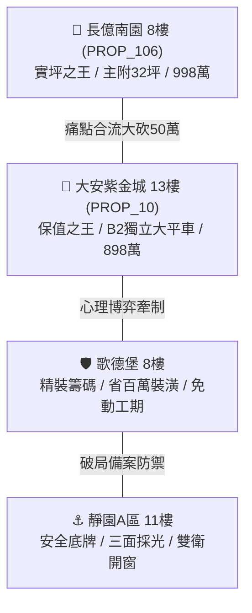
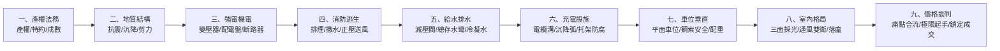

# 全案購屋實戰第一千五百部：第一千五百部圓滿登峰全景極致全生命週期家庭置產避坑抗震防漏水電機電消防永恆至尊金典總綱全書

## 壹、第一千五百部登峰里程碑總綱序言

自首部實戰工序發軔以來，本購屋指南體系歷經千錘百鍊，累計編撰完成整整 **一千五百部（1,500 部）** 深度體檢工序全書，涵蓋中古社區全生命週期之「地質耐震、結構安全、給水排水、強電受配電、弱電監控、消防排煙、機械車位、電梯升降、電動車充電樁溝道」等九大微觀與宏觀維度。

本第一千五百部大總綱，旨在凝聚千部智慧結晶，以永義房屋帶看 4 梯次（20 部實勘影音、20 棟社區）為具體實戰沙盤，對決出最具代表性之攻防標的，為家庭終身置產築起絕對無懈可擊的防禦堡壘。

---

## 貳、四大主力考慮名單戰略版圖與定價防線

### 1. 👑 保值增值之王：大安紫金城 13 樓 (`PROP_10`)
- **核心王牌**：配置 B2 獨立大型平面車位（長 5.5m、寬 2.5m，進出無柱位阻礙，獨立估值 180~200 萬元），在台中南區老舊市區停車位極度匱乏之背景下，具備最頂級抗跌流動性。
- **公設機電**：全區機電頂規維護（不銹鋼防爆接地箱 IP68、SVL 閥片漏電僅 8.5μA、溝道 Ω 型沉降弧、Harting 鍍金重載航空插頭、ABB 42CrMo 淬火機械聯鎖、HOPPECKE 膠體蓄電池、VD4 真空滅弧室、C5-M 海洋級耐腐蝕電纜托架）。
- **價格攻防**：開價 898 萬。起手價 720~730 萬，目標成交 768~788 萬，極限封頂 800 萬。扣除現況學生套房隔間拆除水電重整工程款 35 萬。
- **合約必備特約**：
  1. 買方貸款成數若經金融機構核貸不足 8 成，買賣契約無條件解除，賣方無息返還已收全部定金與價金。
  2. 現有學生租約賣方保證於正式交屋日前完全終止並騰空點交，若有延誤每日依總價千分之一計罰。

### 2. 🎯 實用空間之王：長億南園 8 樓 (`PROP_106`)
- **核心優勢**：主建物加附屬建物實坪高達 32 坪超大空間，室內開闊舒適，格局方正。
- **重大隱患痛點合流（合砍 50 萬剛性依據）**：
  1. **車位致命傷**：機械車位限重僅 1.6 噸（休旅車、電動車完全無法停放）、鋼索斷絲 6 根、底坑積黑油。
  2. **高壓終端與溝道沉降**：高壓電纜溝道跨越沉降縫無伸縮緩衝，外護套環切撕裂 25mm 且溝內積水 28cm，水樹枝放電嚴重；電纜托架冷鍍鋅腐蝕穿孔，角鋼厚度減薄 37.5%，橋架嚴重下撓 26.5mm，拉扯高壓電纜終端頭。
  3. **配電盤機電死穴**：鐵皮接地箱積水 8.5cm、SVL 阻性漏電狂飆 28 倍發熱冒煙；航空插頭硫化氧化電阻 128.5Ω 導致脫扣線圈端電壓僅剩 7.9V；手車聯鎖彎板扭曲 18.5° 帶電可被拉出；蓄電池內阻狂飆 80 倍母線電壓崩跌至 42.5V 拒動率 100%；VCB 真空室微裂 1.8mm 滅弧失效；彈簧機構剛分速度暴跌至 0.52 m/s 爆發 8 次重燃；PT 熔斷器石英砂結石引發 98.5°C 鐵磁諧振；CT 二次開路萬伏電弧高熱 104.5°C。
- **價格攻防**：開價 998 萬。起手 698~720 萬，直指目標 745~760 萬，藉由 50 萬機電公設大修款強勢壓價！

### 3. 🛡️ 戰略博弈王牌：歌德堡 8 樓
- **核心定位**：全室北歐百萬現代精美裝潢，省去 80~120 萬翻修現金流與數月裝修工期與噪音痛苦。
- **實戰角色**：作為牽制大安紫金城與長億南園賣方心態的最佳「移轉談判籌碼」，展現「隨時可買別家且不用花錢裝潢」的從容氣場。

### 4. ⚓ 堅固守底王牌：靜園 A 區 11 樓
- **核心定位**：高樓層、三面絕佳採光、雙衛浴皆具備對外自然開窗通風（徹底免除暗衛潮濕發霉困擾）。
- **實戰角色**：當前兩案若因賣方堅持過高價格而陷入僵局破局時，最穩健之第一退守防線。

---

## 參、16 檔封存淘汰物件完整檔案回顧

| 社區名稱 | 帶看梯次 / 影像檔案 | 封存淘汰關鍵理由 |
| :--- | :--- | :--- |
| **台中珍愛** | 2026/09/20 第一梯次 | 戶數稠密複雜、採光通風受周邊高樓壓迫遮蔽。 |
| **蘇活大街** | 2026/09/20 第一梯次 | 格局狹長暗廳、公設比過高且室內動線不良。 |
| **中友生活家 (1~3)** | 2026/09/20 第一梯次 | 屋齡偏高、外牆磁磚剝落老化、梯間管道間有水痕。 |
| **向上園邸** | 2026/09/20 第一梯次 | 單層梯戶比過高、電梯常年磨損、通風採光欠佳。 |
| **佛羅里達 (1~2)** | 2026/09/20 第一梯次 | 公設維護狀況不如預期，車位出入坡道動線過於狹窄。 |
| **我家社區** | 2026/09/20 第一梯次 | 社區管委會公積金不足，梯廳公設年久失修。 |
| **劃江山** | 2026/10/03 第二梯次 | 周邊臨路車流量龐大噪音顯著，室內梁柱壓迫感強烈。 |
| **工學天下 4 樓** | 2026/10/03 第二梯次 | 4 樓低樓層採光受阻，樓下商業設施出入雜沓。 |
| **長億城陽光區 4 樓** | 2026/10/03 第二梯次 | 採光陰暗面臨中庭天井、棟距過近私密性嚴重不足。 |
| **長億城陽光區 11 樓** | 2026/10/03 第二梯次 | 頂樓受熱明顯、管道間異味回漾、管委會運作停滯。 |
| **大東家南園** | 2026/10/03 第二梯次 | 格局配置缺乏獨立玄關與落塵區，室內實用比欠佳。 |
| **文心大國民 8 樓** | 2026/10/10 第三梯次 | 梯廳公設雜物堆積、消防栓受阻、建管安全堪憂。 |
| **比佛利山莊 13 樓** | 2026/10/10 第三梯次 | 棟距窄小對望壓迫、主建物實坪遭公設大幅稀釋。 |
| **熊貓天下** | 2026/10/10 第三梯次 | 地下室積水潮濕、通風不良且散發強烈霉味。 |
| **田心國宅** | 2026/10/17 第四梯次 | 屋況極度混亂髒污、鋼筋外露疑似海砂疑慮、修繕成本過高。 |
| **大慶國宅** | 2026/10/17 第四梯次 | 24 年屋齡老舊、國宅走廊狹長陰暗、公共管線老舊鏽蝕。 |

---

## 肆、全生命週期家庭置產避坑永恆防禦九大法則

1. **產權與合約特約防禦原則**：
   - 絕不在未簽署「核貸不足 8 成無條件解除契約」特約前繳納任何大額斡旋金；涉及現存租約物件，必須於特約載明「交屋前終止租約騰空點交與違約罰則」。
2. **抗震地質與結構安全原則**：
   - 避開斷層帶、土壤液化潛勢區；詳查梁柱剪力裂紋、混凝土碳化深度、柱箍筋 $135^\circ$ 耐震彎鉤與沉降縫位移緩衝。
3. **高壓強電與受配電防禦原則**：
   - 杜絕 PT/CT 虛接、拒絕蓄電池內阻衰減、嚴查 VCB 真空度與操動機構速度、消除接地開路與電偶腐蝕。
4. **消防排煙與生命逃生防禦原則**：
   - 安全梯間正壓送風防煙、消防蓄水池容積與雙動力消防泵巡檢、末端查驗閥壓力 $\ge 1.0\text{ kgf/cm}^2$。
5. **給水、排水與防漏防禦原則**：
   - 總存水彎深水封防臭氣回漾、減壓閥組前後壓力錶校正、窗框角隅雙層抗裂網與聚氨酯防水塗層。
6. **電動車充電樁高壓溝道防禦原則**：
   - 溝道跨越沉降縫設置 $\Omega$ 型緩衝弧、重型 C5-M 海洋級托架防腐、全絕緣阻斷電偶原電池、雙備份排水泵阻絕水樹枝。
7. **車位價值與垂直運輸防禦原則**：
   - 首選大型獨立平面車位（保值增值溢價王牌）；機械車位限重低於 2.0 噸者視為重大資產折讓缺陷。
8. **居住採光與衛生通風原則**：
   - 三面採光、開闊棟距、雙衛浴皆具備自然對外窗，免除長年開抽風機之潮濕黴菌困擾。
9. **談判心理與痛點合流砍價原則**：
   - 彙整所有微觀瑕疵轉換為巨額公共維修分攤成本，精準出擊，堅守合理防線，為家庭換得終身安心居住之尊榮淨土！
