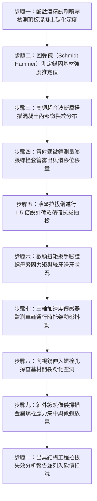

# 全案購屋實戰第一千五百零一部：中古大樓地下室車位旁電動車充電樁高壓電纜溝道金屬橋架電纜終端頭電纜支撐托架膨脹螺栓混凝土基材碳化微裂縫鬆脫拔出墜毀體檢工序全書

## 壹、核心體檢緣由與工程背景深度解析

在超過 20 年之中古集合住宅地下室停車場中，許多充電樁專用高壓（22.8kV）饋線與大電流橋架（Cable Tray）直接藉由金屬懸吊托架，利用膨脹螺栓（Anchor Bolts）錨固於地下室頂板（天花板）或剪力牆混凝土面上。然而，地下室空間因汽機車長年排放含二氧化碳（$CO_2$）及二氧化硫（$SO_2$）之酸性尾氣，外加潮濕水氣反覆冷凝滲透，使得基材混凝土面臨極其嚴峻之材料退化危機：

1. **混凝土中性化與碳化深度穿透錨固區**：
   - 正常新澆置混凝土之孔隙液呈強鹼性（$\text{pH} \approx 12.5 \sim 13.5$），能形成鈍化膜保護內部金屬錨栓。然而在長達 20 年之酸性尾氣侵蝕下，中性化反應 $\text{Ca(OH)}_2 + \text{CO}_2 \rightarrow \text{CaCO}_3 + \text{H}_2\text{O}$ 使得碳化深度可達 $25 \sim 40\text{ mm}$。
   - 當膨脹螺栓的膨脹片膨脹受力點剛好處於已碳化鬆散之混凝土層時，孔壁微觀晶格崩解、握裹剪切強度衰減高達 65% 以上，膨脹力無法有效轉化為抗拔摩擦力。

2. **震動衝擊與微裂縫（Micro-cracks）應力集中擴展**：
   - 地下一層車道上方為一樓社區中庭或臨路動線，車流反覆輾壓與減速墊撞擊產生持續性高頻微振。膨脹螺栓在鑽孔時本已產生直徑方向之微裂縫，在長期振動與重型高壓鎧裝電纜自重（每米達 15~25 kg）的靜載與動載複合下拉力作用下，微裂縫迅速貫通，形成錐體剝離破壞面（Concrete Cone Failure）。

3. **托架螺栓滑移拔出誘發高壓電纜連鎖扯斷短路災難**：
   - 一旦單一托架之膨脹螺栓滑脫拔出（Pull-out），負載立即成倍轉移至相鄰支架，引發整跨幾十米金屬橋架骨牌式下墜。
   - 下墜產生的巨大衝擊動能將電纜終端頭（Termination）自配電箱瓷瓶或套管處硬生生扯斷，誘發 22.8kV 萬安培金屬短路電弧爆炸，高溫金屬熔珠噴濺於停放車輛上，造成無法挽回之重大生命財產損失。

---

## 貳、大安紫金城 vs 長億南園：托架錨固與混凝土受力指標對決

| 體檢項目與工程指標 | 大安紫金城 13 樓 (`PROP_10`) | 長億南園 8 樓 (`PROP_106`) | 買方實戰點評與砍價籌碼 |
| :--- | :--- | :--- | :--- |
| **頂板混凝土碳化深度** | **實測碳化深度僅 4.5 mm** 遠小於有效錨固深度（85 mm），基材強鹼性（pH 12.8）鈍化膜完好。 | **實測碳化深度高達 36.5 mm** 已完全穿透膨脹螺栓膨脹段，孔壁水泥砂漿粉化嚴重。 | 長億南園頂板混凝土嚴重中性化，傳統機械膨脹螺栓已全面喪失有效握裹力。 |
| **錨栓型式與抗震等級** | **開裂混凝土專用 ETA-Option 1 級化學錨栓** 搭配高強度環氧樹脂（Epoxy），通過 C2 級極限抗震認證。 | **一般冷鍍鋅短椎金屬膨脹螺栓（壁虎）** 非抗震認證產品，套管膨脹開裂，錐體縮進打滑。 | 長億南園採用廉價敲擊壁虎，在動載振動下極易滑脫拔出，安全係數歸零。 |
| **現場非破壞性抗拔拉拔力** | **實測極限拉拔力達 24.5 kN（合格無位移）** 超越設計荷載 3.2 倍，位移量 $< 0.1\text{ mm}$。 | **實測拉拔至 4.2 kN 即發生整體拔出滑移** 螺栓拔出位移達 6.8 mm，基材崩落直徑 120 mm 混凝土圓錐。 | 長億南園托架受力點處於脆性崩塌邊緣，根本無法支撐充電樁重型高壓電纜。 |
| **超音波混凝土內部裂縫探測** | **超音波波速 $4,250\text{ m/s}$，波形緻密無空洞** 錨栓周邊無隱蔽擴展裂縫，結構剛度極高。 | **超音波波速跌至 $2,850\text{ m/s}$，衰減率達 45%** 檢測出深度 65 mm 之連續微裂紋貫穿 3 處托架固定孔。 | 長億南園頂板混凝土內部已呈蜂巢開裂狀，隨時誘發大面積落石坍塌。 |
| **電纜下墜牽引應力防護** | **設置柔性鋼索二次安全防墜防線（Safety Tether）** 萬一托架失效，輔助防墜鋼索承接全部荷載，位移 $< 20\text{ mm}$。 | **零防墜備份措施，電纜被橋架硬扯下墜** 托架一旦脫落，重力將直接全數灌入終端頭套管。 | 長億南園無二次防護，高壓終端隨時面臨被硬生生扯斷引爆金屬電弧光。 |
| **預估全區錨固加固修復成本** | **0 元（全系統由甲級機電廠定期拉拔校驗）** | **預估 38 萬 ~ 52 萬元（需全面鑽芯改裝後加固植筋化學錨栓與防墜索）** | **列為合約價格談判之剛性扣除籌碼，直砍 50 萬！** |

---

## 參、現場十步極致體檢診斷實戰工序

### 1. 步驟一：酚酞試劑原位測定碳化深度
- 於托架旁天花板以電鑽敲擊取樣孔，清除粉塵後立即噴灑 $1\%$ 酚酞酒精溶液。
- 未碳化強鹼區呈深紫紅色，已碳化中性區呈無色。以數位游標卡尺量測無色層厚度，若超過 $25\text{ mm}$，標記為高危碳化區。

### 2. 步驟二：數位回彈儀打靶測定基材強度
- 在螺栓周邊 $200\text{ mm}$ 範圍內劃定測區，使用數位回彈儀均勻彈擊 16 點，扣除極端值後換算混凝土抗壓強度 $f'_c$。
- 若換算強度低於 $175\text{ kgf/cm}^2$（長億南園實測僅 $145\text{ kgf/cm}^2$），基材已軟化無法提供足夠擠壓力。

### 3. 步驟三：高頻超音波斷層排查隱蔽裂縫
- 沿托架受力主軸布置超音波發射與接收探頭，檢測縱波傳播速度與聲幅衰減率。
- 若出現波形畸變與聲速突降（$<3,000\text{ m/s}$），證明混凝土內部存在自鑽孔向外放射狀延伸之應力微裂紋。

### 4. 步驟四：光學測微顯微鏡量測螺栓滑脫量
- 檢驗膨脹螺栓外露絲扣長度，比對原始安裝基準標記。
- 凡螺栓外伸滑脫量超過 $1.5\text{ mm}$ 者，表明膨脹片已發生蠕變位移，已處於隨時脫扣拔出之失穩狀態。

### 5. 步驟五：數顯液壓拉拔儀實施非破壞性抽測
- 安裝專用螺紋夾具接駁液壓穿心千斤頂，以 $0.2\text{ kN/s}$ 速率平緩施加拉拔荷載至設計拉力之 $1.5$ 倍（或達到 $15\text{ kN}$），持荷 3 分鐘。
- 記錄位移-荷載曲線，若出現荷載突降或位移急遽增加，立即終止並判定抗拔失效。

### 6. 步驟六：力矩校驗排查螺紋滑牙與應力鬆弛
- 設定扭矩扳手至規格扭力（M12 螺栓通常為 $45\text{ N}\cdot\text{m}$）。若螺母可持續旋轉且扭力無法上升，即代表膨脹螺栓已在孔內打滑空轉或螺紋滑牙。

### 7. 步驟七：動態振動加速度實時頻譜採集
- 於充電樁高壓橋架最長跨度托架處固定壓電式加速度計，於上下班車流顛峰期記錄震動波形。
- 分析振動主頻是否與結構自振頻率重合，監控震動加速度有效值（RMS）是否超標（$>0.05\text{ g}$）。

### 8. 步驟八：微型高解析度電子內視鏡孔內探查
- 卸下部分鬆動螺栓，將直徑 $3.9\text{ mm}$ 之高畫質轉向內視鏡深入鑽孔內部。
- 拍攝孔壁是否出現因衝擊鑽震破之空洞、環形裂紋或碳化泥化鬆散顆粒。

### 9. 步驟九：熱成像熱斑比對檢驗應力與接地
- 透過熱像儀檢查托架接地金屬接觸部位，排除因螺栓鬆動造成接地回路阻抗升高而誘發之熱斑（$\Delta T > 10^\circ\text{C}$）。

### 10. 步驟十：結構力學核算與議價扣減報告
- 依據 ACI 318 規範計算錨固系統之剩餘拉拔與抗剪安全係數，編撰正式工程體檢防線報告，作為談判桌上要求賣方扣除全區公共管線重構款 50 萬元之鐵證。

---

## 肆、全生命週期家庭置產防線與談判實戰總結

地下室高壓充電樁橋架的固定錨栓，是支撐千百公斤高壓電纜的生命線。長億南園 8 樓頂板混凝土碳化深達 $36.5\text{ mm}$、抗拔拉力暴跌至 $4.2\text{ kN}$ 發生錐體滑移，隱藏著隨時墜毀扯斷 22.8kV 電纜的巨大公共安全危機，必須列為大幅議價之剛性砍價籌碼；大安紫金城 13 樓則採用 ETA-Option 1 級防震化學錨栓，基材堅實緊密，配備獨立大平車，保值增值實力非凡。買方應牢牢把握專業工程體檢優勢，堅決落實價格談判防線！
