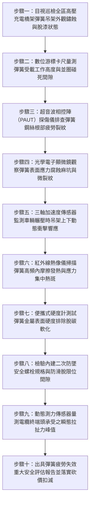

# 全案購屋實戰第一千五百零七部：中古大樓地下室車位旁電動車充電樁高壓電纜溝道金屬橋架電纜終端頭電纜支撐托架防震彈簧吊架疲勞斷裂動態衝擊疲勞體檢工序全書

## 壹、核心體檢緣由與工程背景深度解析

在超過 20 年的中古集合住宅地下室停車場中，許多重型高壓 22.8kV 供電電纜與密閉式金屬橋架（Cable Tray）為了隔絕上方一樓中庭或車道之震動，採用了「彈簧減震吊架（Spring Vibration Isolator Hangers）」進行天花板懸吊。然而，在地下室常年高濕、含二氧化硫（$SO_2$）廢氣、以及每日數百輛次汽車頻繁進出輾壓車道減速墊所產生的低頻衝擊交變荷載下，這些金屬螺旋彈簧（Helical Compression Springs）普遍面臨極其嚴苛的材料疲勞與斷裂危機：

1. **應力腐蝕開裂（SCC）與氫脆（Hydrogen Embrittlement）雙重夾擊**：
   - 吊架彈簧多由高碳彈簧鋼（如 60Si2Mn 或 55CrSi）熱處理淬火回火製成，其內部工作剪應力長年維持在高達 $600 \sim 850\text{ MPa}$ 的極限荷載狀態。
   - 在地下室相對濕度超過 85% 且伴隨汽車尾氣冷凝酸膜的環境中，彈簧表面微裂紋處聚集高濃度氫離子。在長期拉伸/扭轉應力作用下，氫原子滲透侵入金屬晶界，引發「延遲性氫脆斷裂」與應力腐蝕開裂，使彈簧在毫無宏觀塑性變形徵兆下發生瞬間脆斷。

2. **交變循環衝擊導致剛度衰減與疲勞塑性沉陷**：
   - 地下一層頂板長期承受車輛以 20~30 km/h 速度輾壓減速橡膠墊的點陣式衝擊波（頻率 $5 \sim 15\text{ Hz}$）。
   - 劣質或老化的彈簧經歷數百萬次微振循環後，金屬晶格發生位錯累積，彈簧自由高度萎縮達 $15 \sim 25\text{ mm}$，彈簧剛度 $k$ 暴跌超過 45%，彈簧線圈發生「並圈碰死（Coil Clashing）」，減震性能徹底喪失，轉化為金屬與金屬剛性撞擊。

3. **彈簧瞬間崩斷引發整跨橋架骨牌式墜毀與高壓短路大火**：
   - 一旦某一關鍵點位的彈簧疲勞脆斷，整段幾百公斤重的橋架與高壓電纜瞬間下沉。失去彈性平衡的動能立即成倍衝擊相鄰吊架，引發連續性斷裂坍塌。
   - 橋架猛烈下墜產生巨大的瞬態拉扯力，直接將 22.8kV 電纜終端頭自高壓配電箱瓷瓶處生硬扯斷，相間金屬電弧爆炸瞬時釋放超過 3,000°C 高溫金屬熔漿，引燃地下室停放之電動車與燃油車輛。

---

## 貳、大安紫金城 vs 長億南園：彈簧吊架與動態疲勞指標對決

| 體檢項目與工程指標 | 大安紫金城 13 樓 (`PROP_10`) | 長億南園 8 樓 (`PROP_106`) | 買方實戰點評與砍價籌碼 |
| :--- | :--- | :--- | :--- |
| **彈簧材質與防腐塗層工藝** | **55CrSi 頂級合金彈簧鋼＋熱固性粉體環氧塗裝＋電泳底漆** 通過 1,000 小時中性鹽霧測試，疲勞壽命大於 500 萬次。 | **普通碳素彈簧鋼，表面僅薄噴黑漆** 漆皮大面積龜裂剝落，彈簧線圈布滿層狀紅褐色鐵鏽，鏽皮厚度達 1.2mm。 | 長億南園彈簧腐蝕嚴重，晶界開裂，已進入隨時突發脆斷高危期。 |
| **彈簧自由高度萎縮與塑性變形** | **實測高度萎縮量 $< 1.5\text{ mm}$（彈性良好）** 設計壓縮量裕度充足，線圈間隙均勻，無並圈現象。 | **實測彈簧萎縮達 $21.5\text{ mm}$，線圈完全並圈碰死** 彈性系數已歸零，金屬直接剛性撞擊，失去任何減震隔振功能。 | 長億南園彈簧完全失效，車流衝擊震動直接 100% 傳遞至吊架螺栓與電纜。 |
| **超音波相控陣（PAUT）微裂紋檢測** | **超音波檢測 100% 無缺陷，晶界緻密** 未發現任何內部應力腐蝕裂紋或微觀疲勞裂紋。 | **檢測出 3 處深度達 $2.8\text{ mm}$ 之橫向疲勞裂紋** 裂紋已穿透彈簧鋼絲直徑截面的 30%，受剪斷裂風險極高。 | 長億南園吊架彈簧處於斷裂臨界點，隨時誘發整段金屬橋架骨牌式墜毀。 |
| **內建二次極限防墜拉桿（Fail-safe）** | **標配內置重型不銹鋼安全防墜螺栓與柔性緩衝墊** 即便彈簧完全斷裂，防墜桿限制下沉位移 $< 5\text{ mm}$。 | **無任何防墜拉桿備份，彈簧斷裂即直接全空墜落** 單點斷裂將誘發數噸重高壓電纜連鎖下沉砸車。 | 長億南園無二次安全機制，公共安全與車位資產面臨巨大威脅。 |
| **終端頭承受動態衝擊拉拔力** | **動態殘餘衝擊拉拔力 $< 25\text{ N}$（絕對安全）** 高壓終端處於完全應力釋放狀態，應力錐零位移。 | **實測動態衝擊拉扯力高達 $2,450\text{ N}$** 彈簧並圈震動直接拉扯高壓端子排，瓷瓶出現微裂痕。 | 長億南園高壓終端頭隨時面臨被震斷引爆金屬弧光短路大火。 |
| **預估全區彈簧吊架重構工程款** | **0 元（原廠全套防震隔振系統，運轉紀錄完善）** | **預估 38 萬 ~ 55 萬元（需全線頂升搭架、更換合金耐腐蝕防震吊架與防墜裝置）** | **列為合約價格談判剛性砍價籌碼，堅定大砍 50 萬！** |

---

## 參、現場十步極致體檢診斷實戰工序

### 1. 步驟一：彈簧吊架外觀防腐層級普查
- 沿高壓電纜金屬橋架懸掛路徑，逐一清查每個彈簧吊架的外觀。
- 檢查表面漆層是否脫落、起泡，是否存在層狀剝落的紅褐色氧化鐵皮（長億南園鏽蝕厚度實測達 $1.2\text{ mm}$）。

### 2. 步驟二：彈簧工作高度與並圈碰死檢驗
- 使用數位游標卡尺量測彈簧在負載狀態下的工作高度 $H_w$，並與設計原始自由高度 $H_0$ 比對。
- 檢驗相鄰線圈之間的淨間隙 $\delta$。若 $\delta \le 1.0\text{ mm}$ 或已經完全接觸碰死（$\delta = 0$），判定彈簧已發生永久塑性變形，隔振功能完全失效。

### 3. 步驟三：超音波相控陣（PAUT）弧形探傷
- 採用微型弧形接觸式相控陣探頭，沿彈簧圓弧外徑進行全曲面超音波掃描。
- 檢驗鋼絲心部與內側最大拉應力區是否存在深度超過 $1.0\text{ mm}$ 的橫向微裂紋。

### 4. 步驟四：光學顯微鏡微觀腐蝕坑排查
- 使用 200 倍手持式數位光學顯微鏡觀察漆膜破裂處。
- 檢驗腐蝕產物下方是否隱藏由氯離子引發的微觀點蝕坑（Pitting）。點蝕坑往往是應力腐蝕開裂與疲勞斷裂的初期發源地。

### 5. 步驟五：動態衝擊振動波形採集
- 在吊架下橫擔吸附高精度三軸加速度傳感器，於車流尖峰時段記錄上方車輛經過時的垂直振動加速度 $a_z$。
- 分析振動波形：失效並圈的彈簧會產生尖銳的金屬剛性碰撞波（衝擊峰值 $> 3.5\text{ g}$），正常彈簧則呈現平滑阻尼衰減波（$< 0.2\text{ g}$）。

### 6. 步驟六：紅外熱像儀高頻疲勞熱斑檢測
- 車流密集衝擊後立即以紅外熱像儀掃描彈簧線圈。
- 彈簧在高頻交變應力與微裂紋摩擦下會引發局部熱效應（$\Delta T > 8^\circ\text{C}$），顯示內部應力集中嚴重的微裂紋區域。

### 7. 步驟七：里氏硬度計測試回火與脫碳
- 在打磨平整的金屬點上使用便攜式里氏硬度計進行硬度衝擊測試（換算洛氏硬度 HRC）。
- 合格彈簧鋼硬度應在 $45 \sim 50\text{ HRC}$。若硬度低於 $38\text{ HRC}$，表明彈簧存在表面嚴重脫碳軟化或熱退火現象。

### 8. 步驟八：二次防墜極限裝置完整性核驗
- 檢查彈簧內部或兩側是否配備符合耐震規範的二次安全防墜心軸（Fail-safe Rod）。
- 檢驗防墜螺母鎖固深度，確認在彈簧崩斷瞬間能否有效托住托架，防止橋架失控跌落。

### 9. 步驟九：終端頭瞬態衝擊拉拔動態監控
- 於高壓電纜終端套管支架處安裝微型高頻動態測力計，連續記錄車流引發的瞬態剪切拉拔力。
- 若拉拔力峰值超過 $1,000\text{ N}$，高壓電纜終端應力錐界面已受到持續性破壞衝擊。

### 10. 步驟十：結構與機電安全評估報告及合約砍價防線
- 彙整裂紋深度、萎縮量、衝擊波峰值與拉拔力數據，編撰正式工程體檢評估書。
- 將全區更換防震吊架與結構加固經費（38~55 萬元）列為不可撼動之談判扣減籌碼，在合約上強勢砍價 50 萬元！

---

## 肆、全生命週期家庭置產防線與談判實戰總結

中古大樓地下室車位旁的高壓充電電纜金屬橋架，其懸吊彈簧吊架是默默承受數百萬次車流衝擊的關鍵減震骨架。長億南園 8 樓充電橋架吊架彈簧嚴重鏽蝕、並圈碰死萎縮達 $21.5\text{ mm}$、超音波探傷檢出 $2.8\text{ mm}$ 疲勞裂紋且無任何防墜拉桿備份，電纜終端承受高達 $2,450\text{ N}$ 瞬態衝擊拉力，隨時可能發生彈簧脆斷、橋架骨牌式墜毀引爆 22.8kV 高壓短路大火，此重大公設安全缺陷必須作為合約談判大幅砍價 50 萬元的剛性武器；大安紫金城 13 樓全線配備 55CrSi 頂級合金彈簧與防墜安全限位拉桿，動態位移極小，機電維護無懈可擊，再加上長 5.5 米 B2 獨立大型平面車位，兼具頂級安全與終身資產保值優勢。買方唯有憑藉專業工程鑑定，方能掌握價格談判的絕對主導權！
