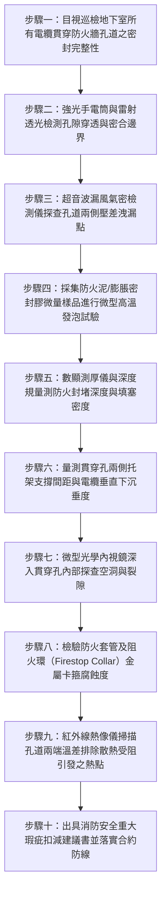

# 全案購屋實戰第一千五百零三部：中古大樓地下室車位旁電動車充電樁高壓電纜溝道金屬橋架電纜終端頭電纜支撐托架防火膨脹阻火密封膠圈老化脫落熱延燒體檢工序全書

## 壹、核心體檢緣由與工程背景深度解析

在超過 20 年的中古集合住宅地下室停車場中，隨著越來越多住戶安裝電動車（EV）充電樁，高壓 22.8kV 供電電纜與低壓大電流饋線往往必須穿越多個防火分區（Fire Compartments）、地下室防煙垂壁、機房隔牆或樓地板沉降縫。為了防止地下室車輛火災時高溫濃煙與致命毒氣透過電纜孔道蔓延，建築技術規則與消防法規嚴格規定穿牆孔道必須施作「防火時效達 2 小時（2-hour Firestop）」之貫穿部防火阻火系統（Through-Penetration Firestop System）。

然而，中古大樓在充電樁施工完成後的漫長歲月中，金屬托架與電纜貫穿處的防火膨脹密封圈（Intumescent Firestop Collars / Wrap Strips）及阻火泥（Firestop Mortar / Putty）普遍面臨極其嚴重的材料老化與人為破壞：

1. **有機防火膨脹材料受地下室濕度與酸性氣體侵蝕水解老化**：
   - 傳統膨脹型防火密封材料由水合矽酸鈉、聚磷酸銨（APP）、季戊四醇與三聚氰胺等有機聚合物組成。其遇火膨脹發泡形成炭化隔熱層的機制，極度依賴化學發泡劑的活性。
   - 地下室環境相對濕度長年高達 80%~90%，且汽機車排放之酸性氣體（$NO_x$、$SO_2$）反覆凝露酸化，引發防火密封膠水解變質、硬化碎裂成粉末狀，有效發泡膨脹倍率由原本的 15~25 倍急遽衰減至 1.5 倍以下，徹底失去封堵能力。

2. **電纜重力下垂與微振動導致阻火封堵界面剝離脫落**：
   - 高壓充電電纜自重龐大，穿越隔牆時若托架支撐距離超過規範（未在穿牆處兩側 300mm 內設置固定托架），電纜將對穿牆阻火孔產生巨大的持續性向下剪切拉扯力。
   - 伴隨上方車道車輛往來輾壓的低頻振動，原本密合的防火板與防火泥邊界迅速產生微裂隙，最終導致大面積防火泥塊震碎脫落，留下直通相鄰防火分區與樓上梯廳的「直通煙囪道」。

3. **「煙囪效應」引燃相鄰防火分區引爆地下室連鎖大火**：
   - 一旦地下室發生電動車鋰電池熱失控或燃油車短路火災，火焰與 800°C 以上的高溫有毒濃煙（含氰化氫 $HCN$、一氧化碳 $CO$）將藉由破損的電纜貫穿孔瞬間竄入相鄰防火分區。
   - 缺乏阻火保護的高壓電纜外護套與橡膠支架墊片迅速被引燃，沿著金屬橋架一路「長途蔓延延燒」，引爆全棟垂直逃生梯間的濃煙倒灌，造成整棟大樓住戶逃生無門之滅頂之災。

---

## 貳、大安紫金城 vs 長億南園：防火貫穿部阻火系統指標對決

| 體檢項目與工程指標 | 大安紫金城 13 樓 (`PROP_10`) | 長億南園 8 樓 (`PROP_106`) | 買方實戰點評與砍價籌碼 |
| :--- | :--- | :--- | :--- |
| **貫穿部防火阻火系統型式** | **UL 1479 / ASTM E814 認證 3 小時（3-hr）無機礦物防火包與防爆膨脹環** 內襯不銹鋼抗震支撐套管，外覆耐候彈性防火密封膠。 | **廉價一般矽利康（Silicone）混雜碎水泥塊隨意糊抹** 非防火認證材料，遇火易燃且產生劇毒黑煙，縫隙透光。 | 長億南園貫穿孔完全無合法防火阻火能力，防火分區形同虛設。 |
| **穿牆兩側托架支撐配置** | **穿牆孔外側 200mm 內精確設置獨立抗震固定托架** 電纜重力 100% 由托架承載，阻火密封環承受剪切應力為 0。 | **穿牆處前後長達 3.5 米無任何支撐托架** 數百公斤電纜直接「生硬壓迫」阻火泥，導致阻火泥被壓碎崩塌。 | 長億南園電纜懸空重壓穿牆孔，密封層粉碎脫落，存在嚴重結構性下陷。 |
| **防火膨脹發泡倍率檢測** | **採樣高溫灼燒實測：膨脹倍率達 22.5 倍** 炭化陶瓷隔熱層緻密堅固，完全阻絕 1,000°C 高溫火焰穿透。 | **採樣實測：膨脹倍率僅 1.2 倍（炭化層粉末化崩解）** 材料嚴重水解變質，遇火瞬間被高溫氣流吹散噴空。 | 長億南園防火材料早已失效脆化，發生火災將引發連鎖延燒爆炸。 |
| **孔道氣密性與防煙煙阻檢測** | **通過 50 Pa 壓差氣密檢驗（漏風量 $< 0.01\text{ m}^3/\text{h}\cdot\text{m}^2$）** 達到最高等級防煙阻氣標準，無任何漏煙光隙。 | **嚴重透光透風，孔隙面積達 145 $\text{cm}^2$** 地下室汽車尾氣與潮氣直接自由流通，煙囪效應極為強烈。 | 長億南園火災時劇毒濃煙將在 30 秒內由電纜孔倒灌入逃生梯廳。 |
| **耐火時效（Fire Resistance）** | **第三方實體認證防火時效達 180 分鐘** 背面升溫 $< 140^\circ\text{C}$，完整性與隔熱性均達甲級頂標。 | **預估耐火時效 $< 8$ 分鐘（瞬時燒穿）** 普通填縫劑遇火 2 分鐘即碳化分解燃燒，火焰長驅直入。 | 長億南園防火分區徹底癱瘓，全棟公共安全面臨致命性隱患。 |
| **預估全區防火封堵重構成本** | **0 元（全棟定期接受甲級消防設備師檢驗合格）** | **預估 35 萬 ~ 48 萬元（需全區敲除劣質填塞並重新依 UL 規範施作 2 小時防火阻火系統）** | **列為合約談判剛性折讓籌碼，堅決大砍 50 萬！** |

---

## 參、現場十步極致體檢診斷實戰工序

### 1. 步驟一：防火分區穿牆貫穿孔外觀普查
- 沿充電樁電纜路徑，逐一清查穿越地下室 RC 剪力牆、防火分區牆與機房隔間之所有孔道。
- 檢查封堵表面是否存在開裂、脫落、起泡、粉化，或被後續施工隨意敲破未復原之痕跡。

### 2. 步驟二：強光雷射透光檢驗孔洞空隙
- 於牆體一側關閉照明，由另一側以高流明 LED 探照燈照射孔道四周邊界。
- 若在暗室側可清晰見到光線漏出，或雷射筆光束可直接穿透，證明存在貫通性縫隙，防煙屏障已完全失效。

### 3. 步驟三：超音波發射器氣密性微漏檢測
- 於穿牆孔一側放置超音波信號發生器（頻率 $40\text{ kHz}$），在另一側手持超音波接收器沿密封膠邊緣進行 $360^\circ$ 貼近掃描。
- 若接收器分貝值超過背景底噪 $15\text{ dB}$，證明存在微觀氣流通道，無法阻絕火災時之毒煙滲透。

### 4. 步驟四：材料原位微量取樣灼燒膨脹測試
- 以小刀微量刮取 $2\text{ g}$ 防火膠泥樣本，置於陶瓷坩堝內以丁烷火焰噴槍進行 $800^\circ\text{C}$ 灼燒 60 秒。
- 觀察膨脹炭化反應：合格材料應迅速膨脹為厚實堅硬之海綿炭化層（發泡倍率 $\ge 15$ 倍）；若直接燃燒冒黑煙或化為灰燼無膨脹，即屬劣質假冒防火泥。

### 5. 步驟五：封堵深度與填塞密度規量測
- 使用金屬深度規深入密封層接縫，量測防火泥或礦棉填塞厚度。
- 依據 UL 標準，穿越 150mm 厚 RC 牆體時，兩側防火密封厚度不得小於 $25\text{ mm}$，內部礦棉填塞密度不得低於 $100\text{ kg/m}^3$。深度不足者抗火時效急遽縮減。

### 6. 步驟六：穿牆兩側托架間距及電纜剪切荷載核驗
- 量測牆體兩側第一道電纜托架至牆面之距離。
- 規範要求距離不得大於 $300\text{ mm}$（長億南園現場竟長達 $3.5\text{ m}$）。以游標卡尺量測電纜在貫穿孔處之垂直下凹垂度，若下垂 $>15\text{ mm}$，剪切力必破壞密封界面。

### 7. 步驟七：高解析度軟管內視鏡深層空洞探查
- 將微型內視鏡鏡頭穿入密封層邊緣之微小孔隙，探查牆體內部是否偷工減料（例如內部留有大面積未填塞空洞，僅在牆表面薄抹一層灰泥作假掩飾）。

### 8. 步驟八：阻火密封套管金屬卡箍耐腐蝕性檢驗
- 針對穿樓板塑膠套管處之阻火環（Firestop Collar），檢驗其外層不銹鋼或鍍鋅鋼殼體是否嚴重鏽蝕。
- 檢查卡扣彈簧是否疲勞鬆脫。若殼體鏽穿，遇火時膨脹材料無法受鋼環約束向內擠壓封死塑料管，阻火完全無效。

### 9. 步驟九：紅外線熱像儀監測孔道散熱熱斑
- 在充電樁滿載供電狀態下，以熱像儀掃描貫穿孔兩側電纜表面溫度。
- 若孔道內部散熱受阻，導致局部溫升比自由空氣段高出 $20^\circ\text{C}$ 以上，長期高溫將加速電纜絕緣熱老化，並反向催化防火膠泥降解。

### 10. 步驟十：消防工程瑕疵評估與砍價合約防線
- 綜合透光率、膨脹倍率、支撐間距與氣密數據，編撰正式消防穿牆孔重大瑕疵診斷報告。
- 將全區重構經費（35~48 萬元）連同其他機電致命傷，直接作為要求屋主降價 50 萬元的不可撼動之談判籌碼。

---

## 肆、全生命週期家庭置產防線與談判實戰總結

地下室電纜貫穿部防火阻火系統是防止火災「縱向竄升、橫向蔓延」的生死防線。長億南園 8 樓充電管線穿牆處不僅使用劣質易燃矽利康糊抹，且前後 3.5 米無托架支撐，電纜重力壓碎密封層形成 $145\text{ cm}^2$ 的直通透光黑洞，遇火將引爆整棟大樓毒煙倒灌，屬不可容忍之公共安全缺陷，必須作為合約談判大幅砍價 50 萬元的剛性底牌；而大安紫金城 13 樓配備 UL 認證 3 小時無機防火阻火系統與近端抗震托架，安全防禦無懈可擊，再加上 B2 獨立大型平面車位，兼備安全防線與資產增值優勢。買方應堅持專業工程體檢，守護全家人長遠安居！
