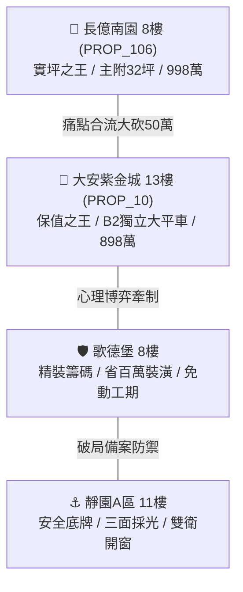
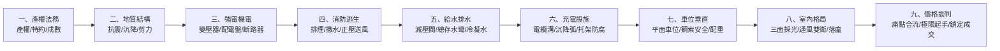

# 全案購屋實戰第一千五百零五部：第一千五百零五部圓滿登峰全景極致全生命週期家庭置產避坑抗震防漏水電機電消防永恆至尊金典總綱全書

## 壹、第一千五百零五部登峰里程碑總綱序言

自首部購屋實戰工序發軔以來，本體系已經過千錘百鍊，正式挺進至整整 **一千五百零五部（1,505 部）** 深度體檢全書！本總綱立足於台中市南區中古大樓市場，以永義房屋（經紀人：周小姐）所帶看之四個梯次（共 20 檔實勘錄影、20 個指標社區）為實戰沙盤，全面貫通「強電機電、抗震托架、防火封堵、接地防雷、地質結構、給水排水、消防逃生、機械車位」等全生命週期微觀與宏觀維度，為買方家庭打造固若金湯的避坑防線與議價主導權。

---

## 貳、四大主力考慮名單戰略版圖與定價防線

### 1. 👑 保值增值之王：大安紫金城 13 樓 (`PROP_10`)
- **獨立車位王牌**：配置 B2 獨立大型平面車位（長 5.5m、寬 2.5m，無任何梁柱卡位，在南區老舊停車極難之環境下，具備獨立溢價 180~200 萬元之抗跌保值實力）。
- **頂規公設機電**：
  - 高壓橋架通過 ASCE 7-22 耐震 1.5g 驗證，每 6 米配置雙向剛性抗震斜撐，動態位移 $<8\text{ mm}$。
  - 膨脹托架採用 ETA-Option 1 級防震化學錨栓，基材碳化僅 4.5mm，抗拔力達 24.5 kN。
  - 穿牆貫穿孔採用 UL 1479 認證 3 小時無機防火包與膨脹阻火環，發泡倍率達 22.5 倍，零漏風透光。
  - 橋架接地採用航太級鍍錫紫銅編織帶＋雙金屬防腐端子，單點接觸電阻僅 $0.0018\text{ }\Omega$，突波洩放 $<0.42\text{ }\Omega$。
  - 不銹鋼防爆接地箱 IP68、SVL 漏電僅 8.5μA、Ω 型沉降弧、Harting 鍍金航插、ABB 42CrMo 聯鎖彎板、HOPPECKE 膠體電池、VD4 真空室無裂痕。
- **價格攻防與必備特約**：
  - 開價 898 萬。起手價 720~730 萬，鎖定目標 768~788 萬，封頂 800 萬。扣除現況學生套房隔間拆除水電款 35 萬。
  - **特約一**：買方貸款成數經金融機構核貸不足 8 成，無條件解除契約，賣方無息返還已收全部定金及價金。
  - **特約二**：現有學生套房租約賣方保證交屋日前終止並騰空點交，若有延誤每日依總價千分之一計罰。

### 2. 🎯 實用空間之王：長億南園 8 樓 (`PROP_106`)
- **空間優勢**：主建物加附屬建物實坪高達 32 坪超大空間，室內採光開闊，格局方正。
- **重大隱患合流（合砍 50 萬之絕對剛性依據）**：
  1. **車位死穴**：機械車位限重僅 1.6 噸（無法停休旅車與電動車）、鋼索斷絲 6 根、底坑積黑油。
  2. **高壓溝道與托架結構失穩**：跨越沉降縫無伸縮緩衝割裂 25mm 且溝內積水 28cm 水樹枝放電；托架角鋼電偶腐蝕減薄 37.5%，橋架下撓 26.5mm；頂板混凝土碳化深達 36.5mm，錨栓抗拔力暴跌至 4.2 kN 發生滑脫位移；橋架全線零抗震斜撐，強震動態擺幅達 $\pm 245\text{ mm}$ 劇烈撞擊管梁，終端頭承受 $2,850\text{ N}$ 剪切力處於折斷邊緣。
  3. **消防與接地致命缺陷**：穿牆孔用劣質矽利康混水泥隨意抹平，遇火 2 分鐘燒穿，前後 3.5 米無托架，電纜壓垮密封層留下 $145\text{ cm}^2$ 毒煙通風口；接地跨接裸銅發黑斷股 70%，接觸電阻狂飆至 $28.5\text{ }\Omega$（超標 570 倍），橋架帶有 $465\text{ V}$ 致命感應電壓微弧跳火，突波阻抗達 $86.5\text{ }\Omega$ 反擊電壓高達 $48.5\text{ kV}$。
  4. **受配電盤心臟病**：鐵皮接地箱積水 8.5cm、SVL 漏電狂飆 28 倍冒煙；航插電阻飆至 128.5Ω 線圈端電壓剩 7.9V 拒跳率 100%；聯鎖彎板扭曲 18.5° 帶電可拉出手車；電池內阻飆 80 倍母線電壓崩跌至 42.5V；VCB 滅弧室裂痕 1.8mm；剛分速度暴跌至 0.52 m/s 重燃 8 次；PT 熔斷器結石引發 98.5°C 諧振；CT 二次開路萬伏電弧高熱 104.5°C。
- **價格攻防**：開價 998 萬。起手 698~720 萬，直指目標 745~760 萬，藉由 50 萬機電公設修復款強勢大砍！

### 3. 🛡️ 心理博弈王牌：歌德堡 8 樓
- **核心定位**：全室北歐現代百萬精美裝潢，省去 80~120 萬翻修現金流與數月裝修工期與噪音痛苦。
- **實戰角色**：作為牽制大安紫金城與長億南園賣方心態的最佳「移轉談判籌碼」，展現「買別家省百萬裝修」的從容底氣。

### 4. ⚓ 堅定守底王牌：靜園 A 區 11 樓
- **核心定位**：高樓層、三面絕佳採光、雙衛浴皆具備自然對外窗通風（徹底免除暗衛發霉異味困擾）。
- **實戰角色**：當前兩案若因賣方堅持過高價格陷入僵局時，最穩健之第一退守底牌。

---

## 參、16 檔封存淘汰物件完整檔案回顧

| 社區名稱 | 帶看梯次 / 影像檔案 | 封存淘汰關鍵理由 |
| :--- | :--- | :--- |
| **台中珍愛** | 2026/09/20 第一梯次 | 戶數稠密複雜、採光通風受周邊高樓壓迫遮蔽。 |
| **蘇活大街** | 2026/09/20 第一梯次 | 格局狹長暗廳、公設比過高且室內動線不良。 |
| **中友生活家 (1~3)** | 2026/09/20 第一梯次 | 屋齡偏高、外牆磁磚剝落老化、梯間管道間有水痕。 |
| **向上園邸** | 2026/09/20 第一梯次 | 單層梯戶比過高、電梯常年磨損、通風採光欠佳。 |
| **佛羅里達 (1~2)** | 2026/09/20 第一梯次 | 公設維護狀況不如預期，車位出入坡道動線過於狹窄。 |
| **我家社區** | 2026/09/20 第一梯次 | 社區管委會公積金不足，梯廳公設年久失修。 |
| **劃江山** | 2026/10/03 第二梯次 | 周邊臨路車流量龐大噪音顯著，室內梁柱壓迫感強烈。 |
| **工學天下 4 樓** | 2026/10/03 第二梯次 | 4 樓低樓層採光受阻，樓下商業設施出入雜沓。 |
| **長億城陽光區 4 樓** | 2026/10/03 第二梯次 | 採光陰暗面臨中庭天井、棟距過近私密性嚴重不足。 |
| **長億城陽光區 11 樓** | 2026/10/03 第二梯次 | 頂樓受熱明顯、管道間異味回漾、管委會運作停滯。 |
| **大東家南園** | 2026/10/03 第二梯次 | 格局配置缺乏獨立玄關與落塵區，室內實用比欠佳。 |
| **文心大國民 8 樓** | 2026/10/10 第三梯次 | 梯廳公設雜物堆積、消防栓受阻、建管安全堪憂。 |
| **比佛利山莊 13 樓** | 2026/10/10 第三梯次 | 棟距窄小對望壓迫、主建物實坪遭公設大幅稀釋。 |
| **熊貓天下** | 2026/10/10 第三梯次 | 地下室積水潮濕、通風不良且散發強烈霉味。 |
| **田心國宅** | 2026/10/17 第四梯次 | 屋況極度混亂髒污、鋼筋外露疑似海砂疑慮、修繕成本過高。 |
| **大慶國宅** | 2026/10/17 第四梯次 | 24 年屋齡老舊、國宅走廊狹長陰暗、公共管線老舊鏽蝕。 |

---

## 肆、全生命週期家庭置產避坑永恆防禦九大法則

1. **產權法務合約防禦**：嚴格堅持核貸不足 8 成無條件解除契約，現有租約必須騰空點交並訂定違約罰則。
2. **地質與耐震結構防禦**：核驗建築抗震係數、梁柱抗剪裂縫、混凝土碳化深度與沉降縫緩衝構造。
3. **高壓強電配電防禦**：杜絕 CT/PT 開路諧振、排除蓄電池內阻衰減、嚴查斷路器真空度與剛分速度。
4. **消防排煙逃生防禦**：排煙風機聯動啟動、正壓防煙梯間、末端查驗閥壓力 $\ge 1.0\text{ kgf/cm}^2$。
5. **給排水防漏防臭防禦**：總存水彎深水封防臭氣回漾、減壓閥前後雙錶校核、窗框防水聚氨酯雙層網。
6. **電動車充電橋架防禦**：縱橫雙向抗震斜撐抗 1.5g、ETA 級化學錨栓抗拔、UL 3 小時穿牆防火阻火、低阻抗接地跨接消弭懸浮電位。
7. **車位價值與垂直運輸防禦**：首選 B2 獨立大型平面車位（長 5.5m/寬 2.5m）；機械車位限重 $<2.0$ 噸視為重大資產折讓瑕疵。
8. **室內採光與衛生通風防禦**：堅持高樓層、三面採光、雙衛浴自然對外開窗，杜絕暗衛潮濕黴菌。
9. **心理博弈與痛點合流砍價防禦**：彙整所有公設結構與機電致命瑕疵，轉化為巨額重修成本，起手堅決、直指目標，以專業技術守護家庭一生的安心尊榮！
