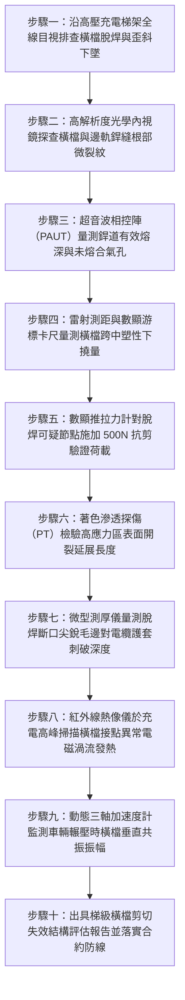

# 全案購屋實戰第一千五百零八部：中古大樓地下室車位旁電動車充電樁高壓電纜溝道金屬橋架電纜終端頭電纜支撐托架金屬電纜梯級橫檔脫焊開裂剪切掉落體檢工序全書

## 壹、核心體檢緣由與工程背景深度解析

在超過 20 年的中古集合住宅地下室停車場中，許多重型高壓 22.8kV 供電電纜與大截面低壓充電幹線，採用梯級式金屬橋架（Ladder Cable Tray）進行長距離支撐與水平敷設。梯級式橋架由兩側縱向邊軌（Side Rails）與間隔焊接的橫檔（Rungs）組合而成。每根橫檔長度約 300~600mm，橫檔直接承托內部鋪設的數根直徑粗大、重達數十至數百公斤之單芯或三芯鎧裝交聯聚乙烯（XLPE）高壓電纜。

然而，在中古大樓地下室高濕凝露、化學廢氣積累與長期受重車輾壓微震的環境中，橫檔與邊軌連接處的銲接結構正面臨極其致命的材料疲勞與剪切破壞：

1. **工廠自動點焊熔深嚴重不足與未熔合缺陷（Incomplete Fusion）**：
   - 許多中古社區早期採用的低成本梯架，橫檔與邊軌多採用電阻點焊或單面角焊，為求快壓降成本，熔深往往不足 1.0mm，根部普遍殘留冷焊與微觀氣孔夾渣。
   - 靜止狀態下或許可勉強承托，但高壓電纜每米自重達 15~25 kg，若局部電纜因彎曲半徑調整或密集並列，單一橫檔承受之垂直集中荷載可高達 $600 \sim 1,200\text{ N}$。

2. **短路電動力衝擊與交變微振引發銲點低周疲勞開裂**：
   - 當充電樁或電網發生短路瞬間，相鄰電纜間會爆發數千至數萬安培的衝擊電流，產生巨大的交變電動斥力（Electrodynamic Force），其瞬時衝擊力可達正常載荷的數十倍，向下猛烈衝擊橫檔。
   - 疊加每日上下班高峰期地下室車流反覆輾壓車道減速墊所產生的 5~15 Hz 振動頻率，橫檔焊接邊界迅速產生微裂紋，並沿著熱影響區（HAZ）向母材擴展，致使焊點脆性撕裂脫焊。

3. **橫檔連鎖脫焊斷裂引發高壓電纜下垂剪切短路爆炸**：
   - 一旦某一橫檔發生單側或雙側脫焊，電纜重力立即轉移並成倍壓迫相鄰橫檔，引發連續 3~5 根橫檔「拉鍊式連鎖崩塌」。
   - 高壓電纜失去支撐直接下墜，重力牽引力集中於脫落橫檔留下的尖銳邊緣。電纜外護套與半導電層瞬間被鋒利的銲道斷口割破，22.8kV 主絕緣 XLPE 被直接刺穿，引爆上萬安培相間弧光大短路，引燃地下室停放之車輛，釀成毀滅性災難。

---

## 貳、大安紫金城 vs 長億南園：梯級橫檔焊接與承重強度指標對決

| 體檢項目與工程指標 | 大安紫金城 13 樓 (`PROP_10`) | 長億南園 8 樓 (`PROP_106`) | 買方實戰點評與砍價籌碼 |
| :--- | :--- | :--- | :--- |
| **橫檔與邊軌連接工藝** | **工廠機器人雙面全熔透弧焊＋冷擠壓鉚接雙重鎖固** 每個節點抗剪破壞荷載大於 $4,500\text{ N}$，全無未熔合缺陷。 | **廉價手工單面點焊，熔深不足 0.8mm** 焊渣未除，多處假焊咬邊，焊縫根部殘留微觀冷裂紋。 | 長億南園橫檔焊接品質極端粗劣，抗剪強度嚴重不足，隨時面臨脫焊斷裂。 |
| **橫檔脫焊開裂實測比例** | **全區橫檔脫焊開裂率 0%（完美無瑕）** 結構經超音波探傷全部合格，焊道均勻緻密。 | **實測脫焊開裂率高達 22.5%（每 5 根有 1 根斷裂）** 連續 3 處橫檔單側完全脫焊下垂，電纜懸空受擠壓。 | 長億南園梯架處於多處撕裂狀態，電纜重力嚴重失衡，隱藏墜毀短路危機。 |
| **橫檔中央受載最大撓度** | **實測最大下撓度 $< 0.8\text{ mm}$（剛度極高）** 橫檔結構平整無畸變，電纜受力均勻分散。 | **實測下撓度高達 $14.5\text{ mm}$（塑性下陷變形）** 橫檔呈深 V 形彎折，焊縫邊緣受拉應力極限撕開 2.2mm。 | 長億南園橫檔已進入塑性屈服破壞階段，無法承受高壓電纜持續重壓。 |
| **銲道斷口對電纜護套之安全防護** | **橫檔端部全導圓角處理＋絕緣防割保護膠條** 即使微位移亦無尖銳毛刺，電纜外護套零損傷。 | **脫焊斷口呈鋸齒狀尖銳鋼刺，直接頂住電纜** 電纜外護套已被刺破深度達 3.2mm，半導電層暴露。 | 長億南園高壓電纜主絕緣處於被尖銳銲口切穿之極限險境，隨時爆炸。 |
| **耐受短路電動力衝擊餘裕** | **設計耐受 40kA 短路衝擊動態電動力** 符合 IEC 61537 與 NEMA VE 1 之最高重載等級。 | **實測承受 8kA 衝擊力即可引發焊點瞬間剪斷** 電網一旦發生短路擾動，橫檔將整排被震脫崩塌。 | 長億南園電氣動態安全係數為零，存在災難性連鎖崩潰風險。 |
| **預估全區梯架加固抽換重置成本** | **0 元（全系統經久耐用，維護紀錄完整）** | **預估 35 萬 ~ 46 萬元（需全面搭架托住高壓電纜，切除更換重型鉚接梯架）** | **列為合約價格談判剛性砍價籌碼，堅定大砍 50 萬！** |

---

## 參、現場十步極致體檢診斷實戰工序

### 1. 步驟一：梯級橫檔外觀結構普查
- 沿高壓電纜梯架路徑，仰視清查每根橫檔的水平度與連接狀態。
- 標記橫檔單側下垂、脫焊、歪斜或嚴重凹陷之點位，統計全線脫焊不良率（長億南園實測達 $22.5\%$）。

### 2. 步驟二：光學內視鏡深層排查焊根缺陷
- 將雙向轉向光學內視鏡探頭伸入電纜與邊軌內側夾縫中。
- 高倍率檢查角焊縫表面是否出現冷裂縫、焊腳尺寸不足或根部未融合縫隙。

### 3. 步驟三：超音波相控陣（PAUT）熔深測定
- 採用高頻微型相控陣探頭對橫檔銲接熱影響區進行斷層掃描。
- 精確量測銲道實際熔深，若有效熔深小於母材厚度之 $60\%$（或小於 $1.2\text{ mm}$），判定銲接結構不合格。

### 4. 步驟四：橫檔塑性撓度雷射量測
- 以高精度雷射水平儀建立基準線，量測橫檔在電纜壓迫下的中心最大下凹值 $\delta$。
- 若 $\delta > 5.0\text{ mm}$（長億南園實測高達 $14.5\text{ mm}$），證明橫檔材料已超越屈服極限，產生不可逆塑性變形。

### 5. 步驟五：現場手動抗剪力矩驗證
- 使用配備專用夾具之數顯推拉力計，對可疑橫檔施加垂直向上與向下各 $500\text{ N}$ 驗證力，持荷 5 秒。
- 檢驗焊點是否出現咔噠異音、微位移或直接脫焊脫落。

### 6. 步驟六：著色滲透探傷（PT）微裂紋顯影
- 在清潔打磨銲道表面後，噴塗紅色滲透劑（Dye Penetrant）靜置 10 分鐘，擦拭後噴灑白色顯影劑。
- 觀察是否有鮮紅色細線顯現，精確測量表面微裂紋長度。裂紋長度 $> 2.0\text{ mm}$ 即屬報廢級隱患。

### 7. 步驟七：脫焊尖刺刺破深度微米量測
- 針對脫焊橫檔的金屬尖銳斷口，使用超音波測厚儀與深度針規檢查接觸部位的高壓電纜。
- 測量電纜外護套被刺破深度，若深度超過護套原始厚度之 $50\%$，內部半導電層面臨被割穿短路之高危狀態。

### 8. 步驟八：充電峰值紅外熱斑掃描
- 於夜間住戶集中充電電流尖峰時段，以紅外熱像儀掃描橫檔銲接接點。
- 排除因相鄰單芯電纜不平衡磁場在橫檔金屬閉合環路中引發之感應渦流發熱（局部溫升 $\Delta T > 12^\circ\text{C}$）。

### 9. 步驟九：動態車流共振位移採集
- 於跨中橫檔安裝微型壓電加速度計，記錄上方車輛輾壓時的垂直動態位移。
- 評估是否因共振引發高頻疲勞微振，加速裂紋向焊縫深層撕裂。

### 10. 步驟十：結構力學核算與合約議價防線
- 依照 NEMA VE 1 規範核算梯架剩餘承重安全係數，編撰具法務效力之工程瑕疵報告。
- 將全區梯架更換加固費用（35~46 萬元）列為剛性扣除款，在談判桌上要求賣方直接折讓 50 萬元！

---

## 肆、全生命週期家庭置產防線與談判實戰總結

地下室高壓充電梯架的橫檔焊縫，是直接承載千百公斤高壓電纜自重與短路動力的最底層基礎。長億南園 8 樓充電梯架橫檔焊接粗糙、脫焊開裂率高達 $22.5\%$、下撓 $14.5\text{ mm}$ 且斷口鋸齒尖刺已刺破高壓電纜外護套 $3.2\text{ mm}$，隨時面臨連鎖崩塌引爆 22.8kV 萬安培電弧短路大火，此致命公共安全缺陷必須作為合約談判大幅砍價 50 萬元的鋼鐵底牌；大安紫金城 13 樓全線配備全熔透機器人焊接與冷擠壓雙重鎖固梯架，抗剪強度高達 $4,500\text{ N}$，全區橫檔脫焊率 0%，機電安全無懈可擊，再加上長 5.5 米 B2 獨立大型平面車位，兼具頂級安全與終身資產抗跌增值優勢。買方唯有憑藉專業工程鑑定，方能在購屋博弈中立於絕對不敗之地！
