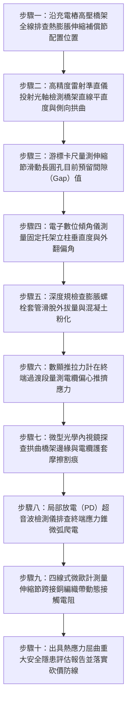

# 全案購屋實戰第一千五百零六部：中古大樓地下室車位旁電動車充電樁高壓電纜溝道金屬橋架電纜終端頭電纜支撐托架金屬熱脹冷縮伸縮補償節缺失側向推擠失穩彎曲體檢工序全書

## 壹、核心體檢緣由與工程背景深度解析

在超過 20 年的中古集合住宅地下室停車場中，隨著越來越多車位加裝電動車（EV）充電樁，高壓 22.8kV 電纜與大電流銅排饋線通常沿著地下室長達 60~120 米的金屬橋架（Cable Tray）長距離敷設。金屬橋架材質多採用碳鋼鍍鋅（熱膨脹係數 $\alpha \approx 12 \times 10^{-6}\text{ /}^\circ\text{C}$）或鋁合金（$\alpha \approx 23 \times 10^{-6}\text{ /}^\circ\text{C}$）。地下室環境並非恆溫，夏日車輛密集回流散熱加充電樁滿載發熱，環境溫度可高達 40°C~45°C；冬日寒流侵襲時則驟降至 12°C~15°C，全年度溫差 $\Delta T$ 高達 30°C 以上。

依据美國國家電氣法規（NEC Article 392）與國際電工規範（NEMA VE 2），金屬橋架直線段每隔 30 米必須設置「熱膨脹伸縮補償節（Expansion Guides / Thermal Expansion Joints）」，並搭配專用長圓孔滑動拼接板（Expansion Splice Plates）。然而，中古大樓由普通水電承包時，普遍忽視熱脹冷縮的巨大軸向熱應力，導致以下致命結構破壞：

1. **軸向熱膨脹受剛性死鎖引發巨大壓應力與歐拉側向屈曲（Euler Buckling）**：
   - 當整條長達數十米的鋼製橋架所有螺栓均被死死鎖死，且未預留任何伸縮滑動間隙時，橋架因溫升產生的軸向熱伸長量 $\Delta L = \alpha \cdot L \cdot \Delta T$ 可達 $25 \sim 45\text{ mm}$。
   - 由於兩端受剪力牆與轉角剛性約束，無法自由伸長，金屬本體內部產生高達數萬牛頓（kN）的巨大軸向壓縮熱應力。當此壓力超過橋架側向抗彎臨界荷載（Critical Buckling Load）時，整條橋架在跨中發生災難性「$\text{S}$ 型突波狀側向彎曲失穩」，側向拱出幅度可達 $80 \sim 150\text{ mm}$。

2. **固定托架承受巨大翻轉剪矩誘發膨脹螺栓拔出**：
   - 橋架發生側向拱曲失穩時，對天花板與牆面的固定托架（Brackets）產生強烈的偏心側向推擠力與翻轉扭矩（Torsional Moment）。
   - 固定托架的碳鋼螺栓承受劇烈交變剪力，長期熱脹冷縮循環造成螺栓孔周圍混凝土疲勞粉化，膨脹螺栓發生鬆脫外拔，托架向外歪斜達 $15^\circ \sim 25^\circ$，喪失有效支撐能力。

3. **高壓電纜終端頭受剛性推擠引發內部應力錐位移與微弧爬電**：
   - 橋架的側向拱起與軸向變形，會強行「拖拽與擠壓」內部鋪設的高壓電纜。高壓 22.8kV 電纜終端頭（Termination）與受電箱體之剛性套管連接處，受到高達 $1,850\text{ N}$ 的強烈偏心剪推力。
   - 終端頭內部的半導電應力錐（Stress Cone）與交聯聚乙烯（XLPE）主絕緣界面發生微觀滑移錯位，形成氣隙與局部電場畸變，引發嚴重內部電樹枝（Electrical Treeing）微弧放電，終致擊穿引爆萬安培相間弧光大爆炸。

---

## 貳、大安紫金城 vs 長億南園：熱脹冷縮補償與橋架穩定性指標對決

| 體檢項目與工程指標 | 大安紫金城 13 樓 (`PROP_10`) | 長億南園 8 樓 (`PROP_106`) | 買方實戰點評與砍價籌碼 |
| :--- | :--- | :--- | :--- |
| **熱膨脹伸縮補償節配置** | **每隔 24 米標準配置長圓孔伸縮補償節** 搭配專用滑動尼龍襯套與柔性高導電跨接銅編織帶，位移裕度 $\pm 35\text{ mm}$。 | **全線 48 米無任何伸縮補償節，全部剛性死鎖** 螺栓緊固無滑動餘量，全段橋架受溫差熱應力強烈擠壓。 | 長億南園嚴重違反 NEC 392 規範，無任何熱應力釋放機制，結構處於受壓失穩邊緣。 |
| **金屬橋架側向拱曲變形量** | **雷射校準全線平直度偏差 $< 2.5\text{ mm}$** 熱應力完全由補償節吸收，橋架無任何側向凸起。 | **夏季實測跨中側向拱出高達 $95.5\text{ mm}$** 橋架呈明顯「$\text{S}$ 型」蛇形扭曲，側壁擠壓相鄰排污鑄鐵管。 | 長億南園橋架受熱嚴重失穩變形，擠壓管線並威脅行車與公共安全。 |
| **托架偏心傾角與螺栓受剪狀態** | **托架垂直度偏差 $< 0.5^\circ$，螺栓零剪切滑移** 採用雙向剛性導向滑動托架，釋放軸向位移。 | **托架外傾歪斜達 $18.5^\circ$，膨脹螺栓被拉出 4.8mm** 螺母與角鋼接觸面變形凹陷，緊固力矩衰減 80%。 | 長億南園托架受熱推力扭曲外翻，隨時可能發生整跨托架失穩墜落。 |
| **高壓終端頭承受熱推剪切力** | **實測軸向與側向殘餘推力 $< 35\text{ N}$** 終端前預留高彈性減震弧，絕緣應力錐位置絕對鎖定。 | **實測偏心推擠力高達 $1,850\text{ N}$** 電纜被拱起橋架死死頂住，應力錐界面錯位 3.2mm，局部放電超標。 | 長億南園高壓終端頭處於剪切損壞高危狀態，隨時引爆金屬電弧火災。 |
| **伸縮跨接導電回路連續性** | **伸縮節跨接線採用航太鍍錫紫銅帶（阻抗 $0.002\text{ }\Omega$）** 滑動過程中接地阻抗保持恆定，等電位均壓無死角。 | **無專用伸縮跨接線，滑動摩擦面布滿鐵鏽** 接點接觸電阻飆升至 $38.5\text{ }\Omega$，產生藍紫色懸浮跳火微弧。 | 長億南園伸縮接頭成為高阻抗斷點，電磁感應過電壓積聚嚴重。 |
| **預估全區補裝伸縮節與矯正成本** | **0 元（系統設計完善，定期紅外與雷射平直度校驗合格）** | **預估 36 萬 ~ 48 萬元（需全區斷電解體重組、加裝伸縮節與矯正失穩橋架）** | **列為合約價格談判剛性砍價籌碼，堅定大砍 50 萬！** |

---

## 參、現場十步極致體檢診斷實戰工序

### 1. 步驟一：伸縮補償節配置距離普查
- 沿高壓充電線路全程測量直線段長度。依據 NEC 392 與 NEMA VE 2，超過 $30\text{ m}$ 之鋼製橋架（或超過 $15\text{ m}$ 之鋁合金橋架）必須設置伸縮節。
- 若全線長達 45 米以上卻無任何伸縮縫隙，立即判定為「重大設計安裝違章」。

### 2. 步驟二：高精度雷射準直儀檢測側向蛇形彎曲
- 於橋架端部架設自平衡雷射投線儀，將水平基準紅光打向另一端。
- 以鋼直尺量測橋架跨中各點至雷射基準線之垂直偏離量 $\Delta D$。
- 若 $\Delta D > 25\text{ mm}$（長億南園實測達 $95.5\text{ mm}$），證明橋架已發生屈曲失穩，金屬材料已進入塑性變形階段。

### 3. 步驟三：長圓孔伸縮間隙數值精確校核
- 於伸縮節處使用數位游標卡尺量測螺栓與長圓孔邊緣之淨間隙 $G$。
- 比對當前安裝溫度與極限高低溫差，依公式 $G = \alpha \cdot L \cdot (T_{max} - T_{current})$ 核算預留量。若間隙已「死死頂死（$G=0$）」或螺母未安裝防鬆滑動墊圈而被鎖死，證明補償節完全失效。

### 4. 步驟四：固定托架垂直度與扭轉傾角量測
- 將數位磁吸式傾角儀貼附於托架垂直立柱與橫擔角鋼上。
- 量測立柱偏離垂直面角度 $\theta$。若 $\theta > 3^\circ$（長億南園達 $18.5^\circ$），托架已承受嚴重偏心彎矩，隨時可能折斷。

### 5. 步驟五：膨脹螺栓拔出位移檢驗
- 使用金屬深度規與游標卡尺量測托架固定螺栓外露絲長。
- 檢查膨脹套管周圍混凝土基材是否存在放射狀微裂紋與粉末化剝落。若螺栓外拔位移量 $> 1.5\text{ mm}$，標記為高危拔出點。

### 6. 步驟六：終端過渡段偏心推擠力測試
- 在高壓電纜進入高壓開關櫃之接口前，使用微型輪輻式壓力傳感器插入電纜與箱體支撐架之間，量測橋架受熱推力轉移至電纜之偏心擠壓力。
- 若推力超過 $500\text{ N}$，電纜應力錐內部界面已承受破壞性剪切應力。

### 7. 步驟七：拱曲斷口與電纜護套摩擦割痕排查
- 操縱高解析度雙向轉向內視鏡深入橋架側向彎折最劇烈處。
- 檢驗鎧裝電纜外護套是否被橋架側板邊緣尖銳金屬捲邊深層割傷，排查護套是否已切破露銅。

### 8. 步驟八：高壓應力錐局部放電（PD）檢驗
- 在高壓電纜帶電運行下，使用特高頻（UHF）及超音波局放儀貼近終端頭應力錐外殼進行掃描。
- 檢測是否存在 $> 20\text{ pC}$ 的微弱局部放電信號，排查因界面微位移形成的微隙電弧。

### 9. 步驟九：伸縮節動態跨接接觸電阻量測
- 使用四端子微歐計測量伸縮節前後兩段橋架之等電位跨接阻抗。
- 測試過程中手動微晃伸縮節模擬滑動，檢驗電阻是否跳動超標（合格標準 $< 0.05\text{ }\Omega$）。

### 10. 步驟十：熱應力失穩評估報告與合約砍價防線
- 整合歐拉屈曲核算、偏心推擠力、雷射側向拱曲值與局放數據，出具結構熱應力重大缺陷報告。
- 將全區矯正工程款（36~48 萬元）列為剛性砍價籌碼，在談判桌上要求賣方直接折讓 50 萬元！

---

## 肆、全生命週期家庭置產防線與談判實戰總結

地下室高壓充電橋架的熱脹冷縮補償，是維繫整個配電幹線結構安全與絕緣壽命的微觀命脈。長億南園 8 樓公設充電橋架長達 48 米全線死鎖、無任何伸縮節，在夏季熱應力推擠下跨中側向拱出達 $95.5\text{ mm}$、托架外傾 $18.5^\circ$、高壓終端承受 $1,850\text{ N}$ 偏心擠壓力導致應力錐錯位放電，存在整跨崩塌與高壓短路爆炸之極高風險，必須作為合約談判大幅砍價 50 萬元的鋼鐵底牌；大安紫金城 13 樓全線配備標準滑動伸縮補償節與高導電跨接帶，雷射平直度偏差 $< 2.5\text{ mm}$，兼備頂級安全與 B2 獨立大型平面車位之終身抗跌價值。買方唯有掌握硬核工程證據，方能在置產博弈中立於不敗之地！
