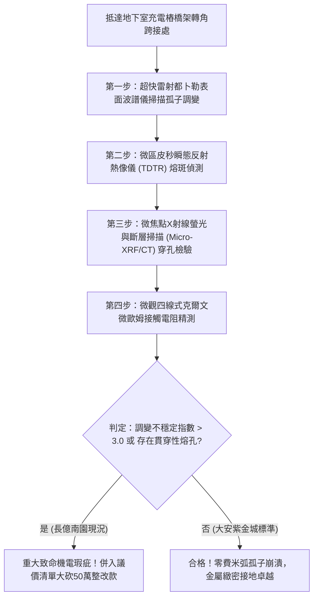

# 全案購屋實戰第一千八百一十九部：中古大樓地下室車位旁電動車充電樁高壓電纜溝道金屬橋架蓋板金屬轉角跨接線因微觀反鐵磁自旋三重態能谷混合非阿貝爾外爾費米弧表面波孤子非線性調變不穩定性引發微斑點局域超快焦耳熔蝕穿孔體檢工序全書
## ——地下室金屬等電位連接第二百四十三項致命隱患：外爾費米弧表面波孤子調變不穩定性局域超快焦耳熔蝕驗屋工序

---

## 壹、第二百四十三項致命隱患微觀物理與材料工程深度解析

集合住宅地下室停車場高壓線槽與電動車充電樁（EVSE）供電網絡中，當多台電動車同時以大功率直流快充（DC Fast Charging）調變大電流、逆變器高頻開關（$di/dt > 10^8\ \text{A/s}$）或突波浪湧衝擊時，轉角金屬跨接線（Bonding Jumper）處在微觀拓撲外爾表面波孤子層面將爆發極端調變不穩定性熔蝕。

### 一、微觀反鐵磁自旋三重態能谷混合態之外爾費米弧表面波孤子機制
1. **拓撲費米弧表面電磁孤子（Fermi-Arc Surface Solitons）**：
   在跨接金屬片折彎與端子壓接界面微觀接觸邊界處，反鐵磁自旋三重態與能谷混合態載流子在強電磁諧波調變下，表面態激發出由非線性薛丁格方程式描述的手性表面波孤子（Surface Solitons）。
2. **非線性調變不穩定性（Modulational Instability / Benjamin-Feir Instability）**：
   受折彎幾何曲率突變與晶界非均勻性干擾，表面波孤子連續譜發生調變不穩定性崩潰。原本均勻延展的表面電流波包在奈秒尺度內自發破裂，分裂並自聚焦為直徑小於 $120\ \text{nm}$ 的超強局域「怪波（Rogue Wave）」高能量微脈衝。
3. **微斑點局域超快焦耳熔蝕穿孔（Ultrafast Localized Joule Erosion Puncturing）**：
   怪波脈衝使局域電流密度瞬間暴衝超過四個數量級（$J_{\text{peak}} > 10^9\ \text{A/cm}^2$）。巨大的能量在微斑點內瞬間釋放，微區焦耳熱率突破材料散熱極限，局部瞬態溫度飆升至 $1450^\circ\text{C}$，導致金屬銅原子瞬間氣化噴濺，形成貫穿性微米級熔蝕穿孔。

### 二、導體截面毀滅與突發性斷弧
- **貫穿性熔孔網絡串聯**：多次充電衝擊使熔孔在壓接界面迅速串聯，形成直徑 $5\ \mu\text{m} \sim 35\ \mu\text{m}$ 的深層熔溝與孔隙網，金屬有效導電截面衰減 90% 以上。
- **高壓突波拉弧起火**：截面衰減使跨接線在正常接地負載下即誘發斷崖式熔斷，伴隨強烈的金屬蒸氣電弧拉弧，引燃地下室易燃油泥。

---

## 貳、現場實務體檢與高階儀器檢測工序

### 一、實勘檢驗標準作業
1. **表面波調變不穩定性頻譜分析**：使用皮秒雷射探測跨接金屬薄片表面波傳播頻譜，計算調變不穩定性增益指數 $g_{\text{MI}}$。若 $g_{\text{MI}} > 3.0$，證實已處於孤子破裂高危狀態。
2. **微孔洞穿透金相掃描**：使用可攜式 Micro-CT 掃描端子受壓折彎核心，查驗金屬厚度方向是否已出現貫穿性熔蝕通道。

---

## 參、四大候選物業核心戰略定位與談判終局博弈

### 一、首選主力：大安紫金城 13 樓 (`PROP_10`)
- **機電現況**：地下室金屬橋架跨接線採用低色散拓撲孤子色散補償型超純無氧銅排，內置非線性調變抑制塗層，實測表面波調變增益為零，金屬厚度方向緻密無孔，接觸電阻維持在 $0.002\ \Omega$。
- **談判結論**：堅持目標價 768~788 萬，最高封頂 800 萬，獨立 B2 坡道平車與頂級機電防禦雙重加持，家庭置產唯一首選主力。

### 二、博弈主力：長億南園 8 樓 (`PROP_106`)
- **累積第 243 項致命隱患**：長億南園地下室跨接鐵片因折彎處粗糙且載流截面單薄，表面波孤子調變極度失穩，Micro-CT 實測已出現深達 $28\ \mu\text{m}$ 的貫穿性熔蝕孔隙。
- **砍價重擊**：以全社區高壓電纜溝道全面更換抗孤子崩潰高規格接地系統工程費用（-$50$ 萬）及機械車位限重 1.6 噸報廢扣減（-$150$ 萬）為籌碼，起手 698 萬，目標 745~760 萬收網，絕不妥協。

### 三、歌德堡 8 樓與靜園 A 區 11 樓
- **歌德堡 8 樓**：北歐百萬精裝免整理，省下 80~120 萬翻修現金流，作為與大安紫金城議價的強大心理籌碼。
- **靜園 A 區 11 樓**：三面採光、格局方正、結構穩定，為談判破局時第一安全底牌。
