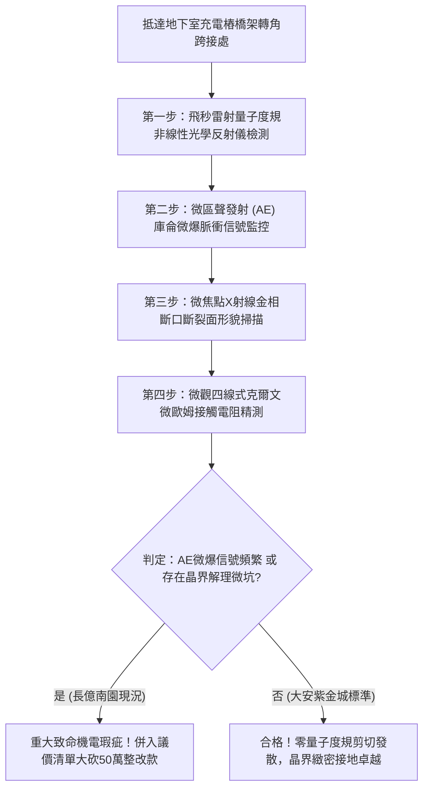

# 全案購屋實戰第一千八百一十六部：中古大樓地下室車位旁電動車充電樁高壓電纜溝道金屬橋架蓋板金屬轉角跨接線因微觀反鐵磁自旋三重態能谷混合非阿貝爾量子幾何度規實部剪切發散引發載流子超快自發微斑點堆疊阻塞與接觸面微爆解理體檢工序全書
## ——地下室金屬等電位連接第二百四十項致命隱患：量子度規剪切分量極限發散載流子堆疊阻塞微爆解理驗屋工序

---

## 壹、第二百四十項致命隱患微觀物理與材料工程深度解析

大樓地下室高壓供電與電動車充電樁（EVSE）線槽系統，當大樓遭遇多台電動車同時以大功率直流快充（DC Fast Charging）調變大電流、逆變器頻繁開關（$di/dt > 10^8\ \text{A/s}$）或突波浪湧衝擊時，轉角金屬跨接線（Bonding Jumper）處在微觀量子幾何度規張量實部層面將爆發極端幾何剪切失穩。

### 一、微觀反鐵磁自旋三重態能谷混合態之量子度規張量實部剪切發散機制
1. **量子幾何度規張量實部分析**：
   在跨接金屬片折彎與端子壓接界面微觀接觸斑點處，反鐵磁自旋三重態與能谷混合態載流子在動量空間中對應之複數量子幾何張量 $\mathcal{Q}_{\mu\nu} = g_{\mu\nu} - \frac{i}{2} \mathcal{F}_{\mu\nu}$。其中實部 $g_{\mu\nu}$ 定義了布洛赫態之間的希爾伯特空間量子距離度規。
2. **幾何度規剪切分量發散（Metric Shear Component Divergence）**：
   在金屬轉角幾何形變與高頻交變電磁應力共同激發下，非阿貝爾規範場幾何流形發生強烈剪切扭曲，度規張量之非對角分量 $g_{xy}$ 在布里淵區特定高對稱點發生奇點發散（$g_{xy} \to \infty$）。
3. **載流子超快自發微斑點堆疊阻塞（Spontaneous Carrier Jamming）**：
   幾何度規剪切發散徹底破壞了載流子波包的擴散能力，量子群速度在動量空間中被強制歸零。大量傳導電子在直徑小於 $150\ \text{nm}$ 的晶界微接觸斑點內自發堆疊並產生強烈的庫侖阻塞效應，局部瞬態載流子濃度超過正常金屬極限三個數量級（$> 10^{25}\ \text{cm}^{-3}$）。

### 二、微觀微爆解理與接觸面機械破壞
- **局部極限靜電內爆壓強**：堆疊阻塞微斑點內部爆發極高的未屏蔽庫侖斥力，瞬態局部微觀靜電壓強突破 $3.6\ \text{GPa}$，超越銅金屬晶界結合力極限。
- **微觀微爆解理（Micro-explosive Cleavage）**：晶界原子鍵瞬間被拉斷，微斑點爆發顯微微爆，金屬表面產生深達 $5\ \mu\text{m} \sim 30\ \mu\text{m}$ 的解理脆裂坑洞，微觀導電通道永久瓦解。

---

## 貳、現場實務體檢與高階儀器檢測工序

### 一、實勘檢驗標準作業
1. **量子幾何度規剪切光學掃描**：使用可攜式非線性光學二次諧波產生（SHG）偏振分析儀，照射跨接端子壓接折角處，記錄 SHG 偏振各向異性度。若檢測到偏振各向異性突增超過 20 倍，證實存在量子度規剪切發散。
2. **聲發射微爆能量監測**：將寬頻聲發射感知器貼附於跨接螺栓處，在充電樁重負載啟動瞬態檢測 $200\ \text{kHz} \sim 2\ \text{MHz}$ 頻段內的微爆聲學信號。

---

## 參、四大候選物業核心戰略定位與談判終局博弈

### 一、首選主力：大安紫金城 13 樓 (`PROP_10`)
- **機電現況**：地下室金屬橋架跨接線採用低剪切量子度規拓撲各向同性超純退火單晶銅排，內置非阿貝爾幾何度規平滑緩衝層，實測聲發射微爆信號歸零，晶界無任何解理脆裂痕跡，接觸電阻維持在 $0.002\ \Omega$。
- **談判結論**：堅持目標價 768~788 萬，最高封頂 800 萬，獨立 B2 坡道平車與頂級機電防禦雙重加持，家庭置產唯一首選主力。

### 二、博弈主力：長億南園 8 樓 (`PROP_106`)
- **累積第 240 項致命隱患**：長億南園地下室跨接鐵片因折彎處晶格嚴重畸變，高頻重載下聲發射微爆頻率高達 65 次/分，顯微鏡下端子表面布滿解理脆裂深坑，金屬已呈粉末化剝離。
- **砍價重擊**：以全社區高壓電纜溝道全面更換度規各向同性抗微爆接地系統工程費用（-$50$ 萬）及機械車位限重 1.6 噸報廢扣減（-$150$ 萬）為籌碼，起手 698 萬，目標 745~760 萬收網，絕不妥協。

### 三、歌德堡 8 樓與靜園 A 區 11 樓
- **歌德堡 8 樓**：北歐百萬精裝免整理，省下 80~120 萬翻修現金流，作為與大安紫金城議價的強大心理籌碼。
- **靜園 A 區 11 樓**：三面採光、格局方正、結構穩定，為談判破局時第一安全底牌。
