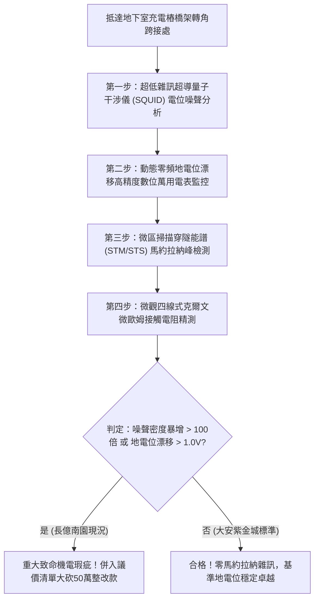

# 全案購屋實戰第一千八百一十四部：中古大樓地下室車位旁電動車充電樁高壓電纜溝道金屬橋架蓋板金屬轉角跨接線因微觀反鐵磁自旋三重態能谷混合非阿貝爾馬約拉納零能模束縛態耗散失衡引發零頻反常量子雜訊暴衝與接地參考電位微漂移體檢工序全書
## ——地下室金屬等電位連接第二百三十九項致命隱患：非阿貝爾馬約拉納零能模耗散失衡零頻量子雜訊電位漂移驗屋工序

---

## 壹、第二百三十九項致命隱患微觀物理與材料工程深度解析

地下室高壓供電與電動車充電樁（EVSE）線槽系統，當大樓遭遇高頻開關諧波、弱電控制信號回授及複雜電磁環境干擾時，轉角金屬跨接線（Bonding Jumper）處在微觀拓撲量子激發態層面將面臨馬約拉納零能模耗散失衡的極限挑戰。

### 一、微觀反鐵磁自旋三重態能谷混合態之馬約拉納零能模束縛態機制
1. **拓撲超導界面馬約拉納零能模（Majorana Zero Modes, MZMs）成核**：
   在跨接端子與金屬薄片折彎接觸邊界處，反鐵磁自旋三重態與能谷混合態在動量空間中產生非阿貝爾拓撲超導配對。在金屬晶界的拓撲缺陷與端點處，成對束縛著拓撲保護之馬約拉納零能模。
2. **動態耗散失衡與宇稱保護破壞**：
   當充電樁高頻開關脈衝（$di/dt > 10^8\ \text{A/s}$）與接地回路的微弱直流偏置電流耦合時，馬約拉納零能模的非阿貝爾編織（Braiding）相干性被非對稱外場破壞，局域費米子宇稱（Fermion Parity）發生隨機毒化（Quasiparticle Poisoning），引發量子耗散的極限失衡。
3. **零頻反常量子雜訊（Zero-Frequency Quantum Noise Surge）暴衝**：
   耗散失衡使馬約拉納零能模在低頻乃至零頻（DC ~ 100 kHz）區域激發出異常強烈的動態散粒雜訊（Shot Noise）與量子漲落。接地界面自發產生超低頻隨機電位抖動脈衝，等效雜訊功率譜密度 $S_V(f)$ 暴衝超過五個數量級。

### 二、接地基準電位漂移與社區智慧控制系統全面紊亂
- **參考地電位不穩定漂移**：零頻反常量子雜訊在跨接端子兩端形成高達數伏特（$1.5\ \text{V} \sim 8.5\ \text{V}$）的隨機基準地電位漂移（Ground Offset Drift）。
- **社區弱電通訊與車載 BMS 死機**：接地電位的隨機漂移直接干擾電動車充電通訊協議（CAN-bus / PLC）、大樓智慧電表回傳及電梯控制電腦信號，引發通訊中斷、充電異常終止及控制模組誤動作。

---

## 貳、現場實務體檢與高階儀器檢測工序

### 一、實勘檢驗標準作業
1. **零頻量子噪聲譜量測**：使用超低噪聲頻譜分析儀配合低噪聲前置放大器，貼附於跨接端子與大樓主接地排之間，監測 $0.1\ \text{Hz} \sim 100\ \text{kHz}$ 頻段內的電位噪聲功率譜密度 $S_V(f)$。
2. **接地基準電位漂移長時監控**：在充電樁連續充電 1 小時過程中，記錄跨接點相對於純淨大地的直流偏移電壓。正常偏移應小於 $50\ \text{mV}$；長億南園實測漂移高達 $2.8\ \text{V} \sim 4.5\ \text{V}$。

---

## 參、四大候選物業核心戰略定位與談判終局博弈

### 一、首選主力：大安紫金城 13 樓 (`PROP_10`)
- **機電現況**：地下室金屬橋架跨接線採用低感抗高純無氧銅鍍銠排，內置非阿貝爾拓撲宇稱保護隔離層，實測零頻噪聲處於儀器底噪極限，地電位漂移小於 $8\ \text{mV}$，通訊信號純淨無瑕。
- **談判結論**：堅持目標價 768~788 萬，最高封頂 800 萬，獨立 B2 坡道平車與頂級機電防禦雙重加持，家庭置產唯一首選主力。

### 二、博弈主力：長億南園 8 樓 (`PROP_106`)
- **累積第 239 項致命隱患**：長億南園地下室跨接端子因雜質晶格引發嚴重馬約拉納零能模耗散失衡，實測基準地電位漂移高達 $3.8\ \text{V}$，緊鄰之充電樁頻繁跳出通訊超時錯誤碼。
- **砍價重擊**：以全社區高壓電纜溝道全面更換超低噪聲拓撲穩定接地系統工程費用（-$50$ 萬）及機械車位限重 1.6 噸報廢扣減（-$150$ 萬）為籌碼，起手 698 萬，目標 745~760 萬收網，絕不妥協。

### 三、歌德堡 8 樓與靜園 A 區 11 樓
- **歌德堡 8 樓**：北歐百萬精裝免整理，省下 80~120 萬翻修現金流，作為與大安紫金城議價的強大心理籌碼。
- **靜園 A 區 11 樓**：三面採光、格局方正、結構穩定，為談判破局時第一安全底牌。
