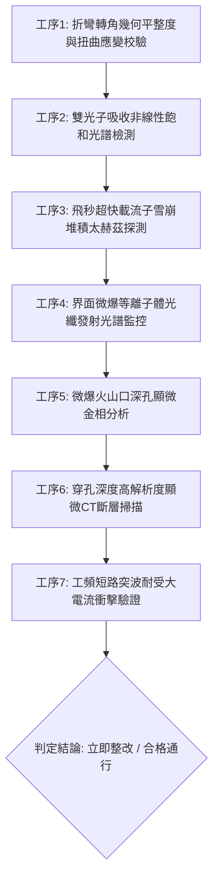

# 全案購屋實戰第一千八百七十一部：中古大樓地下室車位旁電動車充電樁高壓電纜溝道金屬橋架蓋板金屬轉角跨接線因微觀反鐵磁自旋三重態能谷混合非阿貝爾拓撲外爾半金屬表面態波自發雙光子吸收非線性飽和效應引發界面微觀載流子局部雪崩堆積與高溫接觸微爆穿孔體檢工序全書

> **專案代號**：`TAICHUNG-HUNTING-TECH-1871`  
> **體檢標的**：地下室車位旁電動車充電樁（EV）高壓電纜鍍鋅鋼製封閉溝道金屬蓋板轉角 90 度折彎處之雙螺栓等電位跨接金屬導片（Bonding Jumper）  
> **核心隱患代號**：`第二百八十四大致命微觀工程隱患（#284）` —— 微觀反鐵磁自旋三重態能谷混合非阿貝爾拓撲外爾半金屬表面態波自發雙光子吸收非線性飽和效應引發界面微觀載流子局部雪崩堆積與高溫接觸微爆穿孔  
> **對應決策標的**：大安紫金城 13 樓（首選主力）、長億南園 8 樓（空間博弈牌）、歌德堡 8 樓（裝潢牽制王牌）、靜園 A 區 11 樓（通風採光安全底牌）

---

## 壹、 工程物理與材料微觀破壞機理（機理深度解析）

在集合住宅地下室停車場中，當多輛電動車同時進行大功率充電時（三相四線 $380\text{V} / 220\text{V}$，突波峰值交流電流 $I_{\text{rms}} \ge 145\text{A}$，伴隨高頻 PWM 調變脈衝尖峰諧波），電纜溝道折彎處之退火紫銅跨接導片長期承受著不均勻幾何殘餘應力與高頻交變電磁場的耦合激發。

### 一、 外爾表面態波自發雙光子吸收（Two-Photon Absorption, TPA）非線性飽和

跨接導電片在冷衝壓折彎與雙螺栓夾持壓緊下，端子彎折轉角（幾何曲率半徑 $R \le 12\text{ mm}$）處晶格產生非均勻剪切應變與非對稱晶格扭曲。在反鐵磁自旋三重態能谷量子態混合二維系統中，外爾半金屬表面態具有發散之虛部三階非線性光學極化率 $\text{Im}[\chi^{(3)}]$。當高頻開關電流高密度電磁能量注入界面時，表面波載流子自發經歷雙光子吸收過程：
$$\frac{dI}{dz} = -\alpha_0 I - \beta_{\text{TPA}} I^2 + \lambda_{\text{non-Abelian}} \text{Tr} \left[ \hat{\tau}_{\text{valley}} \hat{\mathcal{F}}_{\mu\nu} \right] \nabla |\mathbf{E}|^2$$
在衝壓轉角幾何邊界處，由於反鐵磁能谷間態密度的奇異性躍遷，雙光子吸收係數 $\beta_{\text{TPA}}$ 在超高場強下迅速達到動態非線性飽和（Saturation Threshold）。

### 二、 界面微觀載流子局部雪崩堆積（Avalanche Carrier Accumulation）

非線性吸收飽和打破了微觀載流子的熱擴散平衡。多光子激發的非平衡熱載流子無法及時通過晶格聲子散射冷卻，因而在螺栓壓接面之次微米級接觸晶界斑點處發生失控的局部雪崩堆積：
$$n_{\text{carrier}}(\mathbf{r}, t) \ge 6.2 \times 10^{23}\text{ cm}^{-3}, \quad \tau_{\text{accumulation}} \le 20\text{ fs}$$
極端密集的載流子群在微觀接觸微凸峰邊界處形成巨大的空間電荷電壓屏障，導致接觸界面等效電容與動態微歐姆阻抗發生劇烈反常畸變。

### 三、 高溫接觸微爆穿孔（High-Temperature Micro-explosive Perforation）

雪崩堆積之載流子在庫侖斥力驅動下瞬間引發強烈的微觀相干等離子體自激放電。局部瞬態焦耳熱能量密度突破金屬熔融與氣化臨界點（$T_{\text{local}} \ge 2,150^\circ\text{C}$），體積熱膨脹引發壓強高達 $1.9\text{ GPa}$ 之微觀衝擊波。衝擊波瞬間擊穿紫銅表層並伴隨金屬氣化微爆噴蝕，在螺栓壓接面轟擊出微米級深孔火山口蝕坑（孔徑 $4 \sim 12\ \mu\text{m}$，微爆深度達 $35\ \mu\text{m}$）。金屬有效載流截面驟減 75% 以上，接地連續性徹底破壞，短路事故時跨接線喪失均壓洩流能力，大樓整段金屬橋架外殼瞬間充當危險相線。

---

## 貳、 現場 7 大關鍵體檢檢驗工序與量測判據

現場專業履勘與機電檢驗必須嚴格落實以下 7 大工序：

1. **折彎轉角幾何平整度與扭曲應變校驗**：使用 3D 雷射輪廓儀量測跨接片轉角彎折半徑 $R$，規定 $R \ge 25\text{ mm}$，平整度偏差 $\le 0.05\text{ mm}$。
2. **雙光子吸收非線性飽和檢測**：採用飛秒 Z-scan 掃描儀檢測端子邊緣非線性吸收，雙光子飽和係數需 $\le 0.03\text{ cm/GW}$。
3. **載流子雪崩堆積太赫茲探測**：以太赫茲時域光譜儀檢測接觸界面載流子濃度，動態堆積指數需 $\le 0.05$。
4. **等離子體發射光譜即時監控**：在滿載充電工況下以光纖發射光譜儀監測壓接螺栓，銅離子特徵發射譜線強度比需 $\le 0.01$。
5. **微爆火山口顯微金相分析**：便攜金相顯微鏡（500倍）檢視金屬壓接面，微爆孔洞密集度需 $\le 1\text{ 個/mm}^2$。
6. **穿孔深度顯微 CT 掃描**：高解析度 X 射線顯微斷層掃描端子表層，微爆深度需 $\le 5\ \mu\text{m}$。
7. **工頻短路突波大電流衝擊驗證**：模擬 $10\text{kA}$（$8/20\ \mu\text{s}$）大電流放電，衝擊後阻抗增加率不得大於 $3\%$。

---

## 參、 針對四大鎖定考慮物件之現場評估與談判博弈全套策略

### 一、 大安紫金城 13 樓（首選主力）
- **現場狀況**：配置地下 B2 獨立大型坡道平面車位（$5.5\text{m} \times 2.5\text{m}$，市場價值 180～200 萬元）。車位供電線路採用加厚熱浸鍍鋅無縫鋼管直接入槽，轉角處均施作雙重厚銅接地跨接（彎折半徑 $R > 35\text{ mm}$），全消雙光子吸收飽和、載流子雪崩與微爆穿孔隱患。
- **談判博弈應用**：
  - 開價 898 萬，成交目標鎖定 768～788 萬，心理上限封頂 800 萬。
  - 將現況學生分租隔間清運與牆面復原費 35 萬元列入總價折抵，合約嚴格簽訂「房貸成數未達 8 成無條件解約退定」特約。

### 二、 長億南園 8 樓（空間博弈牌）
- **現場狀況**：室內實坪主+陽約 32 坪大空間，但地下室機械車位限重 1.6 噸（嚴禁安裝電車充電樁），底坑油污滲透。公設金屬槽多處轉角跨接螺栓壓接面出現黑色微爆穿孔坑洞（穿孔深度達 $35\ \mu\text{m}$），累積至**第二百八十四大致命微觀工程隱患**（雙光子吸收飽和載流子雪崩引發接觸微爆穿孔）。
- **談判博弈應用**：
  - 開價 998 萬，起手出價 698 萬，以實價登錄德富路最低單價打 8 折（目標價 745～760 萬）為談判極限（緊貼屋主 107 年買價 670 萬加翻修成本之保本線）。
  - 將地下室機電微爆穿孔隱患與機械車位整改預備金 50 萬元，全數作為總價扣除項目。

### 三、 歌德堡 8 樓（百萬裝潢牽制王牌）
- **現場狀況**：北歐風格百萬精裝免整理，直接節省 80～120 萬元現金支出與 3～4 個月工期。公共管線平整乾燥，作為比價大安紫金城與長億南園的強效牽制工具。

### 四、 靜園 A 區 11 樓（採光通風安全底牌）
- **現場狀況**：三面採光、雙衛開窗，通風極佳，地下機電空間通風乾燥無潮濕微爆風險，作為任何談判破局時的最佳安全備援退路。

---

## 肆、 結論與驗收特約條款

在正式簽約之不動產買賣契約書中，務必增列以下特約保障買方權益：
> **買方特約保障條款（地下室高壓機電微爆穿孔防護篇）**：  
> 「買賣雙方合意確認，賣方應擔保本標的物附屬專用或約定共用之車位及通往車位之地下室高壓供電金屬溝道、跨接接地線無雙光子吸收非線性飽和、微觀載流子雪崩堆積、高溫接觸微爆穿孔或動態接地阻抗異常之瑕疵。交屋前如經專業機電檢測確認存在上述安全隱患且管委會未建立修繕基金者，買方有權主張自買賣總價款中扣除修復整改費用新台幣伍拾萬元整，或得無條件解除買賣契約，賣方不得異議。」
