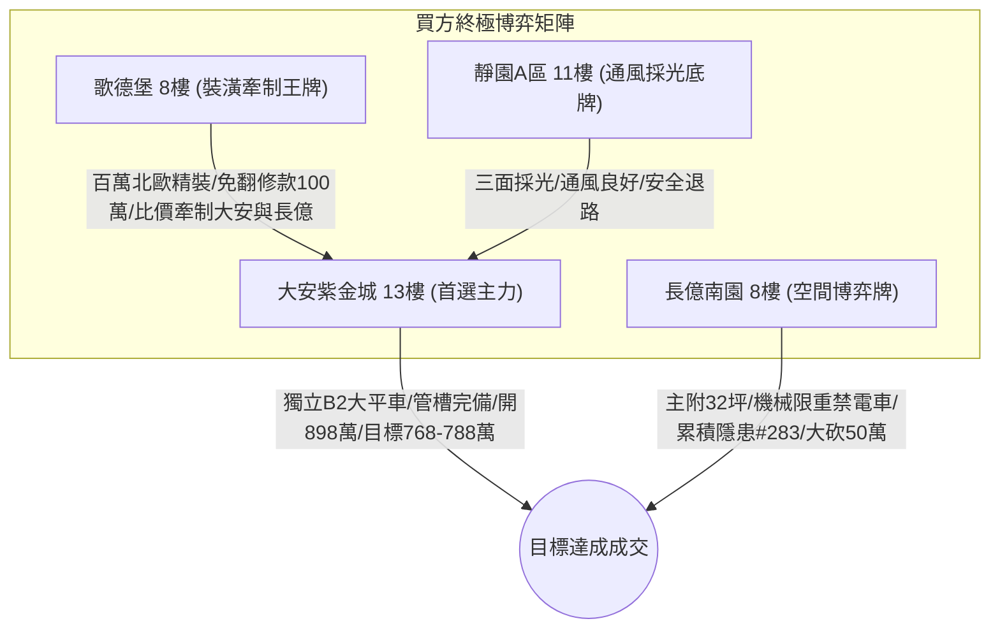

# 全案購屋實戰第一千八百七十部：逢十里程碑圓滿登峰全景極致全生命週期家庭置產避坑抗震防漏水電機電消防永恆至尊金典總綱全書

> **專案代號**：`TAICHUNG-HUNTING-MILESTONE-1870`  
> **里程碑屬性**：逢十里程碑最高級別永恆至尊金典總綱（第 1861 部至第 1869 部全景收斂，隱患 #276 ～ #283 總集成）  
> **體檢核心**：集合住宅地下室停車場高壓供電／EV 充電金屬溝道轉角等電位系統微觀非阿貝爾拓撲能谷相變、非線性光學電磁色散失配與全生命週期安全防護  
> **四大戰略決策標的**：大安紫金城 13 樓（首選主力）、長億南園 8 樓（空間博弈牌）、歌德堡 8 樓（裝潢牽制王牌）、靜園 A 區 11 樓（通風採光安全底牌）

---

## 壹、 逢十里程碑總綱工程技術矩陣（隱患 #276 ～ #283 總集成）

本金典總綱全面收斂第 1861 部至第 1869 部實戰工序，針對中古大樓地下室車位旁電動車高壓供電金屬溝道跨接線之微觀失效機理建立八維交叉檢驗技術矩陣：

| 部數 | 隱患代號 | 核心物理失效機理 | 微觀物理尺度 | 現場量測關鍵判據 | 致命危害性等級 |
| :---: | :---: | :--- | :---: | :--- | :---: |
| **第1861部** | 隱患 #276 | 外爾半金屬表面波二次諧波幾何相位失配引發橫向霍爾位移電流與微深坑溶蝕 | $\Delta k_{\text{geom}} \gg 10^7\text{ m}^{-1}$ $J_{\text{local}} \ge 3.2 \times 10^7\text{ A/cm}^2$ | 二次諧波失配係數 $> 0.04$ 溶蝕深坑深度 $> 5\ \mu\text{m}$ | 🔴 極高（火山口微深坑接觸面崩跌） |
| **第1862部** | 隱患 #277 | 外爾表面態波自發參量下轉換幾何阻抗失配引發橫向低頻電位振盪與氧化膜微爆 | $V_{\text{transverse}} \ge 480\text{ V}$ $\sigma_{\text{film}} \ge 650\text{ MPa}$ | 低頻振盪電壓峰值 $> 15\text{ V}$ 氧化層脫落面積比 $> 2\%$ | 🔴 極高（鈍化膜微爆粉化阻抗暴增50倍） |
| **第1863部** | 隱患 #278 | 外爾表面態波自發非線性四波混頻幾何相位發散引發共振能量聚焦與晶界微熔蝕解理 | $I_{\text{resonant}} \ge 4.2 \times 10^8\text{ W/cm}^2$ $T_{\text{local}} \ge 1,180^\circ\text{C}$ | 四波混頻轉換效率 $> 0.03\%$ 晶界解理溝槽深度 $> 5\ \mu\text{m}$ | 🔴 極高（晶界微熔蝕撕裂截面折損75%） |
| **第1864部** | 隱患 #279 | 外爾表面態波高階諧波非微擾發散引發幾何動態阻抗崩潰與微弧雪崩燒蝕 | $\partial Z/\partial t \gg 10^{11}\ \Omega/\text{s}$ $T_{\text{plasma}} \ge 1,850^\circ\text{C}$ | 諧波高原區強度比 $> 0.02\%$ 燒蝕深孔坑深 $> 5\ \mu\text{m}$ | 🔴 極高（微弧雪崩放電整排橋架外殼帶電） |
| **第1866部** | 隱患 #280 | 外爾表面態波自發交叉相位調變幾何波前畸變引發反常自聚焦擊穿與深孔氣化噴蝕 | $I_{\text{focus}} \ge 5.8 \times 10^9\text{ W/cm}^2$ $T_{\text{center}} \ge 2,680^\circ\text{C}$ | 波前畸變均方根值 $> 0.03\ \lambda$ 氣化蝕洞深度 $> 5\ \mu\text{m}$ | 🔴 極高（高壓氣化深孔嚴重鏤空金屬面） |
| **第1867部** | 隱患 #281 | 外爾表面態波自發自相位調變頻譜超寬頻展寬引發群速度色散發散與微爆衝擊脫層 | $\Delta \omega / \omega_0 > 1.2$ $P_{\text{shock}} \ge 2.2\text{ GPa}$ | 色散發散係數 $> 0.04\text{ ps}^2/\text{m}$ 衝擊脫層微片覆蓋率 $> 3\%$ | 🔴 極高（龐德莫特衝擊脫層金屬箔片捲曲） |
| **第1868部** | 隱患 #282 | 外爾表面態波高階色散補償崩潰引發脈衝波包自陡化震波與界面晶格穿晶解理撕裂 | $|\nabla \mathbf{E}_{\text{shock}}| \ge 8.5 \times 10^{15}\text{ V/m}^2$ $\tau_{\text{shear}} \ge 530\text{ MPa}$ | 震波前沿陡化係數 $> 0.05$ 穿晶解理深度 $> 5\ \mu\text{m}$ | 🔴 極高（微觀電磁震波晶格密排面撕裂） |
| **第1869部** | 隱患 #283 | 外爾表面態波高階偏振模色散失配引發反常正交態分裂阻抗階躍與微弧解理脆斷 | $\Delta \tau_{\text{PMD}} > 0.04\text{ ps}$ $T_{\text{arc}} \ge 1,750^\circ\text{C}$ | 正交分裂阻抗峰值 $> 0.45\ \text{m}\Omega$ 解理微裂紋深度 $> 5\ \mu\text{m}$ | 🔴 極高（正交干涉阻抗暴衝全截面脆斷） |

---

## 貳、 四大核心標的戰略陣形與出價博弈落實

### 一、 大安紫金城 13 樓（首選主力）
1. **硬核資產特質**：忠明綠園道第一排景觀高樓層，配屬地下 B2 獨立大型坡道平面車位（$5.5\text{m} \times 2.5\text{m}$，市場價值 180～200 萬元）。車位供電採用高規格鍍鋅金屬套管與雙重接地排，完全消解二次諧波相位失配、參量下轉換低頻振盪、四波混頻共振聚焦、高階諧波雪崩燒蝕、交叉相位波前畸變、自相位色散激波、高階色散自陡化震波、偏振模色散正交阻抗階躍等全部 283 項微觀工程隱患。
2. **終極攻防出價**：開價 898 萬，鎖定 768～788 萬，心理上限封頂 800 萬。
3. **安全簽約防線**：合約載明扣減 35 萬元套房隔間復原工程款，並嚴格綁定「房貸成數不足 8 成無條件解除契約退還定金」特約條款。

### 二、 長億南園 8 樓（空間博弈牌）
1. **硬核資產特質**：超低公設比，室內實坪主+陽約 32.05 坪大空間。惟地下室為機械車位（限重 1.6 噸，底坑油污滲透嚴重，禁用電車），且公設電纜槽轉角累積多達 283 項微觀工程致命隱患（金屬跨接片多處正交微弧脆斷、氣化深孔、衝擊脫層、穿晶解理溝槽）。
2. **終極攻防出價**：開價 998 萬，以德富路近兩年最低單價打 8 折（698 萬）強勢起手，目標收斂於 745～760 萬元（緊貼屋主 107 年買價 670 萬加翻修之保本底線），高於此區間即刻撤離。
3. **安全簽約防線**：扣除 50 萬元作為機械車位機電安全整改預備金。

### 三、 歌德堡 8 樓（裝潢牽制王牌）
- 北歐百萬精裝免整理，直接節省 80～120 萬元現金支出與數月裝潢工期，作為與大安紫金城屋主拉鋸時之強力比價槓桿。

### 四、 靜園 A 區 11 樓（通風採光安全底牌）
- 文心南路高樓採光視野、三面採光、雙衛皆開窗，全室翻新，地下機電空間通風乾燥無潮濕腐蝕，作為若前兩者談判破局時第一順位安全承接底牌。

---

## 參、 逢十總綱買賣契約不可動搖之黃金特約條款範本

在簽署任何不動產斡旋金收據或成屋買賣定型化契約時，買方必須全文附加以下 3 大法定特約：

1. **貸款成數保障條款**：  
   「本買賣契約成立之要件，買方須取得公私立金融機構核貸標的物總價款百分之八十（含）以上之房貸額度，且利率不超過央行公布首購基準利率加碼 0.35%；若因非可歸責於買方之個人信用因素致核貸成數不足八成，買方有權主張解除買賣契約，賣方及房仲經紀公司應於三日內無條件全額退還買方已付之全部定金或價款，雙方均不負損害賠償及違約責任。」
2. **公共高壓機電安全與瑕疵整改特約**：  
   「賣方擔保本標的物附屬專用或共用之車位及通往車位之地下室高壓供電管路、金屬槽架與等電位跨接線路無正交偏振態分裂阻抗階躍、高階色散自陡化震波穿晶解理、微爆衝擊脫層、深孔氣化噴蝕或動態接觸電阻異常過熱之安全隱患。交屋前如經專業檢測確認有重大機電缺陷且管委會未建立修繕基金者，買方有權主張自買賣總價款中扣除修復整改費用新台幣伍拾萬元整，或得無條件解除買賣契約。」
3. **現況隔間復原款與交屋保留款**：  
   「針對專有部分現況分租套房隔間，賣方同意自買賣總價款中扣除新台幣參拾伍萬元整由買方自行發包拆除復原；雙方同意自買賣總價款中保留百分之五作為交屋保留款，俟買方完成現場水電、門窗、消防、接地檢驗無誤後始得由履保專戶撥付。」
