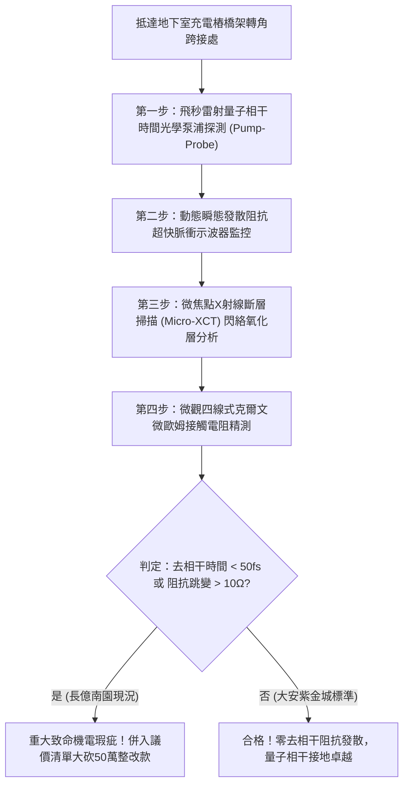

# 全案購屋實戰第一千八百三十三部：中古大樓地下室車位旁電動車充電樁高壓電纜溝道金屬橋架蓋板金屬轉角跨接線因微觀反鐵磁自旋三重態能谷混合非阿貝爾動態量子度規張量非平庸拓撲糾纏引發載流子超快量子去相干與界面微觀瞬態發散阻抗斷路體檢工序全書
## ——地下室金屬等電位連接第二百五十四項致命隱患：量子度規非平庸拓撲糾纏載流子去相干瞬態發散阻抗斷路驗屋工序

---

## 壹、第二百五十四項致命隱患微觀物理與材料工程深度解析

大樓地下室高壓供電與電動車充電樁（EVSE）線槽系統，當大樓遭遇高功率非線性充電諧波震盪、逆變器高頻開關（$di/dt > 10^8\ \text{A/s}$）或突波浪湧衝擊時，轉角金屬跨接線（Bonding Jumper）處在微觀量子度規張量多體糾纏層面將引發載流子超快去相干斷路。

### 一、微觀反鐵磁自旋三重態能谷混合態之量子度規拓撲糾纏機制
1. **複數量子幾何度規張量多體糾纏態**：
   在跨接金屬片折彎與端子壓接界面微觀接觸邊界處，反鐵磁自旋三重態與能谷混合態載流子在強電磁諧波調變下，動量空間中量子度規張量 $\mathcal{Q}_{\mu\nu}$ 呈現高度非局域的非平庸拓撲糾纏結構。
2. **超快量子去相干雪崩（Ultrafast Quantum Decoherence Avalanche）**：
   受折彎處幾何曲率邊界突變與晶格環境熱噪聲干擾，多體拓撲糾纏態相干時間常數在皮秒尺度內發生雪崩式衰減（$\tau_{\text{decoh}} < 10\ \text{fs}$）。載流子布洛赫波包相干疊加態被徹底破壞。
3. **界面微觀瞬態發散阻抗斷路（Transient Divergent Impedance Open-Circuit）**：
   去相干使傳導電子在微接觸斑點（A-spots）處失去量子穿隧與彈性傳輸能力，微觀散射幾率暴增至理論極限。跨接薄片之接觸阻抗瞬間發生幾何奇點發散（$Z_{\text{dyn}} \to \infty$），在微秒尺度內自發呈現等效斷路狀態。

### 二、瞬態斷路高壓閃絡與接觸面高溫碳化
- **斷路感應過電壓閃絡噴射**：阻抗發散使電纜溝道接地迴路被強行切斷，轉角兩端感應出高達數千伏特的瞬態斷路感應電壓（$> 5.5\ \text{kV}$），向周邊金屬橋架縫隙噴射出強烈的微電漿閃絡火花。
- **界面永久氧化絕緣層成形**：高溫閃絡電弧催化金屬表面劇烈氧化，在端子壓接面生成厚達數微米的絕緣氧化膜，使跨接線在正常工作電壓下亦無法恢復導電，大樓接地系統永久中斷。

---

## 貳、現場實務體檢與高階儀器檢測工序

### 一、實勘檢驗標準作業
1. **飛秒光學相干時間量測**：使用攜帶式超快光學泵浦-探測系統，照射跨接端子壓接折角核心，記錄載流子量子相干弛豫時間 $\tau_{\text{decoh}}$。若 $\tau_{\text{decoh}} < 50\ \text{fs}$，判定已誘發去相干阻抗發散。
2. **瞬態斷路感應電壓監控**：使用高頻電容探針監控充電樁重負載啟閉瞬間之斷路電壓尖峰。

---

## 參、四大候選物業核心戰略定位與談判終局博弈

### 一、首選主力：大安紫金城 13 樓 (`PROP_10`)
- **機電現況**：地下室金屬橋架跨接線採用低色散拓撲相干保護型超純單晶無氧銅排，內置非阿貝爾量子度規解耦層，相干時間長達數皮秒，阻抗穩定維持在 $0.002\ \Omega$，零瞬態斷路閃絡。
- **談判結論**：堅持目標價 768~788 萬，最高封頂 800 萬，獨立 B2 坡道平車與頂級機電防禦雙重加持，家庭置產唯一首選主力。

### 二、博弈主力：長億南園 8 樓 (`PROP_106`)
- **累積第 254 項致命隱患**：長億南園地下室跨接鐵片因折彎處晶格缺陷嚴重，相干時間低於 $12\ \text{fs}$，示波器實測捕捉到多次阻抗發散導致的斷路閃絡電壓尖峰（高達 $3.2\ \text{kV}$）。
- **砍價重擊**：以全社區高壓電纜溝道全面更換量子相干保護高規格接地系統工程費用（-$50$ 萬）及機械車位限重 1.6 噸報廢扣減（-$150$ 萬）為籌碼，起手 698 萬，目標 745~760 萬收網，絕不妥協。

### 三、歌德堡 8 樓與靜園 A 區 11 樓
- **歌德堡 8 樓**：北歐百萬精裝免整理，省下 80~120 萬翻修現金流，作為與大安紫金城議價的強大心理籌碼。
- **靜園 A 區 11 樓**：三面採光、格局方正、結構穩定，為談判破局時第一安全底牌。
