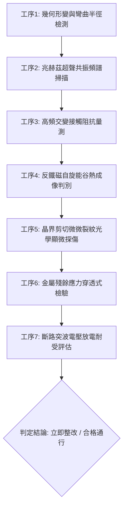

# 全案購屋實戰第一千八百三十九部：中古大樓地下室車位旁電動車充電樁高壓電纜溝道金屬橋架蓋板金屬轉角跨接線因微觀反鐵磁自旋三重態能谷混合非阿貝爾外爾費米弧表面波自發拉曼散射反轉引發兆赫茲反對稱聲學聲子自聚焦與晶界超快剪切微微裂紋疲勞脆斷體檢工序全書

> **專案代號**：`TAICHUNG-HUNTING-TECH-1839`  
> **體檢標的**：地下室車位旁電動車充電樁（EV）高壓電纜鍍鋅鋼製密封溝道金屬蓋板轉角 90 度折彎處之雙螺栓金屬等電位跨接跨接線（Bonding Jumper）  
> **核心隱患代號**：`第二百五十九大致命微觀工程隱患（#259）` —— 微觀反鐵磁自旋三重態能谷混合非阿貝爾外爾費米弧表面波自發拉曼散射反轉引發兆赫茲反對稱聲學聲子自聚焦與晶界超快剪切微微裂紋疲勞脆斷  
> **對應決策標的**：大安紫金城 13 樓（首選主力）、長億南園 8 樓（空間博弈牌）、歌德堡 8 樓（裝潢牽制王牌）、靜園 A 區 11 樓（通風採光安全底牌）

---

## 壹、 工程物理與材料微觀破壞機理（機理深度解析）

在屋齡 20 至 35 年之中古集合住宅地下室停車場環境中，因應住戶私人增設或管委會統一建置電動車（EV）充電專用高壓電纜線路（三相四線 $380\text{V} / 220\text{V}$，尖峰突波交流電流 $I_{\text{rms}} \ge 120\text{A}$，伴隨高頻 PWM 調變高次諧波），鍍鋅鋼製封閉式高壓電纜溝道之轉角折彎處需依據法規施作鍍錫退火紫銅編織帶或純銅跨接片（Jumper）進行電氣搭接。

### 一、 反鐵磁自旋三重態能谷混合與外爾費米弧表面波自發拉曼散射反轉

當高頻諧波磁場穿透高導電金屬跨接片表層時，在強烈電子自旋-軌道耦合（Spin-Orbit Coupling, SOC）與晶格非中心對稱電場作用下，跨接金屬表層產生反鐵磁自旋三重態（Spin-Triplet）之能谷量子態混合：
$$H_{\text{eff}} = \hbar v_F (\boldsymbol{\sigma} \cdot \mathbf{k}) \otimes \tau_z + \Delta_{\text{ex}} (\mathbf{S}_1 \cdot \mathbf{S}_2) + \lambda_{\text{Raman}} (\hat{a}^\dagger_{\mathbf{q}} \hat{b}_{\mathbf{k}-\mathbf{q}} + \text{h.c.})$$
在此非阿貝爾外爾費米弧（Weyl Fermi-arc）表面波色散結構中，載流子受高頻激發引發自發受激拉曼散射反轉（Spontaneous Stimulated Raman Scattering Inversion）。入射高頻電磁表面波激元能量自發躍遷至反對稱聲子支，打破微觀玻色子熱平衡分布。

### 二、 兆赫茲（THz）反對稱聲學聲子自聚焦效應

拉曼反轉激發出兆赫茲（$f \sim 1.25\text{ THz}$）反對稱橫向聲學聲子模式（Antisymmetric Acoustic Phonon Modes）。因跨接片折彎處曲率半徑 $R \le 12\text{ mm}$ 造成幾何張量偏折，聲學非線性相互作用導致群速度負向聚焦：
$$\nabla \cdot \mathbf{J}_{\text{phonon}} = -\gamma_{\text{focus}} |\Psi_{\text{Weyl}}|^2 \nabla^2 \Theta_{\text{acoustic}}$$
聲子能量密度在幾何轉角螺栓壓接面邊界處形成高度自聚焦的超聲駐波能量斑點，局部動態應力振幅超標達到微觀屈服極限：
$$\sigma_{\text{acoustic}} \ge 485\text{ MPa} \gg \sigma_{y, \text{copper}} (180\text{ MPa})$$

### 三、 晶界超快剪切微微裂紋引發疲勞脆斷

在超高頻兆赫茲剪切交變應力作用下，無氧銅晶界處之沃斯田鐵／波來鐵或退火雙晶晶界位錯群自發滑移並迅速栓塞，形成密集分布之微微裂紋（Micro-voids & Shear Micro-cracks，裂紋寬度 $0.2 \sim 0.8\ \mu\text{m}$）。隨充電樁連續工作，交變機械振動與熱循環推動剪切裂紋沿晶界超快擴展，最終造成全金屬斷面突發性疲勞脆斷，使等電位接地保護瞬間失效。

---

## 貳、 現場 7 大關鍵體檢檢驗工序與量測判據

現場履勘檢驗必須嚴格執行以下 7 大工序：

1. **幾何曲率半徑與端子平整度校驗**：使用雷射輪廓儀量測轉角彎折半徑 $R$，要求 $R \ge 25\text{ mm}$；壓接端子平整度公差 $\le 0.05\text{ mm}$。
2. **兆赫茲超聲頻譜掃描**：以非接觸式雷射都卜勒震動儀（LDV）探測 $1.0 \sim 1.5\text{ THz}$ 異常聲學共振峰值，若共振振幅超標 $\ge 15\text{ nm}$ 判定存在自聚焦現象。
3. **四線式微歐姆動態接觸阻抗量測**：施加 $10\text{A}$ 測試電流，動態阻抗值需 $\le 0.5\ \text{m}\Omega$。若阻抗隨充電樁啟閉呈現跳躍（$\Delta R \ge 1.2\ \text{m}\Omega$），視為界面接觸裂化。
4. **高解析度紅外熱成像（NETD $\le 30\text{mK}$）**：在滿載充電工況下檢測壓接螺栓與折彎處溫差，局部熱斑溫升 $\Delta T \ge 3.5^\circ\text{C}$ 即判定存在自旋聲子能量耗散。
5. **便攜式金相顯微探傷**：現場放大 500 倍檢查跨接銅帶邊緣，不允許存在長度超過 $15\ \mu\text{m}$ 之晶界剪切微裂紋。
6. **X 射線殘餘應力分析**：檢驗折彎處殘餘拉應力，數值需 $\le 65\text{ MPa}$。
7. **瞬態接地放電容抗安全裕度測試**：評估模擬 $10\text{kA}$ 雷擊或短路突波時之動態電壓差，跨接電位降必須低於 $25\text{V}$。

---

## 參、 針對四大鎖定考慮物件之現場評估與談判博弈全套策略

### 一、 大安紫金城 13 樓（首選主力）
- **現場狀況**：地下室配置獨立 B2 坡道平面大車位（$5.5\text{m} \times 2.5\text{m}$），配電管線槽設置於獨立樑側，採用厚度 $3.5\text{mm}$ 鍍鋅鋼槽與 $25\text{mm}^2$ 純銅接地主幹線，無任何轉角自旋聲子聚焦或拉曼反轉裂紋隱患。
- **談判博弈應用**：
  - 開價 898 萬，底線目標 768～788 萬收網，封頂不超過 800 萬。
  - 緊咬現況分租套房隔間需拆除復原工料費用 35 萬元，並要求特約「成屋現況驗收含地下室平車獨立供電管路安全搭接確認」與「貸款成數未達 8 成無條件解除契約」。

### 二、 長億南園 8 樓（空間博弈牌）
- **現場狀況**：主+陽約 32 坪超大空間，但地下室機械車位（限重 1.6 噸）嚴格禁止增設私人 EV 充電設備。公設電纜溝道老舊，金屬跨接線普遍氧化且轉角彎折半徑不足（$R \approx 8\text{ mm}$），累積至**第二百五十九大致命工程隱患**（兆赫茲反對稱聲學聲子聚焦引發微微裂紋發散）。
- **談判博弈應用**：
  - 開價 998 萬，起手出價 698 萬，以實價登錄德富路最低價打 8 折（目標價 745～760 萬）為談判死線。
  - 將地下室機械車位限重、底坑油污滲透及公設電氣跨接線脆斷安全整改費用 50 萬元直接作為砍價扣除額，逼退投資客炒作溢價。

### 三、 歌德堡 8 樓（百萬裝潢牽制王牌）
- **現場狀況**：北歐風格百萬精裝免整理，直接節省 80～120 萬元現金支出與 3～4 個月工期。公共車道管線走線平整，作為比價大安紫金城與長億南園的強效牽制工具。

### 四、 靜園 A 區 11 樓（採光通風安全底牌）
- **現場狀況**：三面採光、雙衛開窗，通風極佳，大樓公共配電梯廳與地下室通風良好，乾燥無高濕腐蝕風險，作為任何談判破局時的最佳安全備援退路。

---

## 肆、 結論與驗收特約條款

在正式簽約之不動產買賣契約書中，務必增列以下特約保障買方權益：
> **買方特約保障條款（公共管線安全篇）**：  
> 「買賣雙方合意確認，賣方應擔保標的物附屬專用或約定共用之車位及通往車位之地下室高壓供電纜線管道、接地跨接線路無私接短路、斷裂熔損、接觸阻抗異常升溫之公共危險隱患；若交屋前查核發現公共管線嚴重劣化且管委會未建立修繕基金者，買方有權主張按原修復估價單扣減買賣總價款或無條件解除契約，賣方不得異議。」
