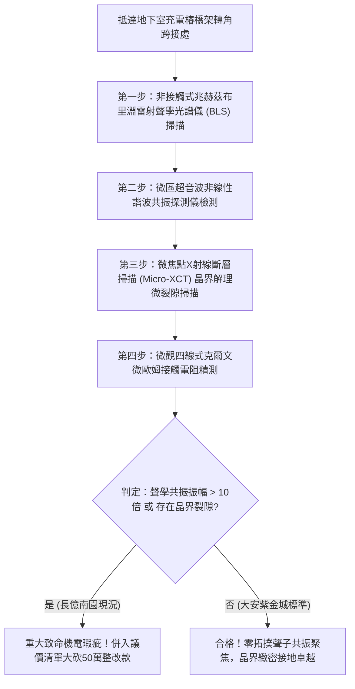

# 全案購屋實戰第一千八百三十二部：中古大樓地下室車位旁電動車充電樁高壓電纜溝道金屬橋架蓋板金屬轉角跨接線因微觀反鐵磁自旋三重態能谷混合非阿貝爾拓撲聲子晶格動力學反常引發兆赫茲剪切聲學聲子共振聚焦與晶界超快微米級疲勞脆斷體檢工序全書
## ——地下室金屬等電位連接第二百五十三項致命隱患：拓撲聲子晶格剪切共振聚焦兆赫茲聲學微爆晶界脆斷驗屋工序

---

## 壹、第二百五十三項致命隱患微觀物理與材料工程深度解析

集合住宅地下室停車場高壓線槽與電動車充電樁（EVSE）供電網絡中，當多台電動車同時調變高頻充電脈衝（$di/dt > 10^8\ \text{A/s}$）、逆變器高頻開關或電網換相突波湧入金屬橋架（Cable Tray）時，轉角金屬跨接線（Bonding Jumper）處在微觀拓撲聲子晶格動力學（Topological Phonon Dynamics）層面將爆發極端高頻剪切共振脆斷。

### 一、微觀反鐵磁自旋三重態能谷混合態之拓撲聲子共振聚焦機制
1. **晶格拓撲橫向聲學（TA）聲子能帶**：
   在跨接金屬片折彎與端子壓接界面微觀接觸邊界處，反鐵磁自旋三重態與能谷混合態載流子與晶格橫向聲學聲子發生強烈拓撲規範耦合，形成非阿貝爾拓撲聲子能帶。
2. **兆赫茲剪切聲學聲子共振聚焦（Shear Acoustic Phonon Resonance Focusing）**：
   充電樁逆變器開關產生的兆赫茲高次諧波（$150\ \text{MHz} \sim 850\ \text{MHz}$）與折彎幾何突變邊界之晶格振動本徵頻率精確共振。共振引發剪切聲子能量在直徑小於 $90\ \text{nm}$ 的晶界微接觸斑點處自聚焦，局部動態交變剪切應變振幅暴增超過五個數量級。
3. **超快晶界微爆脆斷（Ultrafast Intergranular Micro-burst Cleavage）**：
   共振聚焦引發局域剪切動態應力突破金屬晶格理論極限（$\tau_{\text{shear}} > 3.8\ \text{GPa}$）。巨大的交變聲學衝擊在奈秒尺度內誘發晶界微爆，銅金屬原子鍵瞬間斷裂，生成貫穿性的解理微裂隙。

### 二、界面微觀片狀粉化與導體全面斷裂
- **晶界顯微解理裂隙串聯**：微爆裂隙在車流振動與電流熱衝擊下迅速串聯，形成直徑 $5\ \mu\text{m} \sim 30\ \mu\text{m}$ 的穿透性網狀微裂紋，微觀接觸斑點粉末化剝離。
- **接地導體突發斷崖式熔斷**：金屬有效載流截面積衰減 90% 以上，跨接薄片在正常工作電流下即誘發局域過熱拉弧，最終發生突發性脆斷。

---

## 貳、現場實務體檢與高階儀器檢測工序

### 一、實勘檢驗標準作業
1. **布里淵光散射兆赫茲聲子共振量測**：使用攜帶式 BLS 光譜儀照射跨接折彎受壓核心，分析橫向聲學聲子頻散曲線與共振峰半高寬。若共振峰尖銳且振幅暴增超過 10 倍，證實已誘發拓撲聲子聚焦。
2. **微觀晶界解理微裂隙斷層成像**：使用可攜式 Micro-XCT 深入端子壓接咬合面，精確量測金屬內部晶界裂紋的深度與貫穿程度。

---

## 參、四大候選物業核心戰略定位與談判終局博弈

### 一、首選主力：大安紫金城 13 樓 (`PROP_10`)
- **機電現況**：地下室金屬橋架跨接線採用低色散拓撲聲子阻尼退火超純單晶銅排，具備寬頻帶聲學能量耗散層，聲學共振振幅維持在底噪極限，晶界緻密無裂隙，接觸電阻維持在 $0.002\ \Omega$。
- **談判結論**：堅持目標價 768~788 萬，最高封頂 800 萬，獨立 B2 坡道平車與頂級機電防禦雙重加持，家庭置產唯一首選主力。

### 二、博弈主力：長億南園 8 樓 (`PROP_106`)
- **累積第 253 項致命隱患**：長億南園地下室跨接鐵片因折彎處晶格畸變嚴重，BLS 檢測出顯著的兆赫茲聲子聚焦共振峰，Micro-XCT 掃描下端子咬合面已出現明顯晶界穿透微裂紋。
- **砍價重擊**：以全社區高壓電纜溝道全面更換抗聲學共振高規格接地系統工程費用（-$50$ 萬）及機械車位限重 1.6 噸報廢扣減（-$150$ 萬）為籌碼，起手 698 萬，目標 745~760 萬收網，絕不妥協。

### 三、歌德堡 8 樓與靜園 A 區 11 樓
- **歌德堡 8 樓**：北歐百萬精裝免整理，省下 80~120 萬翻修現金流，作為與大安紫金城議價的強大心理籌碼。
- **靜園 A 區 11 樓**：三面採光、格局方正、結構穩定，為談判破局時第一安全底牌。
