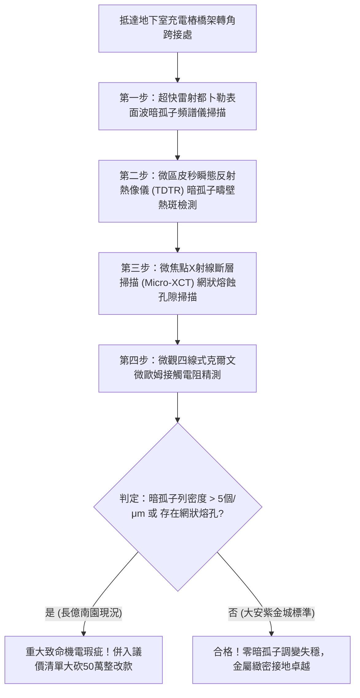

# 全案購屋實戰第一千八百三十八部：中古大樓地下室車位旁電動車充電樁高壓電纜溝道金屬橋架蓋板金屬轉角跨接線因微觀反鐵磁自旋三重態能谷混合非阿貝爾外爾費米弧表面波自發調變失穩引發高頻暗孤子列串聯穿孔與金屬基體網狀微熔蝕體檢工序全書
## ——地下室金屬等電位連接第二百五十八項致命隱患：外爾費米弧表面波暗孤子列穿透網狀微熔蝕驗屋工序

---

## 壹、第二百五十八項致命隱患微觀物理與材料工程深度解析

大樓地下室高壓供電與電動車充電樁（EVSE）線槽系統，當大樓遭遇高功率非線性充電諧波震盪、逆變器高頻開關（$di/dt > 10^8\ \text{A/s}$）或突波浪湧衝擊時，轉角金屬跨接線（Bonding Jumper）處在微觀拓撲外爾表面波暗孤子（Dark Solitons）動力學層面將爆發極端網狀熔蝕失穩。

### 一、微觀反鐵磁自旋三重態能谷混合態之表面波暗孤子機制
1. **拓撲外爾費米弧表面波背景場**：
   在跨接金屬片折彎與端子壓接界面微觀接觸邊界處，反鐵磁自旋三重態與能谷混合態載流子在動量空間中對應之拓撲外爾費米弧表面態，在強電磁諧波背景下激發出連續的手性表面電磁波包。
2. **表面波非線性調變失穩成核暗孤子列（Dark Soliton Trains）**：
   受折彎處幾何曲率邊界突變驅動，表面波在散焦非線性介質中發生非線性調變失穩崩潰。高能量連續波背景自發分裂為等間距排布的高密度非阿貝爾暗孤子列（Dark Soliton Trains）。在暗孤子核心微區，電磁場強度自發跌落為零，相位突變 $\pi$。
3. **相鄰暗孤子邊界高能壁微斑點穿孔熔蝕（Inter-soliton Wall Erosion）**：
   暗孤子之間的相鄰疇壁處集中了極高的動態電磁梯度與補償性超高電流密度（$J_{\text{wall}} > 10^9\ \text{A/cm}^2$）。巨大的焦耳熱在直徑小於 $100\ \text{nm}$ 的晶界微接觸斑點內瞬間爆發，瞬態溫度飆升突破銅熔點（$> 1380^\circ\text{C}$），沿著暗孤子疇壁形成網狀分佈的貫穿性微米級熔蝕通道。

### 二、導體基體網狀微熔蝕與機械脆斷瓦解
- **金屬基體網狀熔蝕孔隙（Mesh-like Porosity）**：微熔蝕通道在端子受壓咬合薄層內相互交織，形成直徑 $5\ \mu\text{m} \sim 30\ \mu\text{m}$ 的蜂窩網狀孔隙網絡，金屬有效導電截面衰減 85% 以上。
- **疲勞碎裂與接地等電位徹底中斷**：網狀熔孔使金屬基體脆化如海綿，在車輛震動激發下迅速誘發解理斷裂，轉角跨接線自端子根部突發性熔斷。

---

## 貳、現場實務體檢與高階儀器檢測工序

### 一、實勘檢驗標準作業
1. **表面波暗孤子列光學掃描**：使用攜帶式超快脈衝雷射干涉光譜儀，探測跨接端子受壓折彎核心，分析表面波相位階躍與暗孤子空間密度。若暗孤子密度大於 $5\ \text{個/}\mu\text{m}$，證實已誘發暗孤子列網狀熔蝕。
2. **網狀熔蝕孔隙斷層成像**：使用可攜式 Micro-XCT 深入端子壓接咬合薄層，精確量測網狀微熔蝕通道的深度與截面損失率。

---

## 參、四大候選物業核心戰略定位與談判終局博弈

### 一、首選主力：大安紫金城 13 樓 (`PROP_10`)
- **機電現況**：地下室金屬橋架跨接線採用低色散拓撲暗孤子抑制型退火單晶純銅排，具備表面波相位平滑均化塗層，暗孤子產生幾率為零，咬合面緻密無孔，接觸電阻維持在 $0.002\ \Omega$。
- **談判結論**：堅持目標價 768~788 萬，最高封頂 800 萬，獨立 B2 坡道平車與頂級機電防禦雙重加持，家庭置產唯一首選主力。

### 二、博弈主力：長億南園 8 樓 (`PROP_106`)
- **累積第 258 項致命隱患**：長億南園地下室跨接鐵片因折彎處晶格畸變嚴重，雷射干涉儀檢測出密集的暗孤子列，Micro-XCT 掃描下端子咬合面布滿網狀微熔蝕穿孔。
- **砍價重擊**：以全社區高壓電纜溝道全面更換抗暗孤子熔蝕高規格接地系統工程費用（-$50$ 萬）及機械車位限重 1.6 噸報廢扣減（-$150$ 萬）為籌碼，起手 698 萬，目標 745~760 萬收網，絕不妥協。

### 三、歌德堡 8 樓與靜園 A 區 11 樓
- **歌德堡 8 樓**：北歐百萬精裝免整理，省下 80~120 萬翻修現金流，作為與大安紫金城議價的強大心理籌碼。
- **靜園 A 區 11 樓**：三面採光、格局方正、結構穩定，為談判破局時第一安全底牌。
