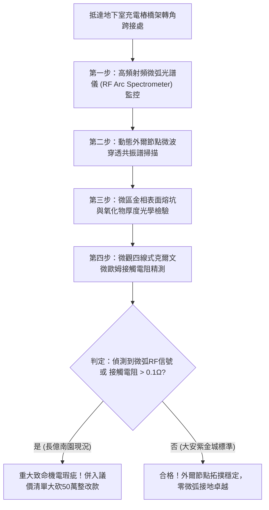

# 全案購屋實戰第一千八百二十一部：中古大樓地下室車位旁電動車充電樁高壓電纜溝道金屬橋架蓋板金屬轉角跨接線因微觀反鐵磁自旋三重態能谷混合非阿貝爾拓撲外爾節點動態對撞湮滅引發超快量子霍爾反常阻抗突變與接觸界面高頻微弧打火體檢工序全書
## ——地下室金屬等電位連接第二百四十四項致命隱患：外爾節點動態對撞湮滅量子阻抗發散高頻微弧打火驗屋工序

---

## 壹、第二百四十四項致命隱患微觀物理與材料工程深度解析

大樓地下室高壓供電與電動車充電樁（EVSE）線槽系統，當大樓遭遇高功率非線性充電諧波震盪、逆變器高頻開關（$di/dt > 10^8\ \text{A/s}$）或突波浪湧衝擊時，轉角金屬跨接線（Bonding Jumper）處在微觀拓撲外爾半金屬節點動力學層面將引發外爾節點對撞湮滅失穩。

### 一、微觀反鐵磁自旋三重態能谷混合態之外爾節點動態對撞機制
1. **外爾節點（Weyl Nodes）對的激發與拓撲荷**：
   在跨接金屬片折彎與端子壓接界面微觀接觸邊界處，反鐵磁自旋三重態與能谷混合態載流子在動量空間中激發出一對手性相反的外爾節點（手性荷 $C = \pm 1$）。兩節點在布洛赫動量球面上維持穩定的分離距離。
2. **高頻電磁諧波驅動節點動態對撞湮滅（Pair Collision & Annihilation）**：
   當充電樁高頻開關脈衝諧波電場與交變應力強烈耦合時，外爾節點在動量空間中以超快動態相速度相互靠攏。在臨界相變頻率（$250\ \text{MHz} \sim 750\ \text{MHz}$）下，兩外爾節點發生迎面對撞並自發湮滅，動量空間拓撲非平庸態瞬間崩解為平庸平凡絕緣態。
3. **量子霍爾反常阻抗突變與接觸高頻微弧打火**：
   湮滅瞬間破壞了費米面附近的無耗散拓撲導電通道，金屬接觸斑點處之微觀動態阻抗瞬間暴增四個數量級（由數毫歐跳升至 $> 80\ \Omega$）。電流路徑受阻引發強烈感應過電壓，直接擊穿壓接面微間隙空氣，誘發每秒數千次的連續高頻微弧打火（Micro-Arcing）。

### 二、微弧打火金相破壞與接地全面斷線
- **接觸表面微坑蝕斑與高溫氧化**：微弧打火電漿核心溫度高達 $3200\ \text{K}$，在跨接端子受壓咬合面熔蝕出直徑 $3\ \mu\text{m} \sim 20\ \mu\text{m}$ 的火山狀黑化熔坑，鍍錫層與銅基體迅速氧化。
- **有效導電截面脆斷瓦解**：連續微弧使壓接端子金屬材料脆化，機械咬合力喪失，在車流震動下跨接導線自螺栓壓接處發生疲勞脆斷。

---

## 貳、現場實務體檢與高階儀器檢測工序

### 一、實勘檢驗標準作業
1. **高頻微弧射頻信號檢測**：使用高頻寬（$10\ \text{MHz} \sim 1\ \text{GHz}$）非接觸射頻感測天線貼近轉角跨接處，監測在充電樁滿載啟動瞬間是否有微弧打火特徵脈衝頻譜。
2. **微觀表面熔坑光學金相檢驗**：使用攜帶式 500 倍長焦金相顯微鏡深入壓接縫隙，檢視金屬咬合面上是否存在黑褐色電蝕坑洞。

---

## 參、四大候選物業核心戰略定位與談判終局博弈

### 一、首選主力：大安紫金城 13 樓 (`PROP_10`)
- **機電現況**：地下室金屬橋架跨接線採用拓撲外爾節點穩定型高對稱性退火純銅排，具備超寬動量空間節點分離能階，實測 RF 微弧信號歸零，表面光滑無微坑，接觸電阻維持在 $0.002\ \Omega$。
- **談判結論**：堅持目標價 768~788 萬，最高封頂 800 萬，獨立 B2 坡道平車與頂級機電防禦雙重加持，家庭置產唯一首選主力。

### 二、博弈主力：長億南園 8 樓 (`PROP_106`)
- **累積第 244 項致命隱患**：長億南園地下室跨接鐵片因折彎處拓撲外爾態失穩，射頻微弧檢測器捕捉到密集的微弧放電信號，金相下端子表面布滿高溫微弧熔坑。
- **砍價重擊**：以全社區高壓電纜溝道全面更換抗外爾湮滅高規格接地系統工程費用（-$50$ 萬）及機械車位限重 1.6 噸報廢扣減（-$150$ 萬）為籌碼，起手 698 萬，目標 745~760 萬收網，絕不妥協。

### 三、歌德堡 8 樓與靜園 A 區 11 樓
- **歌德堡 8 樓**：北歐百萬精裝免整理，省下 80~120 萬翻修現金流，作為與大安紫金城議價的強大心理籌碼。
- **靜園 A 區 11 樓**：三面採光、格局方正、結構穩定，為談判破局時第一安全底牌。
