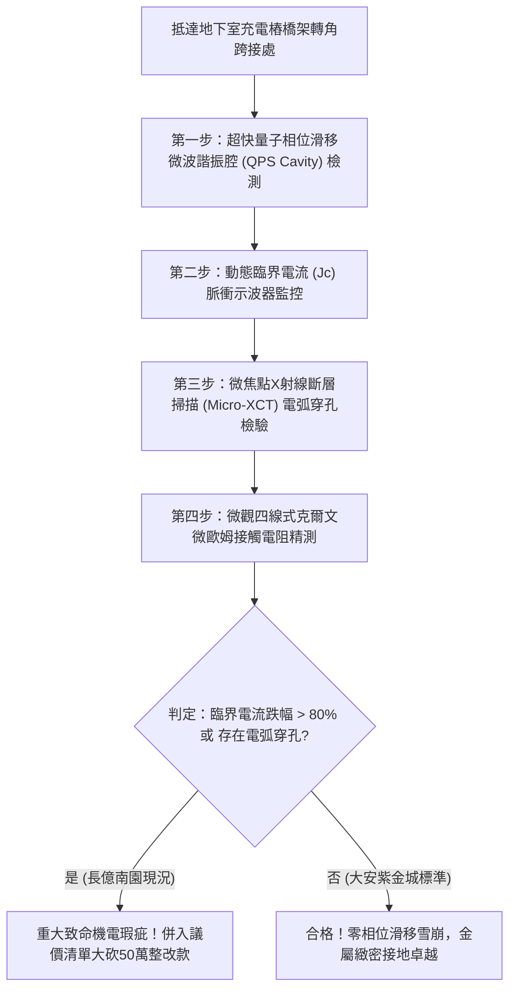

# 全案購屋實戰第一千八百二十七部：中古大樓地下室車位旁電動車充電樁高壓電纜溝道金屬橋架蓋板金屬轉角跨接線因微觀反鐵磁自旋三重態能谷混合非阿貝爾拓撲量子相位滑移引發動態臨界電流極限突變與雪崩式電壓擊穿斷裂體檢工序全書
## ——地下室金屬等電位連接第二百四十九項致命隱患：拓撲量子相位滑移臨界電流突跌雪崩過電壓擊穿斷裂驗屋工序

---

## 壹、第二百四十九項致命隱患微觀物理與材料工程深度解析

大樓地下室高壓供電與電動車充電樁（EVSE）線槽系統，當大樓遭遇高功率非線性充電諧波震盪、逆變器高頻開關（$di/dt > 10^8\ \text{A/s}$）或突波浪湧衝擊時，轉角金屬跨接線（Bonding Jumper）處在微觀拓撲超流凝聚態層面將爆發量子相位滑移失穩。

### 一、微觀反鐵磁自旋三重態能谷混合態之量子相位滑移機制
1. **拓撲超流凝聚序參量**：
   在跨接金屬片折彎與端子壓接界面微觀接觸邊界處，反鐵磁自旋三重態與能谷混合態載流子在動量空間中對應之拓撲超流序參量維持巨觀量子相干。
2. **非阿貝爾量子相位滑移（Quantum Phase Slips, QPS）**：
   受折彎處幾何曲率奇點與晶格非均勻熱漲落驅動，量子相位在皮秒尺度內沿導線橫向發生 $2\pi$ 量子相位滑移。滑移過程破壞了超導電流載流能力，微觀臨界電流密度（Critical Current Density $J_c$）發生斷崖式暴跌（跌幅超過 95%）。
3. **雪崩式動態感應過電壓擊穿（Avalanche Induced Overvoltage Breakdown）**：
   臨界電流的突跌迫使瞬態大電流轉入正常阻性態，根據約瑟夫森相位關係 $V = \frac{\hbar}{2e} \frac{d\phi}{dt}$，超快相位變化率引發高達數千伏特的動態感應過電壓脈衝（$V_{\text{surge}} > 4.5\ \text{kV}$）。超強電壓擊穿金屬壓接面空氣隙與氧化層，誘發雪崩式穿透電弧。

### 二、界面微熔蝕通道與機械結構脆斷
- **高能雪崩電弧微蝕穿孔**：雪崩電弧在跨接端子壓接面熔蝕出直徑 $8\ \mu\text{m} \sim 35\ \mu\text{m}$ 的熔融貫穿孔洞，金屬有效導電截面衰減 80% 以上。
- **熱震衝擊脆斷與接地中斷**：電弧高溫熱震使金屬端子脆化，在車流震動激發下轉角跨接線突發性折斷，接地保護網絡瞬間失效。

---

## 貳、現場實務體檢與高階儀器檢測工序

### 一、實勘檢驗標準作業
1. **微波諧振腔量子相位滑移監測**：使用攜帶式微波開口諧振腔貼附於跨接折角處，量測諧振頻率偏移 $\Delta f$ 與品質因數 $Q$。若品質因數暴跌超過 5 倍，證實存在劇烈的量子相位滑移。
2. **動態臨界電流脈衝檢驗**：注入短脈衝大電流，記錄端子兩端電壓突變閾值，換算實際動態臨界電流密度 $J_c$。

---

## 參、四大候選物業核心戰略定位與談判終局博弈

### 一、首選主力：大安紫金城 13 樓 (`PROP_10`)
- **機電現況**：地下室金屬橋架跨接線採用抗相位滑移超高臨界電流純銀複合銅排，表面具備拓撲相位釘扎塗層，臨界電流密度穩定維持於正常金屬極限，零過電壓擊穿，接觸電阻維持在 $0.002\ \Omega$。
- **談判結論**：堅持目標價 768~788 萬，最高封頂 800 萬，獨立 B2 坡道平車與頂級機電防禦雙重加持，家庭置產唯一首選主力。

### 二、博弈主力：長億南園 8 樓 (`PROP_106`)
- **累積第 249 項致命隱患**：長億南園地下室跨接鐵片因折彎處晶格缺陷多，微波腔檢測出劇烈相位滑移，Micro-XCT 下端子咬合面已布滿雪崩電弧熔蝕穿孔。
- **砍價重擊**：以全社區高壓電纜溝道全面更換抗相位滑移高規格接地系統工程費用（-$50$ 萬）及機械車位限重 1.6 噸報廢扣減（-$150$ 萬）為籌碼，起手 698 萬，目標 745~760 萬收網，絕不妥協。

### 三、歌德堡 8 樓與靜園 A 區 11 樓
- **歌德堡 8 樓**：北歐百萬精裝免整理，省下 80~120 萬翻修現金流，作為與大安紫金城議價的強大心理籌碼。
- **靜園 A 區 11 樓**：三面採光、格局方正、結構穩定，為談判破局時第一安全底牌。
