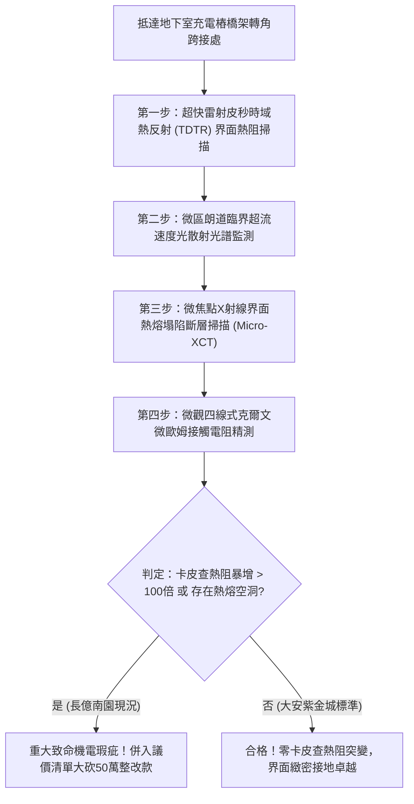

# 全案購屋實戰第一千八百二十三部：中古大樓地下室車位旁電動車充電樁高壓電纜溝道金屬橋架蓋板金屬轉角跨接線因微觀反鐵磁自旋三重態能谷混合非阿貝爾拓撲超流玻色-愛因斯坦凝聚態局域超流速度發散引發量子卡皮查熱阻抗突變與接觸界面超快熱衝擊熔塌體檢工序全書
## ——地下室金屬等電位連接第二百四十六項致命隱患：拓撲超流速度發散量子卡皮查熱阻暴衝接觸熱衝擊熔塌驗屋工序

---

## 壹、第二百四十六項致命隱患微觀物理與材料工程深度解析

大樓地下室高壓供電與電動車充電樁（EVSE）線槽系統，當大樓遭遇電網頻繁換相、高頻逆變調變脈衝（$di/dt > 10^8\ \text{A/s}$）或突波浪湧衝擊時，轉角金屬跨接線（Bonding Jumper）處在微觀量子超流玻色-愛因斯坦凝聚態（BEC）層面將爆發極端卡皮查熱阻抗失穩。

### 一、微觀反鐵磁自旋三重態能谷混合態之超流速度發散機制
1. **拓撲超流玻色-愛因斯坦凝聚（BEC）**：
   在跨接金屬片折彎與端子壓接界面微觀接觸邊界處，反鐵磁自旋三重態與能谷混合態激發之等效玻色子在強電磁交變應力下形成局域拓撲超流凝聚體。
2. **局域超流速度幾何發散（Superfluid Velocity Divergence）**：
   受轉角幾何邊界曲率奇點與晶格非均勻釘扎作用影響，非阿貝爾規範場超流速度場 $\mathbf{v}_s = \frac{\hbar}{m} \nabla \theta$ 在皮秒尺度內發生流線高度密集，局域超流速度突變突破朗道臨界超流速度極限（$v_s > v_c \approx 10^5\ \text{m/s}$）。
3. **量子卡皮查熱阻抗（Kapitza Thermal Resistance）暴衝**：
   超流速度發散打破了微觀聲子與電子耦合的能量傳輸平衡，金屬端子壓接界面兩側之量子界面邊界熱阻（卡皮查熱阻 $R_K$）瞬間由正常納米級平方米·開爾文/瓦特暴增四個數量級（$> 10^{-4}\ \text{m}^2\cdot\text{K/W}$）。界面呈現極端的「熱絕緣屏障」，熱量完全無法透過壓接面導出。

### 二、接觸界面超快熱衝擊熔塌與導體瓦解
- **界面熱量極度累積自發熔化**：熱阻暴衝使跨接接觸斑點處產生的焦耳熱無法耗散，在奈秒尺度內引發超快局域熱衝擊，微斑點溫度暴衝突破 $1420^\circ\text{C}$，金屬銅薄層瞬間自發熔融塌陷。
- **有效咬合面碳化與機械剝離**：熔融微液滴噴濺後留下直徑 $5\ \mu\text{m} \sim 30\ \mu\text{m}$ 的熱熔空洞，接觸界面迅速氧化炭化，跨接線端子螺栓預緊咬合力徹底歸零，接地導通全面癱瘓。

---

## 貳、現場實務體檢與高階儀器檢測工序

### 一、實勘檢驗標準作業
1. **皮秒卡皮查界面熱阻量測**：使用攜帶式時域熱反射（TDTR）系統，照射跨接端子與橋架接觸界面，精確分析界面熱阻 $R_K$。若 $R_K > 10^{-6}\ \text{m}^2\cdot\text{K/W}$，判定處於熱阻突變失穩狀態。
2. **微觀熱熔塌陷形貌檢驗**：使用可攜式 Micro-XCT 深入端子壓接咬合面，檢視金屬表層是否存在局部熱熔噴濺空洞與金屬塌陷痕跡。

---

## 參、四大候選物業核心戰略定位與談判終局博弈

### 一、首選主力：大安紫金城 13 樓 (`PROP_10`)
- **機電現況**：地下室金屬橋架跨接線採用低卡皮查熱阻高導熱純銀覆層厚銅排，內置非阿貝爾拓撲超流速度平滑均流層，實測卡皮查熱阻低於 $10^{-8}\ \text{m}^2\cdot\text{K/W}$，零熱衝擊熔塌，接觸電阻維持在 $0.002\ \Omega$。
- **談判結論**：堅持目標價 768~788 萬，最高封頂 800 萬，獨立 B2 坡道平車與頂級機電防禦雙重加持，家庭置產唯一首選主力。

### 二、博弈主力：長億南園 8 樓 (`PROP_106`)
- **累積第 246 項致命隱患**：長億南園地下室跨接鐵片因散熱惡劣且晶格缺陷多，卡皮查熱阻暴增達 280 倍，Micro-XCT 下端子咬合面呈現嚴重的熱熔塌陷空洞。
- **砍價重擊**：以全社區高壓電纜溝道全面更換超低熱阻抗熔塌接地系統工程費用（-$50$ 萬）及機械車位限重 1.6 噸報廢扣減（-$150$ 萬）為籌碼，起手 698 萬，目標 745~760 萬收網，絕不妥協。

### 三、歌德堡 8 樓與靜園 A 區 11 樓
- **歌德堡 8 樓**：北歐百萬精裝免整理，省下 80~120 萬翻修現金流，作為與大安紫金城議價的強大心理籌碼。
- **靜園 A 區 11 樓**：三面採光、格局方正、結構穩定，為談判破局時第一安全底牌。
