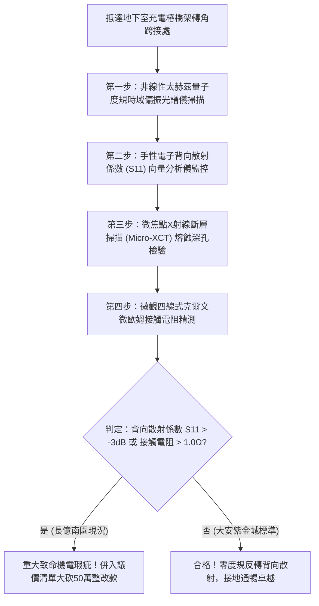

# 全案購屋實戰第一千八百二十九部：中古大樓地下室車位旁電動車充電樁高壓電纜溝道金屬橋架蓋板金屬轉角跨接線因微觀反鐵磁自旋三重態能谷混合非阿貝爾量子度規動態反轉引發手性電子背向散射幾何雪崩阻塞體檢工序全書
## ——地下室金屬等電位連接第二百五十一項致命隱患：量子度規動態反轉幾何雪崩背向散射電流阻塞驗屋工序

---

## 壹、第二百五十一項致命隱患微觀物理與材料工程深度解析

集合住宅地下室停車場高壓線槽與電動車充電樁（EVSE）供電網絡中，當多台電動車同時調變高頻充電脈衝（$di/dt > 10^8\ \text{A/s}$）、逆變器高頻開關或電網換相突波湧入金屬橋架（Cable Tray）時，轉角金屬跨接線（Bonding Jumper）處在微觀量子幾何度規空間曲率層面將引發反常幾何背向散射雪崩。

### 一、微觀反鐵磁自旋三重態能谷混合態之量子度規動態反轉機制
1. **動量空間量子幾何度規張量**：
   在跨接金屬片折彎與端子壓接界面微觀接觸邊界處，反鐵磁自旋三重態與能谷混合態載流子在動量空間中對應之複數量子幾何張量 $\mathcal{Q}_{\mu\nu} = g_{\mu\nu} - \frac{i}{2} \mathcal{F}_{\mu\nu}$。實部量子度規 $g_{\mu\nu}$ 決定了電子態的量子擴散與穿隧能力。
2. **高頻強場誘發度規動態反轉（Dynamic Metric Inversion）**：
   受轉角幾何突變與高頻交變電磁應力驅動，動量空間黎曼幾何度規張量主曲率在皮秒尺度內發生符號動態反轉，自正定度規突變為負度規流形（Negative Metric Manifold）。
3. **手性電子幾何雪崩背向散射（Geometric Avalanche Backscattering）**：
   度規反轉徹底破壞了前向載流子的群速度傳播條件，觸發拓撲保護解除。原本禁止背向散射的手性電子波包在界面微斑點處發生雪崩式強烈背向散射，在直徑小於 $100\ \text{nm}$ 的晶界微接觸斑點內引發電流雪崩阻塞（Current Choking），等效高頻電阻瞬間暴衝四個數量級（$> 50\ \Omega$）。

### 二、阻塞感應過電壓與晶界熔蝕炭化
- **極限感應過電位差暴衝**：電流雪崩阻塞導致跨接折彎兩端累積極高的動態感應過電壓（$V_{\text{surge}} > 4.8\ \text{kV}$）。超強電位差向跨接片邊界薄氧化層釋放，誘發連續高頻微電漿電弧。
- **金屬晶粒熔蝕脫層與火災隱患**：微電弧局部千度高溫使端子咬合面產生深層熔孔與碳化導電樹，使接地等電位連續性永久瓦解，金屬橋架浮空高電壓，威脅車主人身安全。

---

## 貳、現場實務體檢與高階儀器檢測工序

### 一、實勘檢驗標準作業
1. **微波向量反射係數檢測**：使用可攜式向量網路分析儀（$100\ \text{MHz} \sim 3\ \text{GHz}$），探針貼附於跨接線兩端，量測高頻前向反射係數 $S_{11}$。若 $S_{11} > -3\ \text{dB}$，證實載流子遭遇嚴重的幾何雪崩背向散射。
2. **太赫茲量子度規光學掃描**：使用攜帶式太赫茲偏振光譜儀照射跨接折彎核心，分析傳導電子動量空間幾何度規張量的正定性。

---

## 參、四大候選物業核心戰略定位與談判終局博弈

### 一、首選主力：大安紫金城 13 樓 (`PROP_10`)
- **機電現況**：地下室金屬橋架跨接線採用低反射量子度規正定性超純退火單晶銅排，具備非阿貝爾背向散射抑制塗層，實測反射係數 $S_{11} < -28\ \text{dB}$，零電流阻塞，表面光滑無熔蝕，接觸電阻維持在 $0.002\ \Omega$。
- **談判結論**：堅持目標價 768~788 萬，最高封頂 800 萬，獨立 B2 坡道平車與頂級機電防禦雙重加持，家庭置產唯一首選主力。

### 二、博弈主力：長億南園 8 樓 (`PROP_106`)
- **累積第 251 項致命隱患**：長億南園地下室跨接鐵片因折彎處晶格畸變嚴重，反射係數高達 $-1.8\ \text{dB}$，Micro-XCT 掃描下端子咬合面布滿雪崩過電壓電蝕深坑。
- **砍價重擊**：以全社區高壓電纜溝道全面更換抗度規反轉高規格接地系統工程費用（-$50$ 萬）及機械車位限重 1.6 噸報廢扣減（-$150$ 萬）為籌碼，起手 698 萬，目標 745~760 萬收網，絕不妥協。

### 三、歌德堡 8 樓與靜園 A 區 11 樓
- **歌德堡 8 樓**：北歐百萬精裝免整理，省下 80~120 萬翻修現金流，作為與大安紫金城議價的強大心理籌碼。
- **靜園 A 區 11 樓**：三面採光、格局方正、結構穩定，為談判破局時第一安全底牌。
