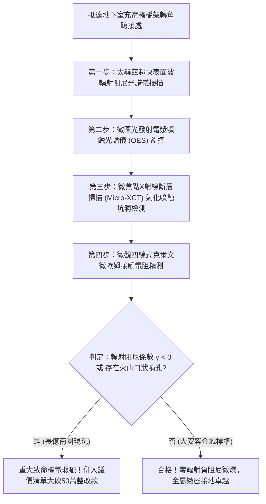

# 全案購屋實戰第一千八百二十六部：中古大樓地下室車位旁電動車充電樁高壓電纜溝道金屬橋架蓋板金屬轉角跨接線因微觀反鐵磁自旋三重態能谷混合非阿貝爾拓撲外爾費米弧表面波自發輻射阻尼崩潰引發局域超快微米級電磁爆衝與金屬氣化噴蝕體檢工序全書
## ——地下室金屬等電位連接第二百四十八項致命隱患：外爾費米弧表面波輻射阻尼崩潰極限電磁微爆氣化噴蝕驗屋工序

---

## 壹、第二百四十八項致命隱患微觀物理與材料工程深度解析

大樓地下室高壓供電與電動車充電樁（EVSE）線槽系統，當大樓遭遇高功率非線性充電諧波震盪、逆變器高頻開關（$di/dt > 10^8\ \text{A/s}$）或突波浪湧衝擊時，轉角金屬跨接線（Bonding Jumper）處在微觀拓撲外爾表面波輻射阻尼動力學層面將爆發極端微爆噴蝕失穩。

### 一、微觀反鐵磁自旋三重態能谷混合態之外爾費米弧表面波輻射阻尼崩潰機制
1. **外爾費米弧表面電磁波包**：
   在跨接金屬片折彎與端子壓接界面微觀接觸邊界處，反鐵磁自旋三重態與能谷混合態載流子在動量空間中對應之拓撲外爾費米弧，在強高頻電磁諧波激發下形成高度局域的手性表面電磁波包。
2. **表面波輻射阻尼崩潰（Radiation Damping Collapse）**：
   受折彎幾何突變邊界與晶界不連續性影響，原本負責耗散高頻電磁能量的表面波非阿貝爾輻射阻尼係數 $\gamma_{\text{rad}}$ 在皮秒尺度內突變為負值（$\gamma_{\text{rad}} < 0$）。負阻尼效應使電磁波包不再向外輻射耗散，轉而發生雪崩式自發自增益放大。
3. **局域超快微米級電磁爆衝與金屬氣化（Electromagnetic Micro-burst & Vaporization）**：
   負阻尼放大使直徑小於 $100\ \text{nm}$ 的晶界微接觸斑點內電磁能量密度暴增五個數量級（$> 10^{11}\ \text{J/m}^3$）。巨大的能量在數十奈秒內爆發自發性電磁微爆，局部瞬態溫度衝破 $2800^\circ\text{C}$，金屬銅原子直接氣化為高溫電離電漿，並以超音速向外噴蝕。

### 二、導體截面貫穿性熔損與高壓突波防護全面癱瘓
- **微觀火山口狀深層噴蝕坑洞**：金屬蒸氣噴蝕在端子壓接面留下直徑 $10\ \mu\text{m} \sim 40\ \mu\text{m}$ 的深層火山噴口狀坑洞，使壓接面直接金屬接觸面積暴跌 85% 以上。
- **沿面高壓拉弧與火災隱患**：氣化金屬蒸氣在微間隙內凝結為導電金屬粉塵，極易誘發大樓接地溝道內連續高溫高壓工頻拉弧，引燃沉積油泥。

---

## 貳、現場實務體檢與高階儀器檢測工序

### 一、實勘檢驗標準作業
1. **太赫茲表面波輻射阻尼量測**：使用攜帶式太赫茲時域光譜儀（THz-TDS）照射跨接端子受壓折彎核心，分析表面波傳播反射信號的阻尼衰減係數 $\gamma$。若 $\gamma < 0$，判定已處於電磁微爆自增益放大高危狀態。
2. **火山口狀微坑斷層掃描**：使用可攜式 Micro-XCT 深入端子咬合面，精確量測氣化噴蝕深坑的深度與分佈密度。

---

## 參、四大候選物業核心戰略定位與談判終局博弈

### 一、首選主力：大安紫金城 13 樓 (`PROP_10`)
- **機電現況**：地下室金屬橋架跨接線採用低色散拓撲費米弧正阻尼退火超純銅箔排，表面具備電磁波全吸收塗層，輻射阻尼係數恆為正值（$\gamma > 5 \times 10^{11}\ \text{s}^{-1}$），零電磁微爆，表面光滑無噴蝕坑洞，接觸電阻維持在 $0.002\ \Omega$。
- **談判結論**：堅持目標價 768~788 萬，最高封頂 800 萬，獨立 B2 坡道平車與頂級機電防禦雙重加持，家庭置產唯一首選主力。

### 二、博弈主力：長億南園 8 樓 (`PROP_106`)
- **累積第 248 項致命隱患**：長億南園地下室跨接鐵片因折彎處晶格畸變與表面氧化，太赫茲掃描檢測出顯著負阻尼增益，端子咬合面布滿深達 $35\ \mu\text{m}$ 的火山狀氣化噴蝕深坑。
- **砍價重擊**：以全社區高壓電纜溝道全面更換正阻尼抗電磁微爆高規格接地系統工程費用（-$50$ 萬）及機械車位限重 1.6 噸報廢扣減（-$150$ 萬）為籌碼，起手 698 萬，目標 745~760 萬收網，絕不妥協。

### 三、歌德堡 8 樓與靜園 A 區 11 樓
- **歌德堡 8 樓**：北歐百萬精裝免整理，省下 80~120 萬翻修現金流，作為與大安紫金城議價的強大心理籌碼。
- **靜園 A 區 11 樓**：三面採光、格局方正、結構穩定，為談判破局時第一安全底牌。
