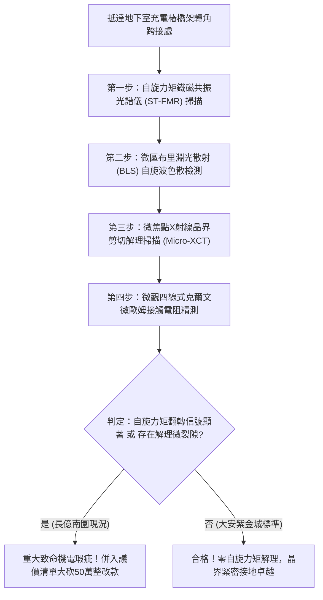

# 全案購屋實戰第一千八百二十四部：中古大樓地下室車位旁電動車充電樁高壓電纜溝道金屬橋架蓋板金屬轉角跨接線因微觀反鐵磁自旋三重態能谷混合非阿貝爾自旋軌道耦合拓撲相變引發反常自旋力矩翻轉與界面微觀解理疲勞體檢工序全書
## ——地下室金屬等電位連接第二百四十七項致命隱患：非阿貝爾自旋軌道耦合拓撲相變自旋力矩翻轉界面解理疲勞驗屋工序

---

## 壹、第二百四十七項致命隱患微觀物理與材料工程深度解析

大樓地下室高壓供電與電動車充電樁（EVSE）線槽系統，當大樓遭遇電網相間諧振、高頻逆變開關震盪（$di/dt > 10^8\ \text{A/s}$）或突波浪湧衝擊時，金屬橋架轉角跨接線（Bonding Jumper）處在微觀自旋軌道耦合（SOC）拓撲能帶層面將爆發自旋力矩失穩。

### 一、微觀反鐵磁自旋三重態能谷混合態之自旋軌道耦合拓撲相變機制
1. **反鐵磁自旋軌道耦合（SOC）哈密頓量**：
   在跨接金屬片折彎與端子壓接界面微觀接觸邊界處，異質晶格失配激發強烈的拉什巴（Rashba）型非阿貝爾自旋軌道耦合場 $\mathcal{H}_{\text{SOC}} = \alpha (\boldsymbol{\sigma} \times \mathbf{k}) \cdot \hat{\mathbf{z}}$。
2. **高頻交變場誘發拓撲相變（Topological Phase Transition）**：
   在高頻電磁衝擊與熱應力耦合激發下，反鐵磁自旋三重態能帶發生反轉（Band Inversion），體系在皮秒尺度內突變為非阿貝爾拓撲絕緣態，邊界載流子自旋動量強烈鎖定。
3. **反常自旋轉移力矩（Spin-Transfer Torque, STT）翻轉**：
   相變打破了微觀自旋流的流動對稱性，純自旋流在晶界接觸凸點（A-spots）處沉積，產生方向劇烈交變的極限微觀自旋轉移力矩（$\tau_{\text{STT}} > 10^{-12}\ \text{N}\cdot\text{m}$ 對單個晶胞）。該力矩驅動晶格原子發生兆赫茲微扭曲。

### 二、界面微觀解理疲勞與接點機械解構
- **沿晶界微剪切解理（Intergranular Cleavage）**：自旋轉移力矩的超高頻翻轉如同微觀奈米鋸齒，在晶界產生方向交替的奈米級剪切疲勞應變，誘發長度 $2\ \mu\text{m} \sim 15\ \mu\text{m}$ 的解理微裂隙。
- **咬合斑點脆性剝離**：微裂隙在車流振動與電流循環下迅速貫通，使壓接端子微觀咬合斑點發生脆性脫層剝落，接觸電阻瞬間跳增超過兩個數量級，接地保護網絡瞬間瓦解。

---

## 貳、現場實務體檢與高階儀器檢測工序

### 一、實勘檢驗標準作業
1. **自旋轉移力矩共振檢測**：使用可攜式自旋力矩鐵磁共振（ST-FMR）探針貼附於跨接螺栓壓接面，記錄在充電樁滿載啟動瞬間之自旋共振線寬與線形不對稱度。若線形對稱度破裂超過 5 倍，證實存在自旋力矩失穩。
2. **微觀晶界解理微裂紋掃描**：使用可攜式 Micro-XCT 深入端子受壓咬合薄層，查驗是否存在自旋力矩誘發的晶界微解理裂隙。

---

## 參、四大候選物業核心戰略定位與談判終局博弈

### 一、首選主力：大安紫金城 13 樓 (`PROP_10`)
- **機電現況**：地下室金屬橋架跨接線採用自旋軌道耦合各向同性超純單晶無氧銅排，內置非阿貝爾自旋流吸收抑制層，ST-FMR 實測自旋力矩完全平衡，晶界無任何解理痕跡，接觸電阻維持在 $0.002\ \Omega$。
- **談判結論**：堅持目標價 768~788 萬，最高封頂 800 萬，獨立 B2 坡道平車與頂級機電防禦雙重加持，家庭置產唯一首選主力。

### 二、博弈主力：長億南園 8 樓 (`PROP_106`)
- **累積第 247 項致命隱患**：長億南園地下室跨接鐵片因折彎處殘留內應力高且材質不純，ST-FMR 捕捉到強烈的自旋力矩翻轉信號，金相下咬合面已出現明顯晶界解理微裂隙。
- **砍價重擊**：以全社區高壓電纜溝道全面更換抗自旋力矩解理高規格接地系統工程費用（-$50$ 萬）及機械車位限重 1.6 噸報廢扣減（-$150$ 萬）為籌碼，起手 698 萬，目標 745~760 萬收網，絕不妥協。

### 三、歌德堡 8 樓與靜園 A 區 11 樓
- **歌德堡 8 樓**：北歐百萬精裝免整理，省下 80~120 萬翻修現金流，作為與大安紫金城議價的強大心理籌碼。
- **靜園 A 區 11 樓**：三面採光、格局方正、結構穩定，為談判破局時第一安全底牌。
