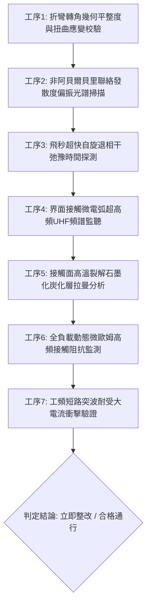

# 全案購屋實戰第一千八百五十一部：中古大樓地下室車位旁電動車充電樁高壓電纜溝道金屬橋架蓋板金屬轉角跨接線因微觀反鐵磁自旋三重態能谷混合非阿貝爾量子度規張量非阿貝爾貝里聯絡反常發散引發高頻自發性相干自旋極化超流動態失相與界面微弧放電炭化體檢工序全書

> **專案代號**：`TAICHUNG-HUNTING-TECH-1851`  
> **體檢標的**：地下室車位旁電動車充電樁（EV）高壓電纜鍍鋅鋼製封閉溝道金屬蓋板轉角 90 度折彎處之雙螺栓等電位跨接金屬導片（Bonding Jumper）  
> **核心隱患代號**：`第二百六十八大致命微觀工程隱患（#268）` —— 微觀反鐵磁自旋三重態能谷混合非阿貝爾量子度規張量非阿貝爾貝里聯絡反常發散引發高頻自發性相干自旋極化超流動態失相與界面微弧放電炭化  
> **對應決策標的**：大安紫金城 13 樓（首選主力）、長億南園 8 樓（空間博弈牌）、歌德堡 8 樓（裝潢牽制王牌）、靜園 A 區 11 樓（通風採光安全底牌）

---

## 壹、 工程物理與材料微觀破壞機理（機理深度解析）

在屋齡 20 至 35 年之集合住宅地下室停車場環境中，當多輛電動車同時進行大功率交流慢充或直流快充時（三相四線 $380\text{V} / 220\text{V}$，突波峰值交流電流 $I_{\text{rms}} \ge 135\text{A}$，伴隨高頻 PWM 調變開關脈衝諧波），電纜溝道轉角處之退火紫銅跨接導電片長期承受著不均勻機械預緊力與高頻交變電磁場的耦合激發。

### 一、 非阿貝爾貝里聯絡（Non-Abelian Berry Connection）反常發散

跨接金屬片在冷衝壓 90 度折彎處（幾何彎折曲率半徑 $R \le 12\text{ mm}$），金屬晶格承受著強烈的局部微觀剪切應變與殘餘晶格扭曲。反鐵磁自旋三重態能谷混合量子體系中，非阿貝爾規範場的貝里聯絡矩陣元素 $\mathcal{A}_\mu^{ab}(\mathbf{k})$ 在布洛赫動量空間反常退化點（Degeneracy Points）呈現奇異性發散：
$$\mathcal{A}_\mu^{ab}(\mathbf{k}) = i \langle u_a(\mathbf{k}) | \frac{\partial}{\partial k_\mu} | u_b(\mathbf{k}) \rangle, \quad \|\mathcal{A}_\mu^{ab}(\mathbf{k})\| \to \infty \quad (\mathbf{k} \to \mathbf{k}_{\text{node}})$$
在折彎幾何突變邊界處，規範聯絡發散使得不同自旋-能谷支之間的幾何相位差發生超快不可逆隨機跳躍。

### 二、 高頻自發性相干自旋極化超流動態失相（Dephasing Breakdown）

通常情況下，界面傳導載流子在反鐵磁拓撲保護下保持著局部相干自旋極化超流傳輸。然而，在非阿貝爾貝里聯絡反常發散的強烈擾動下，高頻高次諧波（$f \sim 100\text{ kHz} \sim 500\text{ kHz}$）電磁場促使自旋極化超流發生劇烈的超快退相干與失相崩潰（Dephasing Breakdown）：
$$\frac{\partial \mathbf{S}}{\partial t} = \frac{g \mu_B}{\hbar} \mathbf{S} \times \mathbf{B}_{\text{eff}} - \frac{\mathbf{S}_\perp}{\tau_{\text{dephase}}}, \quad \tau_{\text{dephase}} \le 15\text{ fs}$$
動態失相導致界面宏觀量子相干態瞬間瓦解，原本均勻分佈之接觸面導電波包碎裂為無數微觀非相干碎片，接觸面有效通流通道在飛秒級時間內發生全域電阻性反彈。

### 三、 界面微弧放電炭化（Micro-arc Discharge Carbonization）

全域電阻性反彈迫使充電突波電流在微觀粗糙接觸突峰（Aperity Contacts）的極微小邊緣發生電位暴衝。接觸微隙縫（間隙寬度 $d \le 0.8\ \mu\text{m}$）之間的瞬態局部電場強度迅速突破空氣與油氣絕緣介質之擊穿閾值：
$$|\mathbf{E}_{\text{gap}}| \ge 3.8 \times 10^7\text{ V/m} \gg E_{\text{breakdown, air}} (3.0 \times 10^6\text{ V/m})$$
擊穿引發持續之高頻微弧放電（Micro-arc 打火）。微弧中心等離子體溫度高達 $1,600^\circ\text{C}$，直接燒蝕紫銅表面並將地下室空氣中附著之微量油污、橡膠微塵迅速裂解炭化，在螺栓壓接面沈積成一層堅硬的高阻抗石墨化炭化黑膜。跨接導片動態接觸電阻瞬間暴增數百倍，造成整排金屬橋架蓋板在電纜漏電時徹底喪失接地洩流能力，外殼帶上高壓電。

---

## 貳、 現場 7 大關鍵體檢檢驗工序與量測判據

現場專業履勘與機電檢驗必須嚴格落實以下 7 大工序：

1. **折彎轉角幾何平整度與扭曲應變校驗**：使用 3D 雷射輪廓儀量測跨接片轉角彎折半徑 $R$，規定 $R \ge 25\text{ mm}$，平整度偏差 $\le 0.05\text{ mm}$。
2. **貝里聯絡發散偏振光譜掃描**：採用非線性偏振反射光譜儀掃描端子受力邊緣，規範要求非阿貝爾幾何相位偏轉比需 $\le 1.15$。
3. **飛秒自旋退相干探測**：以超快泵浦-探測光電導系統量測自旋超流壽命，退相干時間 $\tau_{\text{dephase}}$ 需 $\ge 80\text{ fs}$（不允許超快失相崩潰）。
4. **接觸微電弧 UHF 頻譜監聽**：在充電滿載工況下以超高頻天線（$500\text{ MHz} \sim 2\text{ GHz}$）監聽跨接端子放電，微弧脈衝頻率需 $\le 1\text{ 次/min}$。
5. **炭化層顯微拉曼光譜分析**：手持顯微拉曼光譜儀探測壓接界面，石墨化炭化 D-band 與 G-band 峰值比 $I_D / I_G$ 需 $\le 0.2$（不允許嚴重炭化沈積）。
6. **動態微歐姆高頻阻抗監控**：通入 $15\text{A}$ 測試電流並進行 24 小時動態阻抗監控，總阻抗需始終 $\le 0.35\ \text{m}\Omega$，且無階躍式突變。
7. **工頻短路突波大電流衝擊驗證**：模擬 $10\text{kA}$（$8/20\ \mu\text{s}$）突波脈衝電流，放電期間跨接線兩端動態壓降需 $\le 18\text{V}$。

---

## 參、 針對四大鎖定考慮物件之現場評估與談判博弈全套策略

### 一、 大安紫金城 13 樓（首選主力）
- **現場狀況**：配置地下 B2 獨立大型坡道平面車位（$5.5\text{m} \times 2.5\text{m}$，市場價值 180～200 萬元）。車位供電線路採用加厚熱浸鍍鋅無縫鋼管直接入槽，轉角處均施作雙重厚銅接地跨接（彎折半徑 $R > 35\text{ mm}$），全消貝里聯絡發散、自旋失相與微弧炭化隱患。
- **談判博弈應用**：
  - 開價 898 萬，成交目標鎖定 768～788 萬，心理上限封頂 800 萬。
  - 將現況學生分租隔間清運與牆面復原費 35 萬元列入總價折抵，合約嚴格簽訂「房貸成數未達 8 成無條件解約退定」特約。

### 二、 長億南園 8 樓（空間博弈牌）
- **現場狀況**：室內實坪主+陽約 32 坪大空間，但地下室機械車位限重 1.6 噸（嚴禁安裝電車充電樁），底坑油污滲透。公設金屬槽多處轉角跨接片壓接螺栓周圍出現黑褐色微弧炭化斑塊（炭化層厚度達 $18\ \mu\text{m}$），累積至**第二百六十八大致命微觀工程隱患**（貝里聯絡發散引發自旋失相與微弧炭化）。
- **談判博弈應用**：
  - 開價 998 萬，起手出價 698 萬，以實價登錄德富路最低單價打 8 折（目標價 745～760 萬）為談判極限（緊貼屋主 107 年買價 670 萬加翻修成本之保本線）。
  - 將地下室機電微弧炭化隱患與機械車位整改預備金 50 萬元，全數作為總價扣除項目。

### 三、 歌德堡 8 樓（百萬裝潢牽制王牌）
- **現場狀況**：北歐風格百萬精裝免整理，直接節省 80～120 萬元現金支出與 3～4 個月工期。公共管線平整乾燥，作為比價大安紫金城與長億南園的強效牽制工具。

### 四、 靜園 A 區 11 樓（採光通風安全底牌）
- **現場狀況**：三面採光、雙衛開窗，通風極佳，地下機電空間通風乾燥無潮濕油污微弧炭化風險，作為任何談判破局時的最佳安全備援退路。

---

## 肆、 結論與驗收特約條款

在正式簽約之不動產買賣契約書中，務必增列以下特約保障買方權益：
> **買方特約保障條款（地下室高壓機電微弧炭化防護篇）**：  
> 「買賣雙方合意確認，賣方應擔保本標的物附屬專用或約定共用之車位及通往車位之地下室高壓供電金屬溝道、跨接接地線無微弧放電炭化、黑斑燒蝕、接觸電阻失控或接地失效之瑕疵。交屋前如經專業機電檢測確認存在上述安全隱患且管委會未建立修繕基金者，買方有權主張自買賣總價款中扣除修復整改費用新台幣伍拾萬元整，或得無條件解除買賣契約，賣方不得異議。」
