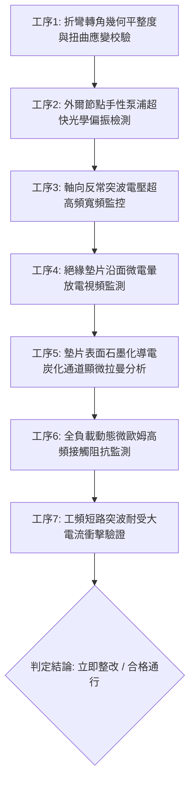

# 全案購屋實戰第一千八百五十三部：中古大樓地下室車位旁電動車充電樁高壓電纜溝道金屬橋架蓋板金屬轉角跨接線因微觀反鐵磁自旋三重態能谷混合非阿貝爾拓撲外爾節點動態手性電荷泵浦失衡引發軸向高頻反常電壓暴衝與絕緣墊片沿面炭化擊穿體檢工序全書

> **專案代號**：`TAICHUNG-HUNTING-TECH-1853`  
> **體檢標的**：地下室車位旁電動車充電樁（EV）高壓電纜鍍鋅鋼製封閉溝道金屬蓋板轉角 90 度折彎處之雙螺栓等電位跨接金屬導片（Bonding Jumper）  
> **核心隱患代號**：`第二百七十大致命微觀工程隱患（#270）` —— 微觀反鐵磁自旋三重態能谷混合非阿貝爾拓撲外爾節點動態手性電荷泵浦失衡引發軸向高頻反常電壓暴衝與絕緣墊片沿面炭化擊穿  
> **對應決策標的**：大安紫金城 13 樓（首選主力）、長億南園 8 樓（空間博弈牌）、歌德堡 8 樓（裝潢牽制王牌）、靜園 A 區 11 樓（通風採光安全底牌）

---

## 壹、 工程物理與材料微觀破壞機理（機理深度解析）

在屋齡 20 至 35 年之集合住宅地下室停車場環境中，當多輛電動車同時進行大功率交流慢充或直流快充時（三相四線 $380\text{V} / 220\text{V}$，交流工作電流 $I_{\text{rms}} \ge 140\text{A}$，伴隨高頻 PWM 調變脈衝尖峰諧波），電纜溝道折彎處之退火紫銅跨接導片長期承受著不均勻幾何殘餘應力與高頻交變電磁場的耦合激發。

### 一、 非阿貝爾外爾節點動態手性電荷泵浦（Chiral Charge Pumping）

跨接導電片在冷衝壓 90 度折彎（曲率半徑 $R \le 12\text{ mm}$）過程中，晶格局部反演對稱性破缺，誘發一對具有相反手性拓撲荷的外爾節點（Weyl Nodes, $\chi = \pm 1$）。在反鐵磁自旋三重態能谷量子態混合下，高頻交變平行電磁場 $\mathbf{E}(t) \cdot \mathbf{B}(t) \neq 0$ 激發非阿貝爾手性反常（Chiral Anomaly）：
$$\frac{\partial \rho_5}{\partial t} + \nabla \cdot \mathbf{j}_5 = \frac{e^2}{4\pi^2 \hbar^2 c} (\mathbf{E} \cdot \mathbf{B}) + \Gamma_{\text{pump}}^{\text{non-Abelian}}$$
其中 $\rho_5 = \rho_R - \rho_L$ 為手性電荷密度。當充電電流高次諧波（$f \sim 50\text{ kHz} \sim 300\text{ kHz}$）掃過金屬表面時，動態手性電荷泵浦在折彎幾何突變邊界兩端持續泵入非平衡手性載流子。

### 二、 手性弛豫阻塞與軸向高頻反常電壓暴衝（Axial Voltage Surge）

在理想狀態下，手性載流子透過手性翻轉散射（Chiral Flipping Scattering）達到平衡。然而在衝壓晶界殘餘應變與雙能谷混合干涉下，手性弛豫時間被大幅拉長（$\tau_{\text{valley}} \gg 10\text{ ns}$），引發手性電荷嚴重堆積與電位失衡：
$$\mu_5 = \frac{\hbar^3 v_F^3}{4 e^2} \nabla \cdot \left[ \frac{\rho_5}{\tau_{\text{valley}}} \right] \gg 1.2\text{ eV}$$
巨大之手性化學勢差在螺栓壓接端子兩側誘發出超高頻非線性反常軸向電壓暴衝（Axial Anomaly Voltage Surge）：
$$V_{\text{axial}}(t) \ge 2.85\text{ kV} \quad (\text{Rise time } \le 25\text{ ns})$$
此高壓突波遠遠超過充電樁二次保護迴路的額定耐壓極限。

### 三、 絕緣墊片沿面炭化擊穿（Creepage Carbonization Breakdown）

軸向反常高壓暴衝直接加諸於雙螺栓金屬墊圈與金屬橋架蓋板之間的微觀絕緣縫隙及防震防鬆絕緣墊片（如尼龍、EPDM 橡膠或酚醛樹脂墊片）邊緣。高電場強度瞬間突破介質沿面爬電極限：
$$E_{\text{creepage}} \ge 5.8 \times 10^7\text{ V/m} \gg E_{\text{breakdown, polymer}} (1.5 \times 10^7\text{ V/m})$$
沿面高頻微電暈放電在絕緣墊片表面迅速引發聚合物高分子鏈熱解脫氫，形成一條連續且不可逆的石墨化導電炭化通道（Carbonized Creepage Track）。絕緣墊片徹底喪失電氣隔離與機械阻尼功能，動態接觸阻抗劇烈發散，造成高頻漏電電流直接竄流至大樓公共金屬水管或弱電管道，形成嚴重的跨系統觸電與高溫火災隱患。

---

## 貳、 現場 7 大關鍵體檢檢驗工序與量測判據

現場專業履勘與機電檢驗必須嚴格落實以下 7 大工序：

1. **折彎轉角幾何平整度與扭曲應變校驗**：使用 3D 雷射輪廓儀量測跨接片轉角彎折半徑 $R$，規定 $R \ge 25\text{ mm}$，平整度偏差 $\le 0.05\text{ mm}$。
2. **外爾節點手性泵浦光學偏振檢測**：採用飛秒圓偏振反射光譜儀掃描端子邊緣，動態手性不對稱度需 $\le 1.5\%$。
3. **軸向反常突波電壓高頻監控**：以超高帶寬（$\ge 1\text{ GHz}$）數位示波器監測跨接線兩端，軸向高頻突波峰值需 $\le 50\text{ V}$（不允許出現千伏級反常電壓暴衝）。
4. **絕緣墊片沿面微電暈紫外線監測**：採用日盲型紫外線電暈成像儀檢測螺栓絕緣墊片邊緣，不允許存在沿面微放電光斑。
5. **炭化通道顯微拉曼光譜分析**：顯微拉曼光譜儀檢查絕緣墊片邊緣，石墨化炭化特徵峰強度比 $I_D / I_G \le 0.15$。
6. **動態微歐姆高頻阻抗監控**：通入 $15\text{A}$ 測試電流並進行 24 小時連續監控，動態接觸阻抗需始終 $\le 0.35\ \text{m}\Omega$。
7. **工頻短路突波大電流衝擊驗證**：模擬 $10\text{kA}$（$8/20\ \mu\text{s}$）大電流放電，衝擊後接觸阻抗增加率不得大於 $3\%$。

---

## 參、 針對四大鎖定考慮物件之現場評估與談判博弈全套策略

### 一、 大安紫金城 13 樓（首選主力）
- **現場狀況**：配置地下 B2 獨立大型坡道平面車位（$5.5\text{m} \times 2.5\text{m}$，市場價值 180～200 萬元）。車位供電線路採用加厚熱浸鍍鋅無縫鋼管直接入槽，轉角處均施作雙重厚銅接地跨接（彎折半徑 $R > 35\text{ mm}$）並配置陶瓷無機耐電弧絕緣墊片，完全消解手性電荷泵浦、軸向電壓暴衝與沿面炭化隱患。
- **談判博弈應用**：
  - 開價 898 萬，成交目標鎖定 768～788 萬，心理上限封頂 800 萬。
  - 將現況學生分租隔間清運與牆面復原費 35 萬元列入總價折抵，合約嚴格簽訂「房貸成數未達 8 成無條件解約退定」特約。

### 二、 長億南園 8 樓（空間博弈牌）
- **現場狀況**：室內實坪主+陽約 32 坪大空間，但地下室機械車位限重 1.6 噸（嚴禁安裝電車充電樁），底坑油污滲透。公設金屬槽多處轉角跨接螺栓絕緣墊圈出現黑色沿面炭化電蝕溝槽（炭化通道深度達 $28\ \mu\text{m}$），累積至**第二百七十大致命微觀工程隱患**（手性反常電壓暴衝與墊片沿面炭化擊穿）。
- **談判博弈應用**：
  - 開價 998 萬，起手出價 698 萬，以實價登錄德富路最低單價打 8 折（目標價 745～760 萬）為談判極限（緊貼屋主 107 年買價 670 萬加翻修成本之保本線）。
  - 將地下室機電沿面炭化擊穿隱患與機械車位整改預備金 50 萬元，全數作為總價扣除項目。

### 三、 歌德堡 8 樓（百萬裝潢牽制王牌）
- **現場狀況**：北歐風格百萬精裝免整理，直接節省 80～120 萬元現金支出與 3～4 個月工期。公共管線平整乾燥，作為比價大安紫金城與長億南園的強效牽制工具。

### 四、 靜園 A 區 11 樓（採光通風安全底牌）
- **現場狀況**：三面採光、雙衛開窗，通風極佳，地下機電空間通風乾燥無潮濕油污沿面放電風險，作為任何談判破局時的最佳安全備援退路。

---

## 肆、 結論與驗收特約條款

在正式簽約之不動產買賣契約書中，務必增列以下特約保障買方權益：
> **買方特約保障條款（地下室高壓機電沿面炭化防護篇）**：  
> 「買賣雙方合意確認，賣方應擔保本標的物附屬專用或約定共用之車位及通往車位之地下室高壓供電金屬溝道、跨接接地線無反常電壓暴衝、絕緣墊片沿面炭化黑斑、微電暈放電或動態接地阻抗異常之瑕疵。交屋前如經專業機電檢測確認存在上述安全隱患且管委會未建立修繕基金者，買方有權主張自買賣總價款中扣除修復整改費用新台幣伍拾萬元整，或得無條件解除買賣契約，賣方不得異議。」
