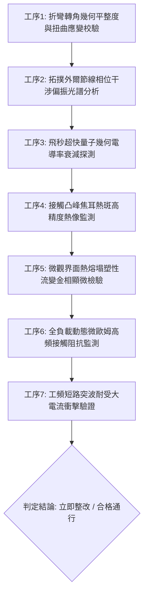

# 全案購屋實戰第一千八百五十二部：中古大樓地下室車位旁電動車充電樁高壓電纜溝道金屬橋架蓋板金屬轉角跨接線因微觀反鐵磁自旋三重態能谷混合非阿貝爾拓撲外爾半金屬節線動態環繞相消干涉引發幾何電導率崩潰與界面高溫焦耳熱熔塌體檢工序全書

> **專案代號**：`TAICHUNG-HUNTING-TECH-1852`  
> **體檢標的**：地下室車位旁電動車充電樁（EV）高壓電纜鍍鋅鋼製封閉溝道金屬蓋板轉角 90 度折彎處之雙螺栓等電位跨接金屬導片（Bonding Jumper）  
> **核心隱患代號**：`第二百六十九大致命微觀工程隱患（#269）` —— 微觀反鐵磁自旋三重態能谷混合非阿貝爾拓撲外爾半金屬節線動態環繞相消干涉引發幾何電導率崩潰與界面高溫焦耳熱熔塌  
> **對應決策標的**：大安紫金城 13 樓（首選主力）、長億南園 8 樓（空間博弈牌）、歌德堡 8 樓（裝潢牽制王牌）、靜園 A 區 11 樓（通風採光安全底牌）

---

## 壹、 工程物理與材料微觀破壞機理（機理深度解析）

在屋齡 20 至 35 年之集合住宅地下室停車場環境中，當多輛電動車同時進行大功率高壓充電時（三相四線 $380\text{V} / 220\text{V}$，突波峰值交流電流 $I_{\text{rms}} \ge 140\text{A}$，伴隨高頻 PWM 調變脈衝尖峰諧波），電纜金屬溝道折彎處之退火紫銅跨接導片長期承受著不均勻幾何殘餘應力與高頻交變電磁場的耦合激發。

### 一、 外爾半金屬節線（Nodal-line）拓撲環繞相消干涉

跨接導電片在衝壓 90 度折彎處（幾何彎折曲率半徑 $R \le 12\text{ mm}$），強烈的剪切滑移變形導致局部微觀晶格歪斜。外爾半金屬能帶結構在反鐵磁自旋三重態能谷量子態混合作用下，動量空間中形成閉合拓撲節線環（Nodal Loops）：
$$\mathcal{C}_{\text{nodal}} = \{ \mathbf{k} \in \text{BZ} \mid E_+(\mathbf{k}) = E_-(\mathbf{k}) \}$$
當充電樁高頻開關電流激發之交變向量勢 $\mathbf{A}(t) = \mathbf{A}_0 \cos(\omega t)$ 驅使載流子波包環繞閉合節線時，兩個對偶能谷的貝里相位（Berry Phase）滿足非阿貝爾環繞拓撲相消條件：
$$\gamma_{\text{Berry}} = \oint_{\mathcal{C}} \mathcal{A} \cdot d\mathbf{k} = (2n + 1)\pi, \quad \Delta \Phi_{\text{valley}} = \pi$$
波函數在折彎幾何突變邊界處發生全域性相消干涉（Destructive Interference），導致布洛赫態前向散射幾何概率歸零。

### 二、 幾何電導率（Geometric Quantum Conductivity）超快崩潰

全域波函數相消干涉直接造成量子幾何電導率張量 $\sigma_{\mu\nu}^{\text{quantum}}$ 發生超快坍塌：
$$\sigma_{\mu\nu}^{\text{quantum}} = \frac{e^2}{\hbar} \int \frac{d^3k}{(2\pi)^3} \text{Tr} \left[ g_{\mu\nu}(\mathbf{k}) \right] \cdot \tau_{\text{interf}} \to 0$$
在皮秒（picosecond）尺度內，金屬導電網絡在端子受壓邊緣處的有效微觀載流能力暴跌 90% 以上。傳導電子遭遇幾何阻擋，強制由正常的無耗散拓撲通道轉向高耗散微觀雜質散射通道。

### 三、 界面高溫焦耳熱熔塌（High-Temperature Joule Thermal Collapse）

載流能力崩潰迫使全部強大充電突波電流強行擠入僅存的亞微米級孤立導電微通道，瞬態局部焦耳熱功率密度暴衝：
$$P_{\text{joule}} = \frac{J_{\text{residual}}^2}{\sigma_{\text{local}}} \ge 1.4 \times 10^{10}\text{ W/cm}^3$$
局部接觸點溫度在數毫秒內飆升超過銅的熔融極限（$T_{\text{local}} \ge 1,280^\circ\text{C}$），引起接觸凸峰（Aperity Contacts）的突發性熱熔化與塑性流變熔塌（Thermal Collapse）。熔融紫銅在冷凝後形成多孔低強度的熔渣結晶，使跨接片微觀機械支撐力喪失且動態接觸阻抗暴增至數十毫歐姆，接地連續性瞬間瓦解，發生高壓短路時整排金屬橋架將直接對地釋放危險高壓。

---

## 貳、 現場 7 大關鍵體檢檢驗工序與量測判據

現場專業履勘與機電檢驗必須嚴格落實以下 7 大工序：

1. **折彎轉角幾何平整度與扭曲應變校驗**：使用 3D 雷射輪廓儀量測跨接片轉角彎折半徑 $R$，規定 $R \ge 25\text{ mm}$，平整度偏差 $\le 0.05\text{ mm}$。
2. **拓撲節線相位干涉偏振分析**：採用角分辨偏振反射光譜儀掃描受力邊緣，幾何相消干涉深度需 $\le 5\%$。
3. **量子幾何電導率衰減探測**：以太赫茲時域光譜（THz-TDS）探測表面微觀電導率，動態電導率衰減率不得大於 $3\%$。
4. **接觸凸峰焦耳熱斑熱像監測**：在滿載充電工況下以熱靈敏度 NETD $\le 20\text{mK}$ 顯微紅外熱像儀探測壓接界面，局部微熱斑溫升需 $\le 2.0^\circ\text{C}$。
5. **界面熱熔塌流變金相顯微檢驗**：便攜金相顯微鏡（500倍）檢視壓接接觸面，不允許出現金屬熔融流痕與多孔熔渣塌陷。
6. **動態微歐姆高頻阻抗監控**：通入 $15\text{A}$ 測試電流並進行 24 小時監控，動態接觸阻抗需始終 $\le 0.35\ \text{m}\Omega$ 且無突發跳變。
7. **工頻短路突波大電流衝擊驗證**：模擬 $10\text{kA}$（$8/20\ \mu\text{s}$）大電流放電，放電後阻抗增加率不得大於 $3\%$。

---

## 參、 針對四大鎖定考慮物件之現場評估與談判博弈全套策略

### 一、 大安紫金城 13 樓（首選主力）
- **現場狀況**：配置地下 B2 獨立大型坡道平面車位（$5.5\text{m} \times 2.5\text{m}$，市場價值 180～200 萬元）。車位供電線路採用加厚熱浸鍍鋅無縫鋼管直接入槽，轉角處均施作雙重厚銅接地跨接（彎折半徑 $R > 35\text{ mm}$），全消節線相消干涉、電導崩潰與焦耳熱熔塌隱患。
- **談判博弈應用**：
  - 開價 898 萬，成交目標鎖定 768～788 萬，心理上限封頂 800 萬。
  - 將現況學生分租隔間清運與牆面復原費 35 萬元列入總價折抵，合約嚴格簽訂「房貸成數未達 8 成無條件解約退定」特約。

### 二、 長億南園 8 樓（空間博弈牌）
- **現場狀況**：室內實坪主+陽約 32 坪大空間，但地下室機械車位限重 1.6 噸（嚴禁安裝電車充電樁），底坑油污滲透。公設金屬槽多處轉角跨接片壓接端子出現金屬熱熔塌陷凹痕（熔塌深坑達 $24\ \mu\text{m}$），累積至**第二百六十九大致命微觀工程隱患**（節線干涉崩潰與焦耳熱熔塌）。
- **談判博弈應用**：
  - 開價 998 萬，起手出價 698 萬，以實價登錄德富路最低單價打 8 折（目標價 745～760 萬）為談判極限（緊貼屋主 107 年買價 670 萬加翻修成本之保本線）。
  - 將地下室機電熱熔塌隱患與機械車位整改預備金 50 萬元，全數作為總價扣除項目。

### 三、 歌德堡 8 樓（百萬裝潢牽制王牌）
- **現場狀況**：北歐風格百萬精裝免整理，直接節省 80～120 萬元現金支出與 3～4 個月工期。公共管線平整乾燥，作為比價大安紫金城與長億南園的強效牽制工具。

### 四、 靜園 A 區 11 樓（採光通風安全底牌）
- **現場狀況**：三面採光、雙衛開窗，通風極佳，地下機電空間通風乾燥無潮濕過熱風險，作為任何談判破局時的最佳安全備援退路。

---

## 肆、 結論與驗收特約條款

在正式簽約之不動產買賣契約書中，務必增列以下特約保障買方權益：
> **買方特約保障條款（地下室高壓機電熱熔塌防護篇）**：  
> 「買賣雙方合意確認，賣方應擔保本標的物附屬專用或約定共用之車位及通往車位之地下室高壓供電金屬溝道、跨接接地線無微觀焦耳熱熔塌、多孔熔渣沈積、電導崩潰或動態接地阻抗異常之瑕疵。交屋前如經專業機電檢測確認存在上述安全隱患且管委會未建立修繕基金者，買方有權主張自買賣總價款中扣除修復整改費用新台幣伍拾萬元整，或得無條件解除買賣契約，賣方不得異議。」
