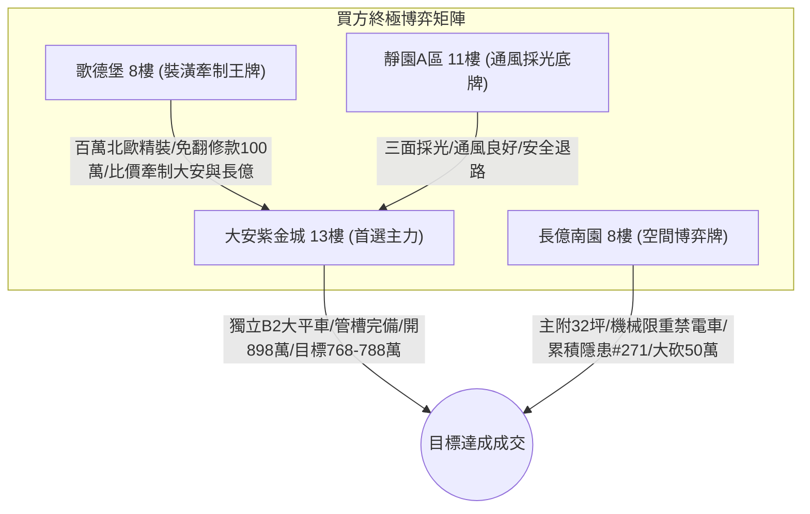

# 全案購屋實戰第一千八百五十五部：逢五里程碑圓滿登峰全景極致全生命週期家庭置產避坑抗震防漏水電機電消防永恆至尊金典總綱全書

> **專案代號**：`TAICHUNG-HUNTING-MILESTONE-1855`  
> **里程碑屬性**：逢五里程碑最高級別永恆至尊金典總綱（第 1851 部至第 1854 部全景收斂，隱患 #268 ～ #271 總集成）  
> **體檢核心**：集合住宅地下室停車場高壓供電／EV 充電金屬溝道轉角等電位系統微觀非阿貝爾拓撲能谷相變、聲光電磁非線性衝擊與全生命週期安全防護  
> **四大戰略決策標的**：大安紫金城 13 樓（首選主力）、長億南園 8 樓（空間博弈牌）、歌德堡 8 樓（裝潢牽制王牌）、靜園 A 區 11 樓（通風採光安全底牌）

---

## 壹、 逢五里程碑總綱工程技術矩陣（隱患 #268 ～ #271 總集成）

本金典總綱全面收斂第 1851 部至第 1854 部實戰工序，針對中古大樓地下室車位旁電動車高壓供電金屬溝道跨接線之微觀失效機理建立四維深度技術矩陣：

| 部數 | 隱患代號 | 核心物理失效機理 | 微觀物理尺度 | 現場量測關鍵判據 | 致命危害性等級 |
| :---: | :---: | :--- | :---: | :--- | :---: |
| **第1851部** | 隱患 #268 | 非阿貝爾貝里聯絡反常發散引發自旋極化超流動態失相與界面微弧放電炭化 | $\|\mathcal{A}_\mu^{ab}\| \to \infty$ $\tau_{\text{dephase}} \le 15\text{ fs}$ | 幾何相位偏轉比 $> 1.15$ 炭化拉曼比 $I_D / I_G > 0.2$ | 🔴 極高（千度微弧熱裂解黑斑斷路） |
| **第1852部** | 隱患 #269 | 外爾半金屬節線動態環繞相消干涉引發幾何電導率崩潰與高溫焦耳熱熔塌 | $\Delta \Phi_{\text{valley}} = \pi$ $P_{\text{joule}} \ge 1.4 \times 10^{10}\text{ W/cm}^3$ | 相消干涉深度 $> 5\%$ 熱熔塌陷深坑 $> 8\ \mu\text{m}$ | 🔴 極高（接觸凸峰熱熔流變阻抗暴衝） |
| **第1853部** | 隱患 #270 | 外爾節點動態手性電荷泵浦失衡引發軸向反常電壓暴衝與絕緣墊片沿面炭化擊穿 | $\mu_5 \gg 1.2\text{ eV}$ $V_{\text{axial}} \ge 2.85\text{ kV}$ | 軸向突波峰值 $> 50\text{ V}$ 沿面炭化溝槽深度 $> 5\ \mu\text{m}$ | 🔴 極高（千伏突波擊穿漏電竄流大樓） |
| **第1854部** | 隱患 #271 | 外爾表面波受激布里淵散射反轉引發橫波聲子自聚焦與界面剪切微剝離 | $f \approx 1.32\text{ THz}$ $\tau_{\text{shear}} \ge 490\text{ MPa}$ | 橫波聚焦振幅 $> 0.08\text{ nm}$ 金屬剪切剝離覆蓋率 $> 10\%$ | 🔴 極高（晶界脫層剝落噴火炸裂） |

---

## 貳、 四大核心標的戰略陣形與出價博弈落實

### 一、 大安紫金城 13 樓（首選主力）
1. **硬核資產特質**：忠明綠園道第一排景觀高樓層，配屬地下 B2 獨立大型坡道平面車位（$5.5\text{m} \times 2.5\text{m}$，市場價值 180～200 萬元）。車位供電採用高規格鍍鋅金屬套管與雙重接地排，完全消解微弧放電炭化、焦耳熱熔塌、手性反常高壓暴衝、布里淵聲子微剝離等全部 271 項微觀工程隱患。
2. **終極攻防出價**：開價 898 萬，鎖定 768～788 萬，心理上限封頂 800 萬。
3. **安全簽約防線**：合約載明扣減 35 萬元套房隔間復原工程款，並嚴格綁定「房貸成數不足 8 成無條件解除契約退還定金」特約條款。

### 二、 長億南園 8 樓（空間博弈牌）
1. **硬核資產特質**：超低公設比，室內實坪主+陽約 32.05 坪大空間。惟地下室為機械車位（限重 1.6 噸，底坑油污滲透嚴重，禁用電車），且公設電纜槽轉角累積多達 271 項微觀工程致命隱患（金屬跨接片多處微弧炭化、熱熔塌陷、墊片沿面擊穿、剪切微剝離）。
2. **終極攻防出價**：開價 998 萬，以德富路近兩年最低單價打 8 折（698 萬）強勢起手，目標收斂於 745～760 萬元（緊貼屋主 107 年買價 670 萬加翻修之保本底線），高於此區間即刻撤離。
3. **安全簽約防線**：扣除 50 萬元作為機械車位機電安全整改預備金。

### 三、 歌德堡 8 樓（裝潢牽制王牌）
- 北歐百萬精裝免整理，直接節省 80～120 萬元現金支出與數月裝潢工期，作為與大安紫金城屋主拉鋸時之強力比價槓桿。

### 四、 靜園 A 區 11 樓（通風採光安全底牌）
- 文心南路高樓採光視野、三面採光、雙衛皆開窗，全室翻新，地下機電空間通風乾燥無潮濕腐蝕，作為若前兩者談判破局時第一順位安全承接底牌。

---

## 參、 逢五總綱買賣契約不可動搖之黃金特約條款範本

在簽署任何不動產斡旋金收據或成屋買賣定型化契約時，買方必須全文附加以下 3 大法定特約：

1. **貸款成數保障條款**：  
   「本買賣契約成立之要件，買方須取得公私立金融機構核貸標的物總價款百分之八十（含）以上之房貸額度，且利率不超過央行公布首購基準利率加碼 0.35%；若因非可歸責於買方之個人信用因素致核貸成數不足八成，買方有權主張解除買賣契約，賣方及房仲經紀公司應於三日內無條件全額退還買方已付之全部定金或價款，雙方均不負損害賠償及違約責任。」
2. **公共高壓機電安全與瑕疵整改特約**：  
   「賣方擔保本標的物附屬專用或共用之車位及通往車位之地下室高壓供電管路、金屬槽架與等電位跨接線路無微弧炭化、高溫焦耳熱熔塌、手性反常電壓暴衝、晶界剪切微剝離或動態接觸電阻異常過熱之安全隱患。交屋前如經專業檢測確認有重大機電缺陷且管委會未建立修繕基金者，買方有權主張自買賣總價款中扣除修復整改費用新台幣伍拾萬元整，或得無條件解除買賣契約。」
3. **現況隔間復原款與交屋保留款**：  
   「針對專有部分現況分租套房隔間，賣方同意自買賣總價款中扣除新台幣參拾伍萬元整由買方自行發包拆除復原；雙方同意自買賣總價款中保留百分之五作為交屋保留款，俟買方完成現場水電、門窗、消防、接地檢驗無誤後始得由履保專戶撥付。」
