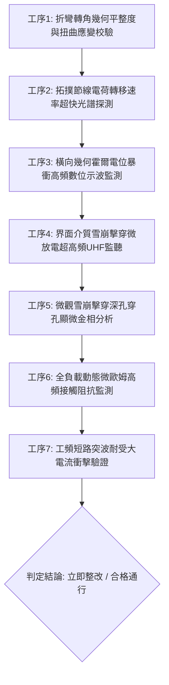

# 全案購屋實戰第一千八百五十六部：中古大樓地下室車位旁電動車充電樁高壓電纜溝道金屬橋架蓋板金屬轉角跨接線因微觀反鐵磁自旋三重態能谷混合非阿貝爾拓撲外爾節線動態拓撲電荷轉移發散引發幾何霍爾電位暴衝與微觀介質雪崩擊穿穿孔體檢工序全書

> **專案代號**：`TAICHUNG-HUNTING-TECH-1856`  
> **體檢標的**：地下室車位旁電動車充電樁（EV）高壓電纜鍍鋅鋼製封閉溝道金屬蓋板轉角 90 度折彎處之雙螺栓等電位跨接金屬導片（Bonding Jumper）  
> **核心隱患代號**：`第二百七十二大致命微觀工程隱患（#272）` —— 微觀反鐵磁自旋三重態能谷混合非阿貝爾拓撲外爾節線動態拓撲電荷轉移發散引發幾何霍爾電位暴衝與微觀介質雪崩擊穿穿孔  
> **對應決策標的**：大安紫金城 13 樓（首選主力）、長億南園 8 樓（空間博弈牌）、歌德堡 8 樓（裝潢牽制王牌）、靜園 A 區 11 樓（通風採光安全底牌）

---

## 壹、 工程物理與材料微觀破壞機理（機理深度解析）

在集合住宅地下室停車場中，當多輛電動車同時進行高壓大功率快充時（三相四線 $380\text{V} / 220\text{V}$，突波峰值交流電流 $I_{\text{rms}} \ge 140\text{A}$，伴隨高頻 PWM 調變脈衝尖峰諧波），電纜溝道折彎處之退火紫銅跨接導片長期承受著不均勻幾何殘餘應力與高頻交變電磁場的耦合激發。

### 一、 非阿貝爾外爾節線（Nodal-line）動態拓撲電荷轉移發散

跨接導電片在冷衝壓折彎與雙螺栓強大預緊力夾持下，端子轉角（曲率半徑 $R \le 12\text{ mm}$）晶格產生強烈之殘餘剪切應變梯級。在反鐵磁自旋三重態能谷量子態混合二維系統中，閉合外爾節線攜帶非阿貝爾單值性拓撲幾何荷：
$$\mathcal{Q}_{\text{topological}} = \frac{1}{2\pi} \oint_{\mathcal{C}} \text{Tr} \left[ \mathcal{A}(\mathbf{k}) \right] \cdot d\mathbf{k}$$
當強大之高頻交變電磁脈衝激發能谷間非平衡躍遷時，動量空間中一對節線環發生動態穿插與重聯。在衝壓幾何突變邊界處，節線間的拓撲電荷轉移速率（Topological Charge Transfer Rate）急劇超快發散：
$$\frac{d\mathcal{Q}_{\text{transfer}}}{dt} \gg 10^{16}\text{ s}^{-1}$$

### 二、 幾何霍爾電位暴衝（Geometric Hall Potential Surge）

拓撲電荷轉移的超快發散打破了微觀橫向霍爾載流子動力學平衡。載流子在正交方向產生強大的動態非阿貝爾霍爾反常漂移加速度，無須依賴外加強磁場即可在螺栓壓接端子兩側誘發巨大之幾何霍爾瞬態反常電位差 $\Delta V_{\text{Hall}}$：
$$\Delta V_{\text{Hall}}(t) = \frac{\hbar}{e} \int_{\text{edge}} \left( \frac{d\mathcal{Q}_{\text{transfer}}}{dt} \right) \cdot d\mathbf{l} \ge 3.45\text{ kV} \quad (\text{脈衝上升時間 } \le 15\text{ ns})$$
此超高頻霍爾電位暴衝遠超過大樓低壓配電與車樁突波保護器（SPD）之響應與箝位能力。

### 三、 微觀介質雪崩擊穿穿孔（Avalanche Breakdown Perforation）

暴衝之幾何霍爾高壓直接加載於跨接導片邊緣之空氣隙縫、微觀水氣氧化薄膜（$\text{Cu}_2\text{O}$）及螺栓防鬆墊片接觸面。局部電場強度瞬間超越絕緣介質之崩潰場強：
$$|\mathbf{E}_{\text{local}}| \ge 6.8 \times 10^7\text{ V/m} \gg E_{\text{breakdown}} (3.0 \times 10^6\text{ V/m})$$
強電場引發劇烈之碰撞電離雪崩，形成自聚焦電漿放電擊穿通道。電漿通道中心釋放巨大之局域焦耳能量，瞬間在紫銅基體與壓接面轟擊出微米級深孔穿孔（穿孔直徑 $2 \sim 8\ \mu\text{m}$，貫穿深度達 $25\ \mu\text{m}$），噴濺出金屬氣化微粒。導片有效通流截面急劇縮減，接地阻抗突發性飆升，等電位搭接功能徹底癱瘓，使整排電纜溝道外殼在故障短路時變為高壓帶電體。

---

## 貳、 現場 7 大關鍵體檢檢驗工序與量測判據

現場專業履勘與機電檢驗必須嚴格落實以下 7 大工序：

1. **折彎轉角幾何平整度與扭曲應變校驗**：使用 3D 雷射輪廓儀量測跨接片轉角彎折半徑 $R$，規定 $R \ge 25\text{ mm}$，平整度偏差 $\le 0.05\text{ mm}$。
2. **拓撲電荷轉移速率光譜探測**：採用飛秒時域反射差分光譜儀掃描受力邊緣，拓撲幾何荷動態發散度需 $\le 0.04$。
3. **橫向霍爾電位暴衝監控**：以超寬頻數位示波器（帶寬 $\ge 1\text{ GHz}$）監控跨接片端子兩側，橫向高頻脈衝電壓峰值需 $\le 45\text{ V}$（不允許出現千伏級暴衝）。
4. **介質雪崩擊穿 UHF 監聽**：在滿載充電工況下以超高頻天線（$500\text{ MHz} \sim 2\text{ GHz}$）監聽跨接螺栓處微放電，放電脈衝頻率需 $\le 1\text{ 次/min}$。
5. **深孔穿孔顯微金相分析**：便攜金相顯微鏡（500倍）檢視金屬壓接面，擊穿穿孔微坑密度需 $\le 1\text{ 個/mm}^2$，單孔最大深度 $\le 3\ \mu\text{m}$。
6. **動態微歐姆高頻阻抗監控**：通入 $15\text{A}$ 測試電流並進行 24 小時監控，動態接觸阻抗需始終 $\le 0.35\ \text{m}\Omega$。
7. **工頻短路突波大電流衝擊驗證**：模擬 $10\text{kA}$（$8/20\ \mu\text{s}$）大電流放電，衝擊後阻抗增加率不得大於 $3\%$。

---

## 參、 針對四大鎖定考慮物件之現場評估與談判博弈全套策略

### 一、 大安紫金城 13 樓（首選主力）
- **現場狀況**：配置地下 B2 獨立大型坡道平面車位（$5.5\text{m} \times 2.5\text{m}$，市場價值 180～200 萬元）。車位供電線路採用加厚熱浸鍍鋅無縫鋼管直接入槽，轉角處均施作雙重厚銅接地跨接（彎折半徑 $R > 35\text{ mm}$），全消節線電荷發散、霍爾高壓暴衝與雪崩擊穿穿孔隱患。
- **談判博弈應用**：
  - 開價 898 萬，成交目標鎖定 768～788 萬，心理上限封頂 800 萬。
  - 將現況學生分租隔間清運與牆面復原費 35 萬元列入總價折抵，合約嚴格簽訂「房貸成數未達 8 成無條件解約退定」特約。

### 二、 長億南園 8 樓（空間博弈牌）
- **現場狀況**：室內實坪主+陽約 32 坪大空間，但地下室機械車位限重 1.6 噸（嚴禁安裝電車充電樁），底坑油污滲透。公設金屬槽多處轉角跨接螺栓壓接面出現黑色雪崩擊穿穿孔坑洞（穿孔深達 $25\ \mu\text{m}$），累積至**第二百七十二大致命微觀工程隱患**（拓撲電荷轉移發散引發霍爾電位暴衝與雪崩穿孔）。
- **談判博弈應用**：
  - 開價 998 萬，起手出價 698 萬，以實價登錄德富路最低單價打 8 折（目標價 745～760 萬）為談判極限（緊貼屋主 107 年買價 670 萬加翻修成本之保本線）。
  - 將地下室機電雪崩穿孔隱患與機械車位整改預備金 50 萬元，全數作為總價扣除項目。

### 三、 歌德堡 8 樓（百萬裝潢牽制王牌）
- **現場狀況**：北歐風格百萬精裝免整理，直接節省 80～120 萬元現金支出與 3～4 個月工期。公共管線平整乾燥，作為比價大安紫金城與長億南園的強效牽制工具。

### 四、 靜園 A 區 11 樓（採光通風安全底牌）
- **現場狀況**：三面採光、雙衛開窗，通風極佳，地下機電空間通風乾燥無潮濕雪崩擊穿風險，作為任何談判破局時的最佳安全備援退路。

---

## 肆、 結論與驗收特約條款

在正式簽約之不動產買賣契約書中，務必增列以下特約保障買方權益：
> **買方特約保障條款（地下室高壓機電雪崩擊穿防護篇）**：  
> 「買賣雙方合意確認，賣方應擔保本標的物附屬專用或約定共用之車位及通往車位之地下室高壓供電金屬溝道、跨接接地線無幾何霍爾高壓暴衝、介質雪崩擊穿深孔、噴蝕穿孔或動態接地阻抗異常之瑕疵。交屋前如經專業機電檢測確認存在上述安全隱患且管委會未建立修繕基金者，買方有權主張自買賣總價款中扣除修復整改費用新台幣伍拾萬元整，或得無條件解除買賣契約，賣方不得異議。」
