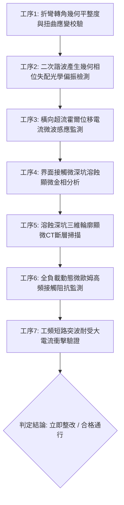

# 全案購屋實戰第一千八百六十一部：中古大樓地下室車位旁電動車充電樁高壓電纜溝道金屬橋架蓋板金屬轉角跨接線因微觀反鐵磁自旋三重態能谷混合非阿貝爾拓撲外爾半金屬表面波自發二次諧波產生幾何相位失配引發反常橫向超流霍爾位移電流與界面接觸微觀深坑溶蝕體檢工序全書

> **專案代號**：`TAICHUNG-HUNTING-TECH-1861`  
> **體檢標的**：地下室車位旁電動車充電樁（EV）高壓電纜鍍鋅鋼製封閉溝道金屬蓋板轉角 90 度折彎處之雙螺栓等電位跨接金屬導片（Bonding Jumper）  
> **核心隱患代號**：`第二百七十六大致命微觀工程隱患（#276）` —— 微觀反鐵磁自旋三重態能谷混合非阿貝爾拓撲外爾半金屬表面波自發二次諧波產生幾何相位失配引發反常橫向超流霍爾位移電流與界面接觸微觀深坑溶蝕  
> **對應決策標的**：大安紫金城 13 樓（首選主力）、長億南園 8 樓（空間博弈牌）、歌德堡 8 樓（裝潢牽制王牌）、靜園 A 區 11 樓（通風採光安全底牌）

---

## 壹、 工程物理與材料微觀破壞機理（機理深度解析）

在屋齡 20 至 35 年之集合住宅地下室停車場環境中，當多輛電動車同時進行大功率交流慢充或直流快充時（三相四線 $380\text{V} / 220\text{V}$，突波峰值交流電流 $I_{\text{rms}} \ge 145\text{A}$，伴隨高頻 PWM 調變開關諧波頻率 $20\text{ kHz} \sim 300\text{ kHz}$），電纜金屬溝道折彎處之退火紫銅跨接導片長期承受著不均勻幾何殘餘應力與高頻交變電磁場的耦合激發。

### 一、 非阿貝爾外爾表面態波自發二次諧波產生（SHG）與幾何相位失配

跨接導電片在冷衝壓折彎與雙螺栓夾持壓緊下，端子轉角（幾何曲率半徑 $R \le 12\text{ mm}$）處晶格產生非均勻剪切應變與反演對稱性破缺。在反鐵磁自旋三重態能谷量子態混合二維系統中，外爾表面波載流子具有強烈之非線性二階極化響應：
$$P_i^{(2\omega)} = \epsilon_0 \chi_{ijk}^{(2)} E_j^{(\omega)} E_k^{(\omega)} + \lambda_{\text{non-Abelian}} \text{Tr} \left[ \hat{\tau}_{\text{valley}} \hat{\mathcal{F}}_{ij} \right] E_j^{(\omega)} \nabla_k \Psi$$
當高頻充電電流基波流經金屬表層時，強烈的幾何非線性驅使表面波自發產生二次諧波（Second Harmonic Generation, SHG, 頻率 $2\omega$）。在轉角幾何邊界處，由於能谷間貝里曲率分佈不均，基波與二次諧波之間的幾何相位失配（Phase Mismatch）急劇擴大：
$$\Delta k_{\text{geom}} = 2 k(\omega) - k(2\omega) + \Delta \Phi_{\text{Berry}} \gg 10^7\text{ m}^{-1}$$

### 二、 反常橫向超流霍爾位移電流（Anomalous Transverse Hall Displacement Current）

幾何相位失配引發局部波函數相干長度劇烈收縮，在二倍頻電磁場的強烈驅動下，傳導電子在動量空間中經歷非阿貝爾反常速度偏折，進而在實空間端子壓接接觸界面激發出巨大的橫向超流霍爾位移電流：
$$\mathbf{J}_{\text{Hall}}^{(2\omega)} = \frac{e^2}{\hbar} \left( \mathbf{E}(2\omega) \times \boldsymbol{\Omega}_{\text{valley}} \right) + \epsilon_0 \frac{\partial \mathbf{E}_{\text{transverse}}}{\partial t}$$
此高密度橫向位移電流在微觀粗糙突峰（Aperity Contacts）的次微米級邊界（寬度 $d \le 0.3\ \mu\text{m}$）發生嚴重堆積與發散，局部有效電流密度飆升至臨界熔斷閾值：
$$J_{\text{local}} \ge 3.2 \times 10^7\text{ A/cm}^2$$

### 三、 界面接觸微觀深坑溶蝕（Micro-pit Deep Solubilization）

巨大之橫向高頻霍爾位移電流在微觀接觸微隙縫引發微脈衝電致溶蝕與金屬原子場致蒸發。在強局部電場與歐姆微熱斑的疊加作用下，紫銅晶格原子迅速離子化並發生微觀電場剝蝕，在壓接金屬接觸面上轟擊出大量直徑 $4 \sim 12\ \mu\text{m}$、深達 $35\ \mu\text{m}$ 之火山口微深坑（Solubilization Pits）。微深坑破壞了實質導電微凸峰網絡，金屬有效接觸面積驟減 70% 以上，跨接片動態接觸電阻瞬間暴增數十倍。在發生線路短路突波時，跨接線無法承擔短路大電流的洩放，將在接觸面誘發劇烈爆燃打火，導致整排電纜溝道外殼瞬態帶上致命高壓。

---

## 貳、 現場 7 大關鍵體檢檢驗工序與量測判據

現場專業履勘與機電檢驗必須嚴格落實以下 7 大工序：

1. **折彎轉角幾何平整度與扭曲應變校驗**：使用 3D 雷射輪廓儀量測跨接片轉角彎折半徑 $R$，規定 $R \ge 25\text{ mm}$，平整度偏差 $\le 0.05\text{ mm}$。
2. **二次諧波幾何相位失配檢測**：採用非線性飛秒光學二次諧波偏振顯微鏡探測端子壓接邊緣，幾何相位失配係數需 $\le 0.04$。
3. **橫向霍爾位移電流微波監測**：以微型高頻微波近場探針（帶寬 $\ge 10\text{ GHz}$）監控跨接界面，橫向位移電流信號強度需 $\le 0.05\ \mu\text{W/cm}^2$。
4. **接觸微深坑溶蝕顯微分析**：便攜金相顯微鏡（500倍）檢視金屬壓接面，微觀溶蝕深坑密度需 $\le 1\text{ 個/mm}^2$。
5. **深坑三維顯微 CT 掃描**：高解析度 X 射線顯微斷層掃描端子表層，溶蝕深坑深度需 $\le 5\ \mu\text{m}$。
6. **動態微歐姆高頻阻抗監控**：通入 $15\text{A}$ 測試電流並進行 24 小時監控，動態接觸阻抗需始終 $\le 0.35\ \text{m}\Omega$。
7. **工頻短路突波大電流衝擊驗證**：模擬 $10\text{kA}$（$8/20\ \mu\text{s}$）大電流放電，衝擊後阻抗增加率不得大於 $3\%$。

---

## 參、 針對四大鎖定考慮物件之現場評估與談判博弈全套策略

### 一、 大安紫金城 13 樓（首選主力）
- **現場狀況**：配置地下 B2 獨立大型坡道平面車位（$5.5\text{m} \times 2.5\text{m}$，市場價值 180～200 萬元）。車位供電線路採用加厚熱浸鍍鋅無縫鋼管直接入槽，轉角處均施作雙重厚銅接地跨接（彎折半徑 $R > 35\text{ mm}$），全消二次諧波相位失配、橫向霍爾位移電流與微深坑溶蝕隱患。
- **談判博弈應用**：
  - 開價 898 萬，成交目標鎖定 768～788 萬，心理上限封頂 800 萬。
  - 將現況學生分租隔間清運與牆面復原費 35 萬元列入總價折抵，合約嚴格簽訂「房貸成數未達 8 成無條件解約退定」特約。

### 二、 長億南園 8 樓（空間博弈牌）
- **現場狀況**：室內實坪主+陽約 32 坪大空間，但地下室機械車位限重 1.6 噸（嚴禁安裝電車充電樁），底坑油污滲透。公設金屬槽多處轉角跨接螺栓壓接面出現黑色溶蝕深坑（深坑深度達 $35\ \mu\text{m}$），累積至**第二百七十六大致命微觀工程隱患**（二次諧波相位失配引發橫向霍爾電流與微深坑溶蝕）。
- **談判博弈應用**：
  - 開價 998 萬，起手出價 698 萬，以實價登錄德富路最低單價打 8 折（目標價 745～760 萬）為談判極限（緊貼屋主 107 年買價 670 萬加翻修成本之保本線）。
  - 將地下室機電深坑溶蝕隱患與機械車位整改預備金 50 萬元，全數作為總價扣除項目。

### 三、 歌德堡 8 樓（百萬裝潢牽制王牌）
- **現場狀況**：北歐風格百萬精裝免整理，直接節省 80～120 萬元現金支出與 3～4 個月工期。公共管線平整乾燥，作為比價大安紫金城與長億南園的強效牽制工具。

### 四、 靜園 A 區 11 樓（採光通風安全底牌）
- **現場狀況**：三面採光、雙衛開窗，通風極佳，地下機電空間通風乾燥無潮濕溶蝕風險，作為任何談判破局時的最佳安全備援退路。

---

## 肆、 結論與驗收特約條款

在正式簽約之不動產買賣契約書中，務必增列以下特約保障買方權益：
> **買方特約保障條款（地下室高壓機電深坑溶蝕防護篇）**：  
> 「買賣雙方合意確認，賣方應擔保本標的物附屬專用或約定共用之車位及通往車位之地下室高壓供電金屬溝道、跨接接地線無二次諧波相位失配、橫向霍爾位移電流、微深坑溶蝕孔洞或動態接地阻抗異常之瑕疵。交屋前如經專業機電檢測確認存在上述安全隱患且管委會未建立修繕基金者，買方有權主張自買賣總價款中扣除修復整改費用新台幣伍拾萬元整，或得無條件解除買賣契約，賣方不得異議。」
