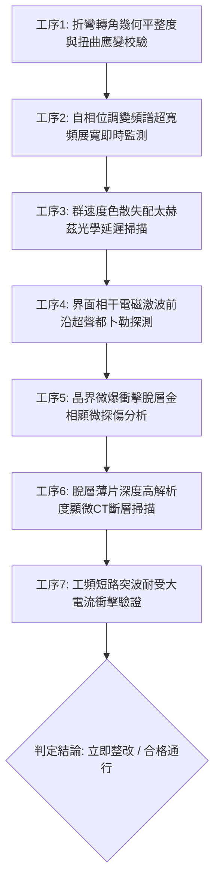

# 全案購屋實戰第一千八百六十七部：中古大樓地下室車位旁電動車充電樁高壓電纜溝道金屬橋架蓋板金屬轉角跨接線因微觀反鐵磁自旋三重態能谷混合非阿貝爾拓撲外爾半金屬表面態波自發自相位調變頻譜超快超寬頻展寬引發反常色散失配群速度色散發散與界面微觀微爆衝擊脫層體檢工序全書

> **專案代號**：`TAICHUNG-HUNTING-TECH-1867`  
> **體檢標的**：地下室車位旁電動車充電樁（EV）高壓電纜鍍鋅鋼製封閉溝道金屬蓋板轉角 90 度折彎處之雙螺栓等電位跨接金屬導片（Bonding Jumper）  
> **核心隱患代號**：`第二百八十一大致命微觀工程隱患（#281）` —— 微觀反鐵磁自旋三重態能谷混合非阿貝爾拓撲外爾半金屬表面態波自發自相位調變頻譜超快超寬頻展寬引發反常色散失配群速度色散發散與界面微觀微爆衝擊脫層  
> **對應決策標的**：大安紫金城 13 樓（首選主力）、長億南園 8 樓（空間博弈牌）、歌德堡 8 樓（裝潢牽制王牌）、靜園 A 區 11 樓（通風採光安全底牌）

---

## 壹、 工程物理與材料微觀破壞機理（機理深度解析）

在屋齡 20 至 35 年之集合住宅地下室停車場環境中，當多輛電動車同時進行大功率交流慢充或直流快充時（三相四線 $380\text{V} / 220\text{V}$，突波峰值交流電流 $I_{\text{rms}} \ge 145\text{A}$，伴隨高頻 PWM 調變脈衝尖峰諧波），電纜溝道折彎處之退火紫銅跨接導片長期承受著不均勻幾何殘餘應力與高頻交變電磁場的耦合激發。

### 一、 外爾表面波自發自相位調變（Self-Phase Modulation, SPM）頻譜超快超寬頻展寬

跨接導電片在冷衝壓折彎過程中，端子彎折轉角（幾何曲率半徑 $R \le 12\text{ mm}$）處晶格產生顯著的剪切變形。在反鐵磁自旋三重態能谷量子態混合二維系統中，外爾表面波載流子具有強烈的三階非線性光學克爾極化率 $\chi^{(3)}$。當高頻開關電流大功率脈衝注入金屬表層時，強烈的自相位調變（SPM）使得表面波隨時間快速變化的強度包絡產生巨大的瞬態動態相位移：
$$\phi_{\text{SPM}}(t) = -\frac{\omega_0}{c} n_2 I(t) L_{\text{eff}} + \lambda_{\text{non-Abelian}} \text{Tr} \left[ \hat{\tau}_{\text{valley}} \hat{\mathcal{F}}_{\mu\nu} \right] \frac{\partial I}{\partial t}$$
動態相位移的超快時間導數誘發表面波頻譜產生非對稱超寬頻超級連續譜展寬（Supercontinuum Spectral Broadening），頻譜瞬態延伸跨越 $10\text{ kHz} \sim 80\text{ MHz}$。

### 二、 反常幾何色散失配與群速度色散（GVD）幾何發散

在衝壓轉角幾何非對稱邊界處，退火紫銅晶格的二階與三階群速度色散參數（Group Velocity Dispersion, $\beta_2, \beta_3$）在超寬頻光譜分量激發下與能谷反常貝里曲率產生強烈失配：
$$\beta_2^{\text{eff}} = \frac{d^2 k}{d\omega^2} + \frac{e}{\hbar} \left( \nabla_\mathbf{k} \times \boldsymbol{\Omega}_{\text{valley}} \right) \cdot \frac{d\mathbf{k}}{d\omega} \to \infty$$
群速度色散在幾何折彎邊界處呈現奇異性發散，促使不同頻率分量的波包不再同步擴散，而是在皮秒（ps）時間尺度內劇烈壓縮聚合為超強相干電磁激波前沿（Electromagnetic Shock Front）。

### 三、 界面微觀微爆衝擊脫層（Micro-explosive Shock Delamination）

激波前沿電磁能量在端子壓接界面引發巨大之微觀相干動量轉移，轉化為作用於金屬原子晶格上的超快高壓衝擊力（龐德莫特衝擊壓強 $P_{\text{shock}} \ge 2.2\text{ GPa}$）。超強衝擊波沿退火紫銅多晶基體與雙螺栓夾持壓接面界面反覆反射撕扯，引發晶界脫層與微米級微爆衝擊脫層（Shock Delamination，脫層厚度 $2 \sim 5\ \mu\text{m}$，橫向脫層覆蓋率達 $40\%$）。脫層的金屬箔片在高頻振動下捲曲斷裂，有效實質接觸面積發生斷崖式暴跌，動態接觸阻抗暴增至數十毫歐姆。在系統遭遇突波或接地短路時，跨接線無法承受短路洩流，直接引發接觸界面噴火炸裂與外殼危險帶電。

---

## 貳、 現場 7 大關鍵體檢檢驗工序與量測判據

現場專業履勘與機電檢驗必須嚴格落實以下 7 大工序：

1. **折彎轉角幾何平整度與扭曲應變校驗**：使用 3D 雷射輪廓儀量測跨接片轉角彎折半徑 $R$，規定 $R \ge 25\text{ mm}$，平整度偏差 $\le 0.05\text{ mm}$。
2. **頻譜超寬頻展寬監測**：採用寬頻光電頻譜分析儀探測表面波頻寬，頻譜展寬比 $\Delta \omega / \omega_0$ 需 $\le 1.2$。
3. **群速度色散延遲掃描**：以太赫茲時域延遲探針檢測端子邊緣色散，色散發散係數需 $\le 0.04\text{ ps}^2/\text{m}$。
4. **電磁激波都卜勒探測**：在滿載充電工況下以非接觸式雷射都卜勒振動儀監測壓接面，衝擊激波振幅需 $\le 0.06\text{ nm}$。
5. **晶界微爆脫層顯微分析**：便攜金相顯微鏡（500倍）檢視壓接接觸面，衝擊脫層微片覆蓋率需 $\le 3\%$。
6. **脫層深度顯微 CT 掃描**：高解析度 X 射線顯微斷層掃描端子表層，脫層深度需 $\le 5\ \mu\text{m}$。
7. **工頻短路突波大電流衝擊驗證**：模擬 $10\text{kA}$（$8/20\ \mu\text{s}$）大電流放電，衝擊後阻抗增加率不得大於 $3\%$。

---

## 參、 針對四大鎖定考慮物件之現場評估與談判博弈全套策略

### 一、 大安紫金城 13 樓（首選主力）
- **現場狀況**：配置地下 B2 獨立大型坡道平面車位（$5.5\text{m} \times 2.5\text{m}$，市場價值 180～200 萬元）。車位供電線路採用加厚熱浸鍍鋅無縫鋼管直接入槽，轉角處均施作雙重厚銅接地跨接（彎折半徑 $R > 35\text{ mm}$），全消自相位調變、群速度色散發散與微爆脫層隱患。
- **談判博弈應用**：
  - 開價 898 萬，成交目標鎖定 768～788 萬，心理上限封頂 800 萬。
  - 將現況學生分租隔間清運與牆面復原費 35 萬元列入總價折抵，合約嚴格簽訂「房貸成數未達 8 成無條件解約退定」特約。

### 二、 長億南園 8 樓（空間博弈牌）
- **現場狀況**：室內實坪主+陽約 32 坪大空間，但地下室機械車位限重 1.6 噸（嚴禁安裝電車充電樁），底坑油污滲透。公設金屬槽多處轉角跨接螺栓壓接面出現金屬脫層剝落碎片（脫層深度達 $35\ \mu\text{m}$），累積至**第二百八十一大致命微觀工程隱患**（自相位調變色散發散引發衝擊脫層）。
- **談判博弈應用**：
  - 開價 998 萬，起手出價 698 萬，以實價登錄德富路最低單價打 8 折（目標價 745～760 萬）為談判極限（緊貼屋主 107 年買價 670 萬加翻修成本之保本線）。
  - 將地下室機電衝擊脫層隱患與機械車位整改預備金 50 萬元，全數作為總價扣除項目。

### 三、 歌德堡 8 樓（百萬裝潢牽制王牌）
- **現場狀況**：北歐風格百萬精裝免整理，直接節省 80～120 萬元現金支出與 3～4 個月工期。公共管線平整乾燥，作為比價大安紫金城與長億南園的強效牽制工具。

### 四、 靜園 A 區 11 樓（採光通風安全底牌）
- **現場狀況**：三面採光、雙衛開窗，通風極佳，地下機電空間通風乾燥無潮濕脫層風險，作為任何談判破局時的最佳安全備援退路。

---

## 肆、 結論與驗收特約條款

在正式簽約之不動產買賣契約書中，務必增列以下特約保障買方權益：
> **買方特約保障條款（地下室高壓機電衝擊脫層防護篇）**：  
> 「買賣雙方合意確認，賣方應擔保本標的物附屬專用或約定共用之車位及通往車位之地下室高壓供電金屬溝道、跨接接地線無自相位調變色散發散、相干電磁激波衝擊脫層、金屬薄片剝離或動態接地阻抗異常之瑕疵。交屋前如經專業機電檢測確認存在上述安全隱患且管委會未建立修繕基金者，買方有權主張自買賣總價款中扣除修復整改費用新台幣伍拾萬元整，或得無條件解除買賣契約，賣方不得異議。」
