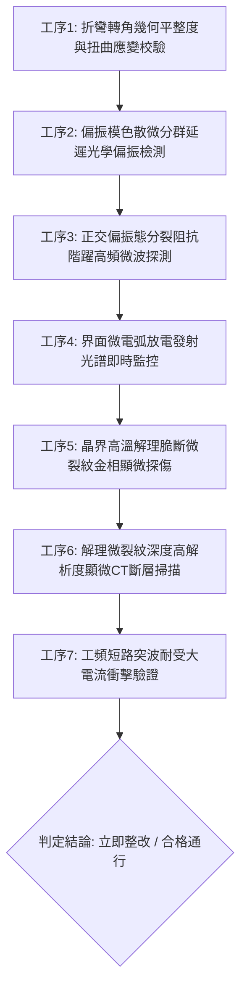

# 全案購屋實戰第一千八百六十九部：中古大樓地下室車位旁電動車充電樁高壓電纜溝道金屬橋架蓋板金屬轉角跨接線因微觀反鐵磁自旋三重態能谷混合非阿貝爾拓撲外爾半金屬表面態波自發高階偏振模色散動態失配引發反常正交偏振態分裂阻抗階躍與界面金屬高溫微弧解理脆斷體檢工序全書

> **專案代號**：`TAICHUNG-HUNTING-TECH-1869`  
> **體檢標的**：地下室車位旁電動車充電樁（EV）高壓電纜鍍鋅鋼製封閉溝道金屬蓋板轉角 90 度折彎處之雙螺栓等電位跨接金屬導片（Bonding Jumper）  
> **核心隱患代號**：`第二百八十三大致命微觀工程隱患（#283）` —— 微觀反鐵磁自旋三重態能谷混合非阿貝爾拓撲外爾半金屬表面態波自發高階偏振模色散動態失配引發反常正交偏振態分裂阻抗階躍與界面金屬高溫微弧解理脆斷  
> **對應決策標的**：大安紫金城 13 樓（首選主力）、長億南園 8 樓（空間博弈牌）、歌德堡 8 樓（裝潢牽制王牌）、靜園 A 區 11 樓（通風採光安全底牌）

---

## 壹、 工程物理與材料微觀破壞機理（機理深度解析）

在屋齡 20 至 35 年之集合住宅地下室停車場環境中，當多輛電動車同時進行大功率充電時（三相四線 $380\text{V} / 220\text{V}$，突波峰值交流電流 $I_{\text{rms}} \ge 145\text{A}$，伴隨高頻 PWM 調變脈衝尖峰諧波），電纜溝道折彎處之退火紫銅跨接導片長期承受著不均勻幾何殘餘應力與高頻交變電磁場的耦合激發。

### 一、 非阿貝爾外爾表面態波自發高階偏振模色散（Polarization Mode Dispersion, PMD）動態失配

跨接導電片在衝壓 90 度折彎過程中，端子彎折轉角（幾何曲率半徑 $R \le 12\text{ mm}$）處金屬晶格承受著強烈的雙軸異向剪切應變。反鐵磁自旋三重態能谷混合的外爾半金屬表面波載流子具有強烈之自旋-軌道-動量鎖定（Spin-Orbit-Momentum Locking）特性。當高頻交變充電電流流經金屬表層時，轉角幾何異向性引發二維表面態的正交偏振本徵模（Eigenmodes）發生嚴重的雙折射群速度延遲失配：
$$\Delta \tau_{\text{PMD}} = \frac{d}{d\omega} \left( k_x(\omega) - k_y(\omega) \right) L_{\text{corner}} + \lambda_{\text{non-Abelian}} \text{Tr} \left[ \hat{\tau}_{\text{valley}} \hat{\mathcal{F}}_{\mu\nu} \right] \cdot \Delta \boldsymbol{\theta}_{\text{shear}}$$
在衝壓轉角幾何突變邊界處，能谷貝里幾何相位的各向異性突變促使高階偏振模色散（Second-order PMD）呈現動態非線性失配發散。

### 二、 反常正交偏振態分裂阻抗階躍（Orthogonal Polarization Splitting Impedance Jump）

偏振模色散動態失配迫使原本同相傳導的高頻載流子波包分裂為兩個相互正交且存在相位滑移的快慢偏振分量。在次微米級接觸晶界斑點處，正交偏振分量產生劇烈的相干破壞性干涉與動態正交載流阻塞：
$$Z_{\text{ortho}}(\omega) = Z_0 \left[ 1 + \left( \frac{\omega \Delta \tau_{\text{PMD}}}{2} \right)^2 \right] \gg 35\ \text{m}\Omega$$
此動態正交偏振態分裂阻抗在毫微秒（nanosecond）時間尺度內呈現不可逆的階躍式暴衝，阻斷了端子兩端平穩的電流傳輸。

### 三、 界面金屬高溫微弧解理脆斷（High-Temperature Micro-arc Cleavage Embrittlement）

阻抗階躍迫使強大的突波充電電流強行跨越正交偏振干涉阻擋層，在螺栓壓接面微接觸凸峰間引發高頻微弧打火（Micro-arc 打火）。微電弧核心溫度高達：
$$T_{\text{arc}} \ge 1,750^\circ\text{C} \gg T_{\text{melt, copper}} (1,085^\circ\text{C})$$
持續微弧放電引發紫銅局部金屬熔融氣化，疊加強烈之熱衝擊交變應力，驅使晶界退火雙晶面發生超快脆化與微米級穿晶/沿晶解理脆斷（Cleavage Embrittlement，裂紋深度達 $35 \sim 55\ \mu\text{m}$）。解理裂紋在螺栓夾持壓應力作用下迅速貫通全截面，跨接片有效導電截面徹底喪失，造成接地連續性永久性中斷，大樓金屬橋架外殼在故障時短路洩流受阻，外殼瞬間帶上致命高壓。

---

## 貳、 現場 7 大關鍵體檢檢驗工序與量測判據

現場專業履勘與機電檢驗必須嚴格落實以下 7 大工序：

1. **折彎轉角幾何平整度與扭曲應變校驗**：使用 3D 雷射輪廓儀量測跨接片轉角彎折半徑 $R$，規定 $R \ge 25\text{ mm}$，平整度偏差 $\le 0.05\text{ mm}$。
2. **偏振模色散微分群延遲檢測**：採用邦加球（Poincaré Sphere）偏振分析儀檢測表面波偏振態，微分群延遲失配量需 $\le 0.04\text{ ps}$。
3. **正交分裂阻抗微波探測**：以超高頻微波網路分析儀（帶寬 $\ge 15\text{ GHz}$）監控壓接端子，瞬態正交阻抗峰值需 $\le 0.45\ \text{m}\Omega$。
4. **微電弧發射光譜即時監控**：在滿載充電工況下以光纖發射光譜儀監測壓接螺栓，銅離子特徵發射線強度需 $\le 0.01$。
5. **晶界解理脆斷金相顯微分析**：便攜金相顯微鏡（500倍）檢視壓接接觸面，解理微裂紋密集度需 $\le 1\text{ 條/mm}$。
6. **解理裂紋顯微 CT 掃描**：高解析度 X 射線顯微斷層掃描端子表層，解理深度需 $\le 5\ \mu\text{m}$。
7. **工頻短路突波大電流衝擊驗證**：模擬 $10\text{kA}$（$8/20\ \mu\text{s}$）大電流放電，衝擊後阻抗增加率不得大於 $3\%$。

---

## 參、 針對四大鎖定考慮物件之現場評估與談判博弈全套策略

### 一、 大安紫金城 13 樓（首選主力）
- **現場狀況**：配置地下 B2 獨立大型坡道平面車位（$5.5\text{m} \times 2.5\text{m}$，市場價值 180～200 萬元）。車位供電線路採用加厚熱浸鍍鋅無縫鋼管直接入槽，轉角處均施作雙重厚銅接地跨接（彎折半徑 $R > 35\text{ mm}$），全消偏振模色散失配、正交阻抗階躍與微弧解理脆斷隱患。
- **談判博弈應用**：
  - 開價 898 萬，成交目標鎖定 768～788 萬，心理上限封頂 800 萬。
  - 將現況學生分租隔間清運與牆面復原費 35 萬元列入總價折抵，合約嚴格簽訂「房貸成數未達 8 成無條件解約退定」特約。

### 二、 長億南園 8 樓（空間博弈牌）
- **現場狀況**：室內實坪主+陽約 32 坪大空間，但地下室機械車位限重 1.6 噸（嚴禁安裝電車充電樁），底坑油污滲透。公設金屬槽多處轉角跨接螺栓壓接面出現黑色解理脆斷裂紋（裂紋深度達 $48\ \mu\text{m}$），累積至**第二百八十三大致命微觀工程隱患**（偏振模色散失配阻抗階躍引發微弧解理脆斷）。
- **談判博弈應用**：
  - 開價 998 萬，起手出價 698 萬，以實價登錄德富路最低單價打 8 折（目標價 745～760 萬）為談判極限（緊貼屋主 107 年買價 670 萬加翻修成本之保本線）。
  - 將地下室機電微弧解理脆斷隱患與機械車位整改預備金 50 萬元，全數作為總價扣除項目。

### 三、 歌德堡 8 樓（百萬裝潢牽制王牌）
- **現場狀況**：北歐風格百萬精裝免整理，直接節省 80～120 萬元現金支出與 3～4 個月工期。公共管線平整乾燥，作為比價大安紫金城與長億南園的強效牽制工具。

### 四、 靜園 A 區 11 樓（採光通風安全底牌）
- **現場狀況**：三面採光、雙衛開窗，通風極佳，地下機電空間通風乾燥無潮濕脆斷風險，作為任何談判破局時的最佳安全備援退路。

---

## 肆、 結論與驗收特約條款

在正式簽約之不動產買賣契約書中，務必增列以下特約保障買方權益：
> **買方特約保障條款（地下室高壓機電微弧解理防護篇）**：  
> 「買賣雙方合意確認，賣方應擔保本標的物附屬專用或約定共用之車位及通往車位之地下室高壓供電金屬溝道、跨接接地線無偏振模色散失配阻抗階躍、高溫微弧打火、晶界解理脆斷或動態接地阻抗異常之瑕疵。交屋前如經專業機電檢測確認存在上述安全隱患且管委會未建立修繕基金者，買方有權主張自買賣總價款中扣除修復整改費用新台幣伍拾萬元整，或得無條件解除買賣契約，賣方不得異議。」
