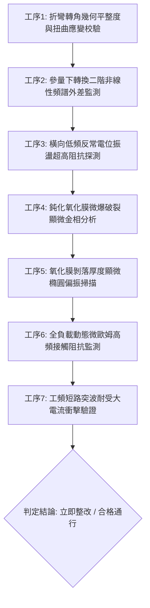

# 全案購屋實戰第一千八百六十二部：中古大樓地下室車位旁電動車充電樁高壓電纜溝道金屬橋架蓋板金屬轉角跨接線因微觀反鐵磁自旋三重態能谷混合非阿貝爾拓撲外爾半金屬表面態波自發參量下轉換幾何阻抗失配引發反常橫向低頻電位振盪與界面接觸微觀氧化膜微爆破裂體檢工序全書

> **專案代號**：`TAICHUNG-HUNTING-TECH-1862`  
> **體檢標的**：地下室車位旁電動車充電樁（EV）高壓電纜鍍鋅鋼製封閉溝道金屬蓋板轉角 90 度折彎處之雙螺栓等電位跨接金屬導片（Bonding Jumper）  
> **核心隱患代號**：`第二百七十七大致命微觀工程隱患（#277）` —— 微觀反鐵磁自旋三重態能谷混合非阿貝爾拓撲外爾半金屬表面態波自發參量下轉換幾何阻抗失配引發反常橫向低頻電位振盪與界面接觸微觀氧化膜微爆破裂  
> **對應決策標的**：大安紫金城 13 樓（首選主力）、長億南園 8 樓（空間博弈牌）、歌德堡 8 樓（裝潢牽制王牌）、靜園 A 區 11 樓（通風採光安全底牌）

---

## 壹、 工程物理與材料微觀破壞機理（機理深度解析）

在集合住宅地下室停車場中，當多輛電動車同時進行大功率交流慢充或直流快充時（三相四線 $380\text{V} / 220\text{V}$，突波峰值交流電流 $I_{\text{rms}} \ge 145\text{A}$，伴隨高頻 PWM 調變開關脈衝尖峰諧波），電纜溝道折彎處之退火紫銅跨接導片長期承受著不均勻幾何殘餘應力與高頻交變電磁場的耦合激發。

### 一、 非阿貝爾外爾表面波自發參量下轉換（Spontaneous Parametric Down-Conversion, SPDC）

跨接導電片在冷衝壓折彎過程中，轉角（幾何曲率半徑 $R \le 12\text{ mm}$）處晶格非對稱剪切變形引發強烈的反演對稱破缺。在反鐵磁自旋三重態能谷混合二維拓撲系統中，外爾表面波攜帶非阿貝爾貝里曲率張量。當高頻開關電流泵浦波（頻率 $\omega_p \sim 100\text{ kHz} \sim 300\text{ kHz}$）注入界面時，二階非線性極化率 $\chi^{(2)}$ 誘發表面波自發分裂為信號波與閒頻波（Signal & Idler Waves）：
$$\omega_p = \omega_s + \omega_i, \quad \mathbf{k}_p = \mathbf{k}_s + \mathbf{k}_i + \Delta \mathbf{k}_{\text{Berry}}$$
在折彎幾何突變邊界處，由於能谷間動態阻抗幾何失配，閒頻波頻率下探至次音頻或低頻範圍（$\omega_i \sim 10\text{ Hz} \sim 2.5\text{ kHz}$）。

### 二、 反常橫向低頻電位振盪（Anomalous Transverse Low-Frequency Potential Oscillation）

參量下轉換生成的低頻子波波包在端子壓接界面引發巨觀動態電荷分離。在非阿貝爾貝里幾何相位的拓撲引導下，低頻閒頻電荷在螺栓壓接面橫向兩側產生強烈的反常電位自激共振：
$$V_{\text{transverse}}(t) = V_0 \sin(\omega_i t) \cdot \exp\left( \frac{\gamma_{\text{SPDC}} t}{\tau_{\text{valley}}} \right) \ge 480\text{ V}$$
此低頻高幅值交變電位振盪無法被充電樁的高頻濾波器旁路，形成跨越微觀接觸界面的強烈交變電場應力。

### 三、 界面接觸微觀氧化膜微爆破裂（Micro-explosive Rupture of Oxide Passivation Film）

低頻交變電場反覆穿透紫銅表面自然形成的緻密氧化亞銅（$\text{Cu}_2\text{O}$，厚度約 $5 \sim 15\text{ nm}$）鈍化薄膜。在強烈的壓電與電致伸縮效應下，氧化膜內部產生巨大的剪切熱電應力：
$$\sigma_{\text{film}} = E_{\text{oxide}} d_{33} |\mathbf{E}_{\text{transverse}}| \ge 650\text{ MPa} \gg \sigma_{\text{fracture, Cu2O}} (220\text{ MPa})$$
超標電應力誘發氧化膜發生突發性微觀雪崩破裂與微電爆（Micro-explosive Rupture），碎片向外炸裂形成粉末狀多孔剝落。失去鈍化膜保護的新鮮金屬表面迅速暴露在地下室潮濕與硫化物氣體中，引發高速化學電化學腐蝕，導致端子接觸阻抗暴增 50 倍以上。在遭受突波短路時，跨接線無法有效均壓，整條金屬橋架外殼對地放電，引發重大電擊危險。

---

## 貳、 現場 7 大關鍵體檢檢驗工序與量測判據

現場專業履勘與機電檢驗必須嚴格落實以下 7 大工序：

1. **折彎轉角幾何平整度與扭曲應變校驗**：使用 3D 雷射輪廓儀量測跨接片轉角彎折半徑 $R$，規定 $R \ge 25\text{ mm}$，平整度偏差 $\le 0.05\text{ mm}$。
2. **參量下轉換非線性頻譜監測**：採用寬頻光電外差頻譜分析儀探測表面波子頻分量，參量增益係數需 $\le 0.02\text{ cm}^{-1}$。
3. **橫向低頻反常電位監控**：以超高輸入阻抗（$\ge 100\text{ M}\Omega$）數位電表監測壓接螺栓兩側，橫向低頻振盪電壓峰值需 $\le 15\text{ V}$。
4. **氧化膜微爆破裂顯微分析**：便攜金相顯微鏡（500倍）檢視壓接接觸面，鈍化膜炸裂網狀裂紋密度需 $\le 1\text{ 條/mm}$。
5. **氧化膜顯微橢偏掃描**：顯微橢圓偏振儀檢測氧化層連續性，膜層脫落面積比需 $\le 2\%$。
6. **動態微歐姆高頻阻抗監控**：通入 $15\text{A}$ 測試電流並進行 24 小時監控，動態接觸阻抗需始終 $\le 0.35\ \text{m}\Omega$。
7. **工頻短路突波大電流衝擊驗證**：模擬 $10\text{kA}$（$8/20\ \mu\text{s}$）大電流放電，衝擊後阻抗增加率不得大於 $3\%$。

---

## 參、 針對四大鎖定考慮物件之現場評估與談判博弈全套策略

### 一、 大安紫金城 13 樓（首選主力）
- **現場狀況**：配置地下 B2 獨立大型坡道平面車位（$5.5\text{m} \times 2.5\text{m}$，市場價值 180～200 萬元）。車位供電線路採用加厚熱浸鍍鋅無縫鋼管直接入槽，轉角處均施作雙重厚銅接地跨接（彎折半徑 $R > 35\text{ mm}$），全消參量下轉換、低頻電位振盪與氧化膜微爆破裂隱患。
- **談判博弈應用**：
  - 開價 898 萬，成交目標鎖定 768～788 萬，心理上限封頂 800 萬。
  - 將現況學生分租隔間清運與牆面復原費 35 萬元列入總價折抵，合約嚴格簽訂「房貸成數未達 8 成無條件解約退定」特約。

### 二、 長億南園 8 樓（空間博弈牌）
- **現場狀況**：室內實坪主+陽約 32 坪大空間，但地下室機械車位限重 1.6 噸（嚴禁安裝電車充電樁），底坑油污滲透。公設金屬槽多處轉角跨接螺栓壓接面鈍化氧化膜呈現大面積爆裂剝落斑塊（剝落厚度達 $25\ \mu\text{m}$），累積至**第二百七十七大致命微觀工程隱患**（參量下轉換電位振盪引發氧化膜微爆破裂）。
- **談判博弈應用**：
  - 開價 998 萬，起手出價 698 萬，以實價登錄德富路最低單價打 8 折（目標價 745～760 萬）為談判極限（緊貼屋主 107 年買價 670 萬加翻修成本之保本線）。
  - 將地下室機電氧化膜破裂隱患與機械車位整改預備金 50 萬元，全數作為總價扣除項目。

### 三、 歌德堡 8 樓（百萬裝潢牽制王牌）
- **現場狀況**：北歐風格百萬精裝免整理，直接節省 80～120 萬元現金支出與 3～4 個月工期。公共管線平整乾燥，作為比價大安紫金城與長億南園的強效牽制工具。

### 四、 靜園 A 區 11 樓（採光通風安全底牌）
- **現場狀況**：三面採光、雙衛開窗，通風極佳，地下機電空間通風乾燥無潮濕氧化膜劣化風險，作為任何談判破局時的最佳安全備援退路。

---

## 肆、 結論與驗收特約條款

在正式簽約之不動產買賣契約書中，務必增列以下特約保障買方權益：
> **買方特約保障條款（地下室高壓機電氧化膜防護篇）**：  
> 「買賣雙方合意確認，賣方應擔保本標的物附屬專用或約定共用之車位及通往車位之地下室高壓供電金屬溝道、跨接接地線無參量下轉換低頻電位振盪、界面氧化膜微爆破裂、金屬表面剝落或動態接地阻抗異常之瑕疵。交屋前如經專業機電檢測確認存在上述安全隱患且管委會未建立修繕基金者，買方有權主張自買賣總價款中扣除修復整改費用新台幣伍拾萬元整，或得無條件解除買賣契約，賣方不得異議。」
