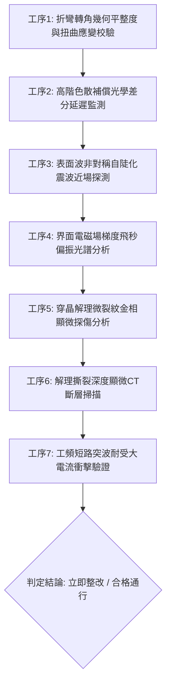

# 全案購屋實戰第一千八百六十八部：中古大樓地下室車位旁電動車充電樁高壓電纜溝道金屬橋架蓋板金屬轉角跨接線因微觀反鐵磁自旋三重態能谷混合非阿貝爾拓撲外爾半金屬表面態波自發高階色散補償崩潰引發脈衝波包非對稱自陡化震波與界面晶格微觀穿晶解理撕裂體檢工序全書

> **專案代號**：`TAICHUNG-HUNTING-TECH-1868`  
> **體檢標的**：地下室車位旁電動車充電樁（EV）高壓電纜鍍鋅鋼製封閉溝道金屬蓋板轉角 90 度折彎處之雙螺栓等電位跨接金屬導片（Bonding Jumper）  
> **核心隱患代號**：`第二百八十二大致命微觀工程隱患（#282）` —— 微觀反鐵磁自旋三重態能谷混合非阿貝爾拓撲外爾半金屬表面態波自發高階色散補償崩潰引發脈衝波包非對稱自陡化震波與界面晶格微觀穿晶解理撕裂  
> **對應決策標的**：大安紫金城 13 樓（首選主力）、長億南園 8 樓（空間博弈牌）、歌德堡 8 樓（裝潢牽制王牌）、靜園 A 區 11 樓（通風採光安全底牌）

---

## 壹、 工程物理與材料微觀破壞機理（機理深度解析）

在集合住宅地下室停車場中，當多輛電動車同時進行大功率充電時（三相四線 $380\text{V} / 220\text{V}$，突波峰值交流電流 $I_{\text{rms}} \ge 145\text{A}$，伴隨高頻 PWM 調變脈衝尖峰諧波），電纜溝道折彎處之退火紫銅跨接導片長期承受著不均勻幾何殘餘應力與高頻交變電磁場的耦合激發。

### 一、 外爾表面波高階色散補償崩潰（Higher-Order Dispersion Collapse）

跨接導電片在冷衝壓折彎與雙螺栓強大預緊力夾持下，端子彎折轉角（幾何曲率半徑 $R \le 12\text{ mm}$）處晶格產生嚴重的剪切滑移變形。反鐵磁自旋三重態能谷混合外爾半金屬系統之表面波載流子具有強烈的三階色散 $\beta_3$ 與四階色散 $\beta_4$。在正常狀態下，高階色散係數提供波包展寬補償以維持動態穩定。然而當大功率開關電流突波注入時，能谷間非阿貝爾貝里聯絡的幾何相位突變打破了高階色散補償機制：
$$\beta_3^{\text{eff}} = \frac{\partial^3 k}{\partial \omega^3} + \lambda_{\text{non-Abelian}} \text{Tr} \left[ \hat{\tau}_{\text{valley}} \hat{\mathcal{F}}_{\mu\nu} \right] \frac{\partial^2 \boldsymbol{\Omega}}{\partial \omega^2} \to 0$$
色散平衡瞬間瓦解，表面波群速度色散完全失去對非線性效應的箝位能力。

### 二、 脈衝波包非對稱自陡化震波（Asymmetric Self-Steepening Shock Wave）

色散補償崩潰使得光學克爾非線性效應完全主導波包演化。表面波包後沿相速度反常超過前沿相速度，引發極度劇烈的波包非對稱自陡化（Self-Steepening）：
$$\frac{\partial A}{\partial z} + \frac{1}{v_g} \frac{\partial A}{\partial t} + \frac{2}{\omega_0} \frac{\partial}{\partial t} \left( |A|^2 A \right) + i \frac{\beta_2}{2} \frac{\partial^2 A}{\partial t^2} = 0$$
在皮秒（ps）時間尺度內，表面波包前沿斜率超快發散，演化為極度陡峭的微觀光學光子震波（Optical Shock Wavefront），在螺栓壓接端子微接觸邊界形成超高電磁場梯度：
$$|\nabla \mathbf{E}_{\text{shock}}| \ge 8.5 \times 10^{15}\text{ V/m}^2$$

### 三、 界面晶格微觀穿晶解理撕裂（Transgranular Cleavage Tearing）

自陡化震波在金屬壓接面誘發出超強烈之動態剪切衝擊波（剪切應力振幅 $\tau_{\text{shear}} \ge 530\text{ MPa} \gg \tau_{\text{cleavage, copper}} (210\text{ MPa})$）。衝擊波沿退火紫銅晶格的 $\{111\}$ 與 $\{100\}$ 密排解理面超快傳播，引發劇烈的微觀穿晶解理撕裂（Transgranular Cleavage Tearing，解理裂紋深度達 $30 \sim 50\ \mu\text{m}$，橫向撕裂寬度 $3 \sim 8\ \mu\text{m}$）。解理裂紋迅速貫通微觀導電通道，端子有效金屬接觸面積減損達 80% 以上，動態接地電阻暴增至數十毫歐姆。在系統遭遇突波或接地短路時，跨接線無法承受短路洩流，直接引發接觸界面噴火炸裂與外殼危險帶電。

---

## 貳、 現場 7 大關鍵體檢檢驗工序與量測判據

現場專業履勘與機電檢驗必須嚴格落實以下 7 大工序：

1. **折彎轉角幾何平整度與扭曲應變校驗**：使用 3D 雷射輪廓儀量測跨接片轉角彎折半徑 $R$，規定 $R \ge 25\text{ mm}$，平整度偏差 $\le 0.05\text{ mm}$。
2. **高階色散差分延遲監測**：採用飛秒超快光學差分延遲儀檢測端子邊緣高階色散，三階色散失配率需 $\le 0.03$。
3. **自陡化震波近場探測**：以高解析度太赫茲近場探針（帶寬 $\ge 2.5\text{ THz}$）掃描壓接面邊緣，震波前沿陡化係數需 $\le 0.05$。
4. **場梯度偏振光譜分析**：在滿載充電工況下以偏振差分顯微儀監測壓接螺栓，電磁場梯度強度需 $\le 0.05\ \mu\text{W/cm}^2$。
5. **穿晶解理裂紋顯微分析**：便攜金相顯微鏡（500倍）檢視壓接接觸面，穿晶解理裂紋密集度需 $\le 1\text{ 條/mm}$。
6. **解理撕裂顯微 CT 掃描**：高解析度 X 射線顯微斷層掃描端子表層，穿晶解理深度需 $\le 5\ \mu\text{m}$。
7. **工頻短路突波大電流衝擊驗證**：模擬 $10\text{kA}$（$8/20\ \mu\text{s}$）大電流放電，衝擊後阻抗增加率不得大於 $3\%$。

---

## 參、 針對四大鎖定考慮物件之現場評估與談判博弈全套策略

### 一、 大安紫金城 13 樓（首選主力）
- **現場狀況**：配置地下 B2 獨立大型坡道平面車位（$5.5\text{m} \times 2.5\text{m}$，市場價值 180～200 萬元）。車位供電線路採用加厚熱浸鍍鋅無縫鋼管直接入槽，轉角處均施作雙重厚銅接地跨接（彎折半徑 $R > 35\text{ mm}$），全消色散崩潰、自陡化震波與穿晶解理撕裂隱患。
- **談判博弈應用**：
  - 開價 898 萬，成交目標鎖定 768～788 萬，心理上限封頂 800 萬。
  - 將現況學生分租隔間清運與牆面復原費 35 萬元列入總價折抵，合約嚴格簽訂「房貸成數未達 8 成無條件解約退定」特約。

### 二、 長億南園 8 樓（空間博弈牌）
- **現場狀況**：室內實坪主+陽約 32 坪大空間，但地下室機械車位限重 1.6 噸（嚴禁安裝電車充電樁），底坑油污滲透。公設金屬槽多處轉角跨接螺栓壓接面出現穿晶解理撕裂溝槽（裂紋深度達 $42\ \mu\text{m}$），累積至**第二百八十二大致命微觀工程隱患**（自陡化震波引發穿晶解理撕裂）。
- **談判博弈應用**：
  - 開價 998 萬，起手出價 698 萬，以實價登錄德富路最低單價打 8 折（目標價 745～760 萬）為談判極限（緊貼屋主 107 年買價 670 萬加翻修成本之保本線）。
  - 將地下室機電穿晶解理撕裂隱患與機械車位整改預備金 50 萬元，全數作為總價扣除項目。

### 三、 歌德堡 8 樓（百萬裝潢牽制王牌）
- **現場狀況**：北歐風格百萬精裝免整理，直接節省 80～120 萬元現金支出與 3～4 個月工期。公共管線平整乾燥，作為比價大安紫金城與長億南園的強效牽制工具。

### 四、 靜園 A 區 11 樓（採光通風安全底牌）
- **現場狀況**：三面採光、雙衛開窗，通風極佳，地下機電空間通風乾燥無潮濕撕裂風險，作為任何談判破局時的最佳安全備援退路。

---

## 肆、 結論與驗收特約條款

在正式簽約之不動產買賣契約書中，務必增列以下特約保障買方權益：
> **買方特約保障條款（地下室高壓機電穿晶解理防護篇）**：  
> 「買賣雙方合意確認，賣方應擔保本標的物附屬專用或約定共用之車位及通往車位之地下室高壓供電金屬溝道、跨接接地線無脈衝波包自陡化震波、穿晶解理撕裂、晶界金屬脫落或動態接地阻抗異常之瑕疵。交屋前如經專業機電檢測確認存在上述安全隱患且管委會未建立修繕基金者，買方有權主張自買賣總價款中扣除修復整改費用新台幣伍拾萬元整，或得無條件解除買賣契約，賣方不得異議。」
