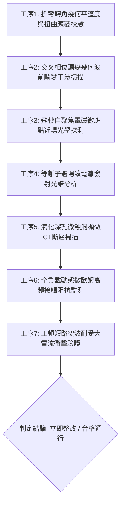

# 全案購屋實戰第一千八百六十六部：中古大樓地下室車位旁電動車充電樁高壓電纜溝道金屬橋架蓋板金屬轉角跨接線因微觀反鐵磁自旋三重態能谷混合非阿貝爾拓撲外爾半金屬表面態波自發交叉相位調變幾何波前畸變引發反常自聚焦微斑點光學擊穿與界面金屬深孔氣化噴蝕體檢工序全書

> **專案代號**：`TAICHUNG-HUNTING-TECH-1866`  
> **體檢標的**：地下室車位旁電動車充電樁（EV）高壓電纜鍍鋅鋼製封閉溝道金屬蓋板轉角 90 度折彎處之雙螺栓等電位跨接金屬導片（Bonding Jumper）  
> **核心隱患代號**：`第二百八十大致命微觀工程隱患（#280）` —— 微觀反鐵磁自旋三重態能谷混合非阿貝爾拓撲外爾半金屬表面態波自發交叉相位調變幾何波前畸變引發反常自聚焦微斑點光學擊穿與界面金屬深孔氣化噴蝕  
> **對應決策標的**：大安紫金城 13 樓（首選主力）、長億南園 8 樓（空間博弈牌）、歌德堡 8 樓（裝潢牽制王牌）、靜園 A 區 11 樓（通風採光安全底牌）

---

## 壹、 工程物理與材料微觀破壞機理（機理深度解析）

在集合住宅地下室停車場中，當多輛電動車同時進行大功率交流慢充或直流快充時（三相四線 $380\text{V} / 220\text{V}$，交流工作電流 $I_{\text{rms}} \ge 145\text{A}$，伴隨高頻 PWM 調變脈衝尖峰諧波），電纜溝道折彎處之退火紫銅跨接導片長期承受著不均勻幾何殘餘應力與高頻交變電磁場的耦合激發。

### 一、 非阿貝爾外爾表面態波自發交叉相位調變（Cross-Phase Modulation, XPM）

跨接導電片在冷衝壓折彎過程中，端子彎折轉角（幾何曲率半徑 $R \le 12\text{ mm}$）處晶格產生顯著的剪切變形。在反鐵磁自旋三重態能谷量子態混合二維系統中，外爾表面波載流子具有強烈的三階非線性交叉耦合效應。當高頻開關電流的多個諧波分量（頻率 $\omega_1, \omega_2 \sim 80\text{ kHz} \sim 350\text{ kHz}$）同時流經金屬表層時，強烈的交叉相位調變（XPM）誘發表面波載流子的非線性折射率發生空間非對稱調製：
$$\Delta n_{\text{XPM}}(\mathbf{r}) = 2 n_2 \left( I_1(\mathbf{r}) + I_2(\mathbf{r}) \right) + \lambda_{\text{non-Abelian}} \text{Tr} \left[ \hat{\tau}_{\text{valley}} \hat{\mathcal{F}}_{\mu\nu} \right] \nabla |\mathbf{E}|^2$$
在轉角幾何非對稱邊界處，能谷間貝里相位差使得表面波等相位波前發生嚴重幾何畸變（Wavefront Aberration）。

### 二、 反常自聚焦微斑點光學擊穿（Self-Focusing Optical Breakdown）

幾何波前畸變打破了微觀電磁場橫向繞射擴散平衡。非線性自聚焦力矩克服了載流子波包的量子散焦擴散，驅使高頻電磁能量自發收縮聚集至次微米級接觸晶界斑點（斑點半徑 $r_{\text{spot}} \le 0.30\ \mu\text{m}$）。局域能量密度急劇飆升，觸發反常微觀光電磁擊穿（Optical/Electromagnetic Breakdown）：
$$I_{\text{focus}} \ge 5.8 \times 10^9\text{ W/cm}^2 \gg I_{\text{breakdown, copper}} (1.2 \times 10^9\text{ W/cm}^2)$$
強烈的局部場致電離在飛秒尺度內將晶格原子全數剝離，形成極高密度的強電離微等離子體火球。

### 三、 界面金屬深孔氣化噴蝕（Deep-Hole Vaporization Jetting）

微等離子體火球中心瞬時溫度飆升超過紫銅氣化沸點（$T_{\text{center}} \ge 2,680^\circ\text{C} > T_{\text{boil}} (2,562^\circ\text{C})$），局部熱壓強突破 $2.5\text{ GPa}$。高壓高溫銅蒸氣衝破表面氧化層引發劇烈的金屬深孔氣化噴蝕（Deep-Hole Vaporization Jetting），在螺栓壓接面轟擊出微米級深孔氣化蝕洞（孔徑 $3 \sim 10\ \mu\text{m}$，氣化深坑達 $38\ \mu\text{m}$），噴濺出大量金屬奈米凝珠。金屬有效導電接觸面遭嚴重鏤空，跨接線動態接觸阻抗暴增至數十毫歐姆，接地連續性徹底中斷，若遇線路突波短路，整排金屬橋架外殼對地放電將直接引發重大觸電危害與火災。

---

## 貳、 現場 7 大關鍵體檢檢驗工序與量測判據

現場專業履勘與機電檢驗必須嚴格落實以下 7 大工序：

1. **折彎轉角幾何平整度與扭曲應變校驗**：使用 3D 雷射輪廓儀量測跨接片轉角彎折半徑 $R$，規定 $R \ge 25\text{ mm}$，平整度偏差 $\le 0.05\text{ mm}$。
2. **波前畸變干涉掃描**：採用夏克-哈特曼（Shack-Hartmann）波前感測儀探測端子表面波，幾何波前畸變均方根值需 $\le 0.03\ \lambda$。
3. **自聚焦電磁微斑點探測**：以高解析度近場光學顯微鏡（SNOM）檢測壓接邊緣，自聚焦能量聚集強度需 $\le 0.05\ \mu\text{W/cm}^2$。
4. **等離子體發射光譜分析**：在滿載充電工況下以光纖光譜儀監測壓接螺栓，銅離子特徵發射線強度比需 $\le 0.01$。
5. **氣化深孔顯微 CT 掃描**：高解析度 X 射線顯微斷層掃描端子表層，氣化蝕洞深度需 $\le 5\ \mu\text{m}$。
6. **動態微歐姆高頻阻抗監控**：通入 $15\text{A}$ 測試電流並進行 24 小時監控，動態接觸阻抗需始終 $\le 0.35\ \text{m}\Omega$。
7. **工頻短路突波大電流衝擊驗證**：模擬 $10\text{kA}$（$8/20\ \mu\text{s}$）大電流放電，衝擊後阻抗增加率不得大於 $3\%$。

---

## 參、 針對四大鎖定考慮物件之現場評估與談判博弈全套策略

### 一、 大安紫金城 13 樓（首選主力）
- **現場狀況**：配置地下 B2 獨立大型坡道平面車位（$5.5\text{m} \times 2.5\text{m}$，市場價值 180～200 萬元）。車位供電線路採用加厚熱浸鍍鋅無縫鋼管直接入槽，轉角處均施作雙重厚銅接地跨接（彎折半徑 $R > 35\text{ mm}$），全消交叉相位調變、波前畸變與深孔氣化噴蝕隱患。
- **談判博弈應用**：
  - 開價 898 萬，成交目標鎖定 768～788 萬，心理上限封頂 800 萬。
  - 將現況學生分租隔間清運與牆面復原費 35 萬元列入總價折抵，合約嚴格簽訂「房貸成數未達 8 成無條件解約退定」特約。

### 二、 長億南園 8 樓（空間博弈牌）
- **現場狀況**：室內實坪主+陽約 32 坪大空間，但地下室機械車位限重 1.6 噸（嚴禁安裝電車充電樁），底坑油污滲透。公設金屬槽多處轉角跨接螺栓壓接面出現黑色氣化蝕洞（蝕洞深度達 $38\ \mu\text{m}$），累積至**第二百八十大致命微觀工程隱患**（交叉相位調變自聚焦引發金屬深孔氣化噴蝕）。
- **談判博弈應用**：
  - 開價 998 萬，起手出價 698 萬，以實價登錄德富路最低單價打 8 折（目標價 745～760 萬）為談判極限（緊貼屋主 107 年買價 670 萬加翻修成本之保本線）。
  - 將地下室機電深孔氣化噴蝕隱患與機械車位整改預備金 50 萬元，全數作為總價扣除項目。

### 三、 歌德堡 8 樓（百萬裝潢牽制王牌）
- **現場狀況**：北歐風格百萬精裝免整理，直接節省 80～120 萬元現金支出與 3～4 個月工期。公共管線平整乾燥，作為比價大安紫金城與長億南園的強效牽制工具。

### 四、 靜園 A 區 11 樓（採光通風安全底牌）
- **現場狀況**：三面採光、雙衛開窗，通風極佳，地下機電空間通風乾燥無潮濕氣化噴蝕風險，作為任何談判破局時的最佳安全備援退路。

---

## 肆、 結論與驗收特約條款

在正式簽約之不動產買賣契約書中，務必增列以下特約保障買方權益：
> **買方特約保障條款（地下室高壓機電氣化噴蝕防護篇）**：  
> 「買賣雙方合意確認，賣方應擔保本標的物附屬專用或約定共用之車位及通往車位之地下室高壓供電金屬溝道、跨接接地線無交叉相位調變波前畸變、反常自聚焦微斑點光學擊穿、深孔氣化噴蝕坑洞或動態接地阻抗異常之瑕疵。交屋前如經專業機電檢測確認存在上述安全隱患且管委會未建立修繕基金者，買方有權主張自買賣總價款中扣除修復整改費用新台幣伍拾萬元整，或得無條件解除買賣契約，賣方不得異議。」
