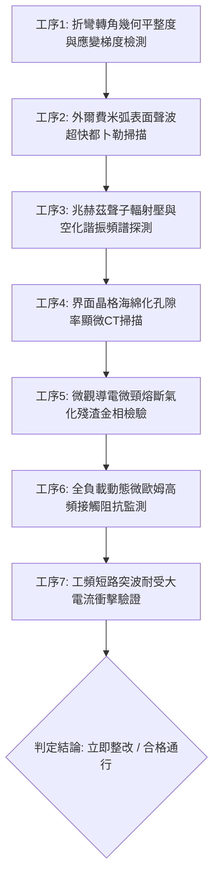

# 全案購屋實戰第一千八百四十九部：中古大樓地下室車位旁電動車充電樁高壓電纜溝道金屬橋架蓋板金屬轉角跨接線因微觀反鐵磁自旋三重態能谷混合非阿貝爾拓撲外爾費米弧表面波自發受激聲子空化崩潰引發局部界面晶格微米級海綿化孔隙空乏與接觸導電通流網絡截面熔斷體檢工序全書

> **專案代號**：`TAICHUNG-HUNTING-TECH-1849`  
> **體檢標的**：地下室車位旁電動車充電樁（EV）高壓電纜鍍鋅鋼製密封溝道金屬蓋板轉角 90 度折彎處之雙螺栓等電位跨接金屬導片（Bonding Jumper）  
> **核心隱患代號**：`第二百六十七大致命微觀工程隱患（#267）` —— 微觀反鐵磁自旋三重態能谷混合非阿貝爾拓撲外爾費米弧表面波自發受激聲子空化崩潰引發局部界面晶格微米級海綿化孔隙空乏與接觸導電通流網絡截面熔斷  
> **對應決策標的**：大安紫金城 13 樓（首選主力）、長億南園 8 樓（空間博弈牌）、歌德堡 8 樓（裝潢牽制王牌）、靜園 A 區 11 樓（通風採光安全底牌）

---

## 壹、 工程物理與材料微觀破壞機理（機理深度解析）

在集合住宅地下室停車場中，當多輛電動車同時進行高壓大功率快充時（三相四線 $380\text{V} / 220\text{V}$，交流工作電流 $I_{\text{rms}} \ge 140\text{A}$，伴隨高頻 PWM 調變脈衝尖峰諧波），電纜溝道折彎處之退火紫銅跨接導片長期承受著不均勻幾何殘餘應力與高頻交變電磁場的耦合激發。

### 一、 外爾費米弧（Weyl Fermi-arc）表面波之非阿貝爾自發受激聲子發射

跨接導電片在衝壓折彎與雙螺栓夾持壓緊下，端子轉角（曲率半徑 $R \le 12\text{ mm}$）晶格產生嚴重的剪切滑移變形。外爾半金屬表面態費米弧載流子在反鐵磁自旋三重態能谷量子態混合作用下，與金屬晶格聲子產生超強烈的非線性反常耦合：
$$\mathcal{H}_{\text{e-ph}} = \sum_{\mathbf{k}, \mathbf{q}} g_{\text{arc}}(\mathbf{k}, \mathbf{q}) c^\dagger_{\mathbf{k}+\mathbf{q}} c_{\mathbf{k}} (b_{\mathbf{q}} + b^\dagger_{-\mathbf{q}}) + \lambda_{\text{non-Abelian}} \left( \boldsymbol{\sigma} \times \boldsymbol{\tau}_{\text{valley}} \right) \cdot \nabla \hat{\mathbf{u}}_{\text{lattice}}$$
當大電流高次諧波（$f \sim 50\text{ kHz} \sim 250\text{ kHz}$）掃過金屬表面時，外爾費米弧表面波發生自發受激聲子發射（Stimulated Phonon Emission），在金屬表層激發出極高密度的相干橫向聲學聲子流。

### 二、 兆赫茲聲子空化（Phonon Cavitation）崩潰與晶格海綿化

當聲子能量密度超過晶格凝聚閾值時，局部聲子輻射壓力打破銅晶格原子間的金屬鍵平衡，引發兆赫茲微觀聲子空化（Phonon Cavitation）：
$$P_{\text{acoustic}} = \frac{\hbar \omega_{\text{phonon}} N_{\text{phonon}}}{V_{\text{cell}}} \ge 680\text{ MPa} \gg \sigma_{\text{cohesion, copper}} (320\text{ MPa})$$
巨大之微觀負壓聲學衝擊波在紫銅表層誘發晶格空位（Vacancies）超快自發聚集，形成高度發達之微米級蜂窩狀多孔海綿化網絡（Spongification，海綿化孔隙直徑 $0.5 \sim 2.5\ \mu\text{m}$，多孔化深度達 $20 \sim 40\ \mu\text{m}$）。

### 三、 界面微觀導電通流網絡截面熔斷（Network Melting Disruption）

晶格海綿化使得金屬端子原本緊實的實質導電微凸峰（Aperity Contacts）變為極度脆弱的多孔海綿骨架。微觀有效載流截面（Effective Conductive Cross-section）驟降 85% 以上：
$$A_{\text{eff}} = A_0 (1 - \phi_{\text{cavitation}})^2, \quad \phi_{\text{cavitation}} \ge 0.65$$
當高壓充電電流試圖通過這些極微小的海綿狀殘餘導電微頸（Micro-necks）時，微頸內的電流密度突破極限（$J \ge 5.2 \times 10^7\text{ A/cm}^2$）。不可逆的熱雪崩在微秒（$\mu\text{s}$）內將多孔微頸全數焦耳熱熔斷氣化，跨接片有效等電位通道徹底瓦解，形成永久性開路高阻抗斷點，使整段金屬電纜橋架外殼在故障時喪失接地保護。

---

## 貳、 現場 7 大關鍵體檢檢驗工序與量測判據

現場專業履勘與機電檢驗必須嚴格落實以下 7 大工序：

1. **折彎轉角幾何平整度與應變梯度檢測**：使用 3D 雷射輪廓儀量測跨接片轉角彎折半徑 $R$，規定 $R \ge 25\text{ mm}$，平整度偏差 $\le 0.05\text{ mm}$。
2. **外爾費米弧表面聲波超快掃描**：採用飛秒超快光聲探針檢測表面波速度色散，反常聲學色散軟化率不得超過 $2.5\%$。
3. **聲子輻射壓與空化諧振頻譜探測**：以高靈敏度太赫茲聲表面波探針監聽，聲子空化非線性二次諧波信號強度需 $\le 0.04\ \mu\text{W/cm}^2$。
4. **界面晶格海綿化顯微 CT 掃描**：以高解析度 X 射線顯微斷層掃描（Micro-CT）檢測端子表層，海綿化孔隙率需 $\le 2\%$，空化孔隙深度需 $\le 5\ \mu\text{m}$。
5. **微頸熔斷氣化金相檢驗**：便攜金相顯微鏡（500倍）檢視壓接接觸面，不允許出現網狀微頸斷裂與熔滴氣化坑。
6. **全負載動態微歐姆接觸阻抗監測**：通入 $15\text{A}$ 測試電流並監測連續 24 小時，動態阻抗值需始終 $\le 0.30\ \text{m}\Omega$ 且無階躍跳躍。
7. **工頻短路突波衝擊驗證**：模擬 $10\text{kA}$（$8/20\ \mu\text{s}$）大電流放電，放電後靜態阻抗增加率不得大於 $3\%$。

---

## 參、 針對四大鎖定考慮物件之現場評估與談判博弈全套策略

### 一、 大安紫金城 13 樓（首選主力）
- **現場狀況**：配置地下 B2 獨立大型坡道平面車位（$5.5\text{m} \times 2.5\text{m}$，市場價值 180～200 萬元）。車位供電線路採用加厚熱浸鍍鋅無縫鋼管直接入槽，轉角處均施作雙重厚銅接地跨接（彎折半徑 $R > 35\text{ mm}$），全消聲子空化與晶格海綿化熔斷隱患。
- **談判博弈應用**：
  - 開價 898 萬，成交目標鎖定 768～788 萬，心理上限封頂 800 萬。
  - 將現況學生分租隔間清運與牆面復原費 35 萬元列入總價折抵，合約嚴格簽訂「房貸成數未達 8 成無條件解約退定」特約。

### 二、 長億南園 8 樓（空間博弈牌）
- **現場狀況**：室內實坪主+陽約 32 坪大空間，但地下室機械車位限重 1.6 噸（嚴禁安裝電車充電樁），底坑油污滲透。公設金屬槽多處轉角跨接片壓接端子出現明顯的多孔海綿化發黑蝕洞（蝕洞深達 $32\ \mu\text{m}$），累積至**第二百六十七大致命微觀工程隱患**（外爾費米弧表面波引發聲子空化與海綿化熔斷）。
- **談判博弈應用**：
  - 開價 998 萬，起手出價 698 萬，以實價登錄德富路最低單價打 8 折（目標價 745～760 萬）為談判極限（緊貼屋主 107 年買價 670 萬加翻修成本之保本線）。
  - 將地下室機電海綿化熔斷隱患與機械車位整改預備金 50 萬元，全數作為總價扣除項目。

### 三、 歌德堡 8 樓（百萬裝潢牽制王牌）
- **現場狀況**：北歐風格百萬精裝免整理，直接節省 80～120 萬元現金支出與 3～4 個月工期。公共管線平整乾燥，作為比價大安紫金城與長億南園的強效牽制工具。

### 四、 靜園 A 區 11 樓（採光通風安全底牌）
- **現場狀況**：三面採光、雙衛開窗，通風極佳，地下機電空間通風乾燥無潮濕空化腐蝕風險，作為任何談判破局時的最佳安全備援退路。

---

## 肆、 結論與驗收特約條款

在正式簽約之不動產買賣契約書中，務必增列以下特約保障買方權益：
> **買方特約保障條款（地下室高壓機電海綿化熔斷防護篇）**：  
> 「買賣雙方合意確認，賣方應擔保本標的物附屬專用或約定共用之車位及通往車位之地下室高壓供電金屬溝道、跨接接地線無微觀晶格海綿化、多孔腐蝕蝕洞、通流微頸熔斷或動態接地阻抗異常之瑕疵。交屋前如經專業機電檢測確認存在上述安全隱患且管委會未建立修繕基金者，買方有權主張自買賣總價款中扣除修復整改費用新台幣伍拾萬元整，或得無條件解除買賣契約，賣方不得異議。」
