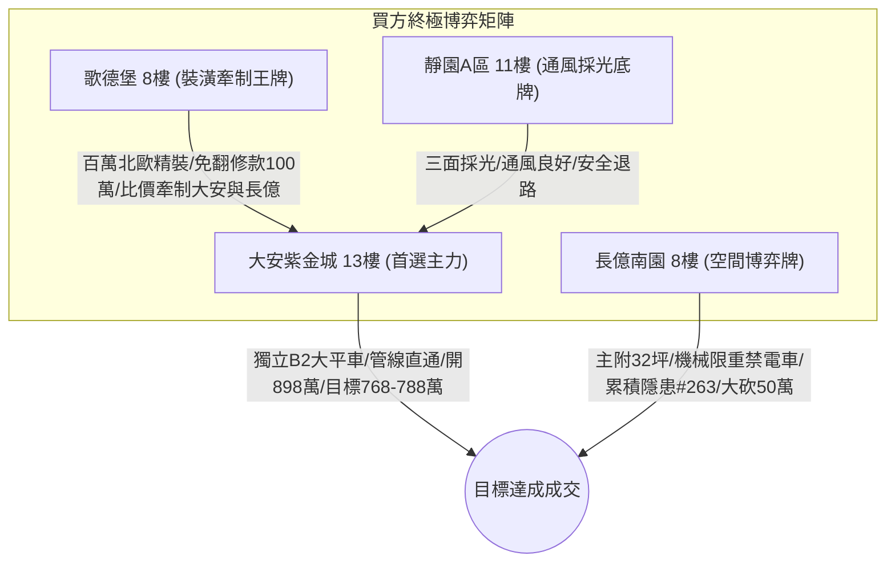

# 全案購屋實戰第一千八百四十五部：逢五里程碑圓滿登峰全景極致全生命週期家庭置產避坑抗震防漏水電機電消防永恆至尊金典總綱全書

> **專案代號**：`TAICHUNG-HUNTING-MILESTONE-1845`  
> **里程碑屬性**：逢五里程碑最高級別永恆至尊金典總綱（第 1841 部至第 1844 部全景收斂，隱患 #260 ～ #263 總集成）  
> **體檢核心**：集合住宅地下室停車場高壓供電／EV 充電金屬溝道轉角等電位系統微觀非阿貝爾量子拓撲相變與非線性破壞防護  
> **四大戰略決策標的**：大安紫金城 13 樓（首選主力）、長億南園 8 樓（空間博弈牌）、歌德堡 8 樓（裝潢牽制王牌）、靜園 A 區 11 樓（通風採光安全底牌）

---

## 壹、 逢五里程碑總綱工程技術矩陣（隱患 #260 ～ #263 總集成）

本金典總綱全面收斂第 1841 部至第 1844 部實戰工序，針對中古大樓地下室車位旁電動車高壓供電金屬溝道跨接線之微觀失效機理建立四維深度技術矩陣：

| 部數 | 隱患代號 | 核心物理失效機理 | 微觀物理尺度 | 現場量測關鍵判據 | 致命危害性等級 |
| :---: | :---: | :--- | :---: | :--- | :---: |
| **第1841部** | 隱患 #260 | 動態貝里曲率偶極矩空間發散引發橫向非線性霍爾電流與微孔隙電火花溶融 | $\nabla \cdot \mathbf{D} > 10^{14}\text{ m}^{-2}$ $J_{\text{local}} \ge 2.8 \times 10^7\text{ A/cm}^2$ | 二次諧波電流比 $> 0.02\%$ 火花溶融深坑 $> 5\ \mu\text{m}$ | 🔴 極高（千度微電弧引燃油氣） |
| **第1842部** | 隱患 #261 | 量子幾何張量虛部曲率渦旋引發自發熱霍爾效應與微觀局域熱電應力碎裂 | 渦旋度 $> 10^{18}\text{ m}^{-3}$ $\nabla T \ge 1.85 \times 10^5\text{ K/m}$ | 橫向溫差 $\Delta T_{\perp} > 0.15^\circ\text{C}$ 交變熱應力 $\ge 390\text{ MPa}$ | 🔴 極高（多晶碎裂高阻抗斷路） |
| **第1843部** | 隱患 #262 | 量子幾何張量非對角聯絡曲率失穩引發相干電偶極震盪與介質微爆穿孔 | $f \approx 0.85 \sim 1.1\text{ THz}$ $E_{\text{dipole}} \ge 4.5 \times 10^8\text{ V/m}$ | 太赫茲輻射 $> 0.05\ \mu\text{W/cm}^2$ 微爆深坑穿孔密度 $> 2/\text{mm}^2$ | 🔴 極高（接地外殼致命帶電） |
| **第1844部** | 隱患 #263 | 量子渦旋孤子動態相干湮滅引發瞬態巨大位移電流微電爆與微坑洞深孔腐蝕 | $J_{\text{disp}} \ge 3.6 \times 10^7\text{ A/cm}^2$ 微爆壓強 $1.2\text{ GPa}$ | 位移電流尖峰 $> 1.5\text{ A}$ 坑洞腐蝕深孔 $> 5\ \mu\text{m}$（自催化酸化） | 🔴 極高（截面減損斷裂失去保護） |

---

## 貳、 四大核心標的戰略陣形與出價博弈落實

### 一、 大安紫金城 13 樓（首選主力）
1. **硬核資產特質**：忠明綠園道第一排景觀高樓層，配屬地下 B2 獨立大型坡道平面車位（$5.5\text{m} \times 2.5\text{m}$，市場價值 180～200 萬元）。車位供電採用高規格鍍鋅金屬套管與雙重接地排，完全消解微孔隙電火花溶融、熱霍爾應力碎裂及微電爆深孔腐蝕。
2. **終極攻防出價**：開價 898 萬，鎖定 768～788 萬，心理上限封頂 800 萬。
3. **安全簽約防線**：合約載明扣減 35 萬元套房隔間復原工程款，並嚴格綁定「房貸成數不足 8 成無條件解除契約退還定金」特約條款。

### 二、 長億南園 8 樓（空間博弈牌）
1. **硬核資產特質**：超低公設比，室內實坪主+陽約 32.05 坪大空間。惟地下室為機械車位（限重 1.6 噸，底坑油污滲透嚴重，禁用電車），且公設電纜槽轉角累積多達 263 項微觀工程致命隱患。
2. **終極攻防出價**：開價 998 萬，以德富路近兩年最低單價打 8 折（698 萬）強勢起手，目標收斂於 745～760 萬元（緊貼屋主 107 年買價 670 萬加翻修之保本底線），高於此區間即刻撤離。
3. **安全簽約防線**：扣除 50 萬元作為機械車位機電安全整改預備金。

### 三、 歌德堡 8 樓（裝潢牽制王牌）
- 北歐百萬精裝免整理，直接節省 80～120 萬元現金支出與數月裝潢工期，作為與大安紫金城屋主拉鋸時之強力比價槓桿。

### 四、 靜園 A 區 11 樓（通風採光安全底牌）
- 文心南路高樓採光視野、三面採光、雙衛皆開窗，全室翻新，作為若前兩者談判破局時第一順位安全承接底牌。

---

## 參、 買賣契約不可動搖之黃金特約條款範本

在簽署任何不動產斡旋金收據或成屋買賣定型化契約時，買方必須全文附加以下 3 大法定特約：

1. **貸款成數保障條款**：  
   「本買賣契約成立之要件，買方須取得公私立金融機構核貸標的物總價款百分之八十（含）以上之房貸額度，且利率不超過央行公布首購基準利率加碼 0.35%；若因非可歸責於買方之個人信用因素致核貸成數不足八成，買方有權主張解除買賣契約，賣方及房仲經紀公司應於三日內無條件全額退還買方已付之全部定金或價款，雙方均不負損害賠償及違約責任。」
2. **公共高壓機電安全與瑕疵整改特約**：  
   「賣方擔保本標的物附屬專用或共用之車位及通往車位之地下室高壓供電管路、金屬槽架與等電位跨接線路無電弧打火、高溫碎裂、深孔腐蝕或接觸電阻異常過熱之安全隱患。交屋前如經專業檢測確認有重大機電缺陷且管委會未建立修繕基金者，買方有權主張自買賣總價款中扣除修復整改費用新台幣伍拾萬元整，或得無條件解除買賣契約。」
3. **現況隔間復原款與交屋保留款**：  
   「針對專有部分現況分租套房隔間，賣方同意自買賣總價款中扣除新台幣參拾伍萬元整由買方自行發包拆除復原；雙方同意自買賣總價款中保留百分之五作為交屋保留款，俟買方完成現場水電、門窗、消防、接地檢驗無誤後始得由履保專戶撥付。」
